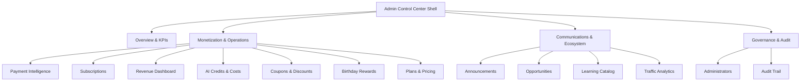
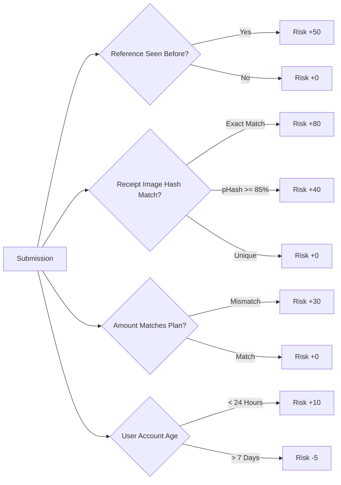

# CareerDev4AI — Admin Control Center Extension Specification
## Subscription, Payment Intelligence, Revenue & AI Credits Administration

- **Document Version**: 1.0.0
- **Status**: ARCHITECTURAL SPECIFICATION — AUTHORITATIVE SINGLE SOURCE OF TRUTH
- **Target Runtime**: React 19, TypeScript, Vite, Tailwind CSS 4, Supabase PostgreSQL 15+, Cloudflare Workers Edge API, Express
- **Target Document Path**: [`docs/subscription-system/planning/ADMIN_CONTROL_CENTER_SPEC.md`](file:///d:/Saas/careerpilot-ai/docs/subscription-system/planning/ADMIN_CONTROL_CENTER_SPEC.md)
- **Primary Monetary Unit**: Egyptian Pound (EGP / ج.م) — Stored as Integer Piasters (1 EGP = 100 Piasters)
- **Author**: Principal Software Architect

---

## 1. Executive Summary & Architectural Context

CareerDev4AI is an Egypt-first career development platform serving university students, fresh graduates, job seekers, and career switchers across Egypt and the MENA region. While core access to career discovery and learning resources remains broadly accessible, advanced capabilities (such as AI CV rewriting, deep ATS scoring, tailored mock interviews, and automated job targeting) are governed by an EGP-denominated subscription and AI credit engine.

Because the Egyptian financial landscape relies heavily on out-of-band payment mechanisms (Vodafone Cash mobile wallets and InstaPay IPN direct transfers) lacking automated merchant webhooks, the administrative team must actively oversee, verify, and reconcile financial flows.

This document specifies the complete expansion of the existing **Admin Communication Center** into a unified, high-security **Admin Control Center**. It introduces 7 new operational panels, 9 fine-grained RBAC permissions, audit logging integrations, real-time risk triage queues, and financial reporting standards.

```
┌─────────────────────────────────────────────────────────────────────────────────────────────────┐
│                           CAREERDEV4AI ADMIN CONTROL CENTER TOPOLOGY                            │
├────────────────────────────────┬────────────────────────────────┬───────────────────────────────┤
│    COMMUNICATION & CONTENT     │     FINANCIAL & PAYMENTS       │     AI & SYSTEM GOVERNANCE    │
├────────────────────────────────┼────────────────────────────────┼───────────────────────────────┤
│ • Announcements & Targeting    │ • Payment Intelligence Queue   │ • AI Credits Consumption      │
│ • Opportunity Curation         │ • Subscription Management      │ • Unit Economics & Margin     │
│ • Learning Catalog             │ • Revenue & Cash Flow Analytics│ • Plans & Pricing Matrix      │
│ • Traffic & GA4 Analytics      │ • Coupons & Promotional Engine │ • Platform Audit Trail        │
│ • User Directory Search        │ • Birthday Rewards Policy      │ • Administrator Roster & RBAC │
└────────────────────────────────┴────────────────────────────────┴───────────────────────────────┘
```

---

## 2. Architectural Classification: Facts, Assumptions, and Recommendations

To maintain complete architectural integrity and avoid ambiguities during engineering execution, all specifications are categorized into verified codebase facts, operational assumptions, and architectural recommendations.

### 2.1 Verified Facts (Existing Codebase)

1. **Existing Admin Center Framework**: The platform features an active administrative center located in [`src/components/views/AdminCenterView.tsx`](file:///d:/Saas/careerpilot-ai/src/components/views/AdminCenterView.tsx) with a tabbed interface, status indicators, and modular panel components.
2. **Existing Admin Database Layer**: Backend operations are centralized in [`server/db/admin.ts`](file:///d:/Saas/careerpilot-ai/server/db/admin.ts) (1,430+ lines), managing `admin_users`, `admin_audit_log`, `announcements`, and `announcement_deliveries`.
3. **Role-Based Access Control (RBAC)**: Defined in [`shared/admin.ts`](file:///d:/Saas/careerpilot-ai/shared/admin.ts) with four roles (`super_admin`, `content_admin`, `opportunity_admin`, `moderator`) and 14 base permissions. Server-side middleware in [`server/admin/permissions.ts`](file:///d:/Saas/careerpilot-ai/server/admin/permissions.ts) enforces `requireAdmin` and `requirePermission()`.
4. **Administrative API Routes**: Defined under `/api/admin/*` in [`app.ts`](file:///d:/Saas/careerpilot-ai/app.ts#L5970-L6775), using [`server/auth/require-auth.ts`](file:///d:/Saas/careerpilot-ai/server/auth/require-auth.ts) and [`server/admin/permissions.ts`](file:///d:/Saas/careerpilot-ai/server/admin/permissions.ts).
5. **Client-Side API Client**: Implemented in [`src/lib/adminApi.ts`](file:///d:/Saas/careerpilot-ai/src/lib/adminApi.ts) with typed DTOs and promise-based callers wrapping [`src/lib/apiClient.ts`](file:///d:/Saas/careerpilot-ai/src/lib/apiClient.ts).
6. **Background Worker Infrastructure**: Background jobs and scheduled tasks operate via Cloudflare Queues (`careerdev4ai-jobs`) and workers in [`worker/jobs/`](file:///d:/Saas/careerpilot-ai/worker/jobs/), backed by `public.background_jobs`.
7. **Database Migrations Baseline**: Established in [`docs/subscription-system/planning/DATABASE_SCHEMA_AND_MIGRATIONS.md`](file:///d:/Saas/careerpilot-ai/docs/subscription-system/planning/DATABASE_SCHEMA_AND_MIGRATIONS.md), introducing `subscription_plans`, `subscriptions`, `payment_requests`, `payment_verifications`, `ai_credit_ledger`, `coupon_definitions`, and `birthday_rewards`.
8. **Payment State Machine**: Authoritatively defined in [`docs/subscription-system/planning/PAYMENT_STATE_MACHINE.md`](file:///d:/Saas/careerpilot-ai/docs/subscription-system/planning/PAYMENT_STATE_MACHINE.md), specifying 7 states: `pending`, `under_review`, `temporary_access`, `paid`, `rejected`, `expired`, `refunded`.

### 2.2 Operational Assumptions

1. **Egyptian Payment Methods**: 90%+ of domestic transactions flow through Vodafone Cash (mobile wallets) or InstaPay (EBC direct bank transfers). Offline transfers require users to upload screenshot receipts and enter sender phone numbers / reference IDs.
2. **Review SLA**: Standard payment verification occurs within 2–6 hours during business hours (09:00–23:00 CLT) and up to 12 hours overnight.
3. **Receipt Storage**: Uploaded receipt images are stored in a private Supabase Storage bucket (`payment-receipts`), accessible only via short-lived signed URLs generated by the server.
4. **Age Privacy for Birthday Rewards**: To comply with privacy best practices and avoid collecting full birth dates, users provide only month and day (1–12, 1–31). Birth year is never recorded.
5. **No IEEE 754 Floating-Point Math**: All monetary amounts are handled strictly as integer piasters (1 EGP = 100 piasters) across database columns, API payloads, and internal calculation engines.

### 2.3 Architectural Recommendations

1. **Strict Separation of Submitted Claims vs. Confirmed Revenue**: Never conflate user-submitted payment claims with confirmed company revenue. Analytics must show them in separate, explicit ledger categories.
2. **Two-Man Rule / Step-Up Confirmation for Plan & Price Mutations**: Modifications to core pricing or credit weights require `super_admin` privilege, an explicit confirmation phrase entry, and an immutable before/after diff in `admin_audit_log`.
3. **Receipt Inspection Canvas**: Provide an interactive inspection canvas with image pan, zoom (100%–500%), 90-degree rotation, and high-contrast filters for analyzing low-quality thermal receipts or compressed screenshots.
4. **Double-Entry Credit Ledger Transparency**: Administrators must have full visibility into the append-only `ai_credit_ledger`, showing running balances, idempotency keys, and associated AI actions.

---

## 3. Extended RBAC & Permissions Architecture

### 3.1 New Permissions Vocabulary

To maintain principle of least privilege, 9 new granular permissions are added to `ADMIN_PERMISSIONS` in [`shared/admin.ts`](file:///d:/Saas/careerpilot-ai/shared/admin.ts):

```typescript
export const ADMIN_PERMISSIONS = [
  // Existing 14 permissions
  'admin.manage',
  'announcements.read',
  'announcements.write',
  'announcements.publish',
  'opportunities.read',
  'opportunities.write',
  'opportunities.verify',
  'learning.read',
  'learning.write',
  'analytics.read',
  'users.read',
  'moderation.read',
  'moderation.write',
  'audit.read',

  // 9 New Monetization & System Permissions
  'subscriptions.read',     // View subscription lists, statuses, and metrics
  'subscriptions.manage',   // Extend subscriptions, change plans, suspend/unsuspend
  'payments.read',          // View payment requests and receipt metadata
  'payments.confirm',       // Confirm, reject, or flag offline payments
  'credits.read',           // View credit consumption logs, unit economics, user balances
  'credits.grant',          // Manually grant bonus/compensatory credits to profiles
  'revenue.read',           // View financial analytics, cash flow, and export ledgers
  'coupons.manage',         // Create, edit, and disable promotional discount coupons
  'plans.manage',           // Modify subscription plan pricing, features, and credit weights
] as const;

export type AdminPermission = (typeof ADMIN_PERMISSIONS)[number];
```

### 3.2 Role-to-Permission Mapping Matrix

The updated role mapping in [`shared/admin.ts`](file:///d:/Saas/careerpilot-ai/shared/admin.ts) assigns permissions as follows:

| Admin Permission | `super_admin` | `content_admin` | `opportunity_admin` | `moderator` | Purpose & Operational Scope |
|:---|:---:|:---:|:---:|:---:|:---|
| `admin.manage` | ✅ | ❌ | ❌ | ❌ | Manage admin roster and permissions |
| `subscriptions.read` | ✅ | ❌ | ❌ | ❌ | View subscription records and renewal stats |
| `subscriptions.manage` | ✅ | ❌ | ❌ | ❌ | Manual plan override, extension, suspension |
| `payments.read` | ✅ | ❌ | ❌ | ❌ | Inspect pending payment queue and receipts |
| `payments.confirm` | ✅ | ❌ | ❌ | ❌ | Approve/reject offline transfers |
| `credits.read` | ✅ | ❌ | ❌ | ❌ | Inspect AI credit balances and cost telemetry |
| `credits.grant` | ✅ | ❌ | ❌ | ❌ | Issue manual bonus or goodwill credits |
| `revenue.read` | ✅ | ✅ | ❌ | ❌ | View financial reports and cash flow dashboards |
| `coupons.manage` | ✅ | ❌ | ❌ | ❌ | Create, configure, and disable discount codes |
| `plans.manage` | ✅ | ❌ | ❌ | ❌ | Edit tier prices and credit cost weights |
| `analytics.read` | ✅ | ✅ | ✅ | ❌ | Platform traffic and general analytics |
| `audit.read` | ✅ | ❌ | ❌ | ❌ | View complete administrative audit log |

```typescript
export const ROLE_PERMISSIONS: Record<AdminRole, readonly AdminPermission[]> = {
  super_admin: ADMIN_PERMISSIONS, // Exhaustive 23 permissions
  content_admin: [
    'announcements.read',
    'announcements.write',
    'announcements.publish',
    'learning.read',
    'learning.write',
    'analytics.read',
    'revenue.read',         // Content admins may observe aggregate revenue impact
    'moderation.read',
  ],
  opportunity_admin: [
    'opportunities.read',
    'opportunities.write',
    'opportunities.verify',
    'analytics.read',
    'moderation.read',
  ],
  moderator: [
    'announcements.read',
    'opportunities.read',
    'learning.read',
    'moderation.read',
    'moderation.write',
  ],
};
```

---

## 4. Admin Control Center Navigation & UI Shell

### 4.1 Navigation Architecture & Tab Grouping

The current flat tab bar in [`src/components/views/AdminCenterView.tsx`](file:///d:/Saas/careerpilot-ai/src/components/views/AdminCenterView.tsx) expands to accommodate monetization workflows. Tabs are grouped into logical operational domains:



### 4.2 Updated Admin Tab Vocabulary

```typescript
export type AdminTab =
  | 'overview'
  // Monetization & Operations
  | 'payments'        // Payment Intelligence & Receipt Triage
  | 'subscriptions'   // Subscription Management & User Tiers
  | 'revenue'         // Financial Analytics & Cash Flow
  | 'credits'         // AI Credits Telemetry & Unit Economics
  | 'coupons'         // Promotional Codes & Redemptions
  | 'birthday'        // Birthday Rewards Policy & Claims
  | 'plans'           // Tier Plans, Pricing & Credit Weights
  // Existing Communication & Ecosystem
  | 'traffic'         // Google Analytics 4 Reports
  | 'announcements'   // Communications & Targeting
  | 'admins'          // Admin Roster Management
  | 'opportunities'   // Volunteer Opportunity Verification
  | 'learning'        // Course Catalog Management
  | 'audit';          // Administrative Audit Log
```

### 4.3 Component Directory Layout

New components are organized within dedicated subdirectories in `src/components/admin/`:

```
src/components/admin/
├── OverviewPanel.tsx               # Existing overview with added monetization cards
├── AnnouncementsPanel.tsx          # Existing communications composer
├── TrafficAnalyticsPanel.tsx       # Existing GA4 traffic reporter
├── payments/
│   ├── PaymentIntelligencePanel.tsx # Queue, triage, and batch verification
│   ├── PaymentReceiptViewer.tsx    # High-resolution pan/zoom/rotate receipt canvas
│   ├── PaymentDetailModal.tsx      # Full verification trail and OCR inspector
│   └── PaymentRejectDialog.tsx     # Reason selection dialog with audit justification
├── subscriptions/
│   ├── SubscriptionManagementPanel.tsx # Filterable subscriber table & stats
│   ├── SubscriptionDetailModal.tsx     # History, usage, and manual overrides
│   └── SubscriptionActionModals.tsx    # Extend duration, change plan, suspend
├── revenue/
│   ├── RevenueDashboardPanel.tsx   # Financial charts, breakdown, and export
│   └── RevenueExportModal.tsx      # Date range and format selector (CSV/Excel)
├── credits/
│   ├── AiCreditsPanel.tsx          # Usage telemetry, API costs vs. revenue
│   ├── UserCreditLookup.tsx        # Per-candidate ledger inspection
│   └── CreditGrantModal.tsx        # Manual bonus/goodwill credit disbursement
├── coupons/
│   ├── CouponManagementPanel.tsx   # Coupon table, status, and redemptions
│   └── CouponEditorModal.tsx       # Create/edit campaign codes and constraints
├── rewards/
│   └── BirthdayRewardsPanel.tsx    # Consent telemetry, claims, and policy config
└── plans/
    ├── PlansPricingPanel.tsx       # Tier matrix, pricing, and credit weights
    └── PlanConfirmModal.tsx        # Two-man rule step-up confirmation modal
```

---

## 5. Detailed Specifications for New Admin Panels

### 5.1 Panel 1: Subscription Management Panel

#### 1. Purpose & Scope
Provides administrators with operational oversight of all user subscriptions, renewal cycles, expiration forecasts, tier distribution, and manual administrative overrides.

```
┌──────────────────────────────────────────────────────────────────────────────────────────────────┐
│ SUBSCRIPTION MANAGEMENT                                             [Export CSV] [Filter Plans ▼] │
├───────────────────┬───────────────────┬───────────────────┬──────────────────────────────────────┤
│ ACTIVE SUBSCRIBERS│ MONTHLY RECURRING │ 30-DAY CHURN RATE │ RENEWAL SUCCESS RATE                 │
│ 1,428             │ 214,200 EGP       │ 4.2%              │ 88.6%                                │
├───────────────────┴───────────────────┴───────────────────┴──────────────────────────────────────┤
│ ⚠ EXPIRING SOON ALERT: 42 subscriptions expiring within the next 7 days.                         │
├──────────────────────────────────────────────────────────────────────────────────────────────────┤
│ Filter: [All Statuses ▼] [All Plans ▼] [Monthly / Annual ▼]  Search: [User Name or Email...     ] │
├──────────────────┬──────────────┬──────────┬────────────┬────────────┬─────────────┬─────────────┤
│ User / Email     │ Current Plan │ Cycle    │ Starts At  │ Ends At    │ Status      │ Actions     │
├──────────────────┼──────────────┼──────────┼────────────┼────────────┼─────────────┼─────────────┤
│ Karim Mansour    │ Pro          │ Monthly  │ 2026-10-15 │ 2026-11-15 │ active      │ [Inspect] ⚙ │
│ Sarah Helmy      │ Student      │ Annual   │ 2026-01-10 │ 2027-01-10 │ active      │ [Inspect] ⚙ │
│ Omar Sherif      │ Pro          │ Monthly  │ 2026-10-01 │ 2026-11-01 │ past_due    │ [Inspect] ⚙ │
│ Dina Zaki        │ Career Plus  │ Monthly  │ 2026-11-05 │ 2026-11-06 │ temp_access │ [Inspect] ⚙ │
└──────────────────┴──────────────┴──────────┴────────────┴────────────┴─────────────┴─────────────┘
```

#### 2. Key Functional Capabilities
1. **Filterable Data Grid**:
   - Status filters: `all`, `active`, `past_due`, `canceled`, `expired`, `temporary_access`.
   - Plan filters: `free`, `student`, `pro`, `career_plus`.
   - Billing cycle: `all`, `monthly`, `annual`.
   - Expiration date range picker.
2. **Expiring Soon Banner**:
   - Real-time aggregation of subscriptions ending in $\le 7$ days.
   - Action button to trigger automated renewal reminder notifications.
3. **KPI Statistics Cards**:
   - Total active subscribers broken down by tier.
   - Monthly Recurring Revenue (MRR) in EGP.
   - 30-day trailing churn rate percentage.
   - Renewal rate percentage (successful renewals / eligible renewals).
4. **Subscription Detail Modal (`SubscriptionDetailModal.tsx`)**:
   - Displays user profile metadata, current plan entitlements, and active period.
   - Linked payment history: list of all `payment_requests` associated with this subscription.
   - Linked AI credit balance: current available credits and recent consumption velocity.
5. **Administrative Actions (Requires `subscriptions.manage`)**:
   - **Extend Subscription**: Add $N$ days/months to `current_period_ends_at`. Requires mandatory administrative justification recorded in `admin_audit_log`.
   - **Change Plan (Override)**: Move candidate immediately to another tier (`student` $\leftrightarrow$ `pro` $\leftrightarrow$ `career_plus`) without waiting for current cycle end.
   - **Suspend / Unsuspend**: Temporarily revoke elevated entitlements in case of investigation or chargeback.

---

### 5.2 Panel 2: Payment Intelligence & Verification Panel

#### 1. Purpose & Scope
The operational core for reviewing offline Egyptian payment proofs (Vodafone Cash and InstaPay). Displays incoming claims, executes automated OCR and duplicate risk checks, provides a high-resolution receipt inspection canvas, and enables one-click approvals or structured rejections.

```
┌──────────────────────────────────────────────────────────────────────────────────────────────────┐
│ PAYMENT INTELLIGENCE QUEUE                             [Auto-Refresh: ON (15s)] [Risk: All ▼]    │
├───────────────────┬───────────────────┬───────────────────┬──────────────────────────────────────┤
│ PENDING REVIEW    │ UNDER REVIEW      │ TEMP ACCESS ACTIVE│ TODAY'S CONFIRMED                    │
│ 14 claims         │ 8 claims          │ 19 users (24h)    │ 46 payments (6,900 EGP)              │
├───────────────────┴───────────────────┴───────────────────┴──────────────────────────────────────┤
│ 🚨 HIGH RISK ALERT: 2 claims flagged for duplicate receipt hash matching previous transactions.  │
├──────────────────────────────────────────────────────────────────────────────────────────────────┤
│ Filter: [All Methods ▼] [Risk: All ▼]  Search: [Ref Number, Phone, Email...                    ] │
├───────┬──────────────┬─────────┬─────────┬──────────────┬────────────┬─────────────┬─────────────┤
│ Risk  │ User / Email │ Method  │ Amount  │ Reference ID │ Submitted  │ Status      │ Quick Action│
├───────┼──────────────┼─────────┼─────────┼──────────────┼────────────┼─────────────┼─────────────┤
│ 12 🟢 │ Ahmed Nabil  │ InstaPay│ 150 EGP │ IPN-98421045 │ 12m ago    │ temp_access │ [Confirm] 👁│
│ 48 🟡 │ Mai Mahmoud  │ V-Cash  │ 150 EGP │ VC-01029384  │ 35m ago    │ under_review│ [Review]  👁│
│ 88 🔴 │ Youssef Ali  │ V-Cash  │ 100 EGP │ VC-01029384  │ 1h ago     │ under_review│ [Inspect] 🚨│
└───────┴──────────────┴─────────┴─────────┴──────────────┴────────────┴─────────────┴─────────────┘
```

#### 2. Risk Scoring & Color Coding Logic
Every submitted payment request is evaluated automatically upon ingestion and assigned a risk score from $0$ to $100$:



| Risk Score Range | Badge Color | Category | System Behavior | Admin Action Required |
|:---|:---:|:---|:---|:---|
| **0 – 25** | 🟢 Green | **Low Risk** | Granted 24h `temporary_access` automatically | Fast-track verification; 1-click confirmation |
| **26 – 60** | 🟡 Yellow | **Medium Risk** | Held in `under_review` (no temporary access) | Review receipt OCR and sender phone match |
| **61 – 85** | 🟠 Orange | **High Risk** | Held in `under_review` (flagged for review) | Senior admin check: verify bank account statement |
| **86 – 100** | 🔴 Red | **Critical / Fraud** | Immediate flag; potential duplicate or recycled proof | Full fraud review; structured rejection |

#### 3. High-Resolution Receipt Viewer (`PaymentReceiptViewer.tsx`)
Because mobile screenshots and printed POS receipts in Egypt often feature compression artifacts, faded thermal ink, or bad lighting, the receipt viewer provides:
- **Interactive Canvas**: Smooth dragging, zooming from 100% to 500%, and 90° clockwise/counter-clockwise rotation.
- **Image Enhancement Filters**: Dynamic contrast slider (+50%), brightness adjustment, and color inversion (useful for reading thermal ATM slips).
- **Side-by-Side OCR Verification**: Displays the uploaded receipt on the left and the extracted OCR tokens on the right, highlighting matched reference numbers, transfer amounts, and dates.
- **Secure Image Delivery**: All images are loaded via signed URLs with a 15-minute TTL generated by `/api/admin/payments/:id/receipt-url`.

```typescript
export interface ReceiptVerificationSideBySide {
  paymentRequestId: string;
  receiptStoragePath: string;
  signedUrl: string;
  claimedData: {
    amountPiasters: number;
    amountEgp: number;
    paymentMethod: 'vodafone_cash' | 'instapay';
    transactionReference: string;
    senderIdentifier: string;
    submittedAt: string;
  };
  ocrData: {
    rawText: string;
    detectedReference: string | null;
    detectedAmountPiasters: number | null;
    detectedTimestamp: string | null;
    confidenceScore: number;
  };
  discrepancies: Array<{
    field: 'amount' | 'reference' | 'timestamp' | 'sender';
    severity: 'critical' | 'warning';
    message: string;
  }>;
}
```

#### 4. Verification Actions & Stored Procedure Execution
- **Confirm Payment**: Calls the atomic database stored procedure `public.confirm_payment_and_activate(p_payment_request_id, p_admin_user_id, p_notes)`. This updates `payment_requests.status = 'paid'`, transitions the candidate's subscription to `active`, credits monthly AI tokens, and logs the action.
- **Reject Payment**: Opens `PaymentRejectDialog.tsx` requiring a structured reason (`unclear_receipt`, `amount_insufficient`, `invalid_reference`, `duplicate_submission`, `fraudulent`). Updates `payment_requests.status = 'rejected'` and sends an in-app notification to the candidate explaining how to resubmit.
- **Flag for Secondary Review**: Sets `payment_requests.status = 'under_review'` with a sticky internal note for another administrator.

---

### 5.3 Panel 3: Revenue Dashboard & Financial Analytics

#### 1. Purpose & Reporting Non-Negotiables
The Revenue Dashboard provides real-time and historical financial intelligence. 

> [!CAUTION]
> **FINANCIAL INTEGRITY RULE**: System analytics must **NEVER** conflate submitted payment claims with confirmed revenue. A user claim is an unverified assertion. Confirmed revenue represents reconciled, verified funds.

```
┌──────────────────────────────────────────────────────────────────────────────────────────────────┐
│ REVENUE DASHBOARD (EGP)                                   [Period: Last 30 Days ▼] [Export CSV]  │
├───────────────────┬───────────────────┬───────────────────┬───────────────────┬──────────────────┤
│ SUBMITTED CLAIMS  │ PENDING TRIAGE    │ CONFIRMED REVENUE │ REFUNDS & CHARGES │ NET COLLECTED    │
│ 348,500 EGP       │ 18,200 EGP        │ 312,400 EGP       │ 2,100 EGP         │ 310,300 EGP      │
│ (2,320 claims)    │ (121 claims)      │ (2,080 payments)  │ (14 refunds)      │ (Net Margin 99%) │
├───────────────────┴───────────────────┴───────────────────┴───────────────────┴──────────────────┤
│ REVENUE BY TIER BREAKDOWN:                                                                       │
│ • Student Tier (45 EGP/mo):      62,400 EGP  (1,386 active subscribers - 20.1%)                  │
│ • Pro Tier (150 EGP/mo):        198,000 EGP  (1,320 active subscribers - 63.8%)                  │
│ • Career Plus (300 EGP/mo):      49,900 EGP  (  166 active subscribers - 16.1%)                  │
├──────────────────────────────────────────────────────────────────────────────────────────────────┤
│ PAYMENT METHOD SHARE:                                                                            │
│ • InstaPay (Direct Bank / IPN): 68.4% (212,245 EGP)                                              │
│ • Vodafone Cash (Wallets):      31.6% ( 98,055 EGP)                                              │
└──────────────────────────────────────────────────────────────────────────────────────────────────┘
```

#### 2. Six Golden Financial Metrics (KPI Cards)
1. **Total Submitted Claims**: Sum of all `payment_requests.amount_piasters` submitted within the date window, regardless of status.
2. **Pending Verification**: Total value of claims currently in `pending`, `under_review`, or `temporary_access`.
3. **Confirmed Revenue (Gross)**: Sum of all claims transitioned to `status = 'paid'`.
4. **Refunds & Reversals**: Total value of confirmed payments transitioned to `status = 'refunded'`.
5. **Net Collected Revenue**: $\text{Confirmed Revenue} - \text{Refunds}$.
6. **Projected Run-Rate (MRR / ARR)**: Projected future recurring revenue based on current active subscriber counts multiplied by tier prices, discounted by historical 30-day renewal rates.

#### 3. Visual Charts & Trend Breakdown
- **Daily / Weekly / Monthly Cash Flow**: Dual-line chart comparing Submitted Claims (dashed grey line) vs. Confirmed Net Revenue (solid green line).
- **Payment Method Distribution**: Donut chart showing InstaPay vs. Vodafone Cash volume and confirmation speed.
- **Tier Revenue Matrix**: Bar chart comparing gross EGP generation across `student`, `pro`, and `career_plus`.
- **Financial Reconciliation Export**: Generates an auditor-ready CSV or Excel export including transaction IDs, profile IDs, payment methods, transaction reference strings, admin verifier IDs, and exact piaster amounts.

---

### 5.4 Panel 4: AI Credits & Infrastructure Cost Intelligence

#### 1. Purpose & Unit Economics Scope
CareerDev4AI leverages Google Gemini (`gemini-3.1-flash-lite`) and OpenRouter for LLM reasoning. The AI Credits panel monitors platform-wide token consumption, matches credit revenue against actual LLM infrastructure bills, detects quota abuse, and allows Super Admins to inspect user ledgers and grant compensatory credits.

```
┌──────────────────────────────────────────────────────────────────────────────────────────────────┐
│ AI CREDITS & UNIT ECONOMICS                               [Period: 30 Days ▼] [Audit Ledger ↗]   │
├───────────────────┬───────────────────┬───────────────────┬──────────────────────────────────────┤
│ CREDITS CONSUMED  │ ESTIMATED API COST│ CREDIT REVENUE    │ GROSS AI MARGIN                      │
│ 142,800 credits   │ $142.80 (~7,140 E)│ 312,400 EGP       │ 97.7%                                │
├───────────────────┴───────────────────┴───────────────────┴──────────────────────────────────────┤
│ 🚨 ABUSE DETECTION: 3 users triggered velocity warnings (> 60 credits consumed in 1 hour).       │
├──────────────────────────────────────────────────────────────────────────────────────────────────┤
│ OPERATION BREAKDOWN:                                                                             │
│ • CV ATS Analysis (5 credits):           52,100 calls (260,500 credits - 41%)                    │
│ • Targeted CV Generation (10 credits):   18,200 calls (182,000 credits - 28%)                    │
│ • Interview Mock Session (8 credits):    11,400 calls ( 91,200 credits - 14%)                    │
│ • Career Roadmap Generator (6 credits):   9,800 calls ( 58,800 credits -  9%)                    │
│ • Cover Letter Generation (4 credits):   10,200 calls ( 40,800 credits -  6%)                    │
│ • Career Copilot Chat (1 credit):        12,500 calls ( 12,500 credits -  2%)                    │
├──────────────────────────────────────────────────────────────────────────────────────────────────┤
│ USER CREDIT LOOKUP:                                                                              │
│ [Enter candidate email or profile ID...              ] [Lookup Ledger] [Grant Bonus Credits 🎁] │
└──────────────────────────────────────────────────────────────────────────────────────────────────┘
```

#### 2. Key Functional Capabilities
1. **Platform-Wide Usage Telemetry**:
   - Total credits granted (via subscription renewals, manual grants, onboarding gifts).
   - Total credits consumed across all AI features.
   - Aggregate outstanding credit liability across active user balances.
2. **Operation Cost Matrix**:
   - Table detailing each registered AI operation, credit weight, execution volume, estimated Gemini token cost, and average response latency.
3. **Unit Economics & Margin Calculation**:
   - Tracks actual Google Gemini API costs (input/output tokens at current API rates) converted to EGP.
   - Compares marginal API cost per operation against the effective EGP value per credit (e.g., in a 150 EGP Pro plan with 150 credits, 1 credit = 1.00 EGP; Gemini cost per 1-credit call is $\approx 0.05$ EGP, yielding a 95% gross margin).
4. **Per-User Ledger Lookup (`UserCreditLookup.tsx`)**:
   - Search by user email or UUID.
   - Replays the candidate's double-entry credit ledger (`public.ai_credit_ledger`) showing running balances, timestamps, source entities, and idempotency keys.
5. **Manual Credit Grant Modal (`CreditGrantModal.tsx`)**:
   - Super Admin can grant compensatory or promotional credits.
   - Requires quantity, operation type (`grant` or `bonus`), and mandatory administrative explanation recorded in `admin_audit_log`.
6. **Abuse & Anomaly Detection**:
   - Automatic flags for accounts consuming $> 50$ credits/hour or $> 150$ credits/day.
   - Flags accounts with high error rates ($> 5$ consecutive LLM parse failures).
   - Super Admin one-click action: "Freeze AI Access" for investigated profiles.

---

### 5.5 Panel 5: Coupon & Promotional Campaign Management

#### 1. Purpose & Campaign Lifecycle
Enables the marketing and administrative team to configure, launch, monitor, and disable promotional discount codes (e.g., student launch campaigns, university partnerships, seasonal discounts).

```
┌──────────────────────────────────────────────────────────────────────────────────────────────────┐
│ COUPON & PROMOTIONS MANAGEMENT                                             [+ Create Coupon]     │
├───────────────────┬───────────────────┬───────────────────┬──────────────────────────────────────┤
│ ACTIVE CAMPAIGNS  │ TOTAL REDEMPTIONS │ TOTAL DISCOUNT EGP│ AVERAGE SAVINGS                      │
│ 4 active coupons  │ 482 redemptions   │ 24,100 EGP        │ 50.00 EGP / user                     │
├───────────────────┴───────────────────┴───────────────────┴──────────────────────────────────────┤
│ Filter: [Active / Expired / Exhausted ▼]   Search: [Coupon Code...                             ] │
├────────────┬─────────────┬─────────────┬────────────┬────────────┬──────────────┬────────────────┤
│ Code       │ Discount    │ Max Cap     │ Validity   │ Used / Max │ Target Plans │ Actions        │
├────────────┼─────────────┼─────────────┼────────────┼────────────┼──────────────┼────────────────┤
│ CAIROU2026 │ 30% Off     │ 60.00 EGP   │ Nov 15 CLT │ 184 / 500  │ Student, Pro │ [Edit] [Disable│
│ TECHSUMMIT │ 50.00 EGP   │ 50.00 EGP   │ Nov 30 CLT │  98 / 100  │ Pro, Plus    │ [Edit] [Disable│
│ EGYPTSTART │ 20% Off     │ 40.00 EGP   │ Dec 31 CLT │ 200 / 200  │ All Plans    │ [Redeemed] 🔒  │
└────────────┴─────────────┴─────────────┴────────────┴────────────┴──────────────┴────────────────┘
```

#### 2. Key Functional Capabilities
1. **Campaign Creation & Validation (`CouponEditorModal.tsx`)**:
   - **Code**: Enforced uppercase alphanumeric format (`^[A-Z0-9_-]{3,20}$`).
   - **Discount Type**: `percentage` (e.g., 25%) or `fixed_piasters` (e.g., 50.00 EGP = 5,000 piasters).
   - **Maximum Discount Cap (Piasters)**: Mandatory for percentage discounts to prevent negative margin exploits on high-tier plans.
   - **Minimum Order Requirement**: Restricts coupons to specific minimum cart values.
   - **Plan Applicability**: Restricts code to specific tiers (`student`, `pro`, `career_plus`) or all tiers.
   - **Redemption Limits**: Global limit (e.g., first 500 users) and per-user limit (default 1).
   - **Validity Window**: Exact start and expiration timestamps with Egyptian Local Time (CLT) display.
2. **Audit & Immutability Rules**:
   - Once a coupon has been redeemed $\ge 1$ times, its discount value, code, and type become permanently **immutable** to preserve accounting integrity.
   - Administrators cannot delete a redeemed coupon; they may only toggle `is_active = false` (soft disable).
3. **Redemption History Inspector**:
   - Displays a modal listing every candidate who redeemed the code, the timestamp, the payment request ID, and the exact piasters discounted.

---

### 5.6 Panel 6: Birthday Rewards Management Panel

#### 1. Purpose & Privacy-Compliant Architecture
To build candidate loyalty, CareerDev4AI offers birthday subscription discounts. In strict accordance with privacy regulations and anti-age-discrimination standards, the platform collects **only birth month and day (1–12, 1–31)** and requires explicit consent (`public.user_privacy_consents` where `consent_purpose = 'birthday_reward'`).

```
┌──────────────────────────────────────────────────────────────────────────────────────────────────┐
│ BIRTHDAY REWARDS INTELLIGENCE & POLICY                                    [Policy Config ⚙]      │
├───────────────────┬───────────────────┬───────────────────┬──────────────────────────────────────┤
│ OPTED-IN USERS    │ ELIGIBLE THIS MO. │ CLAIMED THIS MO.  │ REWARD CONVERSION                    │
│ 3,840 candidates  │ 312 candidates    │ 84 claimed        │ 26.9%                                │
├───────────────────┴───────────────────┴───────────────────┴──────────────────────────────────────┤
│ CURRENT POLICY CONFIGURATION:                                                                    │
│ • Discount Percentage:   25% off any monthly or annual plan                                      │
│ • Maximum Discount Cap:  75.00 EGP (7,500 piasters)                                              │
│ • Validity Window:       14 days from reward issuance                                            │
│ • Re-claim Cooldown:     1 reward per calendar year per profile                                  │
├──────────────────────────────────────────────────────────────────────────────────────────────────┤
│ Filter: [Claimed / Unclaimed ▼]   Search: [Candidate Name or Email...                          ] │
├──────────────────┬─────────────┬─────────────┬────────────┬────────────┬─────────────┬───────────┤
│ User / Email     │ Birthday    │ Consented   │ Issued At  │ Expires At │ Status      │ Actions   │
├──────────────────┼─────────────┼─────────────┼────────────┼────────────┼─────────────┼───────────┤
│ Mona El-Sayed    │ Nov 12      │ 2026-08-10  │ 2026-11-01 │ 2026-11-15 │ claimed     │ [Inspect] │
│ Tarek Fathy      │ Nov 18      │ 2026-09-04  │ 2026-11-01 │ 2026-11-15 │ pending     │ [Resend]  │
│ Hoda Amer        │ Nov 25      │ 2026-10-12  │ 2026-11-01 │ 2026-11-15 │ pending     │ [Resend]  │
└──────────────────┴─────────────┴─────────────┴────────────┴────────────┴─────────────┴───────────┘
```

#### 2. Key Functional Capabilities
1. **Consent & Eligibility Telemetry**:
   - Number of profiles with active birthday consent.
   - Candidates with birthdays occurring in the active calendar month.
   - Redemptions claimed and conversion rate to paid subscriptions.
2. **Global Policy Editor (Requires `super_admin`)**:
   - Modify discount percentage, maximum piaster cap, and claim validity days.
   - Changes apply to future reward generation cycles and emit an `admin_audit_log` event.
3. **Automated Background Job Coordination**:
   - Operates in conjunction with the monthly Cloudflare Queue worker task `generate-birthday-rewards`, which scans eligible consented profiles on the 1st of each month and generates `birthday_rewards` records.

---

### 5.7 Panel 7: Plans, Pricing & AI Weight Matrix Panel

#### 1. Purpose & Super Admin Boundary
The Plans & Pricing panel governs the core monetization configuration of CareerDev4AI. Because price mutations affect live checkout flows and legal consumer expectations, this panel is strictly restricted to `super_admin` users and enforced via a dual-step confirmation mechanism.

```
┌──────────────────────────────────────────────────────────────────────────────────────────────────┐
│ PLANS, PRICING & CREDIT WEIGHT MATRIX (SUPER ADMIN ONLY)                  [+ Add New Tier 🔒]    │
├──────────────────────────────────────────────────────────────────────────────────────────────────┤
│ ACTIVE SUBSCRIPTION TIERS (All monetary values in Egyptian Piasters / EGP)                       │
├─────────────┬─────────────┬─────────────┬──────────┬──────────┬──────────────┬───────────────────┤
│ Plan Code   │ Monthly EGP │ Annual EGP  │ Credits  │ Active   │ Sort Order   │ Actions           │
├─────────────┼─────────────┼─────────────┼──────────┼──────────┼──────────────┼───────────────────┤
│ free        │ 0 EGP       │ 0 EGP       │ 15 / mo  │ Active   │ 1            │ [Edit Matrix] 🔒  │
│ student     │ 45.00 EGP   │ 450.00 EGP  │ 50 / mo  │ Active   │ 2            │ [Edit Matrix] 🔒  │
│ pro         │ 150.00 EGP  │ 1,500.00 EGP│ 150 / mo │ Active   │ 3            │ [Edit Matrix] 🔒  │
│ career_plus │ 300.00 EGP  │ 3,000.00 EGP│ 400 / mo │ Active   │ 4            │ [Edit Matrix] 🔒  │
├─────────────┴─────────────┴─────────────┴──────────┴──────────┴──────────────┴───────────────────┤
│ AI CREDIT OPERATION WEIGHT MATRIX (Credits deducted per execution)                               │
├────────────────────────────────────────┬─────────────────────┬───────────────────┬───────────────┤
│ Operation Identifier                   │ Current Credit Cost │ Est. Gemini Cost  │ Margin / Exec │
├────────────────────────────────────────┼─────────────────────┼───────────────────┼───────────────┤
│ cv_ats_analysis                        │ 5 credits           │ $0.005 (~0.25 EGP)│ 95.0%         │
│ cv_generation (Targeted JD Rewrite)    │ 10 credits          │ $0.012 (~0.60 EGP)│ 94.0%         │
│ interview_mock_session                 │ 8 credits           │ $0.010 (~0.50 EGP)│ 93.8%         │
│ roadmap_generation                     │ 6 credits           │ $0.008 (~0.40 EGP)│ 93.3%         │
│ cover_letter_generation                │ 4 credits           │ $0.004 (~0.20 EGP)│ 95.0%         │
│ career_consultation_chat               │ 1 credit            │ $0.001 (~0.05 EGP)│ 95.0%         │
└────────────────────────────────────────┴─────────────────────┴───────────────────┴───────────────┘
```

#### 2. Two-Man Rule Step-Up Confirmation Dialog (`PlanConfirmModal.tsx`)
Any mutation to plan prices, monthly credit quotas, or operation credit weights triggers an explicit step-up barrier:
1. Modal displays side-by-side JSON/table diff of existing values vs. proposed values.
2. Displays calculated financial impact (e.g., "Changing Pro plan from 150 EGP to 175 EGP will affect 1,320 active subscribers upon next billing cycle").
3. Requires the Super Admin to type an exact confirmation string: `CONFIRM PRICE MUTATION`.
4. Writes an immutable audit row to `admin_audit_log` with `action = 'plan.pricing_updated'` and the complete before/after snapshot.

---

## 6. Comprehensive API Endpoints Specification

All new administrative endpoints are served under `/api/admin/*`, pass through [`requireAdmin`](file:///d:/Saas/careerpilot-ai/server/admin/permissions.ts), and enforce explicit permission checks via [`requirePermission()`](file:///d:/Saas/careerpilot-ai/server/admin/permissions.ts).

### 6.1 Subscriptions API

| Method | Endpoint | Permission | Description |
|:---|:---|:---|:---|
| `GET` | `/api/admin/subscriptions` | `subscriptions.read` | List subscriptions with filters, sorting, and pagination |
| `GET` | `/api/admin/subscriptions/:id` | `subscriptions.read` | Get subscription details, payment history, and credit usage |
| `POST` | `/api/admin/subscriptions/:id/extend` | `subscriptions.manage` | Add $N$ days/months to subscription period |
| `POST` | `/api/admin/subscriptions/:id/change-plan` | `subscriptions.manage` | Immediately change tier with audit reason |
| `POST` | `/api/admin/subscriptions/:id/status` | `subscriptions.manage` | Suspend, unsuspend, or cancel subscription |

#### Example Payload: `POST /api/admin/subscriptions/:id/extend`
```json
{
  "extensionDays": 30,
  "reason": "Compensatory extension due to temporary payment gateway downtime on Nov 5",
  "sendNotification": true
}
```

### 6.2 Payment Intelligence API

| Method | Endpoint | Permission | Description |
|:---|:---|:---|:---|
| `GET` | `/api/admin/payments/queue` | `payments.read` | Real-time triage queue with risk scores and filters |
| `GET` | `/api/admin/payments/:id` | `payments.read` | Get payment verification history, OCR results, and claimed data |
| `GET` | `/api/admin/payments/:id/receipt-url` | `payments.read` | Generate signed Supabase Storage URL for receipt image |
| `POST` | `/api/admin/payments/:id/confirm` | `payments.confirm` | Approve payment, activate subscription, and credit AI tokens |
| `POST` | `/api/admin/payments/:id/reject` | `payments.confirm` | Reject payment with structured reason and user notice |
| `POST` | `/api/admin/payments/:id/flag` | `payments.confirm` | Flag payment for secondary review with internal note |

#### Example Payload: `POST /api/admin/payments/:id/confirm`
```json
{
  "adminNotes": "InstaPay reference IPN-98421045 verified against NBE merchant account statement",
  "notifyUser": true
}
```

### 6.3 Revenue Analytics API

| Method | Endpoint | Permission | Description |
|:---|:---|:---|:---|
| `GET` | `/api/admin/revenue/summary` | `revenue.read` | Summary KPI cards: claims, pending, confirmed, refunds, net |
| `GET` | `/api/admin/revenue/trends` | `revenue.read` | Daily/weekly/monthly cash flow time series |
| `GET` | `/api/admin/revenue/by-tier` | `revenue.read` | Revenue and subscriber distribution by tier code |
| `GET` | `/api/admin/revenue/by-method` | `revenue.read` | Share of volume between Vodafone Cash and InstaPay |
| `GET` | `/api/admin/revenue/export` | `revenue.read` | Auditor-ready CSV/Excel financial reconciliation stream |

### 6.4 AI Credits Telemetry API

| Method | Endpoint | Permission | Description |
|:---|:---|:---|:---|
| `GET` | `/api/admin/credits/stats` | `credits.read` | Platform consumption, API cost estimates, and unit margins |
| `GET` | `/api/admin/credits/users/:profileId` | `credits.read` | Complete double-entry ledger history for a candidate |
| `POST` | `/api/admin/credits/grant` | `credits.grant` | Manually disburse bonus or goodwill credits to a profile |
| `POST` | `/api/admin/credits/users/:profileId/freeze` | `credits.grant` | Freeze/unfreeze AI operation access for suspected abusers |

#### Example Payload: `POST /api/admin/credits/grant`
```json
{
  "profileId": "8f8b8e8b-1234-4a5b-9c8d-e1f2a3b4c5d6",
  "amount": 25,
  "creditType": "bonus",
  "reason": "Top performer in Cairo University hackathon sponsorship",
  "idempotencyKey": "grant_hackathon_8f8b8e8b_202611"
}
```

### 6.5 Coupons & Promotions API

| Method | Endpoint | Permission | Description |
|:---|:---|:---|:---|
| `GET` | `/api/admin/coupons` | `admin.manage` | List all coupons with redemption metrics and status |
| `POST` | `/api/admin/coupons` | `admin.manage` | Create a new promotional discount coupon |
| `PATCH` | `/api/admin/coupons/:id` | `admin.manage` | Toggle coupon active status (or update unredeemed coupon) |
| `GET` | `/api/admin/coupons/:id/redemptions` | `admin.manage` | List all redemption records for a specific coupon code |

### 6.6 Birthday Rewards API

| Method | Endpoint | Permission | Description |
|:---|:---|:---|:---|
| `GET` | `/api/admin/rewards/birthday` | `analytics.read` | Opt-in metrics, eligible candidates this month, and claims |
| `PATCH` | `/api/admin/rewards/birthday/policy` | `admin.manage` | Update global birthday discount percentage and validity |

### 6.7 Plans & Pricing API (Super Admin Only)

| Method | Endpoint | Permission | Description |
|:---|:---|:---|:---|
| `GET` | `/api/admin/plans` | `admin.manage` | List all subscription plans with prices and feature flags |
| `PATCH` | `/api/admin/plans/:id` | `admin.manage` | Update plan pricing, credit quota, or features (super_admin) |
| `GET` | `/api/admin/plans/weights` | `admin.manage` | Get current AI operation credit cost matrix |
| `PATCH` | `/api/admin/plans/weights` | `admin.manage` | Update credit costs per AI operation (super_admin) |

---

## 7. Client-Side API Integration Layer (`src/lib/adminApi.ts`)

To ensure type-safe frontend integration across all 7 panels, the following typed client functions are added to [`src/lib/adminApi.ts`](file:///d:/Saas/careerpilot-ai/src/lib/adminApi.ts):

```typescript
// Subscriptions Client
export async function fetchAdminSubscriptions(params: {
  status?: string;
  planId?: string;
  cycle?: string;
  search?: string;
  limit?: number;
  offset?: number;
}): Promise<{ subscriptions: AdminSubscriptionDTO[]; total: number }>;

export async function extendAdminSubscription(
  id: string,
  payload: { extensionDays: number; reason: string; sendNotification: boolean }
): Promise<{ success: boolean; subscription: AdminSubscriptionDTO }>;

export async function changeAdminSubscriptionPlan(
  id: string,
  payload: { newPlanId: string; reason: string }
): Promise<{ success: boolean; subscription: AdminSubscriptionDTO }>;

// Payment Intelligence Client
export async function fetchAdminPaymentQueue(params: {
  status?: string;
  method?: string;
  riskCategory?: 'low' | 'medium' | 'high' | 'critical';
  limit?: number;
}): Promise<{ queue: AdminPaymentRequestDTO[]; pendingCount: number }>;

export async function fetchAdminPaymentDetail(id: string): Promise<AdminPaymentDetailDTO>;

export async function getAdminPaymentReceiptUrl(id: string): Promise<{ signedUrl: string; expiresAt: string }>;

export async function confirmAdminPayment(
  id: string,
  payload: { adminNotes: string; notifyUser: boolean }
): Promise<{ success: boolean }>;

export async function rejectAdminPayment(
  id: string,
  payload: { reasonCode: string; reasonMessage: string; notifyUser: boolean }
): Promise<{ success: boolean }>;

// Revenue Analytics Client
export async function fetchAdminRevenueSummary(period: '7d' | '30d' | '90d' | '12m'): Promise<AdminRevenueSummaryDTO>;

export async function fetchAdminRevenueTrends(period: '30d' | '12m'): Promise<AdminRevenueTrendPointDTO[]>;

// AI Credits Client
export async function fetchAdminAiCreditStats(): Promise<AdminAiCreditStatsDTO>;

export async function fetchAdminUserCreditLedger(profileId: string): Promise<AdminCreditLedgerEntryDTO[]>;

export async function grantAdminUserCredits(payload: {
  profileId: string;
  amount: number;
  creditType: 'grant' | 'bonus';
  reason: string;
}): Promise<{ success: boolean; newBalance: number }>;

// Coupons Client
export async function fetchAdminCoupons(): Promise<AdminCouponDTO[]>;

export async function createAdminCoupon(payload: CreateCouponPayload): Promise<AdminCouponDTO>;

export async function toggleAdminCouponStatus(id: string, isActive: boolean): Promise<AdminCouponDTO>;

// Birthday Rewards Client
export async function fetchAdminBirthdayRewards(): Promise<AdminBirthdayRewardsDTO>;

export async function updateAdminBirthdayPolicy(payload: BirthdayPolicyPayload): Promise<{ success: boolean }>;

// Plans & Pricing Client
export async function fetchAdminPlans(): Promise<AdminPlanDTO[]>;

export async function updateAdminPlan(id: string, payload: UpdatePlanPayload): Promise<AdminPlanDTO>;

export async function updateAdminAiCreditWeights(weights: Record<string, number>): Promise<{ success: boolean }>;
```

---

## 8. Audit Logging & Security Standards

### 8.1 Mandatory Audit Emission Pattern

In compliance with [`shared/admin.ts`](file:///d:/Saas/careerpilot-ai/shared/admin.ts) and [`server/db/admin.ts`](file:///d:/Saas/careerpilot-ai/server/db/admin.ts), every state-modifying action executed within the Admin Control Center must record an audit entry in `public.admin_audit_log` via `logAdminAction()`.

```typescript
// Standard Audit Logging Execution Pattern in server/db/admin.ts
await logAdminAction(req.admin!, {
  action: 'payment.confirmed',
  entityType: 'payment_request',
  entityId: paymentId,
  metadata: {
    amountPiasters: payment.amount_piasters,
    paymentMethod: payment.payment_method,
    transactionReference: payment.transaction_reference,
    riskScore: payment.risk_score,
    adminNotes: payload.adminNotes,
    activatedSubscriptionId: subscription.id,
  },
});
```

### 8.2 Standard Administrative Audit Vocabulary

| Action Code | Entity Type | Trigger Context & Metadata |
|:---|:---|:---|
| `payment.confirmed` | `payment_request` | Offline transfer approved; records amount, ref, and activated plan |
| `payment.rejected` | `payment_request` | Offline transfer rejected; records reason code and notes |
| `payment.flagged` | `payment_request` | Payment flagged for review; records internal note |
| `subscription.extended` | `subscriptions` | Manual duration extension; records added days and reason |
| `subscription.plan_changed`| `subscriptions` | Immediate tier override; records old plan, new plan, and reason |
| `subscription.suspended` | `subscriptions` | Temporary access suspension; records justification |
| `credits.granted` | `profiles` | Manual credit gift; records credit quantity, type, and reason |
| `credits.frozen` | `profiles` | AI abuse block; records profile ID and violation velocity |
| `coupon.created` | `coupon_definitions` | New campaign code; records code, discount value, and caps |
| `coupon.disabled` | `coupon_definitions` | Coupon deactivated; records remaining redemptions |
| `plan.pricing_updated` | `subscription_plans` | Step-up price mutation; records old price, new price, and diff |
| `plan.weights_updated` | `ai_credit_weights` | AI credit costs updated; records changed action weights |

### 8.3 Security Safeguards & Threat Mitigation

1. **Anti-CSRF & Origin Verification**: All mutating admin routes reject non-same-origin requests and require valid Supabase JWTs with `service_role` or verified admin claims.
2. **Short-Lived Signed URLs**: Receipt images are never stored in public buckets. Signed URLs generated for `PaymentReceiptViewer.tsx` expire after 900 seconds (15 minutes) and are locked to image MIME types (`image/jpeg`, `image/png`, `image/webp`).
3. **Zero PII Exposure in Client Audits**: Audit metadata sanitizes sensitive financial credentials. Bank account numbers, sender National IDs, and raw phone numbers are masked (e.g., `010****9384`) in audit views.
4. **Advisory Locking for Concurrent Admin Clicks**: Database stored procedures utilize `SELECT ... FOR UPDATE` or PostgreSQL advisory locks to guarantee that two administrators simultaneously reviewing the same payment queue cannot double-confirm or double-credit a user.

---

## 9. Implementation Phasing & Acceptance Checklist

To manage implementation risk and deliver immediate operational value to the business, deployment is divided into four distinct phases:

### Phase 1: Core RBAC & Payment Intelligence Panel (Critical Launch Blocker)
- [ ] Add 9 new permissions to `ADMIN_PERMISSIONS` in [`shared/admin.ts`](file:///d:/Saas/careerpilot-ai/shared/admin.ts).
- [ ] Update `ROLE_PERMISSIONS` in [`shared/admin.ts`](file:///d:/Saas/careerpilot-ai/shared/admin.ts).
- [ ] Implement `PaymentIntelligencePanel.tsx` and triage data table.
- [ ] Implement `PaymentReceiptViewer.tsx` with canvas pan/zoom/rotate and signed URL loader.
- [ ] Implement backend routes `/api/admin/payments/queue`, `/:id/confirm`, and `/:id/reject`.
- [ ] Verify atomic confirmation invokes `public.confirm_payment_and_activate()` stored procedure.

### Phase 2: Subscription Management & AI Credits Panels
- [ ] Implement `SubscriptionManagementPanel.tsx` with expiring-soon alerts and status filters.
- [ ] Implement `SubscriptionDetailModal.tsx` and manual override actions (extend, change plan, suspend).
- [ ] Implement `AiCreditsPanel.tsx` with unit economics margin telemetry and per-operation breakdown.
- [ ] Implement `UserCreditLookup.tsx` and `CreditGrantModal.tsx` connected to `public.ai_credit_ledger`.
- [ ] Add backend endpoints under `/api/admin/subscriptions/*` and `/api/admin/credits/*`.

### Phase 3: Revenue Analytics & Coupon Management
- [ ] Implement `RevenueDashboardPanel.tsx` with strict separation of submitted claims vs. confirmed revenue.
- [ ] Build cash flow trend charts (daily/weekly/monthly) and payment method breakdown (InstaPay vs. Vodafone Cash).
- [ ] Implement CSV financial reconciliation exporter.
- [ ] Implement `CouponManagementPanel.tsx` and `CouponEditorModal.tsx`.
- [ ] Add backend endpoints under `/api/admin/revenue/*` and `/api/admin/coupons/*`.

### Phase 4: Birthday Rewards & Plans/Pricing Governance
- [ ] Implement `BirthdayRewardsPanel.tsx` with consent tracking and policy configuration.
- [ ] Implement `PlansPricingPanel.tsx` with plan comparison matrix and AI credit weight editor.
- [ ] Implement `PlanConfirmModal.tsx` two-man rule step-up confirmation dialog.
- [ ] Add backend endpoints for plan pricing mutations and credit weight updates.
- [ ] Conduct end-to-end security audit and verify zero TypeScript errors (`npm run lint`).
