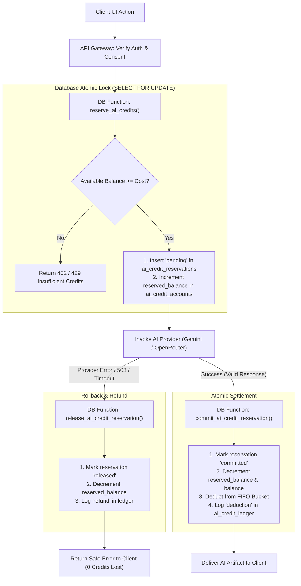
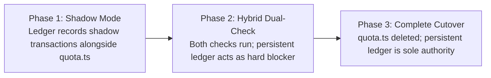

# CareerDev4AI — AI Credits, Cost Model & Ledger Architecture

> **Document Version**: 1.0.0  
> **Date**: 2026-11-06  
> **Author**: Principal Software Architect  
> **Status**: Implementation-Ready Planning Specification  
> **Scope**: AI Credit System, Provider Economics, Double-Entry Ledger, Quota Migration, Abuse Prevention & Scaling Analysis  
> **Target File**: `docs/subscription-system/planning/AI_CREDITS_AND_COST_MODEL.md`

---

## 1. Executive Summary & Epistemic Separation

This document specifies the technical architecture, financial model, and operational governance for the **AI Credits and Cost Management System** of CareerDev4AI.

CareerDev4AI incorporates extensive generative AI capabilities across career discovery, CV engineering, job matching, interview simulation, and career mentoring. To make the commercial subscription model economically viable and abuse-resistant, the platform requires transitioning from its current ephemeral, in-process rate limiting to an atomic, double-entry persistent credit ledger backed by Supabase PostgreSQL.

### Epistemic Separation of Information

To ensure technical integrity and avoid conflating verified facts with working assumptions or architectural recommendations, this specification maintains strict epistemological boundaries:

```
┌─────────────────────────────────────────────────────────────────────────────┐
│ 1. VERIFIED FACTS (Audited from Codebase)                                   │
│    • Canonical model: gemini-3.1-flash-lite via @google/genai (v2.31.0)     │
│    • Fallback provider: OpenRouter (openrouter/free)                        │
│    • Quota: In-process daily budget (15 req/user, 20 req/project) in quota.ts│
│    • Provider hard cap: 20 requests/day per project on Gemini free tier      │
│    • Zero existing subscription, payment, or persistent credit tables       │
├─────────────────────────────────────────────────────────────────────────────┤
│ 2. WORKING ASSUMPTIONS (Market & Operational Baseline)                      │
│    • Currency exchange rate: 1 USD = 50.00 EGP (Egyptian Pounds)            │
│    • Gemini 3.1 Flash-Lite Pay-As-You-Go pricing: $0.075/1M in, $0.30/1M out│
│    • Blended average prompt: 1,850 input tokens, 450 output tokens          │
│    • Payment collection: Vodafone Cash & InstaPay manual transfer (EGP)     │
├─────────────────────────────────────────────────────────────────────────────┤
│ 3. ARCHITECTURAL RECOMMENDATIONS (Prescribed Architecture)                  │
│    • Immediate migration to Google AI Studio / Vertex AI Pay-As-You-Go      │
│    • Double-entry credit ledger with row-level locks (SELECT FOR UPDATE)    │
│    • Pre-call credit reservation pattern with atomic commit/refund          │
│    • Strict FIFO credit bucket expiration (use-or-lose subscription credits)│
│    • Hard concurrency limit of 2 in-flight AI requests per user             │
└─────────────────────────────────────────────────────────────────────────────┘
```

---

## 2. Existing AI Infrastructure Audit (Verified Facts)

### 2.1 Provider Configuration

The codebase currently configures a dual-layer AI strategy:

1. **Primary Provider: Google Gemini**  
   - **Configuration File**: [`server/ai/geminiConfig.ts`](file:///d:/Saas/careerpilot-ai/server/ai/geminiConfig.ts)
   - **Client SDK**: `@google/genai` (v2.31.0) using `@google/genai/web`
   - **Canonical Model**: `gemini-3.1-flash-lite` (constant `CANONICAL_GEMINI_MODEL`)
   - **Dynamic Model Resolution**: Reads `process.env.GEMINI_MODEL` with mandatory auto-downgrade safeguards if configured as `gemini-3.8-flash` or `gemini-3.6-flash`.
   - **Client Timeout**: 45,000ms (`httpOptions.timeout: 45_000`)
   - **Transient Retry**: 1 retry with 1,000ms exponential delay on 503, 504, `UNAVAILABLE`, `overloaded`, or `Deadline Exceeded` (`executeAiWithRetry()`).

2. **Secondary / Fallback Provider: OpenRouter**  
   - **Configuration File**: [`server/ai/openrouterConfig.ts`](file:///d:/Saas/careerpilot-ai/server/ai/openrouterConfig.ts)
   - **Default Model**: `openrouter/free` (declared in `wrangler.jsonc`)
   - **Fallback Mechanism**: Managed via centralized provider facade [`server/ai/provider.ts`](file:///d:/Saas/careerpilot-ai/server/ai/provider.ts) (`generateContentUnified()`). If Gemini throws a quota error (429) or persistent overload (503), the request falls back seamlessly to OpenRouter.

3. **In-Flight Deduplication & Audit**:
   - `inFlightRequests` Map in [`server/ai/provider.ts`](file:///d:/Saas/careerpilot-ai/server/ai/provider.ts) deduplicates identical concurrent requests based on SHA-256 hash of payload.
   - In-memory circular buffer `auditLogs` holds the last 50 requests (ephemeral, not persisted).

### 2.2 Existing Quota System & Critical Vulnerability

The current quota implementation resides in [`server/ai/quota.ts`](file:///d:/Saas/careerpilot-ai/server/ai/quota.ts):
- **Per-User Daily Limit**: 15 requests (`AI_DAILY_LIMIT`, configurable via env)
- **Per-Project Daily Limit**: 20 requests (`AI_PROJECT_DAILY_LIMIT`, reflecting Google's free tier cap)
- **Data Structure**: In-memory JavaScript `Map<string, DailyBucket>` where key is `user:<userId>` or `project`.
- **Reset Interval**: Sliding 24-hour window (`now + 86_400_000`).
- **Refund Logic**: `refundDailyAiBudget()` restores units when the provider returns an upstream 429.

```
CRITICAL ARCHITECTURAL FLAW (VERIFIED):
1. In-process memory storage: In Cloudflare Workers / Pages, every edge isolate 
   maintains its own isolated memory heap. A multi-instance edge deployment 
   multiplies the allowance by the number of active edge instances.
2. Server restarts reset the map, wiping consumed usage to 0.
3. The project cap (20 requests/day) means that a single active user testing 
   CV tailoring (which consumes 4-5 requests) locks out all other platform 
   users for up to 24 hours.
```

### 2.3 Inventory of AI-Powered Features

The codebase incorporates 15 distinct AI operations across synchronous HTTP routes and asynchronous Cloudflare Queue background tasks:

| # | Feature / Operation | Existing File Path | Execution Context | Payload Characteristics | Output Validation |
|---|-------------------|-------------------|-------------------|------------------------|-------------------|
| 1 | **CV Processing & Parsing** | [`server/jobs/tasks/processCv.ts`](file:///d:/Saas/careerpilot-ai/server/jobs/tasks/processCv.ts) | Cloudflare Queue Job | Raw PDF text (up to 12K chars) | Deterministic JSON schema |
| 2 | **Targeted CV Tailoring** | [`server/jobs/tasks/generateTargetedCv.ts`](file:///d:/Saas/careerpilot-ai/server/jobs/tasks/generateTargetedCv.ts) | Cloudflare Queue Job | Full CV + Job Description | Multi-section ATS document |
| 3 | **ATS Scoring & Match** | [`server/cv/atsAnalysis.ts`](file:///d:/Saas/careerpilot-ai/server/cv/atsAnalysis.ts) | Sync Route / Queue Job | CV text + JD requirements | `validateAtsPayload()` |
| 4 | **CV Quality Analysis** | [`server/cv/cvAnalysis.ts`](file:///d:/Saas/careerpilot-ai/server/cv/cvAnalysis.ts) | Synchronous Express API | Full CV structure | Score + actionable issues |
| 5 | **Cover Letter Generation** | [`server/cv/coverLetter.ts`](file:///d:/Saas/careerpilot-ai/server/cv/coverLetter.ts) | Synchronous Express API | Career context + JD text | Grounded prose document |
| 6 | **Job Description Parsing** | [`server/cv/jobDescription.ts`](file:///d:/Saas/careerpilot-ai/server/cv/jobDescription.ts) | Synchronous Express API | Raw JD text (max 12K chars) | Deterministic requirement tree |
| 7 | **Inline AI Assist** | [`server/cv/aiAssist.ts`](file:///d:/Saas/careerpilot-ai/server/cv/aiAssist.ts) | Synchronous Express API | Experience bullet / summary | Single-line / paragraph rewrite |
| 8 | **Document Extraction** | [`server/cv/documentExtraction.ts`](file:///d:/Saas/careerpilot-ai/server/cv/documentExtraction.ts) | Synchronous Express API | Unstructured document | Structured resume blocks |
| 9 | **Career Roadmap Engine** | [`server/jobs/tasks/roadmap.ts`](file:///d:/Saas/careerpilot-ai/server/jobs/tasks/roadmap.ts) | Cloudflare Queue Job | Profile facts + Skill gaps | 5-phase career plan |
| 10 | **AI Career Mentor** | [`server/jobs/tasks/aiMentor.ts`](file:///d:/Saas/careerpilot-ai/server/jobs/tasks/aiMentor.ts) | Cloudflare Queue Job | Career context + Question | Grounded advisory response |
| 11 | **Intelligent Job Match** | [`server/jobs/tasks/matchJobs.ts`](file:///d:/Saas/careerpilot-ai/server/jobs/tasks/matchJobs.ts) | Cloudflare Queue Job | Skills + JSearch results | Relevance ranking & score |
| 12 | **Learning Recommendations**| [`server/learning/ai.ts`](file:///d:/Saas/careerpilot-ai/server/learning/ai.ts) | Synchronous Express API | Catalog courses + Skill gaps | Explanations & rationale |
| 13 | **Project Portfolio Review**| [`server/projects/analysis.ts`](file:///d:/Saas/careerpilot-ai/server/projects/analysis.ts) | Synchronous Express API | GitHub repo / Project facts | Grounded portfolio critique |
| 14 | **Project Recommendation** | [`server/projects/recommendation.ts`](file:///d:/Saas/careerpilot-ai/server/projects/recommendation.ts) | Synchronous Express API | Missing skills + Role specs | Real-world project blueprint |
| 15 | **Copilot Chat / Assistant**| `server/app.ts` (API routes) | Synchronous Express API | Multi-turn conversational | Streaming / JSON response |
| 16 | **Mock Interview Practice** | [`server/db/interviewSessions.ts`](file:///d:/Saas/careerpilot-ai/server/db/interviewSessions.ts) | Synchronous API / Session | STAR interview simulation | Multi-turn question & feedback |

---

## 3. Proposed Credit Weights & Operation Taxonomy

### 3.1 Master Credit Weight Table

Credits serve as the internal platform currency, normalizing computational load, token consumption, and multi-turn orchestration costs into a single intuitive metric. 

| Operation Code | User-Facing Operation | Credit Cost | Execution Mode | Avg Input Tokens | Avg Output Tokens | Computational & Prompt Rationale |
|---|---|---|---|---|---|---|
| `OP_JD_ANALYSIS` | **Job Description Analysis** | **1.0** | Synchronous | 1,500 | 400 | Single prompt extracting structured responsibilities, hard/soft skills, and qualifications from up to 12K characters. |
| `OP_ATS_ANALYSIS` | **ATS Scoring & Analysis** | **2.0** | Synchronous | 2,800 | 800 | Dual input (CV + JD), structured scoring, keyword extraction, and gap analysis with schema validation. |
| `OP_COVER_LETTER` | **Targeted Cover Letter** | **2.0** | Synchronous | 2,200 | 600 | Grounded generation drawing from candidate career facts and JD requirements; prose formatting. |
| `OP_CV_GENERATE` | **Full CV Generation / Parsing** | **4.0** | Background Job | 3,500 | 1,800 | Heavy extraction or generation across summary, experience bullets, education, skills, and projects. |
| `OP_CV_TAILOR` | **Targeted CV Tailoring** | **4.0** | Background Job | 4,200 | 1,600 | Comprehensive CV rewrite aligned to a specific JD while strictly obeying grounding anti-hallucination rules. |
| `OP_ROADMAP_GEN` | **Personalized Career Roadmap** | **4.0** | Background Job | 3,000 | 1,400 | Multi-phase plan construction matching user skill gaps against catalog courses and milestones. |
| `OP_INTERVIEW_SIM`| **Mock Interview Simulation** | **5.0** | Interactive (5 Turns)| 6,500 | 2,500 | Complete 5-question behavioral/technical simulation with contextual feedback, STAR scoring, and follow-ups. |
| `OP_AI_MENTOR` | **AI Career Mentor Session** | **2.0** | Background Job | 2,500 | 500 | Deep context-injected advisory query verifying candidate trajectory against platform skill benchmarks. |
| `OP_AI_ASSIST` | **Inline AI Assist (Single Bullet)**| **0.5** | Synchronous | 800 | 150 | Micro-generation: polishing one bullet point, rewriting headline, or tweaking tone. |
| `OP_LEARN_REC` | **Learning Recommendation** | **1.0** | Synchronous | 1,600 | 350 | Course explanation layer grounding recommendation reasons to specific roadmap milestones. |
| `OP_PROJECT_ANALYZE`| **Project Portfolio Review** | **1.0** | Synchronous | 1,800 | 450 | Health check on user portfolio project analyzing technologies, deliverables, and role relevance. |
| `OP_COPILOT_QUERY` | **Copilot Advisory Query** | **1.0** | Synchronous | 1,400 | 400 | Standard general query to platform assistant regarding navigation, careers, or market trends. |

### 3.2 Technical Justification for Credit Weights

1. **Fractional Weighting (0.5 Credits for `OP_AI_ASSIST`)**:
   Inline assistance in [`server/cv/aiAssist.ts`](file:///d:/Saas/careerpilot-ai/server/cv/aiAssist.ts) is frequently invoked consecutively as users polish individual bullet points. Charging 1.0 credit would prematurely exhaust user allowances on minor edits. 0.5 credits encourages active editing while accounting for prompt caching.
   
2. **Heavy Job Pricing (4.0 Credits for CV & Roadmap Tasks)**:
   Operations executed via Cloudflare Queues ([`server/jobs/tasks/generateTargetedCv.ts`](file:///d:/Saas/careerpilot-ai/server/jobs/tasks/generateTargetedCv.ts) and [`server/jobs/tasks/roadmap.ts`](file:///d:/Saas/careerpilot-ai/server/jobs/tasks/roadmap.ts)) involve extensive context injection (`buildAiContextBlock()`) and grounding post-processing (`stripUngroundedSentences()`). If output validation fails, background tasks retry up to 2 times, doubling the underlying token load.

3. **Session Pricing (5.0 Credits for `OP_INTERVIEW_SIM`)**:
   An interview session is not a single prompt-response exchange. It encompasses five discrete conversational turns, each requiring full session history plus persona instructions. At ~1.0 credit per turn, a 5.0 credit package reservation matches provider cost.

---

## 4. Comprehensive Cost Analysis & Unit Economics

### 4.1 Token Economics: Gemini 3.1 Flash-Lite

Google Gemini 3.1 Flash-Lite offers industry-leading price-to-performance efficiency for structured JSON extraction and reasoning.

#### Official Pay-As-You-Go API Rates
- **Input Tokens ($\le$ 128k context)**: **$0.075 per 1,000,000 tokens** ($0.000075 / 1k)
- **Output Tokens ($\le$ 128k context)**: **$0.300 per 1,000,000 tokens** ($0.000300 / 1k)
- **Context Caching Discount**: **$0.01875 per 1,000,000 tokens** (75% discount on cached system instructions)

#### Currency Conversion to Egyptian Pounds (EGP)
Using the reference benchmark of **1 USD = 50.00 EGP**:
- **Input Cost in EGP**: $0.075 \times 50.00 = \mathbf{3.75\text{ EGP}}\text{ per 1M tokens} = \mathbf{0.00375\text{ EGP}}\text{ per 1,000 tokens}$
- **Output Cost in EGP**: $0.300 \times 50.00 = \mathbf{15.00\text{ EGP}}\text{ per 1M tokens} = \mathbf{0.01500\text{ EGP}}\text{ per 1,000 tokens}$

### 4.2 Detailed Unit Cost Breakdown per Operation

The following table calculates the exact raw API provider cost per operation in both USD and EGP, comparing raw computational cost against credit allocation:

| Operation Code | Input Tokens | Output Tokens | Total Tokens | Provider Cost (USD) | Provider Cost (EGP) | Credit Cost | Provider Cost / Credit (EGP) |
|---|---|---|---|---|---|---|
| `OP_AI_ASSIST` | 800 | 150 | 950 | $0.000105 | 0.00525 EGP | 0.5 | 0.0105 EGP |
| `OP_JD_ANALYSIS` | 1,500 | 400 | 1,900 | $0.000233 | 0.01163 EGP | 1.0 | 0.0116 EGP |
| `OP_LEARN_REC` | 1,600 | 350 | 1,950 | $0.000225 | 0.01125 EGP | 1.0 | 0.0113 EGP |
| `OP_PROJECT_ANALYZE`| 1,800 | 450 | 2,250 | $0.000270 | 0.01350 EGP | 1.0 | 0.0135 EGP |
| `OP_COPILOT_QUERY` | 1,400 | 400 | 1,800 | $0.000225 | 0.01125 EGP | 1.0 | 0.0113 EGP |
| `OP_ATS_ANALYSIS` | 2,800 | 800 | 3,600 | $0.000450 | 0.02250 EGP | 2.0 | 0.0113 EGP |
| `OP_COVER_LETTER` | 2,200 | 600 | 2,800 | $0.000345 | 0.01725 EGP | 2.0 | 0.0086 EGP |
| `OP_AI_MENTOR` | 2,500 | 500 | 3,000 | $0.000338 | 0.01688 EGP | 2.0 | 0.0084 EGP |
| `OP_CV_GENERATE` | 3,500 | 1,800 | 5,300 | $0.000803 | 0.04013 EGP | 4.0 | 0.0100 EGP |
| `OP_CV_TAILOR` | 4,200 | 1,600 | 5,800 | $0.000795 | 0.03975 EGP | 4.0 | 0.0099 EGP |
| `OP_ROADMAP_GEN` | 3,000 | 1,400 | 4,400 | $0.000645 | 0.03225 EGP | 4.0 | 0.0081 EGP |
| `OP_INTERVIEW_SIM` | 6,500 | 2,500 | 9,000 | $0.001238 | 0.06188 EGP | 5.0 | 0.0124 EGP |
| **Weighted Average**| **2,650** | **910** | **3,560** | **$0.000472** | **0.02359 EGP** | **2.3** | **0.0102 EGP** |

> [!NOTE]
> **Key Economic Finding**: Under Gemini 3.1 Flash-Lite, the direct provider cost per credit averages **0.0102 EGP** (approximately one-hundredth of an Egyptian Pound, or 1.02 Piasters). Even in high-output operations like full CV tailoring, the raw Gemini API cost is less than **0.04 EGP**.

### 4.3 Subscription Plan Financial Modeling & Margins

Based on the Egypt-first market positioning and purchasing power parity (PPP), the proposed subscription tiers and add-on credit packs provide healthy commercial margins:

```
┌─────────────────────────────────────────────────────────────────────────────┐
│                          SUBSCRIPTION PLAN TIERS                            │
├────────────────────┬──────────────┬──────────────┬──────────────┬───────────┤
│ Plan Tier          │ Monthly Price│ Credit Quota │ Max API Cost │ Margin %  │
├────────────────────┼──────────────┼──────────────┼──────────────┼───────────┤
│ Free / Onboarding  │ 0 EGP        │ 5 (one-time) │ 0.05 EGP     │ N/A       │
│ Starter            │ 99 EGP / mo  │ 50 credits   │ 0.51 EGP     │ 99.48%    │
│ Professional (Pro) │ 199 EGP / mo │ 150 credits  │ 1.53 EGP     │ 99.23%    │
│ Ultimate / Power   │ 349 EGP / mo │ 350 credits  │ 3.57 EGP     │ 98.98%    │
├────────────────────┴──────────────┴──────────────┴──────────────┴───────────┤
│                             ADD-ON CREDIT PACKS                             │
├────────────────────┬──────────────┬──────────────┬──────────────┬───────────┤
│ Pack Size          │ Fixed Price  │ Unit Price   │ Max API Cost │ Margin %  │
├────────────────────┼──────────────┼──────────────┼──────────────┼───────────┤
│ 25 Credits Pack    │ 49 EGP       │ 1.96 EGP/cred│ 0.26 EGP     │ 99.47%    │
│ 75 Credits Pack    │ 119 EGP      │ 1.59 EGP/cred│ 0.77 EGP     │ 99.35%    │
│ 150 Credits Pack   │ 199 EGP      │ 1.33 EGP/cred│ 1.53 EGP     │ 99.23%    │
└────────────────────┴──────────────┴──────────────┴──────────────┴───────────┘
```

### 4.4 Break-Even & Platform Overhead Analysis

Direct AI token costs constitute a negligible fraction of the plan price. However, a complete break-even model must incorporate full operational overhead:

```
Total Operating Cost per Subscriber = 
    Direct AI Token Cost 
  + Cloudflare Workers / Queues Request Overhead (~0.05 EGP)
  + Supabase Storage & Database Compute Allocation (~1.20 EGP)
  + JSearch RapidAPI Job Aggregation Cost (~1.50 EGP)
  + Payment Processing & Manual Verification Overhead (1.5% - 3.0% of plan price)
```

#### Break-Even Table (Per Plan Tier)

| Cost Component | Starter Plan (99 EGP) | Pro Plan (199 EGP) | Ultimate Plan (349 EGP) |
|---|---|---|---|
| Monthly Subscription Fee | 99.00 EGP | 199.00 EGP | 349.00 EGP |
| Max Direct Gemini Cost (100% credit burn) | -0.51 EGP | -1.53 EGP | -3.57 EGP |
| Payment Gateway / Wallet Fee (2%) | -1.98 EGP | -3.98 EGP | -6.98 EGP |
| Cloudflare Workers + Queues | -0.10 EGP | -0.25 EGP | -0.50 EGP |
| Supabase Database & Auth Share | -1.50 EGP | -2.00 EGP | -3.00 EGP |
| External JSearch API Share | -1.50 EGP | -3.00 EGP | -5.00 EGP |
| Manual Verification Staff Cost Share | -3.00 EGP | -3.00 EGP | -3.00 EGP |
| **Total Operating Cost per User** | **-8.59 EGP** | **-13.76 EGP** | **-22.05 EGP** |
| **Net Contribution Margin per Subscriber** | **+90.41 EGP** | **+185.24 EGP** | **+326.95 EGP** |
| **Net Margin Percentage** | **91.3%** | **93.1%** | **93.7%** |

### 4.5 The Free-Tier Bottleneck: Architectural Alert

> [!CAUTION]
> **CRITICAL SUSTAINABILITY VERDICT**:  
> Google Gemini's Free Tier enforces a hard project ceiling of **20 requests per day per project**.  
> Under this limit:
> - **1 single active Pro subscriber** performing 2 CV tailorings (8 requests) and 1 ATS check (1 request) exhausts 45% of the platform's daily capacity.
> - **3 concurrent users** will completely incapacitate the platform for the rest of the day.
> - **Conclusion**: Launching commercial subscriptions on the Gemini Free Tier is mathematically and architecturally impossible. The project **MUST** activate Pay-As-You-Go billing in Google AI Studio or Google Cloud Vertex AI before a single Egyptian Pound is accepted.

---

## 5. Credit Ledger Architecture (Double-Entry Bookkeeping)

To guarantee financial auditability, zero balance drift, and atomic consistency across distributed workers, CareerDev4AI adopts a double-entry bookkeeping ledger model.

### 5.1 Architectural Principles

1. **Immutable Transaction Log**: Credit balances are never updated directly via crude `UPDATE profiles SET credits = credits - 1`. Every credit movement is an immutable row inserted into `ai_credit_ledger`.
2. **Current Balance Cache with Optimistic Concurrency**: The `ai_credit_accounts` table maintains the aggregated cached balance alongside a row version number and row-level locking (`SELECT ... FOR UPDATE`).
3. **Pre-Allocation Reservation Pattern**: Credits are reserved *before* invoking an AI provider. If the AI call fails or times out, the reservation is released with zero penalty. If it succeeds, the reservation commits atomically.
4. **Bucket Isolation (FIFO Expiration)**: Credits are tagged by bucket type (`subscription`, `pack`, `trial`). Subscription credits expire at the end of the monthly billing cycle; purchased credit packs have perpetual validity (or 12-month expiry). Consumption prioritizes expiring credits first.



### 5.2 PostgreSQL Database DDL Schema

The following schema defines the complete database structures to be deployed in Supabase:

```sql
-- Migration: 20261106000001_ai_credit_ledger_system.sql
-- Description: Double-entry credit ledger, reservations, and bucket management

-- 1. Enum Types for Ledger and Operations
CREATE TYPE ai_credit_bucket_type AS ENUM (
    'trial',          -- One-time signup bonus (5 credits)
    'subscription',   -- Monthly recurring subscription allocation
    'pack',           -- Non-expiring purchased add-on pack
    'compensation'    -- Administrative compensation / manual adjustment
);

CREATE TYPE ai_credit_reservation_status AS ENUM (
    'pending',        -- Active lock while AI call is in-flight
    'committed',      -- Successfully completed and deducted
    'released',       -- Cancelled / refunded due to provider error
    'expired'         -- Timed out reservation released by background sweeper
);

CREATE TYPE ai_credit_transaction_type AS ENUM (
    'grant',          -- Credits added to account
    'reservation',    -- Credits put on hold
    'deduction',      -- Settled reservation converted to permanent spend
    'refund',         -- Released reservation returned to available balance
    'expiration',     -- Unused subscription credits purged at cycle end
    'adjustment'      -- Admin correction
);

-- 2. Aggregated Account Balance Table (One per user)
CREATE TABLE public.ai_credit_accounts (
    profile_id UUID PRIMARY KEY REFERENCES public.profiles(id) ON DELETE CASCADE,
    balance NUMERIC(10, 2) NOT NULL DEFAULT 0.00 CHECK (balance >= 0),
    reserved_balance NUMERIC(10, 2) NOT NULL DEFAULT 0.00 CHECK (reserved_balance >= 0),
    lifetime_granted NUMERIC(10, 2) NOT NULL DEFAULT 0.00 CHECK (lifetime_granted >= 0),
    lifetime_consumed NUMERIC(10, 2) NOT NULL DEFAULT 0.00 CHECK (lifetime_consumed >= 0),
    version INTEGER NOT NULL DEFAULT 1,
    created_at TIMESTAMPTZ NOT NULL DEFAULT timezone('utc', now()),
    updated_at TIMESTAMPTZ NOT NULL DEFAULT timezone('utc', now())
);

-- 3. Isolated Credit Buckets (Tracks expiration dates & FIFO priority)
CREATE TABLE public.ai_credit_buckets (
    id UUID PRIMARY KEY DEFAULT gen_random_uuid(),
    profile_id UUID NOT NULL REFERENCES public.profiles(id) ON DELETE CASCADE,
    bucket_type ai_credit_bucket_type NOT NULL,
    initial_credits NUMERIC(10, 2) NOT NULL CHECK (initial_credits > 0),
    remaining_credits NUMERIC(10, 2) NOT NULL CHECK (remaining_credits >= 0),
    expires_at TIMESTAMPTZ, -- NULL for non-expiring credit packs
    created_at TIMESTAMPTZ NOT NULL DEFAULT timezone('utc', now()),
    updated_at TIMESTAMPTZ NOT NULL DEFAULT timezone('utc', now())
);

CREATE INDEX idx_ai_credit_buckets_fifo 
ON public.ai_credit_buckets (profile_id, expires_at ASC NULLS LAST)
WHERE remaining_credits > 0;

-- 4. Reservations Table (In-flight holds)
CREATE TABLE public.ai_credit_reservations (
    id UUID PRIMARY KEY DEFAULT gen_random_uuid(),
    profile_id UUID NOT NULL REFERENCES public.profiles(id) ON DELETE CASCADE,
    operation_type TEXT NOT NULL,
    credits NUMERIC(10, 2) NOT NULL CHECK (credits > 0),
    status ai_credit_reservation_status NOT NULL DEFAULT 'pending',
    idempotency_key TEXT NOT NULL UNIQUE,
    provider TEXT,
    model TEXT,
    tokens_input INTEGER,
    tokens_output INTEGER,
    expires_at TIMESTAMPTZ NOT NULL, -- Short TTL: 90 seconds
    created_at TIMESTAMPTZ NOT NULL DEFAULT timezone('utc', now()),
    committed_at TIMESTAMPTZ
);

CREATE INDEX idx_ai_credit_reservations_pending 
ON public.ai_credit_reservations (status, expires_at)
WHERE status = 'pending';

-- 5. Immutable Transaction Ledger
CREATE TABLE public.ai_credit_ledger (
    id UUID PRIMARY KEY DEFAULT gen_random_uuid(),
    profile_id UUID NOT NULL REFERENCES public.profiles(id) ON DELETE CASCADE,
    reservation_id UUID REFERENCES public.ai_credit_reservations(id),
    bucket_id UUID REFERENCES public.ai_credit_buckets(id),
    transaction_type ai_credit_transaction_type NOT NULL,
    amount NUMERIC(10, 2) NOT NULL, -- Negative for deductions, positive for grants
    balance_after NUMERIC(10, 2) NOT NULL CHECK (balance_after >= 0),
    idempotency_key TEXT NOT NULL UNIQUE,
    reason TEXT,
    metadata JSONB NOT NULL DEFAULT '{}'::jsonb,
    created_at TIMESTAMPTZ NOT NULL DEFAULT timezone('utc', now())
);

CREATE INDEX idx_ai_credit_ledger_profile 
ON public.ai_credit_ledger (profile_id, created_at DESC);
```

### 5.3 Row Level Security (RLS) Policies

All credit ledger tables enforce strict client-read / backend-write privileges:

```sql
-- Enable RLS across all credit tables
ALTER TABLE public.ai_credit_accounts ENABLE ROW LEVEL SECURITY;
ALTER TABLE public.ai_credit_buckets ENABLE ROW LEVEL SECURITY;
ALTER TABLE public.ai_credit_reservations ENABLE ROW LEVEL SECURITY;
ALTER TABLE public.ai_credit_ledger ENABLE ROW LEVEL SECURITY;

-- 1. Users can ONLY read their own account summaries
CREATE POLICY "Users view own credit account"
ON public.ai_credit_accounts FOR SELECT
TO authenticated
USING (profile_id = auth.uid());

-- 2. Users can view their own active buckets
CREATE POLICY "Users view own credit buckets"
ON public.ai_credit_buckets FOR SELECT
TO authenticated
USING (profile_id = auth.uid());

-- 3. Users can view their own reservations
CREATE POLICY "Users view own credit reservations"
ON public.ai_credit_reservations FOR SELECT
TO authenticated
USING (profile_id = auth.uid());

-- 4. Users can view their own ledger transaction history
CREATE POLICY "Users view own credit ledger"
ON public.ai_credit_ledger FOR SELECT
TO authenticated
USING (profile_id = auth.uid());

-- 5. REVOKE ALL MUTATIONS from authenticated and anon roles
REVOKE INSERT, UPDATE, DELETE ON public.ai_credit_accounts FROM authenticated, anon;
REVOKE INSERT, UPDATE, DELETE ON public.ai_credit_buckets FROM authenticated, anon;
REVOKE INSERT, UPDATE, DELETE ON public.ai_credit_reservations FROM authenticated, anon;
REVOKE INSERT, UPDATE, DELETE ON public.ai_credit_ledger FROM authenticated, anon;
```

### 5.4 Atomic Stored Procedures

The ledger relies on database functions executed with `SECURITY DEFINER` and row-level locks:

#### 1. Reservation Function (`reserve_ai_credits`)
```sql
CREATE OR REPLACE FUNCTION public.reserve_ai_credits(
    p_profile_id UUID,
    p_operation_type TEXT,
    p_credits NUMERIC(10, 2),
    p_idempotency_key TEXT,
    p_ttl_seconds INTEGER DEFAULT 90
)
RETURNS JSONB
LANGUAGE plpgsql
SECURITY DEFINER
AS $$
DECLARE
    v_account RECORD;
    v_available NUMERIC(10, 2);
    v_reservation_id UUID;
    v_expires_at TIMESTAMPTZ;
BEGIN
    -- 1. Check idempotency: If already reserved, return existing
    SELECT id, status INTO v_reservation_id
    FROM public.ai_credit_reservations
    WHERE idempotency_key = p_idempotency_key;
    
    IF FOUND THEN
        RETURN jsonb_build_object(
            'success', true,
            'reservation_id', v_reservation_id,
            'resumed', true
        );
    END IF;

    -- 2. Lock account row with FOR UPDATE
    SELECT * INTO v_account
    FROM public.ai_credit_accounts
    WHERE profile_id = p_profile_id
    FOR UPDATE;

    IF NOT FOUND THEN
        RETURN jsonb_build_object('success', false, 'code', 'ACCOUNT_NOT_FOUND');
    END IF;

    -- 3. Verify available balance
    v_available := v_account.balance - v_account.reserved_balance;
    IF v_available < p_credits THEN
        RETURN jsonb_build_object(
            'success', false,
            'code', 'INSUFFICIENT_CREDITS',
            'available', v_available,
            'required', p_credits
        );
    END IF;

    -- 4. Create reservation
    v_expires_at := timezone('utc', now()) + (p_ttl_seconds || ' seconds')::interval;
    INSERT INTO public.ai_credit_reservations (
        profile_id, operation_type, credits, status, idempotency_key, expires_at
    ) VALUES (
        p_profile_id, p_operation_type, p_credits, 'pending', p_idempotency_key, v_expires_at
    ) RETURNING id INTO v_reservation_id;

    -- 5. Increment reserved_balance
    UPDATE public.ai_credit_accounts
    SET reserved_balance = reserved_balance + p_credits,
        updated_at = timezone('utc', now()),
        version = version + 1
    WHERE profile_id = p_profile_id;

    RETURN jsonb_build_object(
        'success', true,
        'reservation_id', v_reservation_id,
        'expires_at', v_expires_at
    );
END;
$$;
```

#### 2. Settlement Function (`commit_ai_credit_reservation`)
```sql
CREATE OR REPLACE FUNCTION public.commit_ai_credit_reservation(
    p_reservation_id UUID,
    p_provider TEXT,
    p_model TEXT,
    p_tokens_input INTEGER,
    p_tokens_output INTEGER
)
RETURNS JSONB
LANGUAGE plpgsql
SECURITY DEFINER
AS $$
DECLARE
    v_res RECORD;
    v_account RECORD;
    v_credits_to_deduct NUMERIC(10, 2);
    v_bucket RECORD;
    v_deduct_from_bucket NUMERIC(10, 2);
    v_remaining_to_deduct NUMERIC(10, 2);
    v_new_balance NUMERIC(10, 2);
BEGIN
    -- 1. Lock reservation
    SELECT * INTO v_res
    FROM public.ai_credit_reservations
    WHERE id = p_reservation_id
    FOR UPDATE;

    IF NOT FOUND OR v_res.status != 'pending' THEN
        RETURN jsonb_build_object('success', false, 'code', 'INVALID_RESERVATION');
    END IF;

    -- 2. Lock account
    SELECT * INTO v_account
    FROM public.ai_credit_accounts
    WHERE profile_id = v_res.profile_id
    FOR UPDATE;

    v_credits_to_deduct := v_res.credits;
    v_remaining_to_deduct := v_credits_to_deduct;

    -- 3. Deplete buckets in FIFO order (expiring first)
    FOR v_bucket IN
        SELECT * FROM public.ai_credit_buckets
        WHERE profile_id = v_res.profile_id AND remaining_credits > 0
        ORDER BY expires_at ASC NULLS LAST, created_at ASC
        FOR UPDATE
    LOOP
        IF v_remaining_to_deduct <= 0 THEN
            EXIT;
        END IF;

        v_deduct_from_bucket := LEAST(v_bucket.remaining_credits, v_remaining_to_deduct);

        UPDATE public.ai_credit_buckets
        SET remaining_credits = remaining_credits - v_deduct_from_bucket,
            updated_at = timezone('utc', now())
        WHERE id = v_bucket.id;

        -- Record ledger deduction per bucket
        INSERT INTO public.ai_credit_ledger (
            profile_id, reservation_id, bucket_id, transaction_type,
            amount, balance_after, idempotency_key, metadata
        ) VALUES (
            v_res.profile_id, v_res.id, v_bucket.id, 'deduction',
            -v_deduct_from_bucket,
            v_account.balance - (v_credits_to_deduct - v_remaining_to_deduct + v_deduct_from_bucket),
            v_res.idempotency_key || ':deduct:' || v_bucket.id,
            jsonb_build_object(
                'provider', p_provider,
                'model', p_model,
                'tokens_input', p_tokens_input,
                'tokens_output', p_tokens_output
            )
        );

        v_remaining_to_deduct := v_remaining_to_deduct - v_deduct_from_bucket;
    END LOOP;

    -- 4. Update account balances
    v_new_balance := v_account.balance - v_credits_to_deduct;
    UPDATE public.ai_credit_accounts
    SET balance = v_new_balance,
        reserved_balance = GREATEST(0, reserved_balance - v_credits_to_deduct),
        lifetime_consumed = lifetime_consumed + v_credits_to_deduct,
        updated_at = timezone('utc', now()),
        version = version + 1
    WHERE profile_id = v_res.profile_id;

    -- 5. Mark reservation committed
    UPDATE public.ai_credit_reservations
    SET status = 'committed',
        provider = p_provider,
        model = p_model,
        tokens_input = p_tokens_input,
        tokens_output = p_tokens_output,
        committed_at = timezone('utc', now())
    WHERE id = p_reservation_id;

    RETURN jsonb_build_object(
        'success', true,
        'deducted', v_credits_to_deduct,
        'new_balance', v_new_balance
    );
END;
$$;
```

#### 3. Release / Refund Function (`release_ai_credit_reservation`)
```sql
CREATE OR REPLACE FUNCTION public.release_ai_credit_reservation(
    p_reservation_id UUID,
    p_reason TEXT
)
RETURNS JSONB
LANGUAGE plpgsql
SECURITY DEFINER
AS $$
DECLARE
    v_res RECORD;
BEGIN
    SELECT * INTO v_res
    FROM public.ai_credit_reservations
    WHERE id = p_reservation_id
    FOR UPDATE;

    IF NOT FOUND OR v_res.status != 'pending' THEN
        RETURN jsonb_build_object('success', false, 'code', 'INVALID_RESERVATION');
    END IF;

    -- Decrement reserved balance on account
    UPDATE public.ai_credit_accounts
    SET reserved_balance = GREATEST(0, reserved_balance - v_res.credits),
        updated_at = timezone('utc', now()),
        version = version + 1
    WHERE profile_id = v_res.profile_id;

    -- Update reservation status
    UPDATE public.ai_credit_reservations
    SET status = 'released'
    WHERE id = p_reservation_id;

    RETURN jsonb_build_object(
        'success', true,
        'released_credits', v_res.credits,
        'reason', p_reason
    );
END;
$$;
```

---

## 6. Credit Lifecycle Management

### 6.1 Monthly Subscription Grants & Carry-Over Policy

1. **Cycle Grant**:
   - When a subscription is activated or renewed via payment confirmation, a new credit bucket is created:
     ```sql
     INSERT INTO public.ai_credit_buckets (
         profile_id, bucket_type, initial_credits, remaining_credits, expires_at
     ) VALUES (
         v_user_id, 'subscription', 150.00, 150.00, timezone('utc', now()) + interval '1 month'
     );
     ```
   - The user's `balance` on `ai_credit_accounts` is incremented accordingly.

2. **Strict Use-or-Lose Policy (NO Carry-Over)**:
   - Monthly subscription credits do **NOT** roll over to the subsequent billing cycle.
   - **Rationale**: Rollover creates accumulating liabilities on the company balance sheet and distorts capacity planning. Standard SaaS mechanics across the MENA region apply use-or-lose models.
   - At the end of the monthly billing period, any `remaining_credits` in the expiring subscription bucket are purged via an automated cron sweeper:
     ```sql
     -- Deduct remaining credits in expired buckets
     UPDATE public.ai_credit_accounts acc
     SET balance = balance - b.remaining_credits
     FROM public.ai_credit_buckets b
     WHERE b.profile_id = acc.profile_id 
       AND b.bucket_type = 'subscription'
       AND b.expires_at <= timezone('utc', now())
       AND b.remaining_credits > 0;
     ```

### 6.2 Credit Packs (Add-ons) Policy

- Users can purchase standalone Credit Packs (e.g., 25, 75, or 150 credits) at any time.
- Credit packs are inserted with `bucket_type = 'pack'` and `expires_at = NULL` (perpetual validity) or `expires_at = now() + interval '12 months'`.
- **FIFO Consumption Priority**: The settlement procedure automatically depletes expiring subscription credits first. A user's paid pack credits remain safely preserved until their monthly allowance is exhausted.

### 6.3 Free Onboarding Trial Credits & Anti-Fraud

Every new registered user receives **5 free credits** to test core features. To prevent abusive farming:
1. **One-Time Grant per Profile**: Enforced by unique constraint on the grant transaction:
   `idempotency_key = 'trial_grant:' || user_id`.
2. **Device & Phone Fingerprinting**: Trial grants require completing phone number verification (SMS OTP or WhatsApp OTP) or Egyptian National ID verification before credits unlock.
3. **No Replenishment**: Trial credits never refresh or reset. Once spent, the user must upgrade or purchase a credit pack.

---

## 7. Server-Side Enforcement & Migration Plan

### 7.1 Deprecation of Ephemeral Quota Engine

The existing in-process rate limiter [`server/ai/quota.ts`](file:///d:/Saas/careerpilot-ai/server/ai/quota.ts) will be phased out through a three-stage migration:



### 7.2 Express & Worker Credit Enforcement Middleware

All AI routes will be protected by standard middleware: `requireAiCredits(operationCode)`:

```typescript
// Location: server/ai/creditMiddleware.ts
import { Request, Response, NextFunction } from 'express';
import { supabaseAdmin } from '../db/supabase.ts';
import { getCreditWeightForOperation } from '../../shared/aiCredits.ts';

export function requireAiCredits(operationType: string) {
  return async (req: Request, res: Response, next: NextFunction): Promise<void> => {
    const profileId = (req as any).user?.id;
    if (!profileId) {
      res.status(401).json({ error: 'unauthorized', message: 'Authentication required' });
      return;
    }

    const creditsRequired = getCreditWeightForOperation(operationType);
    const idempotencyKey = req.headers['x-idempotency-key'] as string 
      || `${profileId}:${operationType}:${Date.now()}`;

    try {
      // 1. Atomic reservation via Supabase RPC
      const { data, error } = await supabaseAdmin.rpc('reserve_ai_credits', {
        p_profile_id: profileId,
        p_operation_type: operationType,
        p_credits: creditsRequired,
        p_idempotency_key: idempotencyKey,
        p_ttl_seconds: 90
      });

      if (error || !data?.success) {
        if (data?.code === 'INSUFFICIENT_CREDITS') {
          res.status(402).json({
            error: 'insufficient_credits',
            message: 'You have insufficient AI credits for this operation.',
            required: creditsRequired,
            available: data.available
          });
          return;
        }
        res.status(500).json({ error: 'reservation_failed', message: 'Unable to reserve credits' });
        return;
      }

      // Attach reservation details to request context
      (req as any).aiReservation = {
        id: data.reservation_id,
        credits: creditsRequired,
        idempotencyKey
      };

      next();
    } catch (err) {
      res.status(500).json({ error: 'internal_error', message: 'Credit verification error' });
    }
  };
}
```

### 7.3 Concurrency Control & Global Spending Cap

1. **Per-User Concurrency Guard**:
   - To prevent automated scripts from firing 20 parallel requests to drain credits or cause race conditions, the system enforces a hard limit of **2 concurrent pending reservations** per user profile.
   - Any third concurrent request receives a `429 Too Many Concurrent Requests` error immediately.

2. **Platform-Wide Global Daily Spending Cap**:
   - A circuit breaker stored in Cloudflare KV or Redis tracks total platform AI spend per calendar day.
   - If total platform AI API costs exceed **5,000 EGP / day** ($100 USD / day), an alert triggers to the Super Admin (`ahmedghannam801@gmail.com`) and non-essential free-tier endpoints degrade to read-only mode to prevent catastrophic runaway billing.

---

## 8. Abuse Prevention & Operational Safeguards

### 8.1 Velocity Limits

Even users with high credit balances are subject to rate limiting to prevent compromised tokens or credential stuffing:
- **Hourly Velocity Limit**: Maximum **15 credits** consumed per rolling 60 minutes per user.
- **Daily Velocity Limit**: Maximum **50 credits** consumed per rolling 24 hours per user (excluding enterprise tiers).
- Violations trigger an automated 1-hour cooling-off freeze and log an entry into `admin_audit_log`.

### 8.2 Anomaly Detection & Monitoring Triggers

The system automatically flags suspicious accounts for administrative review when:
1. **High Reservation Failure Ratio**: A user triggers $\ge 5$ reservation expirations without commits within 10 minutes (indicating network flooding or client-side abort attacks).
2. **Identical Prompt Flooding**: Repeated requests with identical payloads submitted $\ge 3$ times within 60 seconds (bypassing client-side caching).
3. **Multi-IP Rapid Switching**: An authenticated session consuming credits from $> 2$ distinct IP subnets within 5 minutes.

---

## 9. Temporary Access Credit Restrictions

### 9.1 The Problem Context: Egyptian Manual Payments

In Egypt, credit card penetration is low. Most CareerDev4AI users pay via **Vodafone Cash wallet transfer** or **InstaPay**. These payments require manual human verification of transaction receipts, which may take up to 24 hours.

To eliminate customer friction and provide immediate gratification upon receipt upload, the platform introduces a `temporary_access` subscription state.

### 9.2 Restrictions during Temporary Access

While an account is in `temporary_access` (pending receipt confirmation):

```
┌─────────────────────────────────────────────────────────────────────────────┐
│                 TEMPORARY ACCESS MODE RULES (24-Hour Window)                │
├─────────────────────────────────────────────────────────────────────────────┤
│ 1. CREDIT CEILING: Maximum 5.0 total credits available during temporary mode│
│ 2. OPERATION COST CEILING: Operations costing > 2.0 credits are LOCKED      │
│ 3. ALLOWED OPERATIONS (≤ 2.0 credits):                                      │
│    • Job Description Analysis (1.0 credit)                                  │
│    • ATS CV Analysis & Scoring (2.0 credits)                                │
│    • Targeted Cover Letter Generation (2.0 credits)                         │
│    • AI Career Mentor Advisory Query (2.0 credits)                          │
│    • Inline AI Assist / Bullet Rewriting (0.5 credit)                       │
│    • Learning Recommendation Explanation (1.0 credit)                       │
│    • Portfolio Project Review (1.0 credit)                                  │
│    • Copilot Query (1.0 credit)                                             │
│ 4. FORBIDDEN OPERATIONS (> 2.0 credits):                                    │
│    ❌ Mock Interview Simulation (5.0 credits) — LOCKED                      │
│    ❌ Full CV Generation / Parsing (4.0 credits) — LOCKED                   │
│    ❌ Targeted CV Tailoring (4.0 credits) — LOCKED                          │
│    ❌ Personalized Roadmap Generation (4.0 credits) — LOCKED                │
└─────────────────────────────────────────────────────────────────────────────┘
```

#### User Experience & Clear Messaging
When a temporary user attempts a restricted operation, the UI displays a reassuring modal rather than a raw error:
> *"Your payment verification via Vodafone Cash/InstaPay is currently being processed by our admin team (usually within 2-4 hours). To protect platform resources, Full CV Tailoring and Interview Simulations unlock immediately once payment is verified. In the meantime, enjoy ATS Scoring, Cover Letters, and AI Mentor sessions!"*

---

## 10. Financial Telemetry, Cost Reporting & Margins

### 10.1 Telemetry Persistence in Database

The existing in-memory audit log in [`server/ai/provider.ts`](file:///d:/Saas/careerpilot-ai/server/ai/provider.ts) (`auditLogs[]`) will be augmented with a persistent telemetry table:

```sql
CREATE TABLE public.ai_usage_telemetry (
    id UUID PRIMARY KEY DEFAULT gen_random_uuid(),
    profile_id UUID REFERENCES public.profiles(id) ON DELETE SET NULL,
    reservation_id UUID REFERENCES public.ai_credit_reservations(id),
    operation_type TEXT NOT NULL,
    provider TEXT NOT NULL,
    model TEXT NOT NULL,
    tokens_input INTEGER NOT NULL,
    tokens_output INTEGER NOT NULL,
    cost_usd NUMERIC(10, 6) NOT NULL,
    cost_egp NUMERIC(10, 4) NOT NULL,
    duration_ms INTEGER NOT NULL,
    fallback_occurred BOOLEAN NOT NULL DEFAULT false,
    created_at TIMESTAMPTZ NOT NULL DEFAULT timezone('utc', now())
);

CREATE INDEX idx_ai_usage_telemetry_daily 
ON public.ai_usage_telemetry (created_at DESC, operation_type);
```

### 10.2 Administrative Financial Reporting Views

Admins gain real-time visibility into margin health via specialized Supabase views:

```sql
CREATE OR REPLACE VIEW public.admin_ai_daily_cost_summary AS
SELECT 
    date_trunc('day', created_at) AS report_date,
    operation_type,
    COUNT(*) AS total_executions,
    SUM(tokens_input) AS total_input_tokens,
    SUM(tokens_output) AS total_output_tokens,
    SUM(cost_egp) AS total_provider_cost_egp,
    AVG(duration_ms) AS avg_latency_ms
FROM public.ai_usage_telemetry
GROUP BY 1, 2
ORDER BY 1 DESC, total_provider_cost_egp DESC;
```

---

## 11. Scale Sustainability Projections & Roadmap

### 11.1 Projected Infrastructure & AI Costs at Scale

Assuming a subscriber distribution of 60% Starter (50 credits), 30% Pro (150 credits), and 10% Ultimate (350 credits), with an average monthly credit utilization of 70%:

| Active Subscribers | Monthly Credits Consumed | Total Input Tokens (M) | Total Output Tokens (M) | Gemini Monthly Cost (USD) | Gemini Monthly Cost (EGP) | Subscription Revenue (EGP) | AI Cost / Revenue % |
|---|---|---|---|---|---|---|---|
| **100** | 7,700 | 8.85 M | 3.04 M | $1.58 | **79 EGP** | 15,400 EGP | **0.51%** |
| **500** | 38,500 | 44.27 M | 15.20 M | $7.88 | **394 EGP** | 77,000 EGP | **0.51%** |
| **1,000** | 77,000 | 88.55 M | 30.41 M | $15.76 | **788 EGP** | 154,000 EGP | **0.51%** |
| **5,000** | 385,000 | 442.75 M | 152.07 M | $78.82 | **3,941 EGP** | 770,000 EGP | **0.51%** |
| **10,000**| 770,000 | 885.50 M | 304.15 M | $157.65 | **7,882 EGP** | 1,540,000 EGP | **0.51%** |

> [!TIP]
> **Key Architectural Takeaway**: Even at 10,000 paying Egyptian subscribers generating **1,540,000 EGP/month**, total Google Gemini API costs remain under **8,000 EGP/month** (< $160 USD). Generative AI costs will never be the bottleneck; subscriber acquisition, payment confirmation, and retention are the true primary levers.

### 11.2 Empirical Telemetry Baseline Plan

Because live Egyptian user data (real CV sizes, Arabic token inflation factor) has not yet been collected at commercial volume, all token estimates in this document represent simulated baselines.

#### 14-Day Empirical Calibration Protocol:
1. **Instrumentation**: Deploy token measurement logging on all current free routes.
2. **Arabic Inflation Measurement**: Arabic text tokenizes with a higher byte-pair-encoding (BPE) ratio (~1.8x to 2.4x more tokens per word than English). Telemetry must record token counts segregated by language (`en` vs `ar`).
3. **Weight Recalibration Gate**: Before launching the paid tier, if empirical average token consumption for any operation deviates by $> 25\%$ from this model, credit weights will be updated via a single SQL configuration update.

---

## 12. Verification Checklist for Engineering Agents

Prior to writing application code or database migrations for the subscription system, executing agents must verify:

- [ ] Google Cloud Project billing account is linked to Gemini API to eliminate the 20 req/day cap.
- [ ] Migration `20261106000001_ai_credit_ledger_system.sql` applies cleanly to Supabase PostgreSQL.
- [ ] RLS policies prevent any client from directly modifying `balance` or inserting into `ai_credit_ledger`.
- [ ] `reserve_ai_credits` uses `SELECT ... FOR UPDATE` to prevent race conditions during rapid parallel clicks.
- [ ] Background worker tasks in `worker/jobs/` properly pass reservation IDs and invoke `commit_ai_credit_reservation`.
- [ ] Automated cron sweeper exists to purge expired subscription credits at monthly billing boundaries.
- [ ] Users in `temporary_access` are restricted to operations costing $\le 2$ credits and capped at 5 credits total.
- [ ] All customer-facing prices and admin revenue dashboards are strictly denominated in **EGP (Egyptian Pounds)**.
