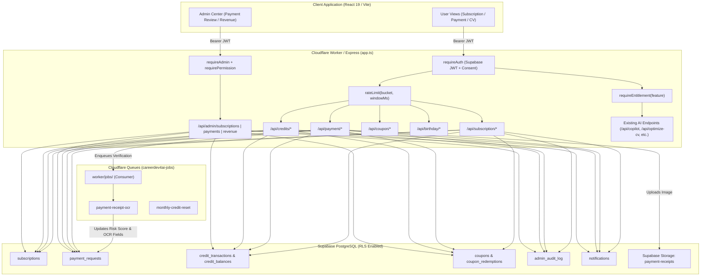
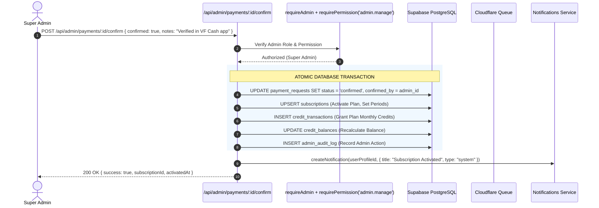
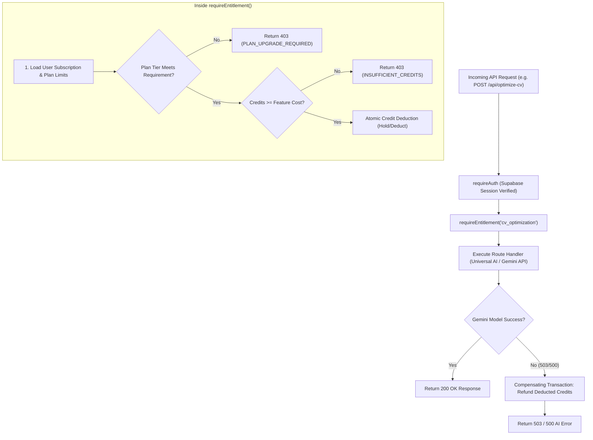

# CareerDev4AI — Subscription & Monetization System: Backend API Contracts

> **Document Type**: Technical Specification & Planning Contract  
> **Document Status**: Draft / Ready for Engineering Review  
> **Target System**: CareerDev4AI Subscription & AI Credits System  
> **Target Execution Runtime**: Express on Cloudflare Workers (via Pages Advanced Mode) & Node.js Test Harness  
> **Target File Location**: `docs/subscription-system/planning/BACKEND_API_CONTRACTS.md`  
> **Author**: Principal Software Architect  
> **Currency Standard**: All monetary values are strictly denominated in **EGP (Egyptian Pounds)**.

---

## 1. Executive Summary & Architectural Context

### 1.1 Architectural Overview
The CareerDev4AI backend operates as an Express application mounted inside Cloudflare Pages Advanced Mode (`dist/_worker.js` compiled from `worker/index.ts`) and exercised directly in Node.js integration tests (`server.ts` and `tests/runner.mjs`). All application endpoints reside under `/api/*` defined in [`app.ts`](file:///d:/Saas/careerpilot-ai/app.ts).

The subscription and monetization system introduces commercial capabilities tailored to the Egyptian market:
1. **Tiered Subscriptions**: Monthly and annual recurring plans (Free, Pro, Elite) billed in EGP.
2. **Manual Payment Verification**: Egypt-first payment rails (Vodafone Cash, Orange Money, Etisalat Cash, WE Pay, InstaPay, and Bank Transfer) utilizing receipt evidence submission and an automated OCR verification pipeline.
3. **AI Credits Ledger**: Atomic credit allocations, balance tracking, and entitlement consumption across Gemini AI-backed endpoints.
4. **Promotional Coupons & Birthday Loyalty**: Strict percentage/fixed discounts and privacy-compliant birthday credit gifts.
5. **Admin Operations & Revenue Intelligence**: Permission-governed reconciliation, payment approvals, audit logs, and fraud detection.



---

## 2. Architectural Principles, Authentication & Shared Conventions

### 2.1 Fact, Assumption & Recommendation Separation

* **Verified Facts (Codebase Truth)**:
  - API routes run in Express via [`app.ts`](file:///d:/Saas/careerpilot-ai/app.ts).
  - Authentication requires a valid Supabase Auth Bearer token verified in [`server/auth/supabase-auth.ts`](file:///d:/Saas/careerpilot-ai/server/auth/supabase-auth.ts) and enforced via [`requireAuth`](file:///d:/Saas/careerpilot-ai/server/auth/require-auth.ts).
  - Admin access is validated via [`requireAdmin`](file:///d:/Saas/careerpilot-ai/server/admin/permissions.ts) and granular permissions via [`requirePermission(permission)`](file:///d:/Saas/careerpilot-ai/server/admin/permissions.ts) against [`shared/admin.ts`](file:///d:/Saas/careerpilot-ai/shared/admin.ts).
  - All admin actions write to `admin_audit_log` via [`logAdminAction`](file:///d:/Saas/careerpilot-ai/server/db/admin.ts).
  - In-app notifications are created via [`createNotification`](file:///d:/Saas/careerpilot-ai/server/db/notifications.ts).
  - Asynchronous background jobs utilize Cloudflare Queues via [`server/jobs/queue.ts`](file:///d:/Saas/careerpilot-ai/server/jobs/queue.ts) and [`server/jobs/jobs.ts`](file:///d:/Saas/careerpilot-ai/server/jobs/jobs.ts).

* **Assumptions**:
  - Payment evidence verification in Egypt is primarily manual/semi-automated because automated merchant webhooks (e.g. Vodafone Cash API) require enterprise telecom aggregator contracts. Proof-of-payment receipts uploaded by users undergo automated Gemini Vision OCR parsing to assist admin verification.
  - Subscription durations follow standard calendar increments: 30 days for monthly and 365 days for annual.
  - Super admin role (`super_admin`) is strictly required for financial state transitions (payment confirmation, manual refunds, and manual credit grants).

* **Recommendations**:
  - Store all prices and balances as integer piasters or fixed 2-decimal numbers in Supabase (numeric) to avoid floating-point rounding errors.
  - Require client idempotency keys (`Idempotency-Key` header) for financial state mutations (`/api/subscription/subscribe`, `/api/payment/submit-evidence`, `/api/credits/purchase`).
  - Introduce an `Entitlement Middleware` that checks active subscription status and atomic credit deduction before executing AI generation logic.

---

### 2.2 Standard Request & Response Envelopes

#### 2.2.1 HTTP Headers
- `Authorization`: `Bearer <supabase_access_token>` (Mandatory for all authenticated routes)
- `Content-Type`: `application/json` (or `multipart/form-data` for file uploads)
- `Idempotency-Key`: UUID v4 string (Optional but strongly recommended on state-mutating POST/PATCH calls)
- `X-Request-Id`: UUID v4 string for distributed tracing across Workers and Cloudflare Queues

#### 2.2.2 Standard Success Response Envelope
All non-streaming JSON responses return either the requested resource directly or wrapped in a standard result shape:
```typescript
export interface ApiResponse<T> {
  success: true;
  data: T;
  meta?: {
    requestId?: string;
    timestamp: string;
  };
}
```

#### 2.2.3 Standard Error Response Envelope
Existing API error patterns in [`app.ts`](file:///d:/Saas/careerpilot-ai/app.ts) return `{ error: string, code?: string }`. To support robust client error handling and localization, error payloads follow this contract:
```typescript
export interface ApiErrorResponse {
  error: string;
  code: string;
  details?: Record<string, unknown> | Array<{ field: string; issue: string }>;
  requestId?: string;
}
```

#### 2.2.4 Canonical HTTP Status Codes & Error Codes
| Status Code | Error Code | Description |
| :--- | :--- | :--- |
| `400` | `INVALID_INPUT` / `VALIDATION_ERROR` | Request body or query parameters failed schema validation |
| `401` | `UNAUTHORIZED` | Missing or invalid Supabase Bearer token |
| `403` | `FORBIDDEN` / `PERMISSION_DENIED` | Caller lacks the necessary admin permission or plan entitlement |
| `403` | `INSUFFICIENT_CREDITS` | User has exhausted their AI credit balance |
| `403` | `CONSENT_REQUIRED` | User has not accepted current Legal Terms / Privacy Policy |
| `404` | `NOT_FOUND` | Requested entity (plan, payment, coupon, subscription) does not exist |
| `409` | `CONFLICT` / `ACTIVE_SUBSCRIPTION_EXISTS` | State collision (e.g., active subscription already present) |
| `422` | `UNPROCESSABLE_ENTITY` | Business logic violation (e.g., coupon expired or not applicable) |
| `429` | `RATE_LIMITED` | Rate quota exceeded within the configured time window |
| `500` | `INTERNAL_SERVER_ERROR` | Unhandled runtime exception |
| `503` | `SERVICE_UNAVAILABLE` | External AI provider or database unavailable |

---

### 2.3 Shared TypeScript Domain Models

```typescript
// Shared across all subscription, payment, and credit endpoints

export type SubscriptionPlanId = 'free' | 'pro' | 'elite';
export type BillingPeriod = 'monthly' | 'annual';
export type SubscriptionStatus = 'active' | 'past_due' | 'cancelled' | 'expired' | 'trialing';

export type PaymentMethod = 
  | 'vodafone_cash' 
  | 'orange_money' 
  | 'etisalat_cash' 
  | 'we_pay' 
  | 'instapay' 
  | 'bank_transfer';

export type PaymentRequestStatus = 
  | 'pending_evidence' 
  | 'submitted' 
  | 'under_review' 
  | 'confirmed' 
  | 'rejected' 
  | 'refunded' 
  | 'expired';

export type PaymentRiskLevel = 'low' | 'medium' | 'high' | 'fraud_suspected';

export type CreditTransactionType = 
  | 'plan_grant' 
  | 'pack_purchase' 
  | 'feature_consumption' 
  | 'admin_grant' 
  | 'admin_deduction' 
  | 'refund_reversal' 
  | 'birthday_reward' 
  | 'expiration_sweep';

export interface MoneyEGP {
  amount: number;       // e.g. 149.00
  currency: 'EGP';
}

export interface PlanFeatureLimits {
  monthlyAiCredits: number;
  atsScansPerMonth: number;           // -1 denotes unlimited
  cvExportsPerMonth: number;          // -1 denotes unlimited
  tailoredCvPerMonth: number;
  mockInterviewsPerMonth: number;
  hasPrioritySupport: boolean;
  hasExecutiveTemplates: boolean;
  hasJobTrackerAdvanced: boolean;
}
```

---

## 3. Subscription Endpoints Specification

### 3.1 `GET /api/subscription/plans`
1. **HTTP Method & Path**: `GET /api/subscription/plans`
2. **Authentication Requirement**: None (Public endpoint).
3. **Authorization**: Public (No permission required).
4. **Request Schema**:
```typescript
// No request body or query parameters required
export type GetSubscriptionPlansRequest = Record<string, never>;
```
5. **Response Schema**:
```typescript
export interface PlanTierDTO {
  id: SubscriptionPlanId;
  name: string;
  nameAr: string;
  badge?: string;
  badgeAr?: string;
  description: string;
  descriptionAr: string;
  pricing: {
    monthly: {
      priceEgp: number;
      effectiveMonthlyEgp: number;
    };
    annual: {
      priceEgp: number;
      effectiveMonthlyEgp: number;
      savingsPercent: number;
      savingsEgp: number;
    };
  };
  features: string[];
  featuresAr: string[];
  limits: PlanFeatureLimits;
  isPopular?: boolean;
}

export interface GetSubscriptionPlansResponse {
  plans: PlanTierDTO[];
  currency: 'EGP';
  billingIntervals: ('monthly' | 'annual')[];
}
```
6. **Error Responses**:
   - `500 INTERNAL_SERVER_ERROR`: Failed to retrieve plan catalog.
7. **Rate Limiting**: IP-based rate limiting via `rateLimit(60, 60_000, 'plans_public')`. Edge CDN cached for 5 minutes (`Cache-Control: public, max-age=300, s-maxage=300, stale-while-revalidate=60`).
8. **Idempotency Requirements**: Naturally idempotent read operation.
9. **Side Effects**: None.
10. **Entitlement Checks**: None (public).

---

### 3.2 `GET /api/subscription/current`
1. **HTTP Method & Path**: `GET /api/subscription/current`
2. **Authentication Requirement**: Mandatory (`requireAuth`). Verified Supabase user via `req.authUser.id`.
3. **Authorization**: Authenticated User.
4. **Request Schema**:
```typescript
// Authenticated via Bearer token in Authorization header
export type GetCurrentSubscriptionRequest = Record<string, never>;
```
5. **Response Schema**:
```typescript
export interface CurrentSubscriptionResponse {
  hasSubscription: boolean;
  subscription: {
    id: string;
    planId: SubscriptionPlanId;
    planName: string;
    status: SubscriptionStatus;
    periodType: BillingPeriod;
    currentPeriodStart: string; // ISO 8601
    currentPeriodEnd: string;   // ISO 8601
    cancelAtPeriodEnd: boolean;
    autoRenew: boolean;
    creditsRemaining: number;
    creditsMonthlyAllocation: number;
    creditsResetAt: string;     // ISO 8601
  } | null;
  pendingPaymentRequest?: {
    id: string;
    amountEgp: number;
    method: PaymentMethod;
    status: PaymentRequestStatus;
    createdAt: string;
    expiresAt: string;
  } | null;
  features: PlanFeatureLimits;
}
```
6. **Error Responses**:
   - `401 UNAUTHORIZED`: Invalid or missing Supabase token.
   - `403 CONSENT_REQUIRED`: Terms & Privacy consent missing or stale.
   - `500 INTERNAL_SERVER_ERROR`: Failed to query subscription state.
7. **Rate Limiting**: `rateLimit(30, 60_000, 'sub_current')`.
8. **Idempotency Requirements**: Naturally idempotent read operation.
9. **Side Effects**: None.
10. **Entitlement Checks**: None (available to all registered accounts).

---

### 3.3 `POST /api/subscription/subscribe`
1. **HTTP Method & Path**: `POST /api/subscription/subscribe`
2. **Authentication Requirement**: Mandatory (`requireAuth`).
3. **Authorization**: Authenticated User.
4. **Request Schema**:
```typescript
export interface SubscribeRequest {
  planId: 'pro' | 'elite';
  periodType: BillingPeriod;
  paymentMethod: PaymentMethod;
  couponCode?: string;
}
```
5. **Response Schema**:
```typescript
export interface PaymentInstructionsDTO {
  method: PaymentMethod;
  recipientAccountName: string;
  recipientNumber: string;       // e.g., Vodafone Cash Wallet or InstaPay Handle
  qrCodeUrl?: string;
  referenceInstruction: string;
  expiryMinutes: number;
}

export interface SubscribeResponse {
  paymentRequestId: string;
  planId: SubscriptionPlanId;
  periodType: BillingPeriod;
  pricing: {
    originalPriceEgp: number;
    discountEgp: number;
    finalAmountEgp: number;
    couponApplied: string | null;
  };
  paymentMethod: PaymentMethod;
  paymentInstructions: PaymentInstructionsDTO;
  expiresAt: string; // ISO 8601 (Now + 8 hours)
  status: PaymentRequestStatus; // 'pending_evidence'
}
```
6. **Error Responses**:
   - `400 INVALID_INPUT`: Invalid `planId`, `periodType`, or unsupported `paymentMethod`.
   - `401 UNAUTHORIZED`: Missing or invalid bearer token.
   - `409 ACTIVE_SUBSCRIPTION_EXISTS`: User already possesses an active subscription of the same tier.
   - `422 INVALID_COUPON`: Provided coupon code is expired, maxed out, or invalid for the selected plan.
   - `500 INTERNAL_SERVER_ERROR`: Database write failure.
7. **Rate Limiting**: `rateLimit(10, 60_000, 'sub_subscribe')`.
8. **Idempotency Requirements**: Enforced via `Idempotency-Key` header or `(profile_id, plan_id, period_type, pending_status)` constraint to prevent duplicate pending orders.
9. **Side Effects**:
   - Inserts row into `payment_requests` table with status `pending_evidence`.
   - Sends transactional in-app notification: "Subscription payment request created".
   - Logs user activity in `activities`.
10. **Entitlement Checks**: Available to Free users or existing users upgrading to a higher tier. Cannot subscribe to `free` via this endpoint.

---

### 3.4 `POST /api/subscription/renew`
1. **HTTP Method & Path**: `POST /api/subscription/renew`
2. **Authentication Requirement**: Mandatory (`requireAuth`).
3. **Authorization**: Authenticated User with an existing `active`, `past_due`, or `expired` subscription.
4. **Request Schema**:
```typescript
export interface RenewSubscriptionRequest {
  periodType?: BillingPeriod; // Defaults to current subscription periodType if omitted
  paymentMethod: PaymentMethod;
  couponCode?: string;
}
```
5. **Response Schema**:
```typescript
export interface RenewSubscriptionResponse {
  paymentRequestId: string;
  subscriptionId: string;
  planId: SubscriptionPlanId;
  periodType: BillingPeriod;
  pricing: {
    originalPriceEgp: number;
    discountEgp: number;
    finalAmountEgp: number;
    couponApplied: string | null;
  };
  paymentMethod: PaymentMethod;
  paymentInstructions: PaymentInstructionsDTO;
  expiresAt: string; // ISO 8601
  status: PaymentRequestStatus;
}
```
6. **Error Responses**:
   - `400 NO_EXISTING_SUBSCRIPTION`: User has no prior subscription eligible for renewal.
   - `401 UNAUTHORIZED`: Missing or invalid bearer token.
   - `409 PENDING_PAYMENT_EXISTS`: A pending payment request is already awaiting receipt evidence.
   - `422 INVALID_COUPON`: Provided renewal discount code cannot be redeemed.
   - `500 INTERNAL_SERVER_ERROR`: Database write failure.
7. **Rate Limiting**: `rateLimit(10, 60_000, 'sub_renew')`.
8. **Idempotency Requirements**: Enforced via `Idempotency-Key` header.
9. **Side Effects**:
   - Creates pending `payment_requests` record linked to existing `subscription_id`.
   - Dispatches notification alerting user to transfer funds.
10. **Entitlement Checks**: Requires an existing paid tier subscription (`pro` or `elite`).

---

## 4. Payment Endpoints Specification

### 4.1 `POST /api/payment/submit-evidence`
1. **HTTP Method & Path**: `POST /api/payment/submit-evidence`
2. **Authentication Requirement**: Mandatory (`requireAuth`).
3. **Authorization**: Authenticated User (must match `payment_requests.profile_id`).
4. **Request Schema**:
```typescript
// Content-Type: multipart/form-data
export interface SubmitPaymentEvidenceFormFields {
  paymentRequestId: string;       // UUID
  transactionReference: string;   // e.g. "VF293849102", "IPN-847291"
  amount: string;                 // Decimal string in EGP, e.g. "149.00"
  senderName: string;             // Name on sender wallet or bank account
  senderPhone?: string;           // Mobile wallet number, e.g. "010xxxxxxxx"
  paymentDate: string;            // ISO 8601 or YYYY-MM-DD HH:mm:ss
  notes?: string;
}
// File field: 'receipt' (JPEG, PNG, or WebP; maximum 5MB)
```
5. **Response Schema**:
```typescript
export interface SubmitPaymentEvidenceResponse {
  paymentRequestId: string;
  status: PaymentRequestStatus;   // 'submitted'
  receiptUrl: string;             // Signed thumbnail or secure retrieval URL
  transactionReference: string;
  submittedAmountEgp: number;
  submittedAt: string;            // ISO 8601
  estimatedReviewHours: number;   // e.g. 2 hours for Egyptian business hours
}
```
6. **Error Responses**:
   - `400 MISSING_FILE`: Receipt image file is missing or invalid format.
   - `400 FILE_TOO_LARGE`: Receipt file exceeds 5MB limit.
   - `400 INVALID_TRANSACTION_DETAILS`: Missing reference code or invalid amount format.
   - `401 UNAUTHORIZED`: Missing or invalid bearer token.
   - `403 FORBIDDEN`: Caller does not own the target `paymentRequestId`.
   - `404 PAYMENT_REQUEST_NOT_FOUND`: Target payment request ID does not exist.
   - `409 PAYMENT_ALREADY_PROCESSED`: Request is already confirmed, under review, or expired.
   - `500 INTERNAL_SERVER_ERROR`: Storage or database error.
7. **Rate Limiting**: `rateLimit(5, 60_000, 'pay_submit_evidence')`.
8. **Idempotency Requirements**: Submissions on requests already in `submitted`, `under_review`, or `confirmed` status are rejected with `409 CONFLICT`.
9. **Side Effects**:
   - Receipt image saved to private Supabase Storage bucket `payment-receipts`.
   - `payment_requests` record updated with status `submitted` and evidence metadata.
   - Background job `payment-receipt-ocr` enqueued to Cloudflare Queue `careerdev4ai-jobs`.
   - Dispatches in-app notification: "Payment evidence submitted and under automated review".
10. **Entitlement Checks**: None (any user with an active pending payment request).

---

### 4.2 `GET /api/payment/status/:requestId`
1. **HTTP Method & Path**: `GET /api/payment/status/:requestId`
2. **Authentication Requirement**: Mandatory (`requireAuth`).
3. **Authorization**: Owner only (`payment_requests.profile_id === req.authUser.id`).
4. **Request Schema**:
```typescript
// Route parameter: requestId: string (UUID)
export type GetPaymentStatusRequest = Record<string, never>;
```
5. **Response Schema**:
```typescript
export interface PaymentStatusTimelineEvent {
  status: PaymentRequestStatus;
  timestamp: string; // ISO 8601
  note?: string;
}

export interface PaymentStatusDetailsResponse {
  paymentRequestId: string;
  planId: SubscriptionPlanId | null;
  creditPackId: string | null;
  amountEgp: number;
  paymentMethod: PaymentMethod;
  status: PaymentRequestStatus;
  createdAt: string;
  expiresAt: string;
  evidence?: {
    receiptUploadedAt: string;
    transactionReference: string;
    senderName: string;
    senderPhone?: string;
  };
  rejectionReason?: string | null;
  rejectionNotes?: string | null;
  timeline: PaymentStatusTimelineEvent[];
}
```
6. **Error Responses**:
   - `401 UNAUTHORIZED`: Missing or invalid bearer token.
   - `403 FORBIDDEN`: Caller does not own this payment request.
   - `404 NOT_FOUND`: Payment request ID does not exist.
   - `500 INTERNAL_SERVER_ERROR`: Database lookup failed.
7. **Rate Limiting**: `rateLimit(30, 60_000, 'pay_status')`.
8. **Idempotency Requirements**: Naturally idempotent read operation.
9. **Side Effects**: None.
10. **Entitlement Checks**: Owner only.

---

### 4.3 `GET /api/payment/history`
1. **HTTP Method & Path**: `GET /api/payment/history`
2. **Authentication Requirement**: Mandatory (`requireAuth`).
3. **Authorization**: Authenticated User.
4. **Request Schema**:
```typescript
export interface GetPaymentHistoryQuery {
  page?: string;   // Default: '1'
  limit?: string;  // Default: '10', Max: '50'
  status?: PaymentRequestStatus;
}
```
5. **Response Schema**:
```typescript
export interface PaymentHistoryItemDTO {
  id: string;
  type: 'subscription' | 'credit_pack';
  description: string;
  descriptionAr: string;
  amountEgp: number;
  paymentMethod: PaymentMethod;
  status: PaymentRequestStatus;
  transactionReference?: string | null;
  createdAt: string;
  confirmedAt?: string | null;
}

export interface GetPaymentHistoryResponse {
  items: PaymentHistoryItemDTO[];
  pagination: {
    currentPage: number;
    totalPages: number;
    totalCount: number;
    limit: number;
  };
}
```
6. **Error Responses**:
   - `401 UNAUTHORIZED`: Missing or invalid bearer token.
   - `500 INTERNAL_SERVER_ERROR`: Failed to query payment history.
7. **Rate Limiting**: `rateLimit(20, 60_000, 'pay_history')`.
8. **Idempotency Requirements**: Naturally idempotent read operation.
9. **Side Effects**: None.
10. **Entitlement Checks**: Authenticated users.

---

## 5. AI Credits Endpoints Specification

### 5.1 `GET /api/credits/balance`
1. **HTTP Method & Path**: `GET /api/credits/balance`
2. **Authentication Requirement**: Mandatory (`requireAuth`).
3. **Authorization**: Authenticated User.
4. **Request Schema**:
```typescript
export type GetCreditBalanceRequest = Record<string, never>;
```
5. **Response Schema**:
```typescript
export interface CreditBalanceResponse {
  totalAvailable: number;
  breakdown: {
    planMonthlyRemaining: number;
    purchasedCreditsRemaining: number;
    promotionalBonusRemaining: number;
  };
  currentPlanId: SubscriptionPlanId;
  nextMonthlyResetAt: string; // ISO 8601
  dailyUsageCountToday: number;
}
```
6. **Error Responses**:
   - `401 UNAUTHORIZED`: Missing or invalid bearer token.
   - `500 INTERNAL_SERVER_ERROR`: Database query failed.
7. **Rate Limiting**: `rateLimit(30, 60_000, 'credits_balance')`.
8. **Idempotency Requirements**: Naturally idempotent read operation.
9. **Side Effects**: None.
10. **Entitlement Checks**: Authenticated users.

---

### 5.2 `GET /api/credits/history`
1. **HTTP Method & Path**: `GET /api/credits/history`
2. **Authentication Requirement**: Mandatory (`requireAuth`).
3. **Authorization**: Authenticated User.
4. **Request Schema**:
```typescript
export interface GetCreditHistoryQuery {
  from?: string;  // ISO 8601 date string
  to?: string;    // ISO 8601 date string
  limit?: string; // Default: '20', Max: '100'
  page?: string;  // Default: '1'
  type?: CreditTransactionType;
}
```
5. **Response Schema**:
```typescript
export interface CreditTransactionDTO {
  id: string;
  type: CreditTransactionType;
  amount: number;             // Positive for grants/topups, negative for consumption
  balanceAfter: number;
  feature?: string | null;    // e.g. 'cv_optimization', 'mock_interview'
  description: string;
  descriptionAr: string;
  createdAt: string;          // ISO 8601
}

export interface GetCreditHistoryResponse {
  transactions: CreditTransactionDTO[];
  pagination: {
    page: number;
    limit: number;
    totalCount: number;
    totalPages: number;
  };
}
```
6. **Error Responses**:
   - `401 UNAUTHORIZED`: Missing or invalid bearer token.
   - `500 INTERNAL_SERVER_ERROR`: Failed to query ledger.
7. **Rate Limiting**: `rateLimit(20, 60_000, 'credits_history')`.
8. **Idempotency Requirements**: Naturally idempotent read operation.
9. **Side Effects**: None.
10. **Entitlement Checks**: Authenticated users.

---

### 5.3 `POST /api/credits/purchase`
1. **HTTP Method & Path**: `POST /api/credits/purchase`
2. **Authentication Requirement**: Mandatory (`requireAuth`).
3. **Authorization**: Authenticated User.
4. **Request Schema**:
```typescript
export interface PurchaseCreditPackRequest {
  packId: 'pack_50' | 'pack_150' | 'pack_500';
  paymentMethod: PaymentMethod;
  couponCode?: string;
}
```
5. **Response Schema**:
```typescript
export interface PurchaseCreditPackResponse {
  paymentRequestId: string;
  packId: string;
  creditsGrantedOnConfirm: number;
  pricing: {
    originalPriceEgp: number;
    discountEgp: number;
    finalAmountEgp: number;
  };
  paymentMethod: PaymentMethod;
  paymentInstructions: PaymentInstructionsDTO;
  expiresAt: string; // ISO 8601
  status: PaymentRequestStatus;
}
```
6. **Error Responses**:
   - `400 INVALID_PACK`: Pack ID does not exist.
   - `401 UNAUTHORIZED`: Missing or invalid bearer token.
   - `422 INVALID_COUPON`: Coupon invalid for credit packs.
   - `500 INTERNAL_SERVER_ERROR`: Failed to initiate credit purchase.
7. **Rate Limiting**: `rateLimit(10, 60_000, 'credits_purchase')`.
8. **Idempotency Requirements**: Enforced via `Idempotency-Key` header.
9. **Side Effects**:
   - Inserts row into `payment_requests` with `credit_pack_id`.
   - Sends transactional in-app notification with payment instructions.
10. **Entitlement Checks**: Authenticated users.

---

## 6. Coupon Endpoints Specification

### 6.1 `POST /api/coupon/validate`
1. **HTTP Method & Path**: `POST /api/coupon/validate`
2. **Authentication Requirement**: Mandatory (`requireAuth`).
3. **Authorization**: Authenticated User.
4. **Request Schema**:
```typescript
export interface ValidateCouponRequest {
  code: string;
  planId?: SubscriptionPlanId;
  packId?: string;
  periodType?: BillingPeriod;
}
```
5. **Response Schema**:
```typescript
export interface ValidateCouponResponse {
  valid: boolean;
  code: string;
  discountType: 'percentage' | 'fixed_egp';
  discountValue: number;          // e.g. 20 for 20% or 50 for 50 EGP
  calculatedDiscountEgp: number;  // The calculated savings in EGP
  originalPriceEgp: number;
  finalPriceEgp: number;
  expiresAt?: string;             // ISO 8601
  message: string;
  messageAr: string;
}
```
6. **Error Responses**:
   - `400 MISSING_COUPON_CODE`: Code was empty.
   - `401 UNAUTHORIZED`: Missing or invalid bearer token.
   - `404 COUPON_NOT_FOUND`: Coupon code does not exist.
   - `422 COUPON_EXPIRED`: Coupon has passed its expiry date.
   - `422 COUPON_USAGE_EXHAUSTED`: Maximum redemption limit reached.
   - `422 COUPON_NOT_APPLICABLE`: Coupon is restricted to a different tier or billing cycle.
   - `500 INTERNAL_SERVER_ERROR`: Database evaluation error.
7. **Rate Limiting**: `rateLimit(15, 60_000, 'coupon_validate')`.
8. **Idempotency Requirements**: Naturally idempotent read/evaluator.
9. **Side Effects**: None (does not redeem coupon).
10. **Entitlement Checks**: Authenticated users.

---

## 7. Birthday Reward Endpoints Specification

### 7.1 `POST /api/birthday/consent`
1. **HTTP Method & Path**: `POST /api/birthday/consent`
2. **Authentication Requirement**: Mandatory (`requireAuth`).
3. **Authorization**: Authenticated User.
4. **Request Schema**:
```typescript
export interface StoreBirthdayConsentRequest {
  birthMonth: number; // 1 to 12
  birthDay: number;   // 1 to 31
  consent: true;      // Must be explicitly true
}
```
5. **Response Schema**:
```typescript
export interface BirthdayConsentResponse {
  success: true;
  birthMonth: number;
  birthDay: number;
  consentRecordedAt: string; // ISO 8601
  rewardStatus: 'pending' | 'eligible' | 'claimed_this_year';
  message: string;
  messageAr: string;
}
```
6. **Error Responses**:
   - `400 INVALID_BIRTH_DATE`: Invalid day/month combination (e.g. Feb 31).
   - `400 CONSENT_MANDATORY`: Consent parameter must be boolean `true`.
   - `401 UNAUTHORIZED`: Missing or invalid bearer token.
   - `500 INTERNAL_SERVER_ERROR`: Failed to record consent.
7. **Rate Limiting**: `rateLimit(5, 60_000, 'bday_consent')`.
8. **Idempotency Requirements**: Naturally idempotent upsert.
9. **Side Effects**:
   - Updates `user_birthday_rewards` / `profile_extensions` with day & month (year excluded for privacy).
   - Logs consent timestamp.
10. **Entitlement Checks**: Authenticated users.

---

### 7.2 `DELETE /api/birthday/consent`
1. **HTTP Method & Path**: `DELETE /api/birthday/consent`
2. **Authentication Requirement**: Mandatory (`requireAuth`).
3. **Authorization**: Authenticated User.
4. **Request Schema**:
```typescript
export type DeleteBirthdayConsentRequest = Record<string, never>;
```
5. **Response Schema**:
```typescript
export interface DeleteBirthdayConsentResponse {
  success: true;
  consentRevokedAt: string;
  message: string;
  messageAr: string;
}
```
6. **Error Responses**:
   - `401 UNAUTHORIZED`: Missing or invalid bearer token.
   - `500 INTERNAL_SERVER_ERROR`: Failed to revoke consent.
7. **Rate Limiting**: `rateLimit(5, 60_000, 'bday_consent')`.
8. **Idempotency Requirements**: Naturally idempotent deletion.
9. **Side Effects**:
   - Purges stored birth date from database.
   - Disables automated birthday credit rewards.
10. **Entitlement Checks**: Authenticated users.

---

### 7.3 `GET /api/birthday/reward`
1. **HTTP Method & Path**: `GET /api/birthday/reward`
2. **Authentication Requirement**: Mandatory (`requireAuth`).
3. **Authorization**: Authenticated User.
4. **Request Schema**:
```typescript
// Query: ?claim=true to claim if eligible
export interface GetBirthdayRewardQuery {
  claim?: 'true' | 'false';
}
```
5. **Response Schema**:
```typescript
export interface BirthdayRewardResponse {
  isEligibleNow: boolean;
  bonusCreditsAvailable: number;
  claimedThisYear: boolean;
  rewardClaimedAt?: string | null;
  message: string;
  messageAr: string;
}
```
6. **Error Responses**:
   - `400 NOT_ELIGIBLE`: Reward already claimed this year or user not in birth month window.
   - `401 UNAUTHORIZED`: Missing or invalid bearer token.
   - `500 INTERNAL_SERVER_ERROR`: Failed to query or claim reward.
7. **Rate Limiting**: `rateLimit(10, 60_000, 'bday_reward')`.
8. **Idempotency Requirements**: Safe claiming via unique partial index `(profile_id, calendar_year)`.
9. **Side Effects**:
   - When claimed: writes to `credit_transactions` (type: `birthday_reward`), increments balance, and sends congratulatory in-app notification.
10. **Entitlement Checks**: Authenticated users with active birthday consent.

---

## 8. Admin Payment & Subscription Endpoints

All admin endpoints strictly require `requireAuth` followed by `requireAdmin` from [`server/admin/permissions.ts`](file:///d:/Saas/careerpilot-ai/server/admin/permissions.ts), and evaluate granular permissions against [`shared/admin.ts`](file:///d:/Saas/careerpilot-ai/shared/admin.ts).



---

### 8.1 `GET /api/admin/payments`
1. **HTTP Method & Path**: `GET /api/admin/payments`
2. **Authentication Requirement**: Mandatory (`requireAuth`).
3. **Authorization**: `requireAdmin` + `requirePermission('admin.manage')`.
4. **Request Schema**:
```typescript
export interface AdminPaymentsFilterQuery {
  status?: PaymentRequestStatus;
  method?: PaymentMethod;
  riskLevel?: PaymentRiskLevel;
  dateFrom?: string;             // ISO 8601
  dateTo?: string;               // ISO 8601
  search?: string;               // Search query (sender phone, reference, profile email)
  page?: string;                 // Default: '1'
  limit?: string;                // Default: '20', Max: '100'
}
```
5. **Response Schema**:
```typescript
export interface AdminPaymentListItemDTO {
  id: string;
  profileId: string;
  userEmail: string;
  userFullName: string;
  planId: SubscriptionPlanId | null;
  creditPackId: string | null;
  amountEgp: number;
  paymentMethod: PaymentMethod;
  status: PaymentRequestStatus;
  transactionReference: string;
  senderName: string;
  senderPhone?: string;
  receiptStoragePath: string;
  receiptSignedUrl: string;
  riskScore: number;             // 0 to 100
  riskLevel: PaymentRiskLevel;
  ocrExtractedData?: {
    extractedReference?: string;
    extractedAmount?: number;
    extractedPhone?: string;
    confidence: number;
  };
  createdAt: string;
  submittedAt?: string;
}

export interface AdminPaymentsListResponse {
  payments: AdminPaymentListItemDTO[];
  pagination: {
    page: number;
    limit: number;
    totalCount: number;
    totalPages: number;
  };
}
```
6. **Error Responses**:
   - `401 UNAUTHORIZED`: Missing or invalid bearer token.
   - `403 FORBIDDEN`: Missing `admin.manage` permission.
   - `500 INTERNAL_SERVER_ERROR`: Database query failure.
7. **Rate Limiting**: `rateLimit(60, 60_000, 'admin_payments')`.
8. **Idempotency Requirements**: Naturally idempotent read operation.
9. **Side Effects**: None.
10. **Entitlement Checks**: Administrator access only.

---

### 8.2 `POST /api/admin/payments/:id/confirm`
1. **HTTP Method & Path**: `POST /api/admin/payments/:id/confirm`
2. **Authentication Requirement**: Mandatory (`requireAuth`).
3. **Authorization**: `requireAdmin` + `requirePermission('admin.manage')` + Enforced **Super Admin** role (`req.admin.role === 'super_admin'`).
4. **Request Schema**:
```typescript
// Route parameter: id: string (UUID of payment request)
export interface AdminConfirmPaymentRequest {
  confirmed: true;
  notes?: string;
}
```
5. **Response Schema**:
```typescript
export interface AdminConfirmPaymentResponse {
  success: true;
  paymentRequestId: string;
  subscriptionId?: string;
  creditsGranted: number;
  newBalance: number;
  activatedAt: string; // ISO 8601
  confirmedByAdminId: string;
}
```
6. **Error Responses**:
   - `400 INVALID_CONFIRMATION`: Body must contain `confirmed: true`.
   - `401 UNAUTHORIZED`: Missing or invalid bearer token.
   - `403 SUPER_ADMIN_REQUIRED`: Caller lacks the `super_admin` role.
   - `404 NOT_FOUND`: Payment request ID does not exist.
   - `409 ALREADY_PROCESSED`: Payment is already in `confirmed` or `rejected` state.
   - `500 INTERNAL_SERVER_ERROR`: Atomic transaction failed.
7. **Rate Limiting**: `rateLimit(30, 60_000, 'admin_payment_confirm')`.
8. **Idempotency Requirements**: Client must provide `Idempotency-Key` header; state machine enforces transitions from `submitted`/`under_review` only.
9. **Side Effects**:
   - Updates `payment_requests` status to `confirmed`.
   - Activates or extends `subscriptions` record.
   - Writes credit grant to `credit_transactions` and updates `credit_balances`.
   - Inserts audit log row into `admin_audit_log` via `logAdminAction`.
   - Sends celebratory in-app notification via `createNotification`.
10. **Entitlement Checks**: Super Admin only.

---

### 8.3 `POST /api/admin/payments/:id/reject`
1. **HTTP Method & Path**: `POST /api/admin/payments/:id/reject`
2. **Authentication Requirement**: Mandatory (`requireAuth`).
3. **Authorization**: `requireAdmin` + `requirePermission('admin.manage')`.
4. **Request Schema**:
```typescript
// Route parameter: id: string (UUID of payment request)
export interface AdminRejectPaymentRequest {
  reason: 
    | 'amount_mismatch' 
    | 'unreadable_receipt' 
    | 'duplicate_receipt' 
    | 'reference_not_found' 
    | 'fraudulent_tampering' 
    | 'other';
  notes?: string;
}
```
5. **Response Schema**:
```typescript
export interface AdminRejectPaymentResponse {
  success: true;
  paymentRequestId: string;
  status: 'rejected';
  rejectedAt: string;
  rejectedByAdminId: string;
}
```
6. **Error Responses**:
   - `400 INVALID_REASON`: Missing or invalid rejection reason code.
   - `401 UNAUTHORIZED`: Missing or invalid bearer token.
   - `403 FORBIDDEN`: Missing `admin.manage` permission.
   - `404 NOT_FOUND`: Payment request ID does not exist.
   - `409 ALREADY_PROCESSED`: Payment already confirmed or rejected.
   - `500 INTERNAL_SERVER_ERROR`: Database update failure.
7. **Rate Limiting**: `rateLimit(30, 60_000, 'admin_payment_reject')`.
8. **Idempotency Requirements**: Client should supply `Idempotency-Key`.
9. **Side Effects**:
   - Updates `payment_requests` status to `rejected` with rejection notes.
   - Writes audit log row into `admin_audit_log` via `logAdminAction`.
   - Sends notification to user explaining rejection reason and re-submission path.
10. **Entitlement Checks**: Administrator access only.

---

### 8.4 `POST /api/admin/payments/:id/refund`
1. **HTTP Method & Path**: `POST /api/admin/payments/:id/refund`
2. **Authentication Requirement**: Mandatory (`requireAuth`).
3. **Authorization**: `requireAdmin` + `requirePermission('admin.manage')` + Enforced **Super Admin** role (`req.admin.role === 'super_admin'`).
4. **Request Schema**:
```typescript
// Route parameter: id: string (UUID of payment request)
export interface AdminRefundPaymentRequest {
  reason: string;
  manualRefundReference?: string; // Vodafone Cash or bank reversal code
}
```
5. **Response Schema**:
```typescript
export interface AdminRefundPaymentResponse {
  success: true;
  paymentRequestId: string;
  status: 'refunded';
  refundedAt: string;
  revokedSubscriptionId?: string;
}
```
6. **Error Responses**:
   - `400 MISSING_REASON`: Refund reason note is mandatory.
   - `401 UNAUTHORIZED`: Missing or invalid bearer token.
   - `403 SUPER_ADMIN_REQUIRED`: Super Admin role strictly required.
   - `404 NOT_FOUND`: Payment request ID does not exist.
   - `409 CANNOT_REFUND_UNCONFIRMED`: Cannot refund a payment that was never confirmed.
   - `500 INTERNAL_SERVER_ERROR`: Refund processing failure.
7. **Rate Limiting**: `rateLimit(10, 60_000, 'admin_payment_refund')`.
8. **Idempotency Requirements**: Client must provide `Idempotency-Key`.
9. **Side Effects**:
   - Updates `payment_requests` status to `refunded`.
   - Cancels associated subscription (`status = 'cancelled'`).
   - Deducts granted credits in `credit_transactions` (`type = 'refund_reversal'`).
   - Writes audit log to `admin_audit_log`.
   - Sends notification to user confirming refund processing.
10. **Entitlement Checks**: Super Admin only.

---

### 8.5 `GET /api/admin/subscriptions`
1. **HTTP Method & Path**: `GET /api/admin/subscriptions`
2. **Authentication Requirement**: Mandatory (`requireAuth`).
3. **Authorization**: `requireAdmin` + `requirePermission('admin.manage')`.
4. **Request Schema**:
```typescript
export interface AdminSubscriptionsQuery {
  status?: SubscriptionStatus;
  planId?: SubscriptionPlanId;
  page?: string;  // Default: '1'
  limit?: string; // Default: '20', Max: '100'
  search?: string; // Email or name query
}
```
5. **Response Schema**:
```typescript
export interface AdminSubscriptionListItemDTO {
  id: string;
  profileId: string;
  userEmail: string;
  userFullName: string;
  planId: SubscriptionPlanId;
  periodType: BillingPeriod;
  status: SubscriptionStatus;
  currentPeriodStart: string; // ISO 8601
  currentPeriodEnd: string;   // ISO 8601
  autoRenew: boolean;
  createdAt: string;
}

export interface AdminSubscriptionsListResponse {
  subscriptions: AdminSubscriptionListItemDTO[];
  pagination: {
    page: number;
    limit: number;
    totalCount: number;
    totalPages: number;
  };
}
```
6. **Error Responses**:
   - `401 UNAUTHORIZED`: Missing or invalid bearer token.
   - `403 FORBIDDEN`: Administrator access required or missing `admin.manage` permission.
   - `500 INTERNAL_SERVER_ERROR`: Failed to retrieve subscriptions list.
7. **Rate Limiting**: `rateLimit(60, 60_000, 'admin_subscriptions')`.
8. **Idempotency Requirements**: Naturally idempotent read operation.
9. **Side Effects**: None.
10. **Entitlement Checks**: Administrator access only.

---

### 8.6 `GET /api/admin/revenue`
1. **HTTP Method & Path**: `GET /api/admin/revenue`
2. **Authentication Requirement**: Mandatory (`requireAuth`).
3. **Authorization**: `requireAdmin` + `requirePermission('analytics.read')`.
4. **Request Schema**:
```typescript
export interface AdminRevenueQuery {
  from?: string; // ISO 8601 date string
  to?: string;   // ISO 8601 date string
  interval?: 'day' | 'week' | 'month';
}
```
5. **Response Schema**:
```typescript
export interface RevenueByMethodDTO {
  method: PaymentMethod;
  confirmedCount: number;
  totalAmountEgp: number;
}

export interface RevenueTimeSeriesPoint {
  date: string; // YYYY-MM-DD
  confirmedRevenueEgp: number;
  pendingRevenueEgp: number;
  refundedRevenueEgp: number;
  transactionCount: number;
}

export interface AdminRevenueAnalyticsResponse {
  summary: {
    totalConfirmedEgp: number;
    totalPendingEgp: number;
    totalRefundedEgp: number;
    netRevenueEgp: number; // totalConfirmedEgp - totalRefundedEgp
    totalTransactions: number;
    averageOrderValueEgp: number;
  };
  breakdownByMethod: RevenueByMethodDTO[];
  timeSeries: RevenueTimeSeriesPoint[];
}
```
6. **Error Responses**:
   - `401 UNAUTHORIZED`: Missing or invalid bearer token.
   - `403 FORBIDDEN`: Administrator access required or missing `analytics.read` permission.
   - `400 INVALID_DATE_RANGE`: `from` date is later than `to` date.
   - `500 INTERNAL_SERVER_ERROR`: Revenue calculation failure.
7. **Rate Limiting**: `rateLimit(30, 60_000, 'admin_revenue')`.
8. **Idempotency Requirements**: Naturally idempotent read operation.
9. **Side Effects**: None.
10. **Entitlement Checks**: Administrator access only.

---

### 8.7 `GET /api/admin/credits/usage`
1. **HTTP Method & Path**: `GET /api/admin/credits/usage`
2. **Authentication Requirement**: Mandatory (`requireAuth`).
3. **Authorization**: `requireAdmin` + `requirePermission('analytics.read')`.
4. **Request Schema**:
```typescript
export interface AdminCreditUsageQuery {
  from?: string; // ISO 8601 date string
  to?: string;   // ISO 8601 date string
  feature?: string;
}
```
5. **Response Schema**:
```typescript
export interface FeatureCreditConsumptionDTO {
  feature: string;
  totalCreditsConsumed: number;
  invocationCount: number;
  estimatedCostEgp: number; // Gemini API token consumption cost model in EGP
}

export interface AdminCreditUsageResponse {
  totalPlatformCreditsBurned: number;
  activeUsersConsuming: number;
  breakdownByFeature: FeatureCreditConsumptionDTO[];
  topConsumingProfiles: Array<{
    profileId: string;
    email: string;
    creditsBurned: number;
  }>;
}
```
6. **Error Responses**:
   - `401 UNAUTHORIZED`: Missing or invalid bearer token.
   - `403 FORBIDDEN`: Missing `analytics.read` permission.
   - `500 INTERNAL_SERVER_ERROR`: Failed to query usage telemetry.
7. **Rate Limiting**: `rateLimit(30, 60_000, 'admin_credits_usage')`.
8. **Idempotency Requirements**: Naturally idempotent read operation.
9. **Side Effects**: None.
10. **Entitlement Checks**: Administrator access only.

---

### 8.8 `POST /api/admin/credits/grant`
1. **HTTP Method & Path**: `POST /api/admin/credits/grant`
2. **Authentication Requirement**: Mandatory (`requireAuth`).
3. **Authorization**: `requireAdmin` + `requirePermission('admin.manage')` + Enforced **Super Admin** role (`req.admin.role === 'super_admin'`).
4. **Request Schema**:
```typescript
export interface AdminCreditGrantRequest {
  profileId: string; // Target user's Supabase auth UUID
  amount: number;    // Positive integer count of credits
  reason: string;    // Human-readable audit note
}
```
5. **Response Schema**:
```typescript
export interface AdminCreditGrantResponse {
  success: true;
  profileId: string;
  grantedAmount: number;
  newBalance: number;
  transactionId: string;
  grantedAt: string; // ISO 8601
  grantedByAdminId: string;
}
```
6. **Error Responses**:
   - `400 INVALID_AMOUNT`: Amount must be a positive integer greater than 0.
   - `401 UNAUTHORIZED`: Missing or invalid bearer token.
   - `403 SUPER_ADMIN_REQUIRED`: Requires `super_admin` role.
   - `404 USER_NOT_FOUND`: Target `profileId` does not exist.
   - `500 INTERNAL_SERVER_ERROR`: Credit grant transaction failed.
7. **Rate Limiting**: `rateLimit(30, 60_000, 'admin_credits_grant')`.
8. **Idempotency Requirements**: Client must provide `Idempotency-Key` header to prevent duplicate manual grants.
9. **Side Effects**:
   - Inserts record into `credit_transactions` (type: `admin_grant`).
   - Updates `credit_balances` row for target profile.
   - Writes entry to `admin_audit_log` via `logAdminAction`.
   - Sends in-app notification to candidate: "You received bonus AI credits".
10. **Entitlement Checks**: Super Admin only.

---

### 8.9 Admin Coupon Management Endpoints

#### 8.9.1 `GET /api/admin/coupons`
1. **HTTP Method & Path**: `GET /api/admin/coupons`
2. **Authentication Requirement**: Mandatory (`requireAuth`).
3. **Authorization**: `requireAdmin` + `requirePermission('admin.manage')`.
4. **Request Schema**:
```typescript
export interface AdminCouponsQuery {
  isActive?: 'true' | 'false';
  page?: string;  // Default: '1'
  limit?: string; // Default: '20', Max: '100'
}
```
5. **Response Schema**:
```typescript
export interface AdminCouponDTO {
  id: string;
  code: string;
  discountType: 'percentage' | 'fixed_egp';
  discountValue: number;
  applicablePlans: SubscriptionPlanId[];
  maxUses: number | null;
  currentUses: number;
  expiresAt: string | null;
  isActive: boolean;
  createdAt: string;
  createdByName: string;
}

export interface AdminCouponsListResponse {
  coupons: AdminCouponDTO[];
  pagination: {
    page: number;
    limit: number;
    totalCount: number;
    totalPages: number;
  };
}
```
6. **Error Responses**:
   - `401 UNAUTHORIZED`: Missing or invalid bearer token.
   - `403 FORBIDDEN`: Missing `admin.manage` permission.
   - `500 INTERNAL_SERVER_ERROR`: Failed to list coupons.
7. **Rate Limiting**: `rateLimit(60, 60_000, 'admin_coupons_list')`.
8. **Idempotency Requirements**: Naturally idempotent read operation.
9. **Side Effects**: None.
10. **Entitlement Checks**: Administrator access only.

---

#### 8.9.2 `POST /api/admin/coupons`
1. **HTTP Method & Path**: `POST /api/admin/coupons`
2. **Authentication Requirement**: Mandatory (`requireAuth`).
3. **Authorization**: `requireAdmin` + `requirePermission('admin.manage')`.
4. **Request Schema**:
```typescript
export interface CreateCouponRequest {
  code: string; // Alphanumeric uppercase string, e.g. "EGYPTTECH25"
  discountType: 'percentage' | 'fixed_egp';
  discountValue: number; // e.g. 25 for 25% or 50 for 50 EGP
  applicablePlans?: SubscriptionPlanId[]; // Empty array or omitted = all plans
  maxUses?: number; // Null or omitted = unlimited
  expiresAt?: string; // ISO 8601 date string or null
  isActive?: boolean; // Default: true
}
```
5. **Response Schema**:
```typescript
export interface CreateCouponResponse {
  success: true;
  coupon: AdminCouponDTO;
}
```
6. **Error Responses**:
   - `400 INVALID_COUPON_CODE`: Code must be alphanumeric uppercase without spaces.
   - `400 INVALID_DISCOUNT_VALUE`: Percentage must be 1-100; fixed discount must be > 0.
   - `409 COUPON_CODE_EXISTS`: A coupon with this exact code already exists.
   - `401 UNAUTHORIZED`: Missing or invalid bearer token.
   - `403 FORBIDDEN`: Missing `admin.manage` permission.
   - `500 INTERNAL_SERVER_ERROR`: Database write failure.
7. **Rate Limiting**: `rateLimit(20, 60_000, 'admin_coupons_create')`.
8. **Idempotency Requirements**: Client must provide `Idempotency-Key` or rely on unique `code` constraint.
9. **Side Effects**:
   - Writes coupon row into `coupons` table.
   - Logs action to `admin_audit_log` via `logAdminAction`.
10. **Entitlement Checks**: Administrator access only.

---

#### 8.9.3 `PATCH /api/admin/coupons/:id`
1. **HTTP Method & Path**: `PATCH /api/admin/coupons/:id`
2. **Authentication Requirement**: Mandatory (`requireAuth`).
3. **Authorization**: `requireAdmin` + `requirePermission('admin.manage')`.
4. **Request Schema**:
```typescript
export interface UpdateCouponRequest {
  isActive?: boolean;
  maxUses?: number | null;
  expiresAt?: string | null;
  applicablePlans?: SubscriptionPlanId[];
}
```
5. **Response Schema**:
```typescript
export interface UpdateCouponResponse {
  success: true;
  coupon: AdminCouponDTO;
}
```
6. **Error Responses**:
   - `400 INVALID_INPUT`: Invalid date or usage parameters.
   - `404 COUPON_NOT_FOUND`: Coupon ID does not exist.
   - `401 UNAUTHORIZED`: Missing or invalid bearer token.
   - `403 FORBIDDEN`: Missing `admin.manage` permission.
   - `500 INTERNAL_SERVER_ERROR`: Database update failure.
7. **Rate Limiting**: `rateLimit(30, 60_000, 'admin_coupons_update')`.
8. **Idempotency Requirements**: Standard PATCH idempotency.
9. **Side Effects**:
   - Updates `coupons` table.
   - Logs action to `admin_audit_log`.
10. **Entitlement Checks**: Administrator access only.

---

#### 8.9.4 `DELETE /api/admin/coupons/:id`
1. **HTTP Method & Path**: `DELETE /api/admin/coupons/:id`
2. **Authentication Requirement**: Mandatory (`requireAuth`).
3. **Authorization**: `requireAdmin` + `requirePermission('admin.manage')`.
4. **Request Schema**:
```typescript
// Route parameter: id: string (UUID)
export type DeleteCouponRequest = Record<string, never>;
```
5. **Response Schema**:
```typescript
export interface DeleteCouponResponse {
  success: true;
  couponId: string;
  deletedAt: string; // ISO 8601
}
```
6. **Error Responses**:
   - `404 COUPON_NOT_FOUND`: Coupon ID does not exist.
   - `409 CANNOT_DELETE_REDEEMED_COUPON`: Coupon with historical redemptions cannot be hard-deleted (must be set `isActive: false` via PATCH).
   - `401 UNAUTHORIZED`: Missing or invalid bearer token.
   - `403 FORBIDDEN`: Missing `admin.manage` permission.
   - `500 INTERNAL_SERVER_ERROR`: Database deletion failure.
7. **Rate Limiting**: `rateLimit(20, 60_000, 'admin_coupons_delete')`.
8. **Idempotency Requirements**: Safe deletion (DELETE is idempotent).
9. **Side Effects**:
   - Deletes or soft-deletes coupon.
   - Logs action to `admin_audit_log`.
10. **Entitlement Checks**: Administrator access only.

---

## 9. Entitlement & Credit Gating Architecture

### 9.1 Entitlement Middleware Design (`requireEntitlement`)

To maintain the architectural standard of CareerDev4AI without scattering subscription checks throughout route handlers, the platform introduces a declarative Express middleware: `requireEntitlement(feature, options)`.

The middleware executes three sequential checks:
1. **Plan Tier Check**: Verifies the user's active subscription tier meets the minimum plan required for the feature.
2. **Quota Check (Optional)**: If the feature is capped by monthly volume (e.g. 5 ATS scans per month on Pro vs unlimited on Elite), verifies that the monthly quota is not exceeded.
3. **Credit Verification & Deduction**: Verifies the candidate holds sufficient AI credits, deducting the credits atomically within a database transaction before the route executes, and providing an automatic compensation rollback if the downstream Gemini API fails.



#### TypeScript Implementation Contract (`server/auth/entitlement.ts`)
```typescript
import type { Response, NextFunction } from 'express';
import type { AuthedRequest } from './require-auth.ts';
import { getSupabaseServer } from '../db/supabase.ts';
import { deductCredits, refundCredits } from '../db/credits.ts';

export type GatedFeature =
  | 'copilot'
  | 'career_analysis'
  | 'cv_optimization'
  | 'mock_interview'
  | 'cover_letter'
  | 'cv_ai_assist'
  | 'jd_analysis'
  | 'jd_generation'
  | 'project_recommendations'
  | 'project_analysis'
  | 'learning_recommendations'
  | 'roadmap_generation';

export interface EntitlementConfig {
  minimumPlan: 'free' | 'pro' | 'elite';
  creditCost: number;
}

export const FEATURE_ENTITLEMENT_MATRIX: Record<GatedFeature, EntitlementConfig> = {
  copilot:                 { minimumPlan: 'free', creditCost: 1 },
  career_analysis:         { minimumPlan: 'free', creditCost: 2 },
  cv_optimization:         { minimumPlan: 'pro',  creditCost: 2 },
  mock_interview:          { minimumPlan: 'pro',  creditCost: 3 },
  cover_letter:            { minimumPlan: 'free', creditCost: 2 },
  cv_ai_assist:            { minimumPlan: 'free', creditCost: 1 },
  jd_analysis:             { minimumPlan: 'pro',  creditCost: 2 },
  jd_generation:           { minimumPlan: 'pro',  creditCost: 2 },
  project_recommendations: { minimumPlan: 'free', creditCost: 1 },
  project_analysis:        { minimumPlan: 'pro',  creditCost: 2 },
  learning_recommendations:{ minimumPlan: 'free', creditCost: 1 },
  roadmap_generation:      { minimumPlan: 'free', creditCost: 3 },
};

/**
 * Express middleware that enforces plan tiers and deducts credits atomically.
 * Attaches a creditTransactionId to req for potential compensation on failure.
 */
export function requireEntitlement(feature: GatedFeature) {
  return async (req: AuthedRequest & { creditTxId?: string }, res: Response, next: NextFunction) => {
    const profileId = req.authUser?.id;
    if (!profileId) return res.status(401).json({ error: 'Unauthorized' });

    const config = FEATURE_ENTITLEMENT_MATRIX[feature];

    try {
      const { allowed, reason, transactionId, balance } = await deductCredits(
        profileId,
        feature,
        config.creditCost,
        config.minimumPlan
      );

      if (!allowed) {
        if (reason === 'UPGRADE_REQUIRED') {
          return res.status(403).json({
            error: `Feature requires a ${config.minimumPlan.toUpperCase()} subscription`,
            code: 'PLAN_UPGRADE_REQUIRED',
            requiredPlan: config.minimumPlan,
          });
        }
        return res.status(403).json({
          error: `Insufficient AI credits. This feature requires ${config.creditCost} credits.`,
          code: 'INSUFFICIENT_CREDITS',
          requiredCredits: config.creditCost,
          currentBalance: balance,
        });
      }

      req.creditTxId = transactionId;

      // Wrap res.json to handle model failure rollback
      const originalJson = res.json.bind(res);
      res.json = (body: any) => {
        if (res.statusCode >= 500 && req.creditTxId) {
          // Asynchronous credit compensation rollback
          void refundCredits(profileId, req.creditTxId, `Rollback: upstream model error (${res.statusCode})`);
        }
        return originalJson(body);
      };

      return next();
    } catch (error) {
      console.error(`Entitlement check error for ${feature}:`, error);
      return res.status(500).json({ error: 'Failed to evaluate feature entitlement' });
    }
  };
}
```

---

### 9.2 Complete Inventory of AI Endpoints & Gating Rules

The following table catalogs every Gemini-backed AI route in [`app.ts`](file:///d:/Saas/careerpilot-ai/app.ts), documenting its existing signature, its minimum subscription tier, and its credit consumption:

| Endpoint Path in [`app.ts`](file:///d:/Saas/careerpilot-ai/app.ts) | Feature Key | Existing Middleware | New Entitlement Gate | Minimum Plan | Credit Cost | Fallback / Behavior on Depletion |
| :--- | :--- | :--- | :--- | :--- | :--- | :--- |
| `POST /api/copilot` | `copilot` | `requireAuth, aiRateLimit` | `requireEntitlement('copilot')` | `free` | **1 Credit** | Prompt modal to purchase credit pack or upgrade |
| `POST /api/analyze-career` | `career_analysis` | `requireAuth, aiRateLimit` | `requireEntitlement('career_analysis')` | `free` | **2 Credits** | Returns 403 `INSUFFICIENT_CREDITS` |
| `POST /api/optimize-cv` | `cv_optimization` | `requireAuth, aiRateLimit` | `requireEntitlement('cv_optimization')` | `pro` | **2 Credits** | Returns 403 `PLAN_UPGRADE_REQUIRED` if on Free |
| `POST /api/mock-interview` | `mock_interview` | `requireAuth, aiRateLimit` | `requireEntitlement('mock_interview')` | `pro` | **3 Credits** | Prompt Pro upgrade or credit pack purchase |
| `POST /api/suggest-summary` | `cv_ai_assist` | `requireAuth, aiRateLimit` | `requireEntitlement('cv_ai_assist')` | `free` | **1 Credit** | Returns 403 `INSUFFICIENT_CREDITS` |
| `POST /api/generate-cover-letter` | `cover_letter` | `requireAuth, aiRateLimit` | `requireEntitlement('cover_letter')` | `free` | **2 Credits** | Returns 403 `INSUFFICIENT_CREDITS` |
| `POST /api/cv/ai-assist` | `cv_ai_assist` | `requireAuth, aiRateLimit` | `requireEntitlement('cv_ai_assist')` | `free` | **1 Credit** | In-place editor disables AI button |
| `POST /api/cv/job-description/analyze` | `jd_analysis` | `requireAuth, aiRateLimit` | `requireEntitlement('jd_analysis')` | `pro` | **2 Credits** | Prompts upgrade to Pro |
| `POST /api/cv/job-description/generate` | `jd_generation` | `requireAuth, aiRateLimit` | `requireEntitlement('jd_generation')` | `pro` | **2 Credits** | Prompts upgrade to Pro |
| `POST /api/projects/recommendations` | `project_recommendations` | `requireAuth, aiRateLimit` | `requireEntitlement('project_recommendations')` | `free` | **1 Credit** | Shows static portfolio guide fallback |
| `POST /api/projects/analyze` | `project_analysis` | `requireAuth, aiRateLimit` | `requireEntitlement('project_analysis')` | `pro` | **2 Credits** | Prompts upgrade to Pro |
| `POST /api/learning/recommendations` | `learning_recommendations` | `requireAuth, aiRateLimit` | `requireEntitlement('learning_recommendations')` | `free` | **1 Credit** | Shows catalog popular courses |
| `POST /api/roadmap/generate` | `roadmap_generation` | `requireAuth` | `requireEntitlement('roadmap_generation')` | `free` | **3 Credits** | Prompts credit pack purchase or Pro |

---

## 10. Background Processing & Queue Jobs Integration

The subscription and payment system interacts with Cloudflare Queues via [`server/jobs/jobs.ts`](file:///d:/Saas/careerpilot-ai/server/jobs/jobs.ts) and [`worker/jobs/index.ts`](file:///d:/Saas/careerpilot-ai/worker/jobs/index.ts).

### 10.1 Background Job Kinds
Two new background tasks are scheduled in the queue workflow:
1. `payment-receipt-ocr`:
   - Triggered when a user uploads payment evidence via `POST /api/payment/submit-evidence`.
   - Downloads the receipt image from Supabase Storage.
   - Passes the image to Gemini 1.5 Flash Vision (`@google/genai/web`) with a structured extraction schema.
   - Extracts: `senderPhoneNumber`, `recipientPhoneNumber`, `transactionReference`, `amountTransferred`, `transferDate`.
   - Compares extracted values against the user's submitted fields.
   - Calculates a `riskScore` (0-100) and flags discrepancies (e.g. amount mismatch, altered timestamps).
   - Updates `payment_requests` with OCR data and transitions state to `under_review`.
2. `monthly-credit-reset`:
   - Periodic scheduled cron task (executed daily at midnight UTC).
   - Sweeps active subscriptions whose `credits_reset_at` <= `NOW()`.
   - Resets the user's monthly allocated credits to their plan allowance.
   - Note: Purchased credit packs (`purchasedCreditsRemaining`) are preserved and never cleared during this sweep.

---

## 11. Security, Idempotency & Rate Limiting Rules

### 11.1 Financial Idempotency
Double payments and duplicate submissions are strictly prevented through dual-layer deduplication:
1. **Application Layer**: State-mutating routes (`/api/subscription/subscribe`, `/api/payment/submit-evidence`, `/api/credits/purchase`) inspect the optional `Idempotency-Key` header. Keys are cached for 24 hours in the database with their response payload.
2. **Database Constraint Layer**:
   - `payment_requests` enforces unique `transaction_reference` where status is `confirmed`.
   - Active subscriptions table enforces a unique partial index: `CREATE UNIQUE INDEX unique_active_sub ON subscriptions (profile_id) WHERE status = 'active';`.

### 11.2 Rate Limiting Architecture
All endpoints leverage the existing `rateLimit(limit, windowMs, namespace)` utility defined in [`app.ts`](file:///d:/Saas/careerpilot-ai/app.ts).
- Payment evidence upload: 5 requests per 60 seconds (prevents storage DOS attacks).
- Coupon validation: 15 requests per 60 seconds (prevents brute-force coupon guessing).
- Admin confirm/refund actions: 30 requests per 60 seconds (prevents automated script errors).

---

## 12. Verification & Testing Strategy

In accordance with the project testing workflow defined in [`AGENTS.md`](file:///d:/Saas/careerpilot-ai/.agents/AGENTS.md):
- All contracts must be verified by running `npm run lint` (`tsc --noEmit`) to ensure zero type errors.
- New unit and integration test suites will be placed in `tests/subscription-contracts.test.mjs` and executed via:
  ```bash
  $env:TEST_ONLY='subscription'; node tests/runner.mjs
  ```
- Tests must explicitly assert:
  1. Unauthorized callers receive `401 UNAUTHORIZED`.
  2. Non-admin users attempting admin routes receive `403 Forbidden`.
  3. Non-super-admin users attempting `/confirm` or `/refund` receive `403 SUPER_ADMIN_REQUIRED`.
  4. Users with 0 credits attempting an AI feature receive `403 INSUFFICIENT_CREDITS`.
  5. Successful payment confirmation atomically activates the subscription and assigns credits in EGP.
