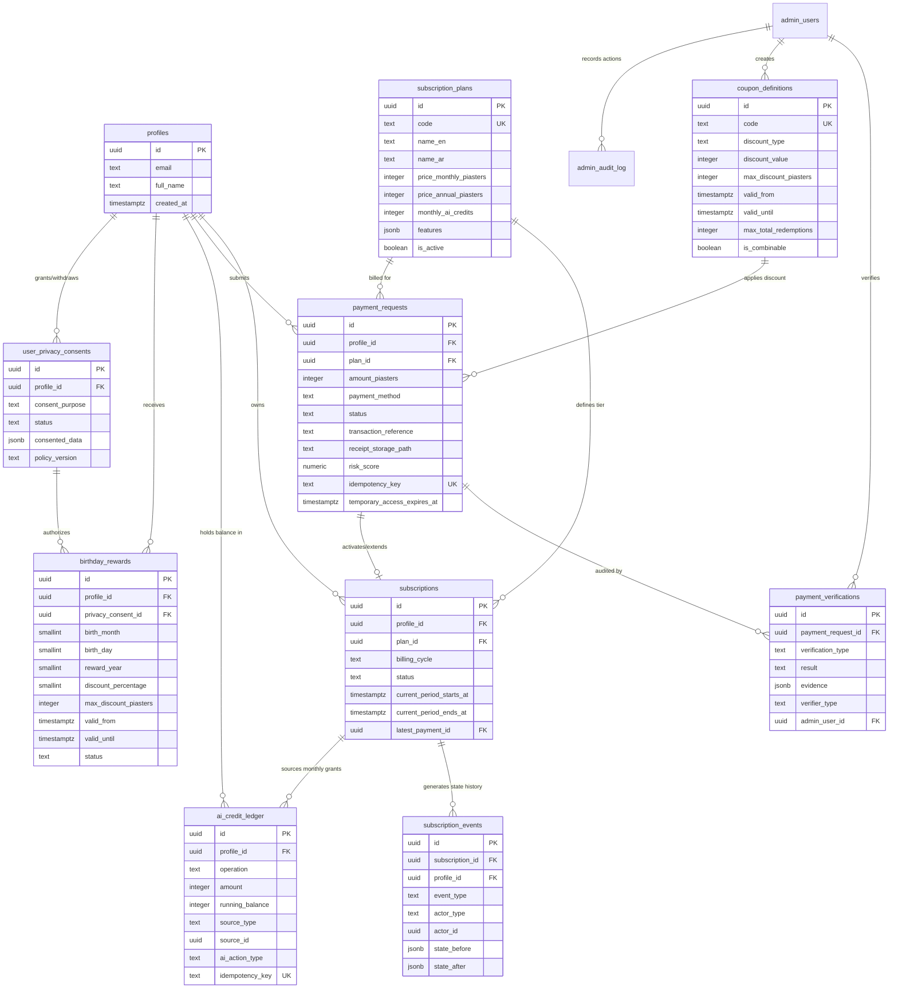
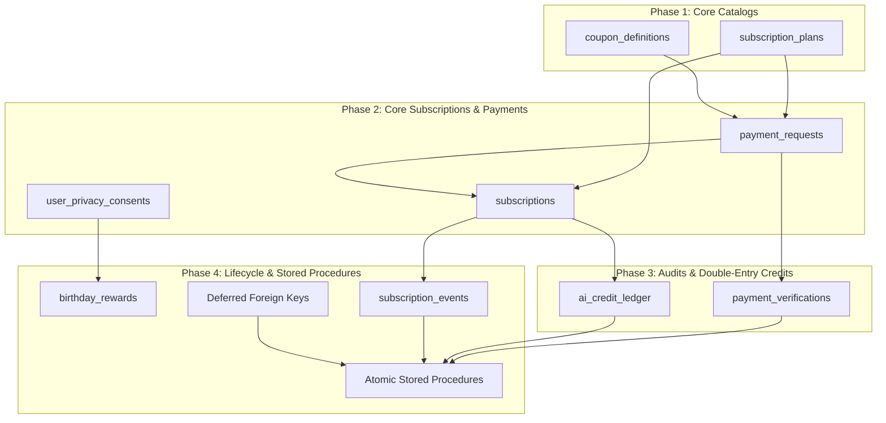
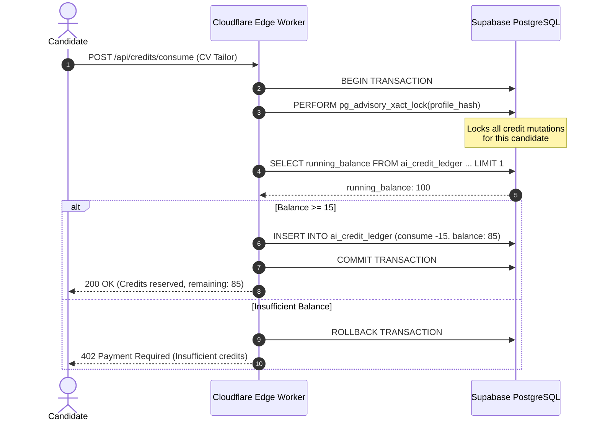

# Database Schema & Migrations Specification
## CareerDev4AI Subscription, Payment & AI Credit System

- **Document Version**: 1.0.0
- **Status**: Ready for Implementation
- **Target Runtime**: Supabase PostgreSQL 15+ / Cloudflare Workers Edge API
- **Target Directory**: `d:\Saas\careerpilot-ai\docs\subscription-system\planning\DATABASE_SCHEMA_AND_MIGRATIONS.md`
- **Applicable Standards**: Strict Typings, Explicit RLS, Immutable Ledgers, EGP Integer Piasters

---

## 1. Executive Context & Architectural Principles

This document specifies the complete database architecture, PostgreSQL Data Definition Language (DDL), Row Level Security (RLS) policies, atomic stored procedures, index justifications, migration phasing, rollback strategies, and concurrency controls for the CareerDev4AI Subscription, Payment, and AI Credit System.

### 1.1 Facts, Assumptions, and Recommendations

To maintain absolute architectural clarity across engineering teams, the requirements and design decisions are partitioned into verified facts, documented assumptions, and recommended operational practices.

```
┌─────────────────────────────────────────────────────────────────────────────┐
│                       ARCHITECTURAL CLASSIFICATION                          │
├──────────────────────────┬──────────────────────────┬───────────────────────┤
│     VERIFIED FACTS       │       ASSUMPTIONS        │    RECOMMENDATIONS    │
├──────────────────────────┼──────────────────────────┼───────────────────────┤
│ • Supabase Postgres 15+  │ • Manual Egypt payment   │ • Store currency in   │
│ • Existing auth.users    │   review window: 24h     │   integer piasters    │
│ • profiles (PK=auth.uid) │ • Vodafone Cash/InstaPay │ • Advisory locking on │
│ • Cloudflare Queues      │   require receipt upload │   profile credits     │
│ • Strict RLS mandatory   │ • Birthday rewards omit  │ • Double-entry credit │
│ • No floating point EGP  │   year for privacy       │   ledger balances     │
└──────────────────────────┴──────────────────────────┴───────────────────────┘
```

#### Verified Facts (Existing Codebase)
1. **User Identity Baseline**: User identities originate from `auth.users`, whose UUID primary key is mirrored 1:1 into `public.profiles(id)` via an automatic trigger, established in [20251019000000_fresh_project_baseline.sql](file:///d:/Saas/careerpilot-ai/supabase/migrations/20251019000000_fresh_project_baseline.sql#L29-L56).
2. **Administrative Role Hierarchy**: Administrative privileges and role checks reside in `public.admin_users`, established in [20261102000006_admin_communication.sql](file:///d:/Saas/careerpilot-ai/supabase/migrations/20261102000006_admin_communication.sql#L24-L42). Permitted roles are `super_admin`, `content_admin`, `opportunity_admin`, and `moderator`.
3. **Audit Logging Standard**: All administrative interventions must record an entry in `public.admin_audit_log`, established in [20261102000006_admin_communication.sql](file:///d:/Saas/careerpilot-ai/supabase/migrations/20261102000006_admin_communication.sql#L100-L125) and hardened in [20261104000001_admin_audit_log_grants.sql](file:///d:/Saas/careerpilot-ai/supabase/migrations/20261104000001_admin_audit_log_grants.sql).
4. **Trigger Infrastructure**: Standard automatic timestamp updates utilize the existing database trigger function `public.careerpilot_set_updated_at()`, defined in [20251019000000_fresh_project_baseline.sql](file:///d:/Saas/careerpilot-ai/supabase/migrations/20251019000000_fresh_project_baseline.sql#L278-L285).
5. **Background Task Transport**: Durable asynchronous executions rely on `public.background_jobs` and Cloudflare Queues with consumer state tracking in `public.background_job_consumers`, detailed in [20261104000002_background_jobs.sql](file:///d:/Saas/careerpilot-ai/supabase/migrations/20261104000002_background_jobs.sql) and [20261106000001_background_jobs_queue.sql](file:///d:/Saas/careerpilot-ai/supabase/migrations/20261106000001_background_jobs_queue.sql).
6. **Existing Legal Consent**: General Terms of Service and Privacy Policy agreements are tracked in `public.user_consents`, established in [20261103000002_consent_onboarding_and_packages.sql](file:///d:/Saas/careerpilot-ai/supabase/migrations/20261103000002_consent_onboarding_and_packages.sql#L25-L35).
7. **User Notification Pipeline**: Notifications are delivered through `public.notifications` (and `public.announcements`), established in [202510200006_notifications.sql](file:///d:/Saas/careerpilot-ai/supabase/migrations/202510200006_notifications.sql).

#### Assumptions
1. **Egyptian Payment Gateway Landscape**: In the Egyptian market, automated card gateways often suffer high rejection rates. Egyptian users heavily utilize peer-to-peer manual transfers (Vodafone Cash and InstaPay). Payment submission involves user-uploaded transaction reference numbers and receipt screenshots stored in Supabase Storage.
2. **Temporary Access Grace Period**: To prevent candidate friction while administrators verify receipts, candidates submitting manual payment receipts may be granted a strictly time-bounded 24-hour `temporary_access` status.
3. **Privacy Compliance (No Birth Year)**: Storing a candidate's full date of birth is legally sensitive and poses age discrimination risks. For birthday rewards, candidates provide only birth month and birth day (1–12, 1–31). Birth year is never captured.

#### Recommendations
1. **Monetary Precision via Integer Piasters**: To completely eradicate IEEE 754 floating-point inaccuracies, all monetary values must be stored as signed integers representing Egyptian Piasters (1 EGP = 100 Piasters). For instance, 150.00 EGP is stored as `15000`.
2. **Double-Entry Credit Ledger**: AI credits must never be managed through an un-audited counter on `profiles`. Every addition and deduction must exist as an immutable row in `public.ai_credit_ledger` with an atomic check preventing negative balances.
3. **Advisory Locks for Credit Operations**: Concurrent AI requests from a single user profile must be serialized via PostgreSQL transaction-level advisory locks (`pg_advisory_xact_lock`) keyed on the candidate's UUID hash.

---

### 1.2 Entity Relationship Diagram (ERD)

The following diagram illustrates the relationship between the existing baseline tables (`profiles`, `admin_users`, `admin_audit_log`, `notifications`) and the 9 new subscription and payment tables.



---

## 2. Comprehensive Table Specifications

### 2.1 Table 1: `subscription_plans` (Plan Catalog)

#### 1. Purpose & Domain Role
The `subscription_plans` table serves as the authoritative product catalog for all tiers on CareerDev4AI (`free`, `student`, `pro`, `career_plus`). It holds monthly and annual pricing in integer piasters, monthly AI credit allocations, feature toggle payloads, and soft-delete visibility flags.

#### 2. DDL Statement
```sql
CREATE TABLE IF NOT EXISTS public.subscription_plans (
  id uuid PRIMARY KEY DEFAULT gen_random_uuid(),
  code text NOT NULL,
  name_en text NOT NULL,
  name_ar text NOT NULL,
  description_en text,
  description_ar text,
  price_monthly_piasters integer NOT NULL DEFAULT 0,
  price_annual_piasters integer NOT NULL DEFAULT 0,
  currency text NOT NULL DEFAULT 'EGP',
  monthly_ai_credits integer NOT NULL DEFAULT 0,
  features jsonb NOT NULL DEFAULT '{}'::jsonb,
  sort_order integer NOT NULL DEFAULT 0,
  is_active boolean NOT NULL DEFAULT true,
  created_at timestamptz NOT NULL DEFAULT now(),
  updated_at timestamptz NOT NULL DEFAULT now(),
  
  -- Constraints
  CONSTRAINT subscription_plans_code_key UNIQUE (code),
  CONSTRAINT subscription_plans_currency_check CHECK (currency = 'EGP'),
  CONSTRAINT subscription_plans_price_monthly_check CHECK (price_monthly_piasters >= 0),
  CONSTRAINT subscription_plans_price_annual_check CHECK (price_annual_piasters >= 0),
  CONSTRAINT subscription_plans_credits_check CHECK (monthly_ai_credits >= 0),
  CONSTRAINT subscription_plans_code_vocab_check CHECK (
    code IN ('free', 'student', 'pro', 'career_plus')
  )
);
```

#### 3. Indexes & Rationale
```sql
-- Fast lookup for active plans displayed in pricing matrix sorted by display order
CREATE INDEX IF NOT EXISTS idx_subscription_plans_active_sort 
  ON public.subscription_plans (is_active, sort_order ASC);
```
*Rationale*: Landing pages and upgrade modals query exclusively for `is_active = true` ordered by `sort_order`.

#### 4. Row Level Security (RLS)
```sql
ALTER TABLE public.subscription_plans ENABLE ROW LEVEL SECURITY;

-- Anonymous and authenticated candidates may read active plans
CREATE POLICY subscription_plans_select_active ON public.subscription_plans
  FOR SELECT TO anon, authenticated
  USING (is_active = true);

-- Administrative users may view all plans (active and inactive)
CREATE POLICY subscription_plans_admin_select ON public.subscription_plans
  FOR SELECT TO authenticated
  USING (
    EXISTS (
      SELECT 1 FROM public.admin_users au 
      WHERE au.profile_id = auth.uid() AND au.status = 'active'
    )
  );

-- Only Super Admins may modify plan configurations
CREATE POLICY subscription_plans_admin_manage ON public.subscription_plans
  FOR ALL TO authenticated
  USING (
    EXISTS (
      SELECT 1 FROM public.admin_users au 
      WHERE au.profile_id = auth.uid() 
        AND au.status = 'active' 
        AND au.role = 'super_admin'
    )
  )
  WITH CHECK (
    EXISTS (
      SELECT 1 FROM public.admin_users au 
      WHERE au.profile_id = auth.uid() 
        AND au.status = 'active' 
        AND au.role = 'super_admin'
    )
  );
```

#### 5. Grants & Triggers
```sql
GRANT SELECT ON public.subscription_plans TO anon, authenticated;
GRANT ALL ON public.subscription_plans TO service_role;

CREATE OR REPLACE TRIGGER trg_subscription_plans_updated_at
  BEFORE UPDATE ON public.subscription_plans
  FOR EACH ROW
  EXECUTE FUNCTION public.careerpilot_set_updated_at();
```

---

### 2.2 Table 2: `subscriptions` (User Active Subscriptions)

#### 1. Purpose & Domain Role
The `subscriptions` table tracks candidates' active tier status. It enforces that a user has at most **one** active subscription at any time using a PostgreSQL partial unique index.

#### 2. DDL Statement
```sql
CREATE TABLE IF NOT EXISTS public.subscriptions (
  id uuid PRIMARY KEY DEFAULT gen_random_uuid(),
  profile_id uuid NOT NULL REFERENCES public.profiles(id) ON DELETE CASCADE,
  plan_id uuid NOT NULL REFERENCES public.subscription_plans(id) ON DELETE RESTRICT,
  billing_cycle text NOT NULL DEFAULT 'monthly',
  status text NOT NULL DEFAULT 'active',
  current_period_starts_at timestamptz NOT NULL DEFAULT now(),
  current_period_ends_at timestamptz NOT NULL,
  cancelled_at timestamptz,
  cancellation_reason text,
  ended_at timestamptz,
  latest_payment_id uuid, -- FK added after payment_requests created
  auto_renew boolean NOT NULL DEFAULT false,
  metadata jsonb NOT NULL DEFAULT '{}'::jsonb,
  created_at timestamptz NOT NULL DEFAULT now(),
  updated_at timestamptz NOT NULL DEFAULT now(),

  -- Constraints
  CONSTRAINT subscriptions_billing_cycle_check CHECK (billing_cycle IN ('monthly', 'annual')),
  CONSTRAINT subscriptions_status_check CHECK (
    status IN ('active', 'expired', 'cancelled', 'suspended')
  ),
  CONSTRAINT subscriptions_period_validity CHECK (
    current_period_ends_at > current_period_starts_at
  )
);
```

#### 3. Indexes & Rationale
```sql
-- Crucial: Enforces exactly ONE active subscription per candidate
CREATE UNIQUE INDEX IF NOT EXISTS idx_subscriptions_one_active_per_user
  ON public.subscriptions (profile_id)
  WHERE (status = 'active');

-- Index for expiration sweeps and cron maintenance
CREATE INDEX IF NOT EXISTS idx_subscriptions_active_expiration
  ON public.subscriptions (status, current_period_ends_at)
  WHERE (status = 'active');

-- Foreign key lookup for candidate history
CREATE INDEX IF NOT EXISTS idx_subscriptions_profile_history
  ON public.subscriptions (profile_id, created_at DESC);
```
*Rationale*: The partial unique index guarantees data integrity against double-billing race conditions at the database level. The active expiration index allows $O(\log N)$ batch queries by expiration workers.

#### 4. Row Level Security (RLS)
```sql
ALTER TABLE public.subscriptions ENABLE ROW LEVEL SECURITY;

-- Candidates can view their own subscriptions
CREATE POLICY subscriptions_select_own ON public.subscriptions
  FOR SELECT TO authenticated
  USING (auth.uid() = profile_id);

-- Subscriptions cannot be directly inserted or modified by clients; mutations go via server/Edge functions
CREATE POLICY subscriptions_admin_select ON public.subscriptions
  FOR SELECT TO authenticated
  USING (
    EXISTS (
      SELECT 1 FROM public.admin_users au 
      WHERE au.profile_id = auth.uid() AND au.status = 'active'
    )
  );
```

#### 5. Grants & Triggers
```sql
GRANT SELECT ON public.subscriptions TO authenticated;
GRANT ALL ON public.subscriptions TO service_role;

CREATE OR REPLACE TRIGGER trg_subscriptions_updated_at
  BEFORE UPDATE ON public.subscriptions
  FOR EACH ROW
  EXECUTE FUNCTION public.careerpilot_set_updated_at();
```

---

### 2.3 Table 3: `payment_requests` (Manual Payment Submissions)

#### 1. Purpose & Domain Role
The `payment_requests` table records all payment intents and submissions. In the Egyptian market, this accommodates Vodafone Cash wallet transfers and InstaPay IPA/account transfers, storing user-submitted transaction references and receipt image storage paths. It supports a 24-hour temporary access window and automated risk scoring.

#### 2. DDL Statement
```sql
CREATE TABLE IF NOT EXISTS public.payment_requests (
  id uuid PRIMARY KEY DEFAULT gen_random_uuid(),
  profile_id uuid NOT NULL REFERENCES public.profiles(id) ON DELETE CASCADE,
  plan_id uuid NOT NULL REFERENCES public.subscription_plans(id) ON DELETE RESTRICT,
  billing_cycle text NOT NULL DEFAULT 'monthly',
  original_amount_piasters integer NOT NULL,
  discount_amount_piasters integer NOT NULL DEFAULT 0,
  amount_piasters integer NOT NULL,
  currency text NOT NULL DEFAULT 'EGP',
  coupon_id uuid, -- FK added after coupon_definitions created
  payment_method text NOT NULL,
  status text NOT NULL DEFAULT 'pending',
  transaction_reference text,
  sender_phone_or_handle text,
  receipt_storage_path text,
  receipt_filename text,
  receipt_content_type text,
  receipt_size_bytes integer,
  risk_score numeric(5,2) NOT NULL DEFAULT 0.00,
  risk_flags jsonb NOT NULL DEFAULT '[]'::jsonb,
  idempotency_key text NOT NULL,
  temporary_access_granted_at timestamptz,
  temporary_access_expires_at timestamptz,
  review_notes text,
  rejection_reason text,
  reviewed_by uuid REFERENCES public.admin_users(id) ON DELETE SET NULL,
  reviewed_at timestamptz,
  paid_at timestamptz,
  expires_at timestamptz NOT NULL,
  created_at timestamptz NOT NULL DEFAULT now(),
  updated_at timestamptz NOT NULL DEFAULT now(),

  -- Constraints
  CONSTRAINT payment_requests_idempotency_key UNIQUE (idempotency_key),
  CONSTRAINT payment_requests_currency_check CHECK (currency = 'EGP'),
  CONSTRAINT payment_requests_amounts_check CHECK (
    original_amount_piasters >= 0 AND
    discount_amount_piasters >= 0 AND
    amount_piasters >= 0 AND
    amount_piasters = (original_amount_piasters - discount_amount_piasters)
  ),
  CONSTRAINT payment_requests_billing_cycle_check CHECK (
    billing_cycle IN ('monthly', 'annual')
  ),
  CONSTRAINT payment_requests_payment_method_check CHECK (
    payment_method IN ('vodafone_cash', 'instapay')
  ),
  CONSTRAINT payment_requests_status_check CHECK (
    status IN (
      'pending',
      'under_review',
      'temporary_access',
      'paid',
      'rejected',
      'expired',
      'refunded'
    )
  ),
  CONSTRAINT payment_requests_risk_score_check CHECK (
    risk_score >= 0.00 AND risk_score <= 100.00
  )
);
```

#### 3. Indexes & Rationale
```sql
-- Lookup for user's pending or current submissions
CREATE INDEX IF NOT EXISTS idx_payment_requests_profile_status
  ON public.payment_requests (profile_id, status, created_at DESC);

-- Fast queue scanning for administrators reviewing manual transfers
CREATE INDEX IF NOT EXISTS idx_payment_requests_admin_queue
  ON public.payment_requests (status, created_at ASC)
  WHERE (status IN ('under_review', 'temporary_access'));

-- Fast background sweeper for expiring 24-hr temporary access
CREATE INDEX IF NOT EXISTS idx_payment_requests_temp_access_sweep
  ON public.payment_requests (status, temporary_access_expires_at)
  WHERE (status = 'temporary_access');

-- Duplicate fraud check on transaction reference
CREATE INDEX IF NOT EXISTS idx_payment_requests_tx_reference
  ON public.payment_requests (payment_method, lower(trim(transaction_reference)))
  WHERE (transaction_reference IS NOT NULL AND status IN ('paid', 'under_review', 'temporary_access'));
```
*Rationale*: The admin queue index allows immediate dispatch of unverified receipts. The duplicate check index allows near-instant verification of whether a Vodafone Cash reference ID has been submitted previously.

#### 4. Row Level Security (RLS)
```sql
ALTER TABLE public.payment_requests ENABLE ROW LEVEL SECURITY;

-- Candidates can view their own payment requests
CREATE POLICY payment_requests_select_own ON public.payment_requests
  FOR SELECT TO authenticated
  USING (auth.uid() = profile_id);

-- Candidates can create payment requests for their own account
CREATE POLICY payment_requests_insert_own ON public.payment_requests
  FOR INSERT TO authenticated
  WITH CHECK (
    auth.uid() = profile_id AND
    status IN ('pending', 'under_review')
  );

-- Candidates may update receipt details on pending submissions
CREATE POLICY payment_requests_update_own ON public.payment_requests
  FOR UPDATE TO authenticated
  USING (auth.uid() = profile_id AND status = 'pending')
  WITH CHECK (auth.uid() = profile_id AND status IN ('pending', 'under_review'));

-- Administrative staff can select and update all requests
CREATE POLICY payment_requests_admin_all ON public.payment_requests
  FOR ALL TO authenticated
  USING (
    EXISTS (
      SELECT 1 FROM public.admin_users au 
      WHERE au.profile_id = auth.uid() AND au.status = 'active'
    )
  )
  WITH CHECK (
    EXISTS (
      SELECT 1 FROM public.admin_users au 
      WHERE au.profile_id = auth.uid() AND au.status = 'active'
    )
  );
```

#### 5. Grants & Triggers
```sql
GRANT SELECT, INSERT, UPDATE ON public.payment_requests TO authenticated;
GRANT ALL ON public.payment_requests TO service_role;

CREATE OR REPLACE TRIGGER trg_payment_requests_updated_at
  BEFORE UPDATE ON public.payment_requests
  FOR EACH ROW
  EXECUTE FUNCTION public.careerpilot_set_updated_at();
```

---

### 2.4 Table 4: `payment_verifications` (Verification Audit Trail)

#### 1. Purpose & Domain Role
The `payment_verifications` table maintains an immutable audit trail of automated checks (OCR text matching, duplicate reference checks, amount checks) and manual administrator actions against payment requests.

#### 2. DDL Statement
```sql
CREATE TABLE IF NOT EXISTS public.payment_verifications (
  id uuid PRIMARY KEY DEFAULT gen_random_uuid(),
  payment_request_id uuid NOT NULL REFERENCES public.payment_requests(id) ON DELETE CASCADE,
  verification_type text NOT NULL,
  result text NOT NULL,
  confidence_score numeric(5,2),
  evidence jsonb NOT NULL DEFAULT '{}'::jsonb,
  verifier_type text NOT NULL,
  admin_user_id uuid REFERENCES public.admin_users(id) ON DELETE SET NULL,
  created_at timestamptz NOT NULL DEFAULT now(),

  -- Constraints
  CONSTRAINT payment_verifications_type_check CHECK (
    verification_type IN (
      'ocr',
      'duplicate_check',
      'amount_check',
      'admin_manual',
      'admin_confirm'
    )
  ),
  CONSTRAINT payment_verifications_result_check CHECK (
    result IN ('pass', 'fail', 'inconclusive')
  ),
  CONSTRAINT payment_verifications_verifier_type_check CHECK (
    verifier_type IN ('system', 'admin')
  ),
  CONSTRAINT payment_verifications_confidence_check CHECK (
    confidence_score IS NULL OR (confidence_score >= 0.00 AND confidence_score <= 100.00)
  )
);
```

#### 3. Indexes & Rationale
```sql
-- Fast lookup of all verification steps for a payment request
CREATE INDEX IF NOT EXISTS idx_payment_verifications_request_id
  ON public.payment_verifications (payment_request_id, created_at ASC);

-- Audit query for admin activities
CREATE INDEX IF NOT EXISTS idx_payment_verifications_admin_audit
  ON public.payment_verifications (admin_user_id, created_at DESC)
  WHERE (admin_user_id IS NOT NULL);
```
*Rationale*: Provides chronological replay of receipt OCR and duplicate detection steps during administrator adjudication.

#### 4. Row Level Security (RLS)
```sql
ALTER TABLE public.payment_verifications ENABLE ROW LEVEL SECURITY;

-- Candidates can view verification outcomes of their own payment requests
CREATE POLICY payment_verifications_select_own ON public.payment_verifications
  FOR SELECT TO authenticated
  USING (
    EXISTS (
      SELECT 1 FROM public.payment_requests pr
      WHERE pr.id = payment_verifications.payment_request_id
        AND pr.profile_id = auth.uid()
    )
  );

-- Administrators have full read access
CREATE POLICY payment_verifications_admin_select ON public.payment_verifications
  FOR SELECT TO authenticated
  USING (
    EXISTS (
      SELECT 1 FROM public.admin_users au 
      WHERE au.profile_id = auth.uid() AND au.status = 'active'
    )
  );

-- Only administrators or service role can insert verification rows
CREATE POLICY payment_verifications_admin_insert ON public.payment_verifications
  FOR INSERT TO authenticated
  WITH CHECK (
    EXISTS (
      SELECT 1 FROM public.admin_users au 
      WHERE au.profile_id = auth.uid() AND au.status = 'active'
    )
  );
```

#### 5. Grants & Triggers
```sql
GRANT SELECT ON public.payment_verifications TO authenticated;
GRANT ALL ON public.payment_verifications TO service_role;
-- Note: payment_verifications is an immutable audit log; updates and deletes are prohibited.
```

---

### 2.5 Table 5: `ai_credit_ledger` (Double-Entry Credit Tracking)

#### 1. Purpose & Domain Role
The `ai_credit_ledger` table implements strict double-entry tracking of AI credits. Unaudited user balance increments or decrements are strictly forbidden. Every credit grant (subscription renewal, top-up, bonus) and consumption (CV generation, ATS analysis, interview mock) writes an immutable record with a calculated `running_balance`.

#### 2. DDL Statement
```sql
CREATE TABLE IF NOT EXISTS public.ai_credit_ledger (
  id uuid PRIMARY KEY DEFAULT gen_random_uuid(),
  profile_id uuid NOT NULL REFERENCES public.profiles(id) ON DELETE CASCADE,
  operation text NOT NULL,
  amount integer NOT NULL,
  running_balance integer NOT NULL,
  source_type text NOT NULL,
  source_id uuid,
  ai_action_type text,
  idempotency_key text NOT NULL,
  description text,
  metadata jsonb NOT NULL DEFAULT '{}'::jsonb,
  created_at timestamptz NOT NULL DEFAULT now(),

  -- Constraints
  CONSTRAINT ai_credit_ledger_idempotency_key UNIQUE (idempotency_key),
  CONSTRAINT ai_credit_ledger_amount_nonzero CHECK (amount <> 0),
  CONSTRAINT ai_credit_ledger_running_balance_positive CHECK (running_balance >= 0),
  CONSTRAINT ai_credit_ledger_operation_check CHECK (
    operation IN ('grant', 'consume', 'refund', 'expire', 'bonus')
  ),
  CONSTRAINT ai_credit_ledger_operation_sign_check CHECK (
    (operation IN ('grant', 'refund', 'bonus') AND amount > 0) OR
    (operation IN ('consume', 'expire') AND amount < 0)
  ),
  CONSTRAINT ai_credit_ledger_source_type_check CHECK (
    source_type IN ('subscription', 'payment', 'admin', 'system', 'onboarding', 'birthday')
  ),
  CONSTRAINT ai_credit_ledger_ai_action_type_check CHECK (
    ai_action_type IS NULL OR ai_action_type IN (
      'cv_generation',
      'cv_ats_analysis',
      'cover_letter_generation',
      'interview_mock_session',
      'roadmap_generation',
      'career_consultation_chat'
    )
  )
);
```

#### 3. Indexes & Rationale
```sql
-- Rapid balance calculation and latest running_balance check
CREATE INDEX IF NOT EXISTS idx_ai_credit_ledger_profile_created
  ON public.ai_credit_ledger (profile_id, created_at DESC);

-- Source traceability (e.g., finding credits granted by a specific subscription period)
CREATE INDEX IF NOT EXISTS idx_ai_credit_ledger_source
  ON public.ai_credit_ledger (source_type, source_id);

-- Analytics by AI operation category
CREATE INDEX IF NOT EXISTS idx_ai_credit_ledger_analytics
  ON public.ai_credit_ledger (ai_action_type, created_at)
  WHERE (ai_action_type IS NOT NULL);
```
*Rationale*: Balance verification requires querying the single latest ledger row for a candidate profile. The composite index `(profile_id, created_at DESC)` makes this an index-only scan taking < 1ms.

#### 4. Row Level Security (RLS)
```sql
ALTER TABLE public.ai_credit_ledger ENABLE ROW LEVEL SECURITY;

-- Candidates can view their own credit history
CREATE POLICY ai_credit_ledger_select_own ON public.ai_credit_ledger
  FOR SELECT TO authenticated
  USING (auth.uid() = profile_id);

-- Administrative staff can inspect any candidate's ledger
CREATE POLICY ai_credit_ledger_admin_select ON public.ai_credit_ledger
  FOR SELECT TO authenticated
  USING (
    EXISTS (
      SELECT 1 FROM public.admin_users au 
      WHERE au.profile_id = auth.uid() AND au.status = 'active'
    )
  );

-- Direct client INSERT/UPDATE/DELETE is strictly forbidden; mutations occur via stored procedures
```

#### 5. Grants & Triggers
```sql
GRANT SELECT ON public.ai_credit_ledger TO authenticated;
GRANT ALL ON public.ai_credit_ledger TO service_role;
-- Table is append-only. No UPDATE or DELETE grants are given to anyone except service_role.
```

---

### 2.6 Table 6: `coupon_definitions` (Promotions & Discounts)

#### 1. Purpose & Domain Role
The `coupon_definitions` table governs promotional campaign discounts. It supports both percentage and fixed-amount discounts, maximum discount caps (in piasters), time windows, redemption limits, plan restrictions, and non-stackable flags.

#### 2. DDL Statement
```sql
CREATE TABLE IF NOT EXISTS public.coupon_definitions (
  id uuid PRIMARY KEY DEFAULT gen_random_uuid(),
  code text NOT NULL,
  discount_type text NOT NULL,
  discount_value integer NOT NULL,
  max_discount_piasters integer,
  min_order_piasters integer NOT NULL DEFAULT 0,
  valid_from timestamptz NOT NULL,
  valid_until timestamptz NOT NULL,
  max_total_redemptions integer,
  max_redemptions_per_user integer NOT NULL DEFAULT 1,
  times_redeemed integer NOT NULL DEFAULT 0,
  applicable_plan_ids uuid[] NOT NULL DEFAULT '{}'::uuid[],
  is_combinable boolean NOT NULL DEFAULT false,
  is_active boolean NOT NULL DEFAULT true,
  created_by uuid REFERENCES public.admin_users(id) ON DELETE SET NULL,
  created_at timestamptz NOT NULL DEFAULT now(),
  updated_at timestamptz NOT NULL DEFAULT now(),

  -- Constraints
  CONSTRAINT coupon_definitions_discount_type_check CHECK (
    discount_type IN ('percentage', 'fixed_amount')
  ),
  CONSTRAINT coupon_definitions_discount_value_check CHECK (
    discount_value > 0 AND
    (discount_type <> 'percentage' OR discount_value <= 100)
  ),
  CONSTRAINT coupon_definitions_max_discount_check CHECK (
    max_discount_piasters IS NULL OR max_discount_piasters > 0
  ),
  CONSTRAINT coupon_definitions_min_order_check CHECK (
    min_order_piasters >= 0
  ),
  CONSTRAINT coupon_definitions_validity_window CHECK (
    valid_until > valid_from
  ),
  CONSTRAINT coupon_definitions_redemptions_check CHECK (
    (max_total_redemptions IS NULL OR max_total_redemptions > 0) AND
    max_redemptions_per_user > 0 AND
    times_redeemed >= 0
  )
);
```

#### 3. Indexes & Rationale
```sql
-- Case-insensitive unique index on coupon code
CREATE UNIQUE INDEX IF NOT EXISTS idx_coupon_definitions_code_upper
  ON public.coupon_definitions (upper(trim(code)));

-- Fast lookup for active valid coupons
CREATE INDEX IF NOT EXISTS idx_coupon_definitions_valid_window
  ON public.coupon_definitions (is_active, valid_from, valid_until);
```
*Rationale*: Egyptian candidates type coupon codes interchangeably in uppercase or lowercase (e.g., `LAUNCH2026` vs `launch2026`). An expression index guarantees case-insensitive uniqueness and fast lookups.

#### 4. Row Level Security (RLS)
```sql
ALTER TABLE public.coupon_definitions ENABLE ROW LEVEL SECURITY;

-- Candidates can view active valid coupons during checkout validation
CREATE POLICY coupon_definitions_select_active ON public.coupon_definitions
  FOR SELECT TO authenticated
  USING (
    is_active = true AND
    now() BETWEEN valid_from AND valid_until
  );

-- Administrative users can inspect and manage all coupons
CREATE POLICY coupon_definitions_admin_all ON public.coupon_definitions
  FOR ALL TO authenticated
  USING (
    EXISTS (
      SELECT 1 FROM public.admin_users au 
      WHERE au.profile_id = auth.uid() AND au.status = 'active'
    )
  )
  WITH CHECK (
    EXISTS (
      SELECT 1 FROM public.admin_users au 
      WHERE au.profile_id = auth.uid() AND au.status = 'active'
    )
  );
```

#### 5. Grants & Triggers
```sql
GRANT SELECT ON public.coupon_definitions TO authenticated;
GRANT ALL ON public.coupon_definitions TO service_role;

CREATE OR REPLACE TRIGGER trg_coupon_definitions_updated_at
  BEFORE UPDATE ON public.coupon_definitions
  FOR EACH ROW
  EXECUTE FUNCTION public.careerpilot_set_updated_at();
```

---

### 2.7 Table 7: `birthday_rewards` (Annual Candidate Discount)

#### 1. Purpose & Domain Role
The `birthday_rewards` table manages annual 30% discount rewards (capped at 100 EGP / 10,000 piasters) for candidates celebrating their birthday. In accordance with Egypt Data Protection Law (Law No. 151 of 2020), **no birth year is stored**. Candidates explicitly opt-in via privacy consent. The table strictly enforces one birthday reward per candidate per calendar year.

#### 2. DDL Statement
```sql
CREATE TABLE IF NOT EXISTS public.birthday_rewards (
  id uuid PRIMARY KEY DEFAULT gen_random_uuid(),
  profile_id uuid NOT NULL REFERENCES public.profiles(id) ON DELETE CASCADE,
  privacy_consent_id uuid NOT NULL REFERENCES public.user_privacy_consents(id) ON DELETE RESTRICT,
  birth_month smallint NOT NULL,
  birth_day smallint NOT NULL,
  reward_year smallint NOT NULL,
  discount_percentage smallint NOT NULL DEFAULT 30,
  max_discount_piasters integer NOT NULL DEFAULT 10000, -- 100.00 EGP
  valid_from timestamptz NOT NULL,
  valid_until timestamptz NOT NULL,
  is_combinable boolean NOT NULL DEFAULT false,
  status text NOT NULL DEFAULT 'available',
  redeemed_at timestamptz,
  redeemed_payment_id uuid REFERENCES public.payment_requests(id) ON DELETE SET NULL,
  created_at timestamptz NOT NULL DEFAULT now(),

  -- Constraints
  CONSTRAINT birthday_rewards_month_check CHECK (birth_month BETWEEN 1 AND 12),
  CONSTRAINT birthday_rewards_day_check CHECK (birth_day BETWEEN 1 AND 31),
  CONSTRAINT birthday_rewards_year_check CHECK (reward_year >= 2026),
  CONSTRAINT birthday_rewards_one_per_user_year UNIQUE (profile_id, reward_year),
  CONSTRAINT birthday_rewards_discount_percent_check CHECK (discount_percentage = 30),
  CONSTRAINT birthday_rewards_max_discount_check CHECK (max_discount_piasters = 10000),
  CONSTRAINT birthday_rewards_non_combinable CHECK (is_combinable = false),
  CONSTRAINT birthday_rewards_status_check CHECK (
    status IN ('available', 'redeemed', 'expired')
  ),
  CONSTRAINT birthday_rewards_validity_window CHECK (valid_until > valid_from)
);
```

#### 3. Indexes & Rationale
```sql
-- Fast checking of candidate's available rewards
CREATE INDEX IF NOT EXISTS idx_birthday_rewards_profile_status
  ON public.birthday_rewards (profile_id, status, valid_until)
  WHERE (status = 'available');

-- Daily batch job search for candidates whose birthday window begins
CREATE INDEX IF NOT EXISTS idx_birthday_rewards_calendar_search
  ON public.birthday_rewards (birth_month, birth_day, reward_year);
```
*Rationale*: Enables rapid checkout verification of whether the user possesses an unexpired birthday reward for the current year.

#### 4. Row Level Security (RLS)
```sql
ALTER TABLE public.birthday_rewards ENABLE ROW LEVEL SECURITY;

-- Candidates can view their own birthday rewards
CREATE POLICY birthday_rewards_select_own ON public.birthday_rewards
  FOR SELECT TO authenticated
  USING (auth.uid() = profile_id);

-- Administrators can view all rewards
CREATE POLICY birthday_rewards_admin_select ON public.birthday_rewards
  FOR SELECT TO authenticated
  USING (
    EXISTS (
      SELECT 1 FROM public.admin_users au 
      WHERE au.profile_id = auth.uid() AND au.status = 'active'
    )
  );

-- Direct client insertion/modification is blocked; managed by backend routines
```

#### 5. Grants & Triggers
```sql
GRANT SELECT ON public.birthday_rewards TO authenticated;
GRANT ALL ON public.birthday_rewards TO service_role;
```

---

### 2.8 Table 8: `subscription_events` (Event Sourcing & State Audit)

#### 1. Purpose & Domain Role
The `subscription_events` table captures an append-only event stream of all subscription lifecycle transitions (`created`, `activated`, `renewed`, `upgraded`, `downgraded`, `expired`, `cancelled`, `suspended`, `restored`). Each row stores full `state_before` and `state_after` JSONB snapshots for forensic auditing.

#### 2. DDL Statement
```sql
CREATE TABLE IF NOT EXISTS public.subscription_events (
  id uuid PRIMARY KEY DEFAULT gen_random_uuid(),
  subscription_id uuid NOT NULL REFERENCES public.subscriptions(id) ON DELETE CASCADE,
  profile_id uuid NOT NULL REFERENCES public.profiles(id) ON DELETE CASCADE,
  event_type text NOT NULL,
  actor_type text NOT NULL,
  actor_id uuid,
  state_before jsonb,
  state_after jsonb NOT NULL,
  payment_request_id uuid REFERENCES public.payment_requests(id) ON DELETE SET NULL,
  reason text,
  metadata jsonb NOT NULL DEFAULT '{}'::jsonb,
  created_at timestamptz NOT NULL DEFAULT now(),

  -- Constraints
  CONSTRAINT subscription_events_type_check CHECK (
    event_type IN (
      'created',
      'activated',
      'renewed',
      'upgraded',
      'downgraded',
      'expired',
      'cancelled',
      'suspended',
      'restored'
    )
  ),
  CONSTRAINT subscription_events_actor_type_check CHECK (
    actor_type IN ('user', 'admin', 'system', 'cron')
  )
);
```

#### 3. Indexes & Rationale
```sql
-- Chronological event timeline for a specific subscription
CREATE INDEX IF NOT EXISTS idx_subscription_events_subscription_id
  ON public.subscription_events (subscription_id, created_at ASC);

-- Chronological audit timeline for a candidate
CREATE INDEX IF NOT EXISTS idx_subscription_events_profile_id
  ON public.subscription_events (profile_id, created_at DESC);
```
*Rationale*: Essential for reconstructing subscription state during dispute resolution and reporting MRR/churn metrics.

#### 4. Row Level Security (RLS)
```sql
ALTER TABLE public.subscription_events ENABLE ROW LEVEL SECURITY;

-- Candidates can view their own subscription event history
CREATE POLICY subscription_events_select_own ON public.subscription_events
  FOR SELECT TO authenticated
  USING (auth.uid() = profile_id);

-- Administrators have full read access
CREATE POLICY subscription_events_admin_select ON public.subscription_events
  FOR SELECT TO authenticated
  USING (
    EXISTS (
      SELECT 1 FROM public.admin_users au 
      WHERE au.profile_id = auth.uid() AND au.status = 'active'
    )
  );

-- Table is append-only; direct mutations by users are prohibited.
```

#### 5. Grants & Triggers
```sql
GRANT SELECT ON public.subscription_events TO authenticated;
GRANT ALL ON public.subscription_events TO service_role;
```

---

### 2.9 Table 9: `user_privacy_consents` (Birthday & Privacy Consents)

#### 1. Purpose & Domain Role
The `user_privacy_consents` table manages explicit, revocable consents distinct from general legal terms (which are tracked in `public.user_consents`). It specifically logs consent for storing birth day/month for birthday rewards and special AI processing, providing complete audit records of opt-in, data correction, and withdrawal.

#### 2. DDL Statement
```sql
CREATE TABLE IF NOT EXISTS public.user_privacy_consents (
  id uuid PRIMARY KEY DEFAULT gen_random_uuid(),
  profile_id uuid NOT NULL REFERENCES public.profiles(id) ON DELETE CASCADE,
  consent_purpose text NOT NULL,
  status text NOT NULL DEFAULT 'granted',
  consented_data jsonb NOT NULL DEFAULT '{}'::jsonb,
  policy_version text NOT NULL DEFAULT 'v1.0',
  ip_address text,
  user_agent text,
  granted_at timestamptz NOT NULL DEFAULT now(),
  withdrawn_at timestamptz,
  corrected_at timestamptz,
  created_at timestamptz NOT NULL DEFAULT now(),
  updated_at timestamptz NOT NULL DEFAULT now(),

  -- Constraints
  CONSTRAINT user_privacy_consents_purpose_check CHECK (
    consent_purpose IN (
      'birthday_reward',
      'ai_data_processing',
      'marketing_communications'
    )
  ),
  CONSTRAINT user_privacy_consents_status_check CHECK (
    status IN ('granted', 'withdrawn', 'corrected')
  )
);
```

#### 3. Indexes & Rationale
```sql
-- At most one active consent per user per purpose
CREATE UNIQUE INDEX IF NOT EXISTS idx_user_privacy_consents_active_purpose
  ON public.user_privacy_consents (profile_id, consent_purpose)
  WHERE (status = 'granted');

-- Audit history lookup
CREATE INDEX IF NOT EXISTS idx_user_privacy_consents_profile_history
  ON public.user_privacy_consents (profile_id, created_at DESC);
```
*Rationale*: Guarantees that at any point in time, a candidate has exactly one authoritative granted consent record per purpose.

#### 4. Row Level Security (RLS)
```sql
ALTER TABLE public.user_privacy_consents ENABLE ROW LEVEL SECURITY;

-- Candidates can view their own consents
CREATE POLICY user_privacy_consents_select_own ON public.user_privacy_consents
  FOR SELECT TO authenticated
  USING (auth.uid() = profile_id);

-- Candidates can grant consents
CREATE POLICY user_privacy_consents_insert_own ON public.user_privacy_consents
  FOR INSERT TO authenticated
  WITH CHECK (auth.uid() = profile_id);

-- Candidates can withdraw or correct their consents
CREATE POLICY user_privacy_consents_update_own ON public.user_privacy_consents
  FOR UPDATE TO authenticated
  USING (auth.uid() = profile_id)
  WITH CHECK (auth.uid() = profile_id);

-- Administrative staff can view consent records for legal audits
CREATE POLICY user_privacy_consents_admin_select ON public.user_privacy_consents
  FOR SELECT TO authenticated
  USING (
    EXISTS (
      SELECT 1 FROM public.admin_users au 
      WHERE au.profile_id = auth.uid() AND au.status = 'active'
    )
  );
```

#### 5. Grants & Triggers
```sql
GRANT SELECT, INSERT, UPDATE ON public.user_privacy_consents TO authenticated;
GRANT ALL ON public.user_privacy_consents TO service_role;

CREATE OR REPLACE TRIGGER trg_user_privacy_consents_updated_at
  BEFORE UPDATE ON public.user_privacy_consents
  FOR EACH ROW
  EXECUTE FUNCTION public.careerpilot_set_updated_at();
```

---

### 2.10 Deferred Foreign Keys & Inter-Table Constraints

Because circular dependencies exist between `subscriptions` and `payment_requests`, and between `payment_requests` and `coupon_definitions`, the foreign keys must be formally wired after table creation:

```sql
-- Link payment_requests to coupon_definitions
ALTER TABLE public.payment_requests
  ADD CONSTRAINT fk_payment_requests_coupon
  FOREIGN KEY (coupon_id) REFERENCES public.coupon_definitions(id)
  ON DELETE SET NULL;

-- Link subscriptions to payment_requests
ALTER TABLE public.subscriptions
  ADD CONSTRAINT fk_subscriptions_latest_payment
  FOREIGN KEY (latest_payment_id) REFERENCES public.payment_requests(id)
  ON DELETE SET NULL;
```

---

## 3. Atomic Operations as PostgreSQL Stored Procedures

All critical billing and credit transitions must execute within atomic, deterministic PostgreSQL functions with `SECURITY DEFINER` semantics and an explicit `search_path = public, pg_temp`.

```
┌─────────────────────────────────────────────────────────────────────────────┐
│                          ATOMIC OPERATIONS SUMMARY                          │
├───────────────────────────────┬─────────────────────────────┬───────────────┤
│ Function Name                 │ Primary Target Tables       │ Lock Type     │
├───────────────────────────────┼─────────────────────────────┼───────────────┤
│ confirm_payment_and_activate  │ payment_requests, sub.,     │ FOR UPDATE    │
│                               │ ai_credit_ledger, events    │ (row locks)   │
├───────────────────────────────┼─────────────────────────────┼───────────────┤
│ consume_ai_credits            │ ai_credit_ledger            │ pg_advisory   │
│                               │                             │ (profile key) │
├───────────────────────────────┼─────────────────────────────┼───────────────┤
│ refund_ai_credits             │ ai_credit_ledger            │ pg_advisory   │
│                               │                             │ (profile key) │
├───────────────────────────────┼─────────────────────────────┼───────────────┤
│ expire_subscriptions          │ subscriptions, events       │ FOR UPDATE    │
│                               │                             │ (batch cursor)│
├───────────────────────────────┼─────────────────────────────┼───────────────┤
│ expire_temporary_access       │ payment_requests, sub.      │ FOR UPDATE    │
├───────────────────────────────┼─────────────────────────────┼───────────────┤
│ late_payment_restore          │ payment_requests, sub.,     │ FOR UPDATE    │
│                               │ ai_credit_ledger, events    │ (row locks)   │
└───────────────────────────────┴─────────────────────────────┴───────────────┘
```

---

### 3.1 `confirm_payment_and_activate`

This stored procedure transitions a payment request from `pending`, `under_review`, or `temporary_access` into `paid`. In the same transaction, it activates or extends the candidate's subscription, provisions the plan's monthly AI credit allocation in the double-entry ledger, creates an audit verification row, writes a subscription event, and pushes an in-app notification.

```sql
CREATE OR REPLACE FUNCTION public.confirm_payment_and_activate(
  p_payment_id uuid,
  p_admin_id uuid,
  p_notes text DEFAULT NULL
)
RETURNS jsonb
LANGUAGE plpgsql
SECURITY DEFINER
SET search_path = public, pg_temp
AS $$
DECLARE
  v_payment public.payment_requests;
  v_plan public.subscription_plans;
  v_existing_sub public.subscriptions;
  v_sub_id uuid;
  v_period_interval interval;
  v_starts_at timestamptz;
  v_ends_at timestamptz;
  v_credit_balance integer;
  v_sub_event_type text;
  v_sub_state_before jsonb := NULL;
  v_sub_state_after jsonb;
BEGIN
  -- 1. Validate Admin Authorization
  IF p_admin_id IS NOT NULL THEN
    IF NOT EXISTS (
      SELECT 1 FROM public.admin_users
      WHERE id = p_admin_id AND status = 'active'
    ) THEN
      RAISE EXCEPTION 'Unauthorized: Active administrator record not found.';
    END IF;
  END IF;

  -- 2. Lock and retrieve Payment Request
  SELECT * INTO v_payment
  FROM public.payment_requests
  WHERE id = p_payment_id
  FOR UPDATE;

  IF NOT FOUND THEN
    RAISE EXCEPTION 'Payment request % not found.', p_payment_id;
  END IF;

  IF v_payment.status = 'paid' THEN
    RETURN jsonb_build_object('success', true, 'message', 'Payment already confirmed.');
  END IF;

  IF v_payment.status NOT IN ('pending', 'under_review', 'temporary_access') THEN
    RAISE EXCEPTION 'Cannot confirm payment with status %.', v_payment.status;
  END IF;

  -- 3. Retrieve Plan Details
  SELECT * INTO v_plan
  FROM public.subscription_plans
  WHERE id = v_payment.plan_id;

  IF NOT FOUND THEN
    RAISE EXCEPTION 'Associated subscription plan % not found.', v_payment.plan_id;
  END IF;

  -- 4. Calculate Subscription Duration
  IF v_payment.billing_cycle = 'annual' THEN
    v_period_interval := interval '1 year';
  ELSE
    v_period_interval := interval '1 month';
  END IF;

  -- 5. Lock and evaluate candidate's existing subscription
  SELECT * INTO v_existing_sub
  FROM public.subscriptions
  WHERE profile_id = v_payment.profile_id AND status = 'active'
  FOR UPDATE;

  v_starts_at := now();

  IF FOUND THEN
    v_sub_id := v_existing_sub.id;
    v_sub_state_before := to_jsonb(v_existing_sub);

    -- If candidate had temporary access or same plan, extend from max(current_period_ends_at, now())
    IF v_existing_sub.current_period_ends_at > now() AND v_existing_sub.plan_id = v_payment.plan_id THEN
      v_ends_at := v_existing_sub.current_period_ends_at + v_period_interval;
      v_sub_event_type := 'renewed';
    ELSE
      -- Upgrading or replacing existing plan
      v_ends_at := v_starts_at + v_period_interval;
      v_sub_event_type := CASE 
        WHEN v_plan.price_monthly_piasters >= (
          SELECT price_monthly_piasters FROM public.subscription_plans WHERE id = v_existing_sub.plan_id
        ) THEN 'upgraded' ELSE 'downgraded' END;
    END IF;

    UPDATE public.subscriptions
    SET plan_id = v_payment.plan_id,
        billing_cycle = v_payment.billing_cycle,
        status = 'active',
        current_period_starts_at = v_starts_at,
        current_period_ends_at = v_ends_at,
        latest_payment_id = v_payment.id,
        updated_at = now()
    WHERE id = v_sub_id
    RETURNING to_jsonb(subscriptions.*) INTO v_sub_state_after;

  ELSE
    -- Creating a brand new subscription
    v_ends_at := v_starts_at + v_period_interval;
    v_sub_event_type := 'activated';

    INSERT INTO public.subscriptions (
      profile_id,
      plan_id,
      billing_cycle,
      status,
      current_period_starts_at,
      current_period_ends_at,
      latest_payment_id
    ) VALUES (
      v_payment.profile_id,
      v_payment.plan_id,
      v_payment.billing_cycle,
      'active',
      v_starts_at,
      v_ends_at,
      v_payment.id
    )
    RETURNING id, to_jsonb(subscriptions.*) INTO v_sub_id, v_sub_state_after;
  END IF;

  -- 6. Transition Payment Request to 'paid'
  UPDATE public.payment_requests
  SET status = 'paid',
      paid_at = now(),
      reviewed_by = p_admin_id,
      reviewed_at = now(),
      review_notes = coalesce(p_notes, review_notes),
      updated_at = now()
  WHERE id = v_payment.id;

  -- 7. Insert Payment Verification Record
  INSERT INTO public.payment_verifications (
    payment_request_id,
    verification_type,
    result,
    confidence_score,
    evidence,
    verifier_type,
    admin_user_id
  ) VALUES (
    v_payment.id,
    CASE WHEN p_admin_id IS NOT NULL THEN 'admin_confirm' ELSE 'amount_check' END,
    'pass',
    100.00,
    jsonb_build_object(
      'admin_id', p_admin_id,
      'notes', p_notes,
      'confirmed_at', now()
    ),
    CASE WHEN p_admin_id IS NOT NULL THEN 'admin' ELSE 'system' END,
    p_admin_id
  );

  -- 8. Allocate Plan AI Credits in Ledger
  IF v_plan.monthly_ai_credits > 0 THEN
    -- Acquire candidate advisory lock to serialize ledger writes
    PERFORM pg_advisory_xact_lock(hashtext(v_payment.profile_id::text));

    SELECT running_balance INTO v_credit_balance
    FROM public.ai_credit_ledger
    WHERE profile_id = v_payment.profile_id
    ORDER BY created_at DESC
    LIMIT 1;

    v_credit_balance := coalesce(v_credit_balance, 0) + v_plan.monthly_ai_credits;

    INSERT INTO public.ai_credit_ledger (
      profile_id,
      operation,
      amount,
      running_balance,
      source_type,
      source_id,
      idempotency_key,
      description
    ) VALUES (
      v_payment.profile_id,
      'grant',
      v_plan.monthly_ai_credits,
      v_credit_balance,
      'subscription',
      v_sub_id,
      'grant_sub_' || v_sub_id::text || '_' || to_char(now(), 'YYYYMMDDHH24MISS'),
      'Monthly allocation for ' || v_plan.name_en
    );
  END IF;

  -- 9. Append Subscription Event
  INSERT INTO public.subscription_events (
    subscription_id,
    profile_id,
    event_type,
    actor_type,
    actor_id,
    state_before,
    state_after,
    payment_request_id,
    reason
  ) VALUES (
    v_sub_id,
    v_payment.profile_id,
    v_sub_event_type,
    CASE WHEN p_admin_id IS NOT NULL THEN 'admin' ELSE 'system' END,
    p_admin_id,
    v_sub_state_before,
    v_sub_state_after,
    v_payment.id,
    coalesce(p_notes, 'Payment confirmed successfully.')
  );

  -- 10. Send User In-App Notification
  INSERT INTO public.notifications (
    recipient_id,
    type,
    title,
    message,
    action_url
  ) VALUES (
    v_payment.profile_id,
    'payment_success',
    'Subscription Activated!',
    'Your ' || v_plan.name_en || ' plan is now active until ' || to_char(v_ends_at, 'YYYY-MM-DD') || '.',
    '/billing'
  );

  RETURN jsonb_build_object(
    'success', true,
    'subscription_id', v_sub_id,
    'status', 'active',
    'ends_at', v_ends_at
  );
END;
$$;
```

---

### 3.2 `consume_ai_credits`

Atomically validates, reserves, and deducts AI credits for high-value generative operations. It employs transaction-level advisory locks to prevent concurrent credit-exhaustion race conditions.

```sql
CREATE OR REPLACE FUNCTION public.consume_ai_credits(
  p_profile_id uuid,
  p_operation text,
  p_amount integer,
  p_idempotency_key text,
  p_metadata jsonb DEFAULT '{}'::jsonb
)
RETURNS jsonb
LANGUAGE plpgsql
SECURITY DEFINER
SET search_path = public, pg_temp
AS $$
DECLARE
  v_current_balance integer;
  v_new_balance integer;
  v_existing_ledger public.ai_credit_ledger;
BEGIN
  IF p_amount <= 0 THEN
    RAISE EXCEPTION 'Deduction amount must be strictly positive.';
  END IF;

  -- Check for existing idempotent execution
  SELECT * INTO v_existing_ledger
  FROM public.ai_credit_ledger
  WHERE idempotency_key = p_idempotency_key;

  IF FOUND THEN
    RETURN jsonb_build_object(
      'success', true,
      'idempotent_replay', true,
      'remaining_balance', v_existing_ledger.running_balance,
      'ledger_id', v_existing_ledger.id
    );
  END IF;

  -- Serialize credit mutations for this candidate profile
  PERFORM pg_advisory_xact_lock(hashtext(p_profile_id::text));

  -- Retrieve latest running balance
  SELECT running_balance INTO v_current_balance
  FROM public.ai_credit_ledger
  WHERE profile_id = p_profile_id
  ORDER BY created_at DESC
  LIMIT 1;

  v_current_balance := coalesce(v_current_balance, 0);

  IF v_current_balance < p_amount THEN
    RETURN jsonb_build_object(
      'success', false,
      'error', 'INSUFFICIENT_CREDITS',
      'current_balance', v_current_balance,
      'required_amount', p_amount
    );
  END IF;

  v_new_balance := v_current_balance - p_amount;

  INSERT INTO public.ai_credit_ledger (
    profile_id,
    operation,
    amount,
    running_balance,
    source_type,
    ai_action_type,
    idempotency_key,
    description,
    metadata
  ) VALUES (
    p_profile_id,
    'consume',
    -p_amount,
    v_new_balance,
    'system',
    p_operation,
    p_idempotency_key,
    'AI Action: ' || p_operation,
    p_metadata
  )
  RETURNING id INTO v_existing_ledger.id;

  RETURN jsonb_build_object(
    'success', true,
    'idempotent_replay', false,
    'deducted', p_amount,
    'remaining_balance', v_new_balance,
    'ledger_id', v_existing_ledger.id
  );
END;
$$;
```

---

### 3.3 `refund_ai_credits`

Restores AI credits to a candidate's ledger if an upstream Gemini AI call experiences a transient failure or model interruption.

```sql
CREATE OR REPLACE FUNCTION public.refund_ai_credits(
  p_profile_id uuid,
  p_amount integer,
  p_reason text,
  p_idempotency_key text,
  p_source_id uuid DEFAULT NULL
)
RETURNS jsonb
LANGUAGE plpgsql
SECURITY DEFINER
SET search_path = public, pg_temp
AS $$
DECLARE
  v_current_balance integer;
  v_new_balance integer;
  v_ledger_id uuid;
BEGIN
  IF p_amount <= 0 THEN
    RAISE EXCEPTION 'Refund amount must be strictly positive.';
  END IF;

  -- Check idempotency
  SELECT id INTO v_ledger_id
  FROM public.ai_credit_ledger
  WHERE idempotency_key = p_idempotency_key;

  IF FOUND THEN
    RETURN jsonb_build_object('success', true, 'idempotent_replay', true);
  END IF;

  -- Serialize candidate credit mutations
  PERFORM pg_advisory_xact_lock(hashtext(p_profile_id::text));

  SELECT running_balance INTO v_current_balance
  FROM public.ai_credit_ledger
  WHERE profile_id = p_profile_id
  ORDER BY created_at DESC
  LIMIT 1;

  v_current_balance := coalesce(v_current_balance, 0);
  v_new_balance := v_current_balance + p_amount;

  INSERT INTO public.ai_credit_ledger (
    profile_id,
    operation,
    amount,
    running_balance,
    source_type,
    source_id,
    idempotency_key,
    description
  ) VALUES (
    p_profile_id,
    'refund',
    p_amount,
    v_new_balance,
    'system',
    p_source_id,
    p_idempotency_key,
    'Refund: ' || p_reason
  )
  RETURNING id INTO v_ledger_id;

  RETURN jsonb_build_object(
    'success', true,
    'refunded', p_amount,
    'new_balance', v_new_balance,
    'ledger_id', v_ledger_id
  );
END;
$$;
```

---

### 3.4 `expire_subscriptions`

Executed on a scheduled cron worker to identify overdue subscriptions whose `current_period_ends_at < now()`, transition them to `expired`, emit event-sourcing events, and send warning notifications.

```sql
CREATE OR REPLACE FUNCTION public.expire_subscriptions()
RETURNS jsonb
LANGUAGE plpgsql
SECURITY DEFINER
SET search_path = public, pg_temp
AS $$
DECLARE
  v_sub record;
  v_count integer := 0;
BEGIN
  FOR v_sub IN
    SELECT s.*, p.code as plan_code
    FROM public.subscriptions s
    JOIN public.subscription_plans p ON p.id = s.plan_id
    WHERE s.status = 'active'
      AND s.current_period_ends_at < now()
    FOR UPDATE SKIP LOCKED
  LOOP
    -- 1. Transition status
    UPDATE public.subscriptions
    SET status = 'expired',
        ended_at = now(),
        updated_at = now()
    WHERE id = v_sub.id;

    -- 2. Emit lifecycle event
    INSERT INTO public.subscription_events (
      subscription_id,
      profile_id,
      event_type,
      actor_type,
      state_before,
      state_after,
      reason
    ) VALUES (
      v_sub.id,
      v_sub.profile_id,
      'expired',
      'cron',
      to_jsonb(v_sub),
      jsonb_build_object('status', 'expired', 'ended_at', now()),
      'Billing period ended without auto-renewal.'
    );

    -- 3. Notify Candidate
    INSERT INTO public.notifications (
      recipient_id,
      type,
      title,
      message,
      action_url
    ) VALUES (
      v_sub.profile_id,
      'subscription_expired',
      'Subscription Expired',
      'Your subscription has expired. Renew today to keep premium features.',
      '/pricing'
    );

    v_count := v_count + 1;
  END LOOP;

  RETURN jsonb_build_object('success', true, 'expired_count', v_count);
END;
$$;
```

---

### 3.5 `expire_temporary_access`

Sweeps payment submissions that were granted 24-hour temporary access but whose receipts were either rejected or unverified within the grace period.

```sql
CREATE OR REPLACE FUNCTION public.expire_temporary_access()
RETURNS jsonb
LANGUAGE plpgsql
SECURITY DEFINER
SET search_path = public, pg_temp
AS $$
DECLARE
  v_req record;
  v_count integer := 0;
BEGIN
  FOR v_req IN
    SELECT pr.*
    FROM public.payment_requests pr
    WHERE pr.status = 'temporary_access'
      AND pr.temporary_access_expires_at < now()
    FOR UPDATE SKIP LOCKED
  LOOP
    -- 1. Expire Payment Request
    UPDATE public.payment_requests
    SET status = 'expired',
        updated_at = now()
    WHERE id = v_req.id;

    -- 2. Suspend associated temporary subscription
    UPDATE public.subscriptions
    SET status = 'suspended',
        updated_at = now()
    WHERE latest_payment_id = v_req.id
      AND status = 'active';

    -- 3. Record Audit Verification
    INSERT INTO public.payment_verifications (
      payment_request_id,
      verification_type,
      result,
      evidence,
      verifier_type
    ) VALUES (
      v_req.id,
      'duplicate_check',
      'fail',
      jsonb_build_object('reason', '24-hour temporary access window elapsed without verification.'),
      'system'
    );

    -- 4. Notify Candidate
    INSERT INTO public.notifications (
      recipient_id,
      type,
      title,
      message,
      action_url
    ) VALUES (
      v_req.profile_id,
      'payment_failed',
      'Temporary Access Expired',
      'Your temporary access has elapsed. Please re-submit your receipt or contact support.',
      '/billing'
    );

    v_count := v_count + 1;
  END LOOP;

  RETURN jsonb_build_object('success', true, 'expired_count', v_count);
END;
$$;
```

---

### 3.6 `late_payment_restore`

Accommodates Egypt-specific scenarios where an administrator adjudicates a Vodafone Cash transfer or InstaPay transaction **after** the 24-hour temporary access window has already expired. It cleanly restores the payment request, creates an active subscription, provisions credits, and emits audit records.

```sql
CREATE OR REPLACE FUNCTION public.late_payment_restore(
  p_payment_id uuid,
  p_admin_id uuid,
  p_notes text DEFAULT NULL
)
RETURNS jsonb
LANGUAGE plpgsql
SECURITY DEFINER
SET search_path = public, pg_temp
AS $$
DECLARE
  v_payment public.payment_requests;
  v_result jsonb;
BEGIN
  SELECT * INTO v_payment
  FROM public.payment_requests
  WHERE id = p_payment_id
  FOR UPDATE;

  IF NOT FOUND THEN
    RAISE EXCEPTION 'Payment request % not found.', p_payment_id;
  END IF;

  IF v_payment.status <> 'expired' THEN
    RAISE EXCEPTION 'late_payment_restore can only be invoked for expired payments. Current status: %', v_payment.status;
  END IF;

  -- Re-open to under_review temporarily so confirm_payment_and_activate accepts it
  UPDATE public.payment_requests
  SET status = 'under_review',
      updated_at = now()
  WHERE id = p_payment_id;

  -- Call standard confirmation routine
  v_result := public.confirm_payment_and_activate(
    p_payment_id,
    p_admin_id,
    'Late Confirmation: ' || coalesce(p_notes, 'Receipt verified after expiration.')
  );

  -- Append restoration event note
  INSERT INTO public.subscription_events (
    subscription_id,
    profile_id,
    event_type,
    actor_type,
    actor_id,
    state_after,
    reason
  ) VALUES (
    (v_result->>'subscription_id')::uuid,
    v_payment.profile_id,
    'restored',
    'admin',
    p_admin_id,
    v_result,
    'Restored from expired status following late receipt verification.'
  );

  RETURN v_result;
END;
$$;
```

---

## 4. Migration Plan & Phased Dependencies

The migrations are split into 4 strictly ordered phases to honor foreign key constraints and isolate risks during deployment.



### 4.1 Phase 1: `20261110000001_subscription_plans_and_coupons.sql`
- **Scope**: Creates catalog tables with zero dependencies on other subscription tables.
- **Tables**: `public.subscription_plans`, `public.coupon_definitions`.
- **Seed Data**: Pre-populates the baseline tiers (`free`, `student`, `pro`, `career_plus`) with official Egyptian Pound pricing and monthly AI credit quotas:

```sql
INSERT INTO public.subscription_plans (
  code, name_en, name_ar, price_monthly_piasters, price_annual_piasters, monthly_ai_credits, features, sort_order
) VALUES 
('free', 'Free Explorer', 'المستكشف المجاني', 0, 0, 15, '{"cv_tailoring": true, "mock_interviews_per_month": 1}'::jsonb, 1),
('student', 'Student Booster', 'داعم الطلاب', 7500, 75000, 100, '{"cv_tailoring": true, "mock_interviews_per_month": 5, "priority_support": true}'::jsonb, 2),
('pro', 'Professional Accelerator', 'المتسارع المهني', 15000, 150000, 300, '{"cv_tailoring": true, "mock_interviews_per_month": 15, "unlimited_ats": true}'::jsonb, 3),
('career_plus', 'Career Plus Elite', 'النخبة بلس', 30000, 300000, 1000, '{"cv_tailoring": true, "mock_interviews_per_month": 50, "dedicated_coach": true}'::jsonb, 4)
ON CONFLICT (code) DO NOTHING;
```

### 4.2 Phase 2: `20261110000002_subscriptions_and_payments.sql`
- **Scope**: Creates user identity bindings.
- **Dependencies**: Depends on `public.profiles`, `public.subscription_plans`, and `public.coupon_definitions`.
- **Tables**: `public.user_privacy_consents`, `public.payment_requests`, `public.subscriptions`.

### 4.3 Phase 3: `20261110000003_verifications_and_ai_credits.sql`
- **Scope**: Creates verification pipelines and financial ledger.
- **Dependencies**: Depends on `public.payment_requests` and `public.subscriptions`.
- **Tables**: `public.payment_verifications`, `public.ai_credit_ledger`.

### 4.4 Phase 4: `20261110000004_privacy_birthdays_events_and_procs.sql`
- **Scope**: Completes event sourcing, privacy rewards, circular foreign keys, and atomic stored procedures.
- **Dependencies**: Depends on Phases 1–3.
- **Tables**: `public.birthday_rewards`, `public.subscription_events`.
- **Actions**:
  - Adds circular deferred foreign keys between `subscriptions` and `payment_requests`.
  - Defines the 6 atomic stored procedures (`confirm_payment_and_activate`, `consume_ai_credits`, `refund_ai_credits`, `expire_subscriptions`, `expire_temporary_access`, `late_payment_restore`).

---

## 5. Rollback Strategy & Disaster Recovery

Every migration has an explicit, non-destructive downgrade counterpart. If an abort occurs during release, rollback steps execute in strict reverse chronological order.

```sql
-- ---------------------------------------------------------------------------
-- DOWN MIGRATION: Phase 4
-- ---------------------------------------------------------------------------
DROP FUNCTION IF EXISTS public.late_payment_restore(uuid, uuid, text);
DROP FUNCTION IF EXISTS public.expire_temporary_access();
DROP FUNCTION IF EXISTS public.expire_subscriptions();
DROP FUNCTION IF EXISTS public.refund_ai_credits(uuid, integer, text, text, uuid);
DROP FUNCTION IF EXISTS public.consume_ai_credits(uuid, text, integer, text, jsonb);
DROP FUNCTION IF EXISTS public.confirm_payment_and_activate(uuid, uuid, text);

ALTER TABLE public.subscriptions DROP CONSTRAINT IF EXISTS fk_subscriptions_latest_payment;
ALTER TABLE public.payment_requests DROP CONSTRAINT IF EXISTS fk_payment_requests_coupon;

DROP TABLE IF EXISTS public.subscription_events CASCADE;
DROP TABLE IF EXISTS public.birthday_rewards CASCADE;

-- ---------------------------------------------------------------------------
-- DOWN MIGRATION: Phase 3
-- ---------------------------------------------------------------------------
DROP TABLE IF EXISTS public.ai_credit_ledger CASCADE;
DROP TABLE IF EXISTS public.payment_verifications CASCADE;

-- ---------------------------------------------------------------------------
-- DOWN MIGRATION: Phase 2
-- ---------------------------------------------------------------------------
DROP TABLE IF EXISTS public.subscriptions CASCADE;
DROP TABLE IF EXISTS public.payment_requests CASCADE;
DROP TABLE IF EXISTS public.user_privacy_consents CASCADE;

-- ---------------------------------------------------------------------------
-- DOWN MIGRATION: Phase 1
-- ---------------------------------------------------------------------------
DROP TABLE IF EXISTS public.coupon_definitions CASCADE;
DROP TABLE IF EXISTS public.subscription_plans CASCADE;
```

### Pre-Rollback Data Safeguards
Before executing any drop in production environments, the migration runner must assert that zero paid transactions exist:
```sql
DO $$
BEGIN
  IF EXISTS (SELECT 1 FROM public.payment_requests WHERE status = 'paid') THEN
    RAISE EXCEPTION 'SAFETY HALT: Live paid transactions exist in public.payment_requests. Drop cancelled.';
  END IF;
END $$;
```

---

## 6. Concurrency Handling & Distributed Locking Architecture

Financial ledgers and credit deductions are prone to race conditions if multiple browser tabs or concurrent edge workers dispatch duplicate requests simultaneously.

### 6.1 Lock Ordering Hierarchy
To completely eliminate PostgreSQL deadlocks, transactions acquiring multiple table locks must strictly follow this acquisition sequence:

```
Step 1: Lock Profile via Advisory Lock: pg_advisory_xact_lock(hashtext(profile_id::text))
Step 2: Lock Payment Request: SELECT ... FROM payment_requests WHERE id = ... FOR UPDATE
Step 3: Lock Subscription: SELECT ... FROM subscriptions WHERE profile_id = ... FOR UPDATE
```



### 6.2 Idempotency Pattern
1. Every payment submission and credit ledger insertion requires a client- or worker-generated UUID `idempotency_key`.
2. Tables enforce unique constraints on `idempotency_key`.
3. If a network timeout occurs between Cloudflare and Supabase and the worker retries, PostgreSQL raises a unique violation (`SQLSTATE 23505`). The stored procedure handles this gracefully and returns the previously processed row without re-debiting.

---

## 7. Data Retention, Regulatory Compliance & Storage Governance

### 7.1 Egyptian Data Protection Law (Law No. 151 of 2020) Alignment
1. **Minimization of PII**: In compliance with Article 3 of Law 151/2020, birth year is never gathered or stored. Only month and day are retained for birthday reward eligibility.
2. **Right of Revocation**: Candidates may revoke birthday and AI processing consent at any time via `public.user_privacy_consents`. Revocation immediately disables the birthday reward and redacts the month/day payload.
3. **Data Localization & Encryption**: All uploaded receipt media and transaction numbers are encrypted at rest using AES-256 within Supabase Storage and PostgreSQL.

### 7.2 Receipt Storage Lifecycle
Uploaded payment screenshots (Vodafone Cash SMS captures and InstaPay transfer confirmations) are stored in a dedicated Supabase Storage bucket (`receipts-vault`):
- Access is restricted exclusively via short-lived signed URLs (15-minute TTL) generated by the server for verified administrators.
- Receipts for rejected or expired payments are purged from object storage after **90 days**.
- Receipts for verified `paid` transactions are retained for **5 years** to satisfy Egyptian statutory tax and accounting audit standards, after which candidate phone numbers and names are redacted.

### 7.3 High-Volume Ledger Partitioning Strategy
When `public.ai_credit_ledger` and `public.subscription_events` exceed 5,000,000 rows:
- PostgreSQL declarative table partitioning by range (`PARTITION BY RANGE (created_at)`) will be enabled on annual boundaries.
- Historical partitions older than 3 calendar years can be migrated to cold Parquet storage in Cloudflare R2 via background export workers.
