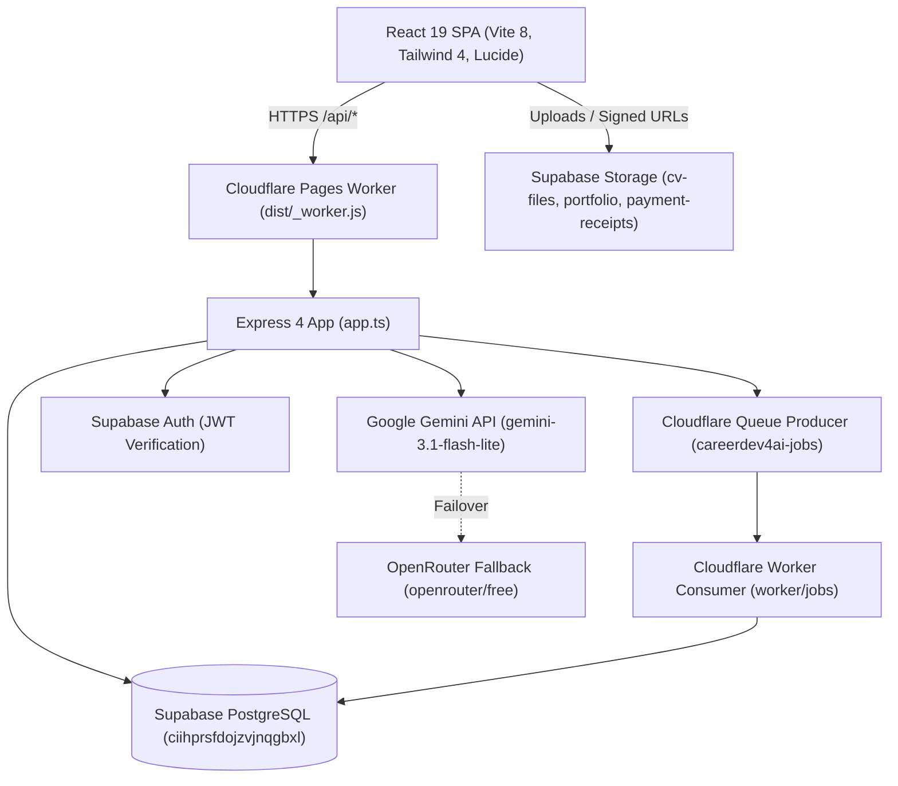
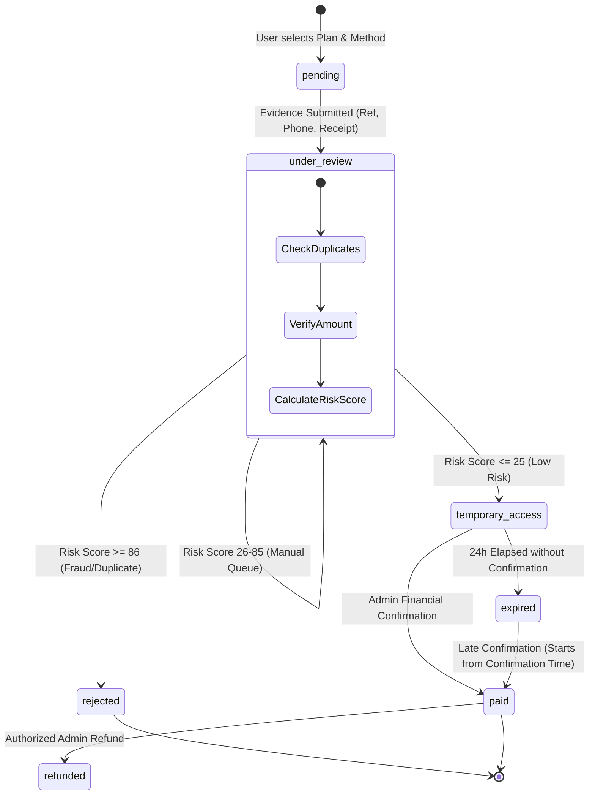

# CareerDev4AI — Master SaaS Architecture & Engineering Plan
## Executive Architecture Report

> **Target Platform:** CareerDev4AI (Egypt-First Career Super App)  
> **Status:** Architecture Approved / Ready for Production Implementation  
> **Date:** 2026-11-06  
> **Prepared By:** Principal Software Architecture & Engineering Group  

---

## 1. System Vision & Core Mission

CareerDev4AI is an Egypt-first Career Operating System serving university students, fresh graduates, job seekers, and career transitioners across Egypt and the MENA region.

The core educational journey (`DISCOVER → LEARN → PRACTICE → PROVE → BUILD → APPLY → INTERVIEW → GROW`) and the foundational tier remain **permanently free**. The newly designed SaaS subscription and AI credit engine adds sustainable monetization for premium computational services (advanced CV tailoring, deep ATS matching, multi-turn AI mock interviews, personalized career roadmaps, and dedicated AI career mentoring) while maintaining absolute data integrity and 100% Arabic (RTL) / English (LTR) bilingual parity.

---

## 2. Verified Baseline Architecture

Our deep technical audit verified the actual codebase structure across 50+ database migrations, server handlers, Cloudflare edge entrypoints, and frontend state stores:



### Key Architectural Realities Verified:
1. **Single Source of Truth:** All persistent state resides in Supabase PostgreSQL under Row Level Security (RLS). The frontend client never determines plan entitlements, credit balances, or admin roles.
2. **Dual Cloudflare Deployment:** Pages Worker handles synchronous API requests (`worker/index.ts`), while a separate Cloudflare Worker (`worker/jobs/`) handles durable queue consumption and scheduled cron sweeps (`*/5 * * * *`).
3. **Decoupled Admin System:** A comprehensive administrative hierarchy (`super_admin`, `content_admin`, `opportunity_admin`, `moderator`) is enforced server-side via `server/admin/permissions.ts` and `shared/admin.ts`.
4. **Bilingual Requirement:** Every user-facing UI string must pass through `t()` and exist in `src/translations/parts/`.

---

## 3. Commercial Tiers & Pricing Model (in EGP)

All financial calculations use integer **piasters** (1 EGP = 100 piasters) to prevent IEEE 754 floating-point inaccuracies.

| Tier | Price (Monthly) | Price (Annual) | Monthly AI Credits | Target Audience & Core Capabilities |
|---|---|---|---|---|
| **Free** | 0 EGP | 0 EGP | 5 one-time trial | Basic account, job search, save up to 5 jobs, public learning catalog, basic CV builder. |
| **Student** | 99 EGP | 999 EGP | 25 credits | CV Builder, ATS Analysis, Cover Letter, Job Description Analysis, Skill Gap Analysis, CV PDF Export. |
| **Pro** | 179 EGP | 1,790 EGP | 60 credits | Student features + Multiple CV versions, Interview Simulation, AI Career Mentor, Portfolio showcase. |
| **Career Plus**| 299 EGP | 2,990 EGP | 120 credits | Pro features + Career Transition Plans, Multi-job comparison, Advanced learning plans, Extended career reports. |

### Credit Packs (Ad-Hoc Top-Ups)
- **15 Credits:** 49 EGP
- **40 Credits:** 99 EGP
- **100 Credits:** 199 EGP

### AI Credit Consumption Weights

| AI Feature / Operation | Proposed Credits | Backend Handler / Task |
|---|---|---|
| Job Description Analysis | 1 | `server/cv/jobDescription.ts` |
| ATS Resume Analysis | 2 | `server/cv/atsAnalysis.ts` |
| Cover Letter Generation | 2 | `server/cv/coverLetter.ts` |
| Full CV Generation | 4 | `server/jobs/tasks/generateTargetedCv.ts` |
| CV Tailoring Rewrite | 4 | `server/jobs/tasks/generateTargetedCv.ts` |
| Career Roadmap Generation | 4 | `server/jobs/tasks/roadmap.ts` |
| AI Interview Simulation | 5 | `server/jobs/tasks/aiMentor.ts` / `app.ts` |
| AI Mentor Advisory Session | 2 | `server/jobs/tasks/aiMentor.ts` |

---

## 4. Egyptian Payment Infrastructure & Hybrid Verification

Because local wallets (**Vodafone Cash**, **InstaPay**) do not provide merchant webhook callbacks for personal/small business accounts, CareerDev4AI adopts a **two-phase hybrid verification state machine**:



### Core Security Rules of the Payment Engine:
1. **OCR is Not Proof of Payment:** Optical character recognition only assists in extracting transaction reference and amount. Real money receipt must be verified.
2. **24-Hour Provisional Access:** Unlocks features up to 2 credits per operation with an absolute 5-credit cap. Blocks expensive AI generation until full confirmation.
3. **Late Payment Recovery:** If bank reconciliation confirms payment after 24 hours, the subscription is restored with validity starting from the **confirmation timestamp**, ensuring zero lost subscription days.
4. **Idempotency & Fraud Checks:** Transaction references and SHA-256 binary receipt hashes enforce global uniqueness to prevent receipt recycling.

---

## 5. Target Architecture & Database Schema Additions

Nine new tables are introduced without dropping, altering, or modifying any existing production tables:

```
1. subscription_plans       -> System catalog of commercial tiers and features
2. subscriptions            -> User subscription records (one active per user)
3. payment_requests         -> Inbound payment intents, receipt URLs, risk scores
4. payment_verifications    -> Audit log of verification passes (OCR, hash, admin)
5. ai_credit_ledger         -> Immutable double-entry ledger for credit accounting
6. coupon_definitions       -> Discount coupons, caps, and validity windows
7. birthday_rewards         -> Annual 30% discount rewards (Law 151 compliant)
8. subscription_events      -> Event-sourced state audit trail
9. user_privacy_consents    -> Granular consent records (birthday data, AI processing)
```

### Atomic Database Operations (`SECURITY DEFINER`):
- `confirm_payment_and_activate(payment_id, admin_id, notes)`
- `consume_ai_credits(profile_id, operation, amount, idempotency_key, metadata)`
- `refund_ai_credits(profile_id, amount, reason, idempotency_key, source_id)`
- `expire_subscriptions()`
- `expire_temporary_access()`
- `late_payment_restore(payment_id, admin_id, notes)`

---

## 6. Implementation Phasing Strategy

```
Phase 0: Repository Audit & Pre-flight [COMPLETE]
Phase 1: Database Foundation & Migrations
Phase 2: Subscription & Entitlement Engine
Phase 3: AI Credit Ledger & Usage Accounting
Phase 4: Payment Intelligence & Receipt Ingestion
Phase 5: Super Admin Center Extensions
Phase 6: Birthday Rewards & Coupon Engine
Phase 7: Background Sweeps & Real Notifications
Phase 8: Frontend UI & Bilingual Polish
Phase 9: End-to-End Verification, Load Testing & Production Readiness
```

---

## 7. Deliverable Readiness

All 12 required planning specifications are published in `docs/subscription-system/planning/`:
- `EXECUTIVE_ARCHITECTURE_REPORT.md`
- `CURRENT_STATE_AUDIT.md`
- `TARGET_SYSTEM_ARCHITECTURE.md`
- `DATABASE_SCHEMA_AND_MIGRATIONS.md`
- `BACKEND_API_CONTRACTS.md`
- `PAYMENT_STATE_MACHINE.md`
- `SECURITY_AND_RLS_MATRIX.md`
- `AI_CREDITS_AND_COST_MODEL.md`
- `ADMIN_CONTROL_CENTER_SPEC.md`
- `IMPLEMENTATION_ROADMAP.md`
- `QA_AND_ACCEPTANCE_PLAN.md`
- `OPEN_DECISIONS_AND_BLOCKERS.md`

The system is fully specified and ready for Phase 1 execution.

