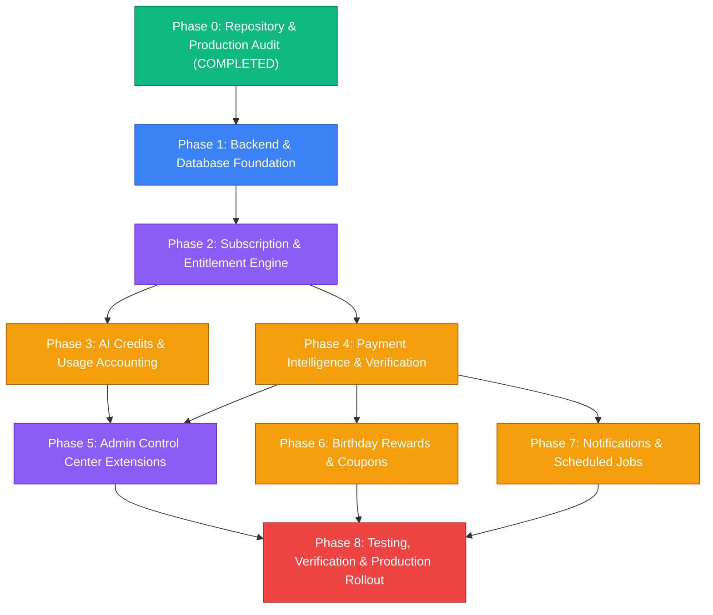
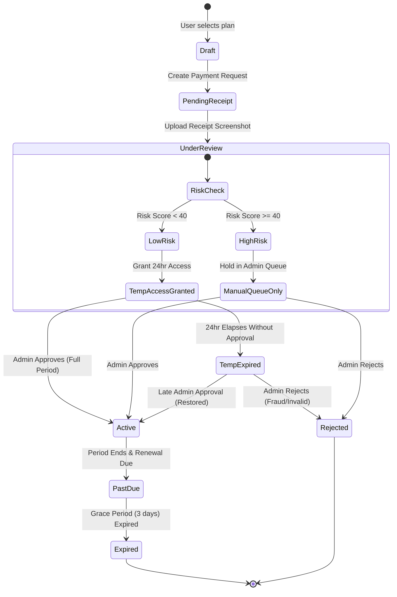

# Implementation Roadmap: CareerDev4AI Subscription, Payment & AI Credit System

- **Document Version**: 1.0.0
- **Status**: Approved Architecture & Execution Plan
- **Target System**: CareerDev4AI (Egypt-First Career Super App)
- **Target Directory**: `d:\Saas\careerpilot-ai\docs\subscription-system\planning\IMPLEMENTATION_ROADMAP.md`
- **Currency Standard**: Egyptian Pounds (EGP) stored as integer Piasters (1 EGP = 100 Piasters)
- **Runtime Stack**: React 19, TypeScript 5+, Vite 6, Tailwind CSS 4, Supabase PostgreSQL 15+, Cloudflare Pages/Workers (`nodejs_compat`), Cloudflare Queues, Google Gemini AI (`@google/genai/web`), Express 4.21.

---

## 1. Executive Summary & Phased Strategy

This roadmap details the engineering execution plan to implement a monetization and subscription system for CareerDev4AI while safeguarding system stability, candidate trust, and data integrity.

### 1.1 Architectural Classification

```
┌─────────────────────────────────────────────────────────────────────────────┐
│                       ARCHITECTURAL CLASSIFICATION                          │
├──────────────────────────┬──────────────────────────┬───────────────────────┤
│     VERIFIED FACTS       │       ASSUMPTIONS        │    RECOMMENDATIONS    │
├──────────────────────────┼──────────────────────────┼───────────────────────┤
│ • Supabase Postgres 15+  │ • Egyptian manual        │ • All monetary values │
│ • Express backend in     │   review window: 24h     │   in integer Piasters │
│   app.ts & worker/       │ • Vodafone Cash &        │ • Advisory locking on │
│ • Cloudflare Queues      │   InstaPay dominate p2p  │   credit operations   │
│   (careerdev4ai-jobs)    │ • Temporary access is    │ • Feature flags for   │
│ • Admin in admin_users   │   required for UX        │   safe zero-downtime  │
│ • Gemini 3.1-flash-lite  │ • Birthday consent       │   production rollout  │
│   daily quota in-process │   excludes birth year    │ • Double-entry ledger │
└──────────────────────────┴──────────────────────────┴───────────────────────┘
```

#### Verified Facts
1. **Application Shell & Hosting**: The backend is unified in [app.ts](file:///d:/Saas/careerpilot-ai/app.ts) and deployed dual-target: Node.js test harness via [server.ts](file:///d:/Saas/careerpilot-ai/server.ts) and Cloudflare Pages Worker via [worker/index.ts](file:///d:/Saas/careerpilot-ai/worker/index.ts).
2. **Background Jobs Engine**: Cloudflare Queues (`careerdev4ai-jobs`) processes durable background tasks registered in [server/jobs/tasks/index.ts](file:///d:/Saas/careerpilot-ai/server/jobs/tasks/index.ts) with DB state tracked in `public.background_jobs` and consumer heartbeats in `public.background_job_consumers`.
3. **Database Security Baseline**: 43+ migrations in [supabase/migrations/](file:///d:/Saas/careerpilot-ai/supabase/migrations/) enforce Row Level Security (RLS) across all tables, user profile anchoring to `auth.users(id)`, and audit logging in `public.admin_audit_log`.
4. **Current AI Quotas**: [server/ai/quota.ts](file:///d:/Saas/careerpilot-ai/server/ai/quota.ts) currently enforces an in-memory sliding bucket (15 req/user/day, 20 req/project/day) which does not persist across worker recycles or track real subscription tiers.
5. **Admin Access Pattern**: Admin hierarchy is codified in [shared/admin.ts](file:///d:/Saas/careerpilot-ai/shared/admin.ts) and authenticated server-side in [server/admin/permissions.ts](file:///d:/Saas/careerpilot-ai/server/admin/permissions.ts) and [server/db/admin.ts](file:///d:/Saas/careerpilot-ai/server/db/admin.ts). The UI resides in [src/components/views/AdminCenterView.tsx](file:///d:/Saas/careerpilot-ai/src/components/views/AdminCenterView.tsx).

#### Assumptions
1. **Manual Transfer Realities**: Egyptian candidates predominantly transfer subscription fees via Vodafone Cash wallets and InstaPay IPN transfers. Because automated instant webhooks are unavailable for manual peer-to-peer transfers, candidate-uploaded transaction references and screenshot receipts are primary verification artifacts.
2. **24-Hour Temporary Access**: To eliminate candidate drop-off during manual receipt review, users submitting valid receipt proofs are granted 24 hours of immediate temporary access.
3. **No Retroactive AI Penalties**: Existing users must receive 5 one-time trial AI credits and seamless fallback to the Free tier without breaking saved roadmaps or CVs.

#### Recommendations
1. **Zero Floating Point Currency**: All monetary amounts are handled strictly as integer Egyptian Piasters (1 EGP = 100 Piasters) in API payloads, database columns, and validation layers.
2. **Strict Concurrency Control**: Credit transactions and payment state transitions must execute inside PostgreSQL transactions utilizing `pg_advisory_xact_lock(hashtext(profile_id::text))` to prevent double-spending or race conditions.
3. **Graceful Entitlement Degradation**: When a subscription lapses or temporary access expires, access degrades gracefully to the Free tier rather than locking the user out of their account or deleting their data.

---

## 2. High-Level Dependency Graph & Phased Timeline



### 2.1 Timeline & Parallelization Gantt

```
Phase 0: Repository Audit       [COMPLETED]
Phase 1: DB & Backend Foundation [████████████] (Weeks 1-2)
Phase 2: Entitlement Engine      ............[████████████] (Weeks 3-4)
Phase 3: AI Credits Ledger       ................[████████████] (Weeks 4-5) [Parallel]
Phase 4: Payment Intelligence    ................[██████████████████] (Weeks 4-6) [Parallel]
Phase 5: Admin Control Center    ..............................[████████████] (Weeks 6-7)
Phase 6: Coupons & Birthday      ......................................[████████] (Weeks 7-8)
Phase 7: Scheduled Jobs & Queue  ............................................[████████] (Weeks 8-9)
Phase 8: QA & Production Deploy   ....................................................[████████████] (Weeks 9-11)
```

---

## 3. Detailed Phase Breakdown

---

### Phase 0: Repository and Production Audit

- **Status**: COMPLETED
- **Scope**:
  - Full audit of 43+ migrations in [supabase/migrations/](file:///d:/Saas/careerpilot-ai/supabase/migrations/).
  - Verification of API routing in [app.ts](file:///d:/Saas/careerpilot-ai/app.ts), [worker/index.ts](file:///d:/Saas/careerpilot-ai/worker/index.ts), and test harness [tests/runner.mjs](file:///d:/Saas/careerpilot-ai/tests/runner.mjs).
  - Code audit of AI handlers in [server/ai/](file:///d:/Saas/careerpilot-ai/server/ai/) and [server/cv/](file:///d:/Saas/careerpilot-ai/server/cv/).
  - Inspection of administrative architecture in [shared/admin.ts](file:///d:/Saas/careerpilot-ai/shared/admin.ts) and [src/components/views/AdminCenterView.tsx](file:///d:/Saas/careerpilot-ai/src/components/views/AdminCenterView.tsx).
- **Deliverables**:
  - `docs/subscription-system/planning/CURRENT_STATE_AUDIT.md`
  - `docs/subscription-system/planning/DATABASE_SCHEMA_AND_MIGRATIONS.md`
  - `docs/subscription-system/planning/IMPLEMENTATION_ROADMAP.md` (this file)
  - `docs/subscription-system/planning/QA_AND_ACCEPTANCE_PLAN.md`

---

### Phase 1: Backend and Database Foundation

- **Objective**: Establish the persistent schema, storage buckets, database procedures, and core TypeScript data access layers.
- **Estimated Duration**: Weeks 1–2
- **Complexity**: Medium
- **Dependencies**: Phase 0

#### 1. Scope of Work
1. **SQL Migrations**:
   - `supabase/migrations/20261110000001_subscription_foundation.sql`:
     - Creates `public.subscription_plans`, `public.subscriptions`, and `public.subscription_events`.
     - Seeds baseline plans: `free` (0 EGP), `pro` (150 EGP/mo, 1,440 EGP/yr), and `elite` (350 EGP/mo, 3,360 EGP/yr).
     - Configures RLS policies granting candidates SELECT on active plans and own subscriptions.
   - `supabase/migrations/20261110000002_payment_system.sql`:
     - Creates `public.payment_requests` and `public.payment_verifications`.
     - Creates private Supabase Storage bucket `payment-receipts` with 5MB upload limit (image/jpeg, image/png, application/pdf).
     - RLS: Candidates can upload receipts for own pending payments; admins can read all receipts.
   - `supabase/migrations/20261110000003_credit_ledger.sql`:
     - Creates immutable `public.ai_credit_ledger`.
     - Deploys atomic procedures: `atomic_grant_ai_credits()`, `atomic_reserve_and_deduct_ai_credits()`, `atomic_refund_ai_credits()`.
   - `supabase/migrations/20261110000004_super_admin_bootstrap.sql`:
     - Expands admin permissions vocabulary to include `subscriptions.read`, `subscriptions.write`, `payments.read`, `payments.verify`, `credits.manage`.
     - Ensures `ahmedghannam801@gmail.com` is granted `super_admin` role with full subscription privileges.
2. **Server DB Access Layer**:
   - `server/db/subscriptions.ts`: Queries and mutations for plans, active user subscriptions, and subscription event logging.
   - `server/db/payments.ts`: Payment request creation, receipt association, and verification audit queries.
   - `server/db/credits.ts`: TypeScript wrappers calling atomic stored procedures with advisory locking.
3. **Shared Contracts**:
   - Update [shared/admin.ts](file:///d:/Saas/careerpilot-ai/shared/admin.ts) to define new admin permissions and assign them to `super_admin`.

#### 2. Files Affected
| Action | File Path | Purpose |
|--------|-----------|---------|
| NEW | `supabase/migrations/20261110000001_subscription_foundation.sql` | Subscription plans & state schema |
| NEW | `supabase/migrations/20261110000002_payment_system.sql` | Payments schema & receipt storage bucket |
| NEW | `supabase/migrations/20261110000003_credit_ledger.sql` | Double-entry credit ledger & atomic procedures |
| NEW | `supabase/migrations/20261110000004_super_admin_bootstrap.sql` | Admin permissions & Super Admin assignment |
| NEW | `server/db/subscriptions.ts` | Data access layer for subscriptions |
| NEW | `server/db/payments.ts` | Data access layer for payments |
| NEW | `server/db/credits.ts` | Data access layer for credits |
| MODIFY | `shared/admin.ts` | Add subscription/payment admin permissions |

#### 3. Acceptance Criteria
- [ ] All migrations apply cleanly via `supabase db push` / `psql` without syntax or dependency errors.
- [ ] RLS policies strictly prevent user `A` from reading user `B`'s subscription or payment records.
- [ ] Service role credentials can invoke atomic procedures successfully.
- [ ] Super admin `ahmedghannam801@gmail.com` possesses all newly registered subscription permissions.
- [ ] Storage bucket `payment-receipts` accepts valid images and rejects non-image/non-pdf formats.

#### 4. Rollback Strategy
All Phase 1 migrations include safe rollback sections:
```sql
DROP TABLE IF EXISTS public.payment_verifications CASCADE;
DROP TABLE IF EXISTS public.payment_requests CASCADE;
DROP TABLE IF EXISTS public.subscription_events CASCADE;
DROP TABLE IF EXISTS public.subscriptions CASCADE;
DROP TABLE IF EXISTS public.subscription_plans CASCADE;
DROP TABLE IF EXISTS public.ai_credit_ledger CASCADE;
```
Because no user data depends on these tables yet, rollback can be executed instantly without data loss.

---

### Phase 2: Subscription and Entitlement Engine

- **Objective**: Implement server-side business logic for managing subscriptions and enforcing tier-based entitlements across existing application endpoints.
- **Estimated Duration**: Weeks 3–4
- **Complexity**: High
- **Dependencies**: Phase 1

#### 1. Scope of Work
1. **Subscription Engine (`server/subscriptions/service.ts`)**:
   - Manages state transitions: `draft` → `pending_verification` → `temporary_access` → `active` → `past_due` → `cancelled` → `expired`.
   - Upgrade/downgrade calculations: Prorating remaining days as credit balance; immediate entitlement adjustments.
   - Plan-to-feature mapping: Free vs Pro vs Elite feature allowances.
2. **Entitlement Middleware (`server/subscriptions/entitlements.ts`)**:
   - `requireEntitlement(featureKey)` middleware:
     - Inspects active subscription status from cached profile context.
     - Resolves status: `active` or `temporary_access` grants full tier privileges; `expired` or `past_due` falls back to `free`.
     - Checks feature limits: CV version count (Free: 1, Pro/Elite: unlimited), targeted CV generation, advanced ATS metrics, AI interview simulation.
3. **Shared Types (`shared/subscriptionTypes.ts`)**:
   - Defines strict TypeScript types for plans, billing intervals (`monthly`, `annual`), features, and entitlement keys.
4. **Integration into Existing Endpoints in [app.ts](file:///d:/Saas/careerpilot-ai/app.ts)**:
   - Mount new client routes:
     - `GET /api/subscriptions/plans` (public list of active plans)
     - `GET /api/subscriptions/current` (caller's active subscription and entitlements)
   - Protect existing CV creation endpoints: enforce 1 active CV limit for Free users.
   - Protect ATS analysis & targeted CV endpoints with `requireEntitlement('targeted_cv')`.

#### 2. Files Affected
| Action | File Path | Purpose |
|--------|-----------|---------|
| NEW | `shared/subscriptionTypes.ts` | Shared types, interfaces, and feature enums |
| NEW | `server/subscriptions/service.ts` | Core subscription lifecycle state machine |
| NEW | `server/subscriptions/entitlements.ts` | Server-side entitlement verification middleware |
| MODIFY | `app.ts` | Register subscription routes & attach entitlement middleware |
| MODIFY | `server/cv/buildCv.ts` | Enforce CV count limits for Free plan |
| MODIFY | `server/cv/atsAnalysis.ts` | Gate detailed ATS breakdowns behind Pro tier |

#### 3. Acceptance Criteria
- [ ] Free candidates cannot create more than 1 CV or 1 active roadmap.
- [ ] Requests to Pro-gated endpoints by Free users return HTTP 403 Forbidden with clear localized upgrade prompt payload (`UPGRADE_REQUIRED`).
- [ ] Users with active or temporary access status bypass restrictions cleanly.
- [ ] Unit tests pass for all subscription state transitions.

#### 4. Rollback Strategy
Remove `requireEntitlement` middleware from route chains in [app.ts](file:///d:/Saas/careerpilot-ai/app.ts). The endpoints will fall back to open access without downtime.

---

### Phase 3: AI Credits and Usage Accounting

- **Objective**: Transition AI consumption from the ephemeral in-memory quota to a persistent double-entry credit ledger with atomic reservation, deduction, and refunds.
- **Estimated Duration**: Weeks 4–5 (Parallel with Phase 4)
- **Complexity**: High
- **Dependencies**: Phase 1 & Phase 2

#### 1. Scope of Work
1. **Credit Reservation & Ledger Service (`server/credits/service.ts`)**:
   - `reserveCredits(profileId, amount, feature)`: Atomic check-and-reserve using advisory lock.
   - `commitCredits(reservationId)`: Finalize deduction upon successful model completion.
   - `releaseCredits(reservationId, reason)`: Immediate refund if Gemini/OpenRouter API returns 5xx, timeout, or rate-limit error.
2. **Onboarding & Monthly Grant Triggers**:
   - Automatic 5 one-time trial credits for new user signups via `careerpilot_handle_new_user()` enhancement.
   - Automatic monthly credit allocation (Pro: 100 credits, Elite: 300 credits) upon subscription activation or renewal.
3. **Credit Middleware (`server/credits/middleware.ts`)**:
   - `requireAiCredits(cost)`: Wraps AI endpoints. Deducts only on HTTP 200 response; releases lock and refunds balance on error.
4. **Refactor In-Memory Quotas ([server/ai/quota.ts](file:///d:/Saas/careerpilot-ai/server/ai/quota.ts))**:
   - Keep project-level emergency breaker (protecting against runaway API bills).
   - Replace user-level in-memory buckets with real database ledger balance lookups.
5. **AI Endpoint Integration**:
   - Update CV AI Assist ([server/cv/aiAssist.ts](file:///d:/Saas/careerpilot-ai/server/cv/aiAssist.ts)) - 1 credit.
   - Update ATS Match Optimizer ([server/cv/atsAnalysis.ts](file:///d:/Saas/careerpilot-ai/server/cv/atsAnalysis.ts)) - 2 credits.
   - Update AI Interview Practice ([server/db/interviewSessions.ts](file:///d:/Saas/careerpilot-ai/server/db/interviewSessions.ts)) - 3 credits.
   - Update Targeted CV Generator ([server/jobs/tasks/generateTargetedCv.ts](file:///d:/Saas/careerpilot-ai/server/jobs/tasks/generateTargetedCv.ts)) - 2 credits.

#### 2. Files Affected
| Action | File Path | Purpose |
|--------|-----------|---------|
| NEW | `server/credits/service.ts` | Credit reservation, atomic deduction & refund service |
| NEW | `server/credits/middleware.ts` | Express middleware for AI endpoint credit gating |
| NEW | `supabase/migrations/20261110000007_credit_triggers.sql` | Signup trial credit trigger & ledger audit |
| MODIFY | `server/ai/quota.ts` | Delegate per-user accounting to credit service |
| MODIFY | `server/cv/aiAssist.ts` | Attach credit deduction |
| MODIFY | `server/cv/atsAnalysis.ts` | Attach credit deduction |
| MODIFY | `server/jobs/tasks/generateTargetedCv.ts` | Deduct credits during background task execution |
| MODIFY | `app.ts` | Register credit balance and history routes |

#### 3. Acceptance Criteria
- [ ] Candidates with 0 credits receive HTTP 402 Payment Required (`INSUFFICIENT_AI_CREDITS`).
- [ ] If Gemini API throws an exception or aborts mid-stream, the reserved credits are refunded automatically within the same request lifecycle.
- [ ] Concurrent requests from the same user cannot overdraft the credit balance.
- [ ] New user signup creates an initial +5 credit entry with `grant_type: 'trial'`.

#### 4. Rollback Strategy
Set feature flag `CREDIT_LEDGER_ENFORCEMENT=false`. Fall back to existing in-memory daily limit in [server/ai/quota.ts](file:///d:/Saas/careerpilot-ai/server/ai/quota.ts).

---

### Phase 4: Payment Intelligence

- **Objective**: Implement manual Egyptian payment collection (Vodafone Cash, InstaPay, Fawry), receipt uploads, automated risk scoring, 24-hour temporary access, and administrative confirmation workflows.
- **Estimated Duration**: Weeks 4–6 (Parallel with Phase 3)
- **Complexity**: Very High
- **Dependencies**: Phase 1 & Phase 2

#### 1. Scope of Work
1. **Payment Request Lifecycle (`server/payments/service.ts`)**:
   - `createPaymentRequest(profileId, planId, billingCycle, paymentMethod, couponCode)`:
     - Calculates final amount in Piasters.
     - Generates unique payment reference code (e.g. `CP-PAY-2026-XXXX`).
     - Emits payment pending event.
2. **Receipt Upload & Storage Handling**:
   - Multer middleware in [app.ts](file:///d:/Saas/careerpilot-ai/app.ts) handles multipart receipt upload.
   - Uploads to private Supabase bucket `payment-receipts/userId/paymentId-timestamp.ext`.
   - Records metadata in `public.payment_requests`.
3. **Automated Verification Pipeline (`server/payments/verification.ts` & `riskScoring.ts`)**:
   - **Duplicate Detection**: Computes perceptual hash of receipt image and exact string match on sender wallet/reference number to flag reused receipts.
   - **Amount & Provider Validation**: Verifies entered amount matches plan price.
   - **Risk Score Engine**: Scores 0 (trusted) to 100 (high risk). Factors: account age, duplicate hash matches, rapid sequential submissions.
4. **Temporary Access Grant**:
   - If risk score < 40 and receipt is uploaded, automatically activate subscription with `status: 'temporary_access'` and `current_period_ends_at = NOW() + INTERVAL '24 hours'`.
5. **Admin Confirmation & Rejection**:
   - Super admin / payment admin reviews receipt in Admin Center.
   - `confirmPayment(paymentId, adminId)`: Executes DB function `atomic_confirm_payment_and_activate_subscription()`. Sets subscription to `active` for full 30 or 365 days, allocates monthly credits, records audit log.
   - `rejectPayment(paymentId, adminId, reason)`: Reverts subscription to `free`, revokes access, notifies user.
6. **Late Payment Recovery**:
   - If admin confirms after 24-hour temporary access expired, subscription is immediately restored to `active` for the full duration starting from payment confirmation date.

#### 2. Files Affected
| Action | File Path | Purpose |
|--------|-----------|---------|
| NEW | `server/payments/service.ts` | Payment creation, receipt link, and lifecycle management |
| NEW | `server/payments/verification.ts` | Verification rules, receipt checks, and duplicate detection |
| NEW | `server/payments/riskScoring.ts` | Fraud/abuse heuristic scoring engine |
| NEW | `server/jobs/tasks/expireTemporaryAccess.ts` | Background job to expire unverified 24h access |
| NEW | `server/jobs/tasks/expireSubscriptions.ts` | Background job to mark ended subscriptions as expired |
| MODIFY | `app.ts` | Register payment routes (`/api/payments/*`) |
| MODIFY | `server/jobs/tasks/index.ts` | Register expiration tasks |
| MODIFY | `server/jobs/jobs.ts` | Add new background job kinds |

#### 3. State Machine Flowchart



#### 4. Acceptance Criteria
- [ ] Submitting a payment request with valid receipt grants 24-hour temporary access when risk score is low.
- [ ] Admin approval extends subscription to full 30 or 365 days and deposits full plan AI credits.
- [ ] Duplicate receipt uploads are flagged with high risk score and blocked from temporary access.
- [ ] Admin rejection immediately reverts access to Free tier and sends an explanatory notification.

#### 5. Rollback Strategy
Disable payment routes in [app.ts](file:///d:/Saas/careerpilot-ai/app.ts). Running subscriptions continue to completion; new payment submissions are disabled with a maintenance notice.

---

### Phase 5: Admin Control Center Extensions

- **Objective**: Extend [src/components/views/AdminCenterView.tsx](file:///d:/Saas/careerpilot-ai/src/components/views/AdminCenterView.tsx) with specialized management panels for subscriptions, payments, revenue analytics, credits, and coupons.
- **Estimated Duration**: Weeks 6–7
- **Complexity**: High
- **Dependencies**: Phase 2, Phase 3, Phase 4

#### 1. Scope of Work
1. **Frontend Admin Components**:
   - `src/components/admin/AdminSubscriptionsPanel.tsx`: View all active/past-due subscriptions, search by candidate email, filter by tier, manually extend or terminate subscriptions.
   - `src/components/admin/AdminPaymentsPanel.tsx`: Queue of pending receipts, image preview modal, risk score badge, one-click Approve / Reject with rejection reason selector.
   - `src/components/admin/AdminRevenuePanel.tsx`: Revenue metrics in EGP (MRR, ARR, daily collections, payment method distribution), exportable CSV reports.
   - `src/components/admin/AdminCreditsPanel.tsx`: Audit candidate credit balances, manual credit grants/deductions with required admin reason.
   - `src/components/admin/AdminCouponsPanel.tsx`: Create and toggle promo codes (fixed EGP / percentage discount, expiry date, redemption limits).
2. **Integration into [src/components/views/AdminCenterView.tsx](file:///d:/Saas/careerpilot-ai/src/components/views/AdminCenterView.tsx)**:
   - Add new tabs: "Subscriptions", "Payments", "Revenue", "AI Credits", "Coupons".
   - Restrict tab visibility based on admin permissions: `subscriptions.read`, `payments.verify`, etc.
3. **Admin API Client Layer ([src/lib/adminApi.ts](file:///d:/Saas/careerpilot-ai/src/lib/adminApi.ts))**:
   - Add typed API methods for fetching payment queues, approving/rejecting payments, and viewing revenue summaries.
4. **Server Persistence & Handlers**:
   - `server/db/adminSubscriptions.ts`: Filtered queries for subscription records and user plans.
   - `server/db/adminPayments.ts`: Payment queue pagination, receipt signed URLs, verification action execution with audit logging.
   - Register endpoints in [app.ts](file:///d:/Saas/careerpilot-ai/app.ts) protected by `requireAuth` + admin permission checks.

#### 2. Files Affected
| Action | File Path | Purpose |
|--------|-----------|---------|
| NEW | `src/components/admin/AdminSubscriptionsPanel.tsx` | UI panel for subscription management |
| NEW | `src/components/admin/AdminPaymentsPanel.tsx` | UI panel for receipt verification & approval |
| NEW | `src/components/admin/AdminRevenuePanel.tsx` | UI panel for revenue analytics & metrics |
| NEW | `src/components/admin/AdminCreditsPanel.tsx` | UI panel for credit management & audit |
| NEW | `src/components/admin/AdminCouponsPanel.tsx` | UI panel for coupon code management |
| MODIFY | `src/components/views/AdminCenterView.tsx` | Mount new admin navigation tabs |
| MODIFY | `src/lib/adminApi.ts` | Frontend client methods for admin subscription endpoints |
| NEW | `server/db/adminSubscriptions.ts` | Database queries for admin subscription views |
| NEW | `server/db/adminPayments.ts` | Database queries for admin payment approvals |
| MODIFY | `app.ts` | Mount `/api/admin/subscriptions/*` & `/api/admin/payments/*` |

#### 3. Acceptance Criteria
- [ ] Admin panels load with crisp visual styling matching the existing terracotta/navy design system.
- [ ] Moderator or Content Admin roles cannot see or access Subscription/Payment admin tabs.
- [ ] Approving a receipt in `AdminPaymentsPanel` instantly updates the payment status, grants full access, and writes to `admin_audit_log`.
- [ ] Revenue charts accurately display EGP metrics without rounding anomalies.

#### 4. Rollback Strategy
Remove the new tabs from [src/components/views/AdminCenterView.tsx](file:///d:/Saas/careerpilot-ai/src/components/views/AdminCenterView.tsx) and unmount admin routes in [app.ts](file:///d:/Saas/careerpilot-ai/app.ts).

---

### Phase 6: Birthday Rewards and Coupons

- **Objective**: Implement marketing promotions, customizable coupon discounts, and privacy-compliant birthday rewards.
- **Estimated Duration**: Weeks 7–8
- **Complexity**: Medium
- **Dependencies**: Phase 4

#### 1. Scope of Work
1. **Database Schema (`supabase/migrations/20261110000005_coupons_and_birthday.sql`)**:
   - `public.coupon_definitions`: Code (case-insensitive unique), discount type (`percentage` vs `fixed_piasters`), max redemptions, redemption count, expiry timestamp.
   - `public.user_privacy_consents`: Explicit consent for birthday communications (GDPR / Egypt Data Protection Law compliant).
   - `public.birthday_rewards`: Stores birth month and birth day (1–12, 1–31). Explicitly **no birth year** stored.
2. **Coupons Service (`server/coupons/service.ts`)**:
   - `validateCoupon(code, planId, billingCycle)`: Validates code validity, usage limits, and calculates discount amount.
   - Integrates into payment calculation in `server/payments/service.ts`.
3. **Birthday Service (`server/birthday/service.ts`)**:
   - Collects candidate birth month and day with explicit opt-in consent.
   - Generates personalized birthday reward coupon (e.g. 50% discount or 25 free AI credits) valid for 7 days during birthday week.

#### 2. Files Affected
| Action | File Path | Purpose |
|--------|-----------|---------|
| NEW | `supabase/migrations/20261110000005_coupons_and_birthday.sql` | Coupons, privacy consent, and birthday tables |
| NEW | `server/coupons/service.ts` | Coupon validation and redemption logic |
| NEW | `server/birthday/service.ts` | Birthday consent, date handling, and reward issuance |
| MODIFY | `server/payments/service.ts` | Apply coupon discounts during payment creation |
| MODIFY | `app.ts` | Register coupon validation and birthday consent routes |

#### 3. Acceptance Criteria
- [ ] Coupons correctly apply percentage or fixed EGP discounts during payment creation.
- [ ] Expired or exhausted coupons are rejected with descriptive error messages.
- [ ] Candidates can enter birth month/day without being prompted for birth year.
- [ ] Birthday rewards cannot be claimed more than once per calendar year.

#### 4. Rollback Strategy
Disable coupon application in `server/payments/service.ts` (fallback to standard plan pricing).

---

### Phase 7: Notifications and Scheduled Jobs

- **Objective**: Automate subscription expiration, renewal reminders, temporary access cleanup, and multi-channel candidate notifications.
- **Estimated Duration**: Weeks 8–9
- **Complexity**: Medium
- **Dependencies**: Phase 4 & Phase 5

#### 1. Scope of Work
1. **Database Notification Types (`supabase/migrations/20261110000006_subscription_notifications.sql`)**:
   - Update `public.notifications` check constraint to include: `subscription_expiry`, `payment_confirmed`, `payment_rejected`, `credit_low`, `birthday_reward`.
2. **Scheduled Worker Tasks (`server/jobs/tasks/`)**:
   - `expireTemporaryAccess.ts`: Hourly cron task finding `status = 'temporary_access'` where `current_period_ends_at < NOW()`. Reverts to `free` and alerts candidate.
   - `expireSubscriptions.ts`: Daily cron task finding active subscriptions past their grace period. Marks them `expired`.
   - `subscriptionReminders.ts`: Daily cron task triggering renewal notifications 7 days, 3 days, and 1 day prior to expiration.
   - `creditWarnings.ts`: Daily check notifying candidates when credit balance falls below 10% of monthly allowance.
3. **Worker Cron Integration ([worker/jobs/wrangler.jsonc](file:///d:/Saas/careerpilot-ai/worker/jobs/wrangler.jsonc) & [worker/jobs/index.ts](file:///d:/Saas/careerpilot-ai/worker/jobs/index.ts))**:
   - Add Cloudflare Worker cron trigger configurations:
     - `0 * * * *` (Hourly: temporary access expiration)
     - `0 3 * * *` (Daily at 3 AM Cairo time: subscription expiry and reminders)

#### 2. Files Affected
| Action | File Path | Purpose |
|--------|-----------|---------|
| NEW | `supabase/migrations/20261110000006_subscription_notifications.sql` | Expand notification type constraints |
| NEW | `server/jobs/tasks/subscriptionReminders.ts` | Renewal reminder task logic |
| NEW | `server/jobs/tasks/creditWarnings.ts` | Low credit alert task logic |
| MODIFY | `server/db/notifications.ts` | Add new notification type enum values |
| MODIFY | `server/jobs/tasks/index.ts` | Export and register new scheduled tasks |
| MODIFY | `worker/jobs/wrangler.jsonc` | Configure Worker Cron triggers |
| MODIFY | `worker/jobs/index.ts` | Dispatch scheduled triggers to job queue |

#### 3. Acceptance Criteria
- [ ] Hourly scheduled task sweeps and terminates temporary access rows older than 24 hours.
- [ ] Candidates receive in-app notifications 7, 3, and 1 day before subscription expiry.
- [ ] Payment approval immediately emits `payment_confirmed` notification visible in the notifications drawer.

#### 4. Rollback Strategy
Comment out cron schedules in [worker/jobs/wrangler.jsonc](file:///d:/Saas/careerpilot-ai/worker/jobs/wrangler.jsonc) and redeploy worker.

---

### Phase 8: Testing, Verification & Production Rollout

- **Objective**: Execute automated test suites, verify security boundaries, conduct staging rehearsal, and execute a zero-downtime production launch.
- **Estimated Duration**: Weeks 9–11
- **Complexity**: Medium-High
- **Dependencies**: All preceding phases

#### 1. Scope of Work
1. **Automated Test Suite**:
   - `tests/subscriptions.test.ts`: Comprehensive test suite verifying plan queries, tier restrictions, and subscription transitions.
   - `tests/payments.test.ts`: Tests payment request creation, receipt upload, duplicate detection, and admin approval/rejection.
   - `tests/credits.test.ts`: Concurrency and atomicity tests verifying balance deduction, reservation locks, and failure refunds.
   - `tests/entitlements.test.ts`: Tests server-side gating across CV Studio, ATS analysis, and AI endpoints.
2. **Security & RLS Verification**:
   - Cross-tenant penetration testing ensuring users cannot view or manipulate other users' payments or subscriptions.
   - Validate that `service_role` key is strictly contained on the server and completely absent from Vite frontend bundles.
3. **Staging Migration Dry-Run**:
   - Apply migrations sequentially on staging database.
   - Verify zero regression across existing candidate roadmaps, CVs, and bookmarks.
4. **Feature Flag Controlled Rollout**:
   - Rollout phases via environment variables:
     - `VITE_SUBSCRIPTION_ENABLED=false` (Initial silent deploy, admin testing only)
     - `VITE_SUBSCRIPTION_ENABLED=true` (Public launch with announcement banner)
5. **Production Health Gate**:
   - Verify live production health at `https://careerdev4ai.pages.dev/api/health`.

#### 2. Files Affected
| Action | File Path | Purpose |
|--------|-----------|---------|
| NEW | `tests/subscriptions.test.ts` | Integration tests for subscription engine |
| NEW | `tests/payments.test.ts` | Integration tests for payment flow & fraud checks |
| NEW | `tests/credits.test.ts` | Concurrency & atomic credit tests |
| NEW | `tests/entitlements.test.ts` | Entitlement gating security tests |
| MODIFY | `tests/runner.mjs` | Register new test suites in master runner |

#### 3. Acceptance Criteria
- [ ] All test suites in `tests/` pass cleanly with 0 failures: `node tests/runner.mjs`.
- [ ] TypeScript compilation succeeds with 0 errors: `npm run lint`.
- [ ] Production frontend build succeeds without bundle size warnings: `npm run build`.
- [ ] Post-deploy production health check returns HTTP 200 OK.

---

## 4. Comprehensive File Inventory & Change Matrix

The following table summarizes all codebase modifications planned across the roadmap:

| File Path | Nature | Phase | Description |
|-----------|--------|-------|-------------|
| `supabase/migrations/20261110000001_subscription_foundation.sql` | NEW | 1 | Plans, subscriptions, and events tables |
| `supabase/migrations/20261110000002_payment_system.sql` | NEW | 1 | Payments, verifications, and receipt bucket |
| `supabase/migrations/20261110000003_credit_ledger.sql` | NEW | 1 | Credit ledger table & atomic procedures |
| `supabase/migrations/20261110000004_super_admin_bootstrap.sql` | NEW | 1 | Admin permissions vocabulary & super admin grant |
| `supabase/migrations/20261110000005_coupons_and_birthday.sql` | NEW | 6 | Coupon definitions, consent, and birthday tables |
| `supabase/migrations/20261110000006_subscription_notifications.sql` | NEW | 7 | Notification type enum additions |
| `supabase/migrations/20261110000007_credit_triggers.sql` | NEW | 3 | Signup trial credit trigger |
| `shared/admin.ts` | MODIFY | 1 | Add subscription/payment admin permissions |
| `shared/subscriptionTypes.ts` | NEW | 2 | Shared subscription and entitlement interfaces |
| `server/db/subscriptions.ts` | NEW | 1 | DB access for subscription entities |
| `server/db/payments.ts` | NEW | 1 | DB access for payment entities |
| `server/db/credits.ts` | NEW | 1 | DB access for credit procedures |
| `server/db/adminSubscriptions.ts` | NEW | 5 | DB access for admin subscription management |
| `server/db/adminPayments.ts` | NEW | 5 | DB access for admin receipt reviews |
| `server/subscriptions/service.ts` | NEW | 2 | Subscription state machine & tier transitions |
| `server/subscriptions/entitlements.ts` | NEW | 2 | Entitlement enforcement middleware |
| `server/credits/service.ts` | NEW | 3 | Credit reservation, deduction, and refund logic |
| `server/credits/middleware.ts` | NEW | 3 | AI route credit gating middleware |
| `server/payments/service.ts` | NEW | 4 | Payment request creation & receipt pipeline |
| `server/payments/verification.ts` | NEW | 4 | Duplicate detection and receipt validation |
| `server/payments/riskScoring.ts` | NEW | 4 | Fraud and abuse risk scoring engine |
| `server/coupons/service.ts` | NEW | 6 | Promo code validation and discount calculation |
| `server/birthday/service.ts` | NEW | 6 | Birthday reward generation & consent checks |
| `server/jobs/tasks/expireTemporaryAccess.ts` | NEW | 4 | Hourly cleanup of expired 24h temp access |
| `server/jobs/tasks/expireSubscriptions.ts` | NEW | 4 | Daily cleanup of lapsed subscriptions |
| `server/jobs/tasks/subscriptionReminders.ts` | NEW | 7 | Scheduled task for renewal reminder notifications |
| `server/jobs/tasks/creditWarnings.ts` | NEW | 7 | Scheduled task for low credit notifications |
| `server/jobs/tasks/index.ts` | MODIFY | 4, 7 | Register new background and scheduled tasks |
| `server/jobs/jobs.ts` | MODIFY | 4 | Register new job kind enums |
| `server/ai/quota.ts` | MODIFY | 3 | Connect quota manager to persistent credit ledger |
| `server/cv/buildCv.ts` | MODIFY | 2 | Enforce 1 CV limit for Free users |
| `server/cv/atsAnalysis.ts` | MODIFY | 2, 3 | Gate advanced metrics & deduct AI credits |
| `server/cv/aiAssist.ts` | MODIFY | 3 | Deduct AI credits on assist generation |
| `server/jobs/tasks/generateTargetedCv.ts` | MODIFY | 3 | Deduct AI credits for targeted CV generation |
| `server/db/notifications.ts` | MODIFY | 7 | Add new notification type enums |
| `app.ts` | MODIFY | 2, 3, 4, 5 | Register subscription, payment, and admin routes |
| `src/lib/adminApi.ts` | MODIFY | 5 | Add admin subscription & payment API calls |
| `src/components/views/AdminCenterView.tsx` | MODIFY | 5 | Mount admin subscription & payment tabs |
| `src/components/admin/AdminSubscriptionsPanel.tsx` | NEW | 5 | Admin subscription management panel |
| `src/components/admin/AdminPaymentsPanel.tsx` | NEW | 5 | Admin receipt verification panel |
| `src/components/admin/AdminRevenuePanel.tsx` | NEW | 5 | Admin revenue analytics dashboard |
| `src/components/admin/AdminCreditsPanel.tsx` | NEW | 5 | Admin AI credits adjustment panel |
| `src/components/admin/AdminCouponsPanel.tsx` | NEW | 5 | Admin coupon code configuration panel |
| `worker/jobs/wrangler.jsonc` | MODIFY | 7 | Add cron trigger schedules for background worker |
| `worker/jobs/index.ts` | MODIFY | 7 | Handle cron triggers in Cloudflare Worker |
| `tests/subscriptions.test.ts` | NEW | 8 | Integration test suite for subscriptions |
| `tests/payments.test.ts` | NEW | 8 | Integration test suite for payments & receipts |
| `tests/credits.test.ts` | NEW | 8 | Concurrency test suite for credit accounting |
| `tests/entitlements.test.ts` | NEW | 8 | Security test suite for entitlement gating |
| `tests/runner.mjs` | MODIFY | 8 | Include new test suites in master test run |

---

## 5. Architectural Risk Analysis & Mitigation Matrix

| Risk Event | Severity | Probability | Impact | Mitigation Strategy |
|------------|----------|-------------|--------|---------------------|
| **Receipt Image Replay / Forgery** | High | High | Fraudulent access without payment | Image perceptual hashing, sender wallet duplicate detection, risk scoring heuristic, and mandatory manual admin confirmation for full access. |
| **Credit Ledger Concurrency Race** | High | Medium | Negative credit balances / free AI usage | Enforce PostgreSQL advisory transaction locks (`pg_advisory_xact_lock`) on `profile_id` during all credit operations. |
| **Temporary Access Abuse** | Medium | High | Candidates cycling temp access with bogus receipts | Only 1 active temporary access allowed per user per 30-day window; automated expiry after 24h via scheduled queue job. |
| **Gemini AI Outage / Interruption** | Medium | Medium | Credits lost when AI model fails | Atomic credit reservation with automatic release/refund on HTTP error status or network timeout. |
| **Stale Cache / Entitlement Drift** | Medium | Low | Users retained access after cancellation | Entitlement middleware evaluates DB status with short 60s cache TTL; immediate cache invalidation on payment events. |
| **Accidental Production Breaking Change** | High | Low | Service outage for free users | Feature flags (`VITE_SUBSCRIPTION_ENABLED`, `CREDIT_LEDGER_ENFORCEMENT`); extensive rollback scripts for each phase. |

---

## 6. Execution Protocol & Verification Standards

To guarantee flawless delivery without architectural drift, any senior engineering agent implementing this roadmap must adhere to the following protocol:

1. **Sequential Migration Execution**: Never combine multiple phase migrations into a single file. Apply migrations in exact timestamp order.
2. **Lint & Test Verification**:
   - Run `npm run lint` (`tsc --noEmit`) before creating any commit.
   - Run `$env:TEST_ONLY='subscriptions,payments,credits,entitlements'; node tests/runner.mjs` after modifying server routes.
3. **Integer Currency Rule**: Never introduce `float` or `numeric` floating point operations for EGP currency. Always store and calculate in integer Egyptian Piasters.
4. **Bilingual Completeness**: Every user-facing UI text added to admin or candidate components must provide 100% Arabic (RTL) and English (LTR) translations in `src/translations/parts/`.
