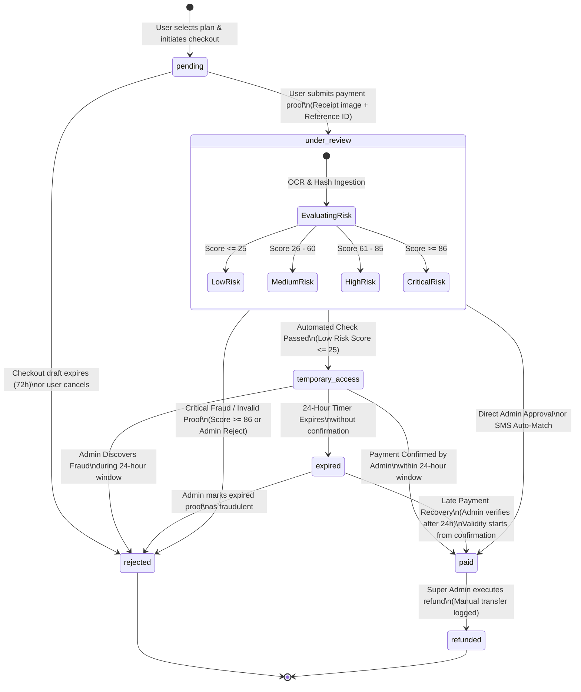

# CareerDev4AI — Subscription System Architecture: Payment State Machine

**Document Version:** 1.0.0  
**Status:** ARCHITECTURAL SPECIFICATION — AUTHORITATIVE SINGLE SOURCE OF TRUTH  
**Last Updated:** November 2026  
**Primary Currency:** Egyptian Pound (EGP)  
**Target Platform:** CareerDev4AI (Egypt-First Career Super App)  
**Authoritative Location:** `docs/subscription-system/planning/PAYMENT_STATE_MACHINE.md`

---

## 1. Executive Summary & Architectural Overview

CareerDev4AI is an Egypt-first career platform providing AI-powered career discovery, learning paths, CV building, and interview preparation. To democratize access in the Egyptian market while maintaining platform sustainability, CareerDev4AI supports localized payment channels:
1. **Vodafone Cash** (Egypt's dominant mobile money wallet network).
2. **InstaPay Egypt** (Instant payment network operated by the Egyptian Banks Company under Central Bank of Egypt regulations).

### 1.1 The Egyptian Payment Reality & Problem Statement
Neither Vodafone Cash nor personal/business InstaPay accounts offer public automated merchant webhook APIs for real-time programmatic confirmation of incoming transfers to small business or individual accounts. As a result, users transfer funds offline or out-of-band and submit payment evidence (transaction reference numbers, sender mobile numbers / Instant Payment Addresses [IPA], and transfer receipt screenshots).

Relying entirely on manual human verification creates severe operational bottlenecks and friction:
- Manual confirmation delays of 1 to 24 hours cause high user drop-off during onboarding.
- Users expect immediate gratification after transferring their hard-earned money.
- Fraud risks (recycled receipts, fabricated Photoshop screenshots, reused transaction IDs) threaten business viability.

### 1.2 The Hybrid State Machine Solution
CareerDev4AI employs a robust, fraud-resilient **Hybrid Payment State Machine**:
- **Optimistic 24-Hour Temporary Access (`temporary_access`)**: Upon evidence submission, if automated risk scoring evaluates the transaction as Low Risk (Score $\le 25$), the user is instantly granted a 24-hour provisional subscription window.
- **Credit-Gated Access**: To prevent abuse and protect infrastructure costs, temporary access strictly permits core features and lightweight AI requests (costing $\le 2$ credits) while blocking expensive batch or multimodal operations ($> 2$ credits).
- **Asynchronous Dual Verification**: Transactions are processed asynchronously via automated receipt OCR/hash verification and an administrative review dashboard.
- **Late Payment Recovery**: If a 24-hour temporary access window expires before manual admin reconciliation, the state safely degrades to `expired` without data loss, and automatically restores to `paid` once the administrator or SMS gateway reconciles the transfer, calculating the subscription duration from the confirmation timestamp.

---

## 2. Verified Facts, Assumptions, and Recommendations

### 2.1 Verified Facts (Existing Codebase)
1. **Backend Runtime & Architecture**: Cloudflare Pages + Cloudflare Workers (`dist/_worker.js` compiled from `worker/index.ts`) with an Express/Node test harness ([`server/jobs/queue.ts`](file:///d:/Saas/careerpilot-ai/server/jobs/queue.ts), [`server/db/supabase.ts`](file:///d:/Saas/careerpilot-ai/server/db/supabase.ts)).
2. **Database & Authorization**: Supabase PostgreSQL with Row Level Security (RLS) enabled on all tables ([`server/db/supabase.ts`](file:///d:/Saas/careerpilot-ai/server/db/supabase.ts), [`server/auth/require-auth.ts`](file:///d:/Saas/careerpilot-ai/server/auth/require-auth.ts)).
3. **Administrative Framework**: Server-enforced RBAC defined in [`shared/admin.ts`](file:///d:/Saas/careerpilot-ai/shared/admin.ts), evaluated in [`server/admin/permissions.ts`](file:///d:/Saas/careerpilot-ai/server/admin/permissions.ts), with existing audit logging in `admin_audit_log` via [`server/db/admin.ts`](file:///d:/Saas/careerpilot-ai/server/db/admin.ts#L1386-L1401).
4. **Background Asynchronous Jobs**: Cloudflare Queues (`careerdev4ai-jobs`) with worker consumers implemented in [`worker/jobs/index.ts`](file:///d:/Saas/careerpilot-ai/worker/jobs/index.ts) and [`server/jobs/queue.ts`](file:///d:/Saas/careerpilot-ai/server/jobs/queue.ts).
5. **AI Service & Quotas**: Google Gemini API via `@google/genai`, with daily limits and per-request quota management defined in [`server/ai/quota.ts`](file:///d:/Saas/careerpilot-ai/server/ai/quota.ts).
6. **In-App Notifications**: Backed by `public.notifications` table and persisted via [`server/db/notifications.ts`](file:///d:/Saas/careerpilot-ai/server/db/notifications.ts).
7. **Monetary Unit**: Egyptian Pound (EGP / ج.م).

### 2.2 Operational Assumptions
1. **InstaPay Transaction Reference**: Standard InstaPay transactions generate a 12-digit numeric Reference / RRN (Retrieval Reference Number) or an EBC alphanumeric transaction code displayed on the completion receipt.
2. **Vodafone Cash SMS Confirmation**: Vodafone Cash transfers generate an SMS to both sender and recipient containing a transfer amount, recipient number, and a transaction ID (typically numeric or alphanumeric).
3. **Receipt Formats**: Users submit images in JPEG, PNG, or WebP format via mobile screenshots or camera captures, typically between 100 KB and 10 MB.
4. **Administrative SLA**: Normal review SLA is within 2 to 6 hours during operating hours (9:00 AM – 11:00 PM CLT) and up to 14 hours overnight.

### 2.3 Architectural Recommendations
1. **Isolated Payment Tables**: Store payment transactions in a dedicated `payment_transactions` table separated from subscription status rows, preventing circular foreign key locks.
2. **SHA-256 + Perceptual Hashing**: Combine cryptographic SHA-256 binary hashing with perceptual image hashing (pHash) to detect exact receipt re-uploads as well as minor cropping/re-compression attempts.
3. **PostgreSQL Row-Level Locking**: Execute all state transitions within a `SERIALIZABLE` or `READ COMMITTED` transaction using `SELECT ... FOR UPDATE` on the payment record to eliminate race conditions between concurrent admin clicks or worker retries.
4. **Pl/pgSQL State Transition Function**: Encapsulate the state machine validation logic within a PostgreSQL stored function (`transition_payment_state`) to guarantee atomic transitions, audit emission, and idempotency at the database engine level.

---

## 3. Payment State Vocabulary & Entity Definitions

The payment engine operates across seven discrete, strictly defined states:

```
  +---------+         +--------------+         +------------------+
  | pending | ------> | under_review | ------> | temporary_access |
  +---------+         +--------------+         +------------------+
       |                     |                          |
       |                     v                          v
       |               +----------+               +-----------+
       |               | rejected | <------------ |  expired  |
       |               +----------+               +-----------+
       |                     ^                          |
       |                     |                          |
       +-------------------->| (timeout/cancel)         |
                             |                          v
                      +-------------+            +--------------+
                      |  refunded   | <--------- |     paid     |
                      +-------------+            +--------------+
```

### 3.1 State Definitions

| State | Scope & Description | User Access Level | Immutability / Timer |
|---|---|---|---|
| `pending` | User initiated checkout and selected an EGP subscription plan. Payment instructions (Vodafone Cash wallet number or InstaPay IPA/account) are displayed. No payment evidence has been submitted. | **Free Tier** (No elevated access). | Expires after 72 hours of inactivity. |
| `under_review` | User submitted payment proof (receipt image, reference ID, sender details). Automated risk scoring and async checks are in flight. If risk score is $\ge 26$, the payment remains here awaiting manual admin review. | **Free Tier** (Elevated access not yet granted). | None (Awaiting triage/review). |
| `temporary_access` | Automated risk assessment evaluated submission as **Low Risk** (Score $\le 25$). User is granted immediate 24-hour provisional access to Pro features. | **Pro (Provisional)**: Gated to operations costing $\le 2$ AI credits. | **Strict 24-Hour Timer**: Starts immediately on entry. Resubmissions do NOT reset timer. |
| `paid` | Payment is definitively confirmed by an authorized administrator or trusted automated bank/SMS reconciliation. Full subscription is active. | **Full Paid Tier**: Unrestricted access to all plan entitlements. | Terminal payment state; subscription duration starts from confirmation timestamp. |
| `rejected` | Payment proof was determined to be fraudulent, invalid, recycled, or unverified. | **Free Tier** (Access immediately terminated if previously provisional). | Terminal state for this transaction ID. |
| `expired` | The 24-hour provisional window in `temporary_access` elapsed without administrative confirmation. | **Free Tier** (Access gracefully suspended). | Eligible for **Late Payment Recovery** to `paid` if verified later. |
| `refunded` | Confirmed payment was refunded back to the user via manual bank transfer or Vodafone Cash reverse payment. | **Free Tier** (Subscription revoked). | Final terminal state. |

---

## 4. Comprehensive State Diagram



---

## 5. Exhaustive State Transition Table

The following table documents every valid state transition allowed within the payment pipeline. Any transition not explicitly listed here is strictly prohibited and must be rejected by database constraints.

| # | From State | To State | Trigger / Event | Authorized Actor | Required Evidence & Preconditions | Side Effects & Actions | Recovery & Failure Behavior |
|---|---|---|---|---|---|---|---|
| **T01** | `[*] / None` | `pending` | `CHECKOUT_INITIATED` | `user` | - User authenticated via Supabase Auth.<br>- Valid Plan ID in EGP.<br>- No active overlapping subscription.<br>- Idempotency key present. | - Inserts row into `payment_transactions` with state `pending`.<br>- Generates unique transaction tracking reference.<br>- Emits audit log entry.<br>- Renders payment instructions. | Abort checkout; display localized error. No database mutation. |
| **T02** | `pending` | `under_review` | `PROOF_SUBMITTED` | `user` | - Receipt image uploaded to Supabase Storage bucket `payment-receipts`.<br>- SHA-256 hash computed.<br>- Sender phone or IPA supplied.<br>- Reference number supplied.<br>- Transaction in `pending` state. | - Stores evidence in `payment_evidence`.<br>- Deduplicates hash in `payment_receipt_hashes`.<br>- Dispatches Cloudflare queue job `evaluate-payment-risk`.<br>- Sends in-app confirmation notification.<br>- Emits audit log. | Rollback upload; keep in `pending`; prompt user to re-upload. |
| **T03** | `pending` | `rejected` | `CHECKOUT_CANCELLED` or `CHECKOUT_TIMED_OUT` | `user` or `system_cron` | - User explicitly cancels checkout OR 72 hours elapsed since creation without proof submission. | - Sets `cancelled_at` / `rejected_at`.<br>- Frees any locked checkout draft slots.<br>- Emits audit log. | Idempotent cleanup. Safe to retry. |
| **T04** | `under_review` | `temporary_access` | `AUTO_RISK_APPROVED` | `system_automated` (Worker) | - Risk Score $\le 25$.<br>- Receipt SHA-256 hash has zero prior matches.<br>- Reference number has zero prior matches.<br>- Payment method valid (Vodafone Cash or InstaPay).<br>- Transaction in `under_review` state. | - Sets state to `temporary_access`.<br>- Sets `temporary_access_granted_at = NOW()`.<br>- Sets `temporary_access_expires_at = NOW() + INTERVAL '24 hours'`.<br>- Sets user provisional access flags in `profiles`.<br>- Enqueues expiry check job.<br>- Sends "Temporary Access Granted" notification.<br>- Emits audit log. | If worker crashes, transaction rolls back to `under_review` for retry or fallback to manual review queue. |
| **T05** | `under_review` | `paid` | `ADMIN_APPROVE` or `AUTO_SMS_MATCH` | `admin` (with `payments.verify`) or `system_automated` | - Exact bank/wallet incoming transfer verified.<br>- Reference and amount match.<br>- Transaction currently in `under_review`. | - Sets state to `paid`.<br>- Sets `paid_at = NOW()`.<br>- Sets `subscription_starts_at = NOW()`.<br>- Sets `subscription_ends_at = NOW() + plan_duration`.<br>- Activates full subscription tier in `user_subscriptions`.<br>- Emits celebration in-app notification & bilingual email.<br>- Emits financial audit entry. | Rollback to `under_review`; alert system administrator of activation failure. |
| **T06** | `under_review` | `rejected` | `AUTO_FRAUD_DETECTED` or `ADMIN_REJECT` | `system_automated` or `admin` (with `payments.verify`) | - Risk Score $\ge 86$ (Hard Fraud) OR admin inspects receipt and determines it is forged, invalid, or unpaid.<br>- Admin mandatory rejection reason provided. | - Sets state to `rejected`.<br>- Sets `rejected_at = NOW()`.<br>- Logs `rejection_reason` and risk metrics.<br>- Sends rejection notification with specific appeal instructions.<br>- Emits audit entry. | Rollback to `under_review`; retry audit logging. |
| **T07** | `temporary_access` | `paid` | `ADMIN_APPROVE` or `AUTO_SMS_MATCH` | `admin` (with `payments.verify`) or `system_automated` | - Admin verifies transfer in Vodafone Cash wallet or InstaPay statement.<br>- Transaction in `temporary_access` state.<br>- Idempotency token verified. | - Sets state to `paid`.<br>- Clears provisional limitations.<br>- Sets `paid_at = NOW()`.<br>- Sets `subscription_starts_at = NOW()`.<br>- Sets `subscription_ends_at = NOW() + plan_duration` (User receives full duration from confirmation moment).<br>- Unlocks high-credit AI operations.<br>- Dispatches welcome notifications.<br>- Emits audit log. | Rollback to `temporary_access`; alert administrator. |
| **T08** | `temporary_access` | `expired` | `TEMP_TIMER_EXPIRED` | `system_cron` (Worker) | - `temporary_access_expires_at <= NOW()`.<br>- Transaction currently in `temporary_access`.<br>- Not yet confirmed by admin. | - Sets state to `expired`.<br>- Sets `expired_at = NOW()`.<br>- Downgrades user profile access to Free Tier.<br>- Preserves all user-generated work.<br>- Sends "Temporary Access Expired — Verification in Progress" notification.<br>- Emits audit log. | Idempotent check; retried on next cron iteration if worker fails. |
| **T09** | `temporary_access` | `rejected` | `ADMIN_REJECT` | `admin` (with `payments.verify`) | - Admin reviews receipt during 24h window and flags as fraudulent/fake.<br>- Mandatory rejection reason provided. | - Immediately revokes provisional Pro access.<br>- Sets state to `rejected`.<br>- Records admin notes.<br>- Dispatches fraud/rejection alert to user.<br>- Flags profile for suspicious payment velocity.<br>- Emits audit log. | Rollback; keep in `temporary_access`; alert Super Admin on collision. |
| **T10** | `expired` | `paid` | `LATE_ADMIN_APPROVE` | `admin` (with `payments.verify`) or `system_automated` | - Admin verifies payment after 24h expiration.<br>- Transaction currently in `expired`.<br>- Admin confirmation justification provided. | - Sets state to `paid`.<br>- **Key Rule**: Sets `subscription_starts_at = NOW()` and `subscription_ends_at = NOW() + plan_duration`.<br>- Restores full Pro entitlements.<br>- Sends "Subscription Activated" recovery notification.<br>- Emits audit log. | Rollback to `expired`; alert admin of activation failure. |
| **T11** | `expired` | `rejected` | `ADMIN_REJECT` | `admin` (with `payments.verify`) | - Admin reviews expired transaction and confirms receipt was fraudulent or invalid. | - Sets state to `rejected`.<br>- Logs administrative reasoning.<br>- Sends final rejection notification.<br>- Emits audit log. | Rollback to `expired`; retry audit write. |
| **T12** | `paid` | `refunded` | `ADMIN_REFUND` | `super_admin` ONLY | - Payment currently in `paid`.<br>- Super Admin verifies manual refund transfer to user's Vodafone Cash wallet / bank account.<br>- Mandatory refund reference & reason entered. | - Sets state to `refunded`.<br>- Sets `refunded_at = NOW()`.<br>- Terminates active subscription.<br>- Downgrades user profile to Free Tier.<br>- Sends bilingual refund confirmation notification.<br>- Emits high-priority financial audit log. | Rollback to `paid`; alert Super Admin immediately. |

---

## 6. Invalid Transitions & Architectural Boundary Guards

### 6.1 State Transition Permissibility Matrix

The following $7 \times 7$ matrix formally establishes what transitions are allowed versus strictly forbidden. Any cell marked **FORBIDDEN** will be rejected by database triggers.

| Target State $\rightarrow$<br>Source State $\downarrow$ | `pending` | `under_review` | `temporary_access` | `paid` | `rejected` | `expired` | `refunded` |
|---|---|---|---|---|---|---|---|
| **`pending`** | FORBIDDEN | **ALLOWED (T02)** | FORBIDDEN | FORBIDDEN | **ALLOWED (T03)** | FORBIDDEN | FORBIDDEN |
| **`under_review`** | FORBIDDEN | FORBIDDEN | **ALLOWED (T04)** | **ALLOWED (T05)** | **ALLOWED (T06)** | FORBIDDEN | FORBIDDEN |
| **`temporary_access`**| FORBIDDEN | FORBIDDEN | FORBIDDEN | **ALLOWED (T07)** | **ALLOWED (T09)** | **ALLOWED (T08)**| FORBIDDEN |
| **`paid`** | FORBIDDEN | FORBIDDEN | FORBIDDEN | FORBIDDEN | FORBIDDEN | FORBIDDEN | **ALLOWED (T12)**|
| **`rejected`** | FORBIDDEN | FORBIDDEN | FORBIDDEN | FORBIDDEN | FORBIDDEN | FORBIDDEN | FORBIDDEN |
| **`expired`** | FORBIDDEN | FORBIDDEN | FORBIDDEN | **ALLOWED (T10)** | **ALLOWED (T11)** | FORBIDDEN | FORBIDDEN |
| **`refunded`** | FORBIDDEN | FORBIDDEN | FORBIDDEN | FORBIDDEN | FORBIDDEN | FORBIDDEN | FORBIDDEN |

### 6.2 Architectural Rationale for Key Forbidden Transitions

1. **`pending` $\rightarrow$ `paid` (FORBIDDEN)**:
   - *Rationale*: A transaction cannot jump from checkout initiation directly to `paid` without evidence submission (`under_review`) and verification. Bypassing evidence submission is a catastrophic integrity violation.
2. **`pending` $\rightarrow$ `temporary_access` (FORBIDDEN)**:
   - *Rationale*: Temporary access is only granted *after* payment proof is submitted and passes automated risk scoring. Users cannot obtain free access simply by clicking checkout.
3. **`paid` $\rightarrow$ `temporary_access` (FORBIDDEN)**:
   - *Rationale*: Downgrading a fully verified, paying customer to provisional temporary access would revoke their access to $>2$ credit AI operations and violate consumer trust.
4. **`paid` $\rightarrow$ `rejected` (FORBIDDEN)**:
   - *Rationale*: Once a payment is verified and marked `paid`, it cannot be arbitrarily marked `rejected`. If the transaction was fraudulent or needs revocation, the authorized financial path is `refunded` via Super Admin action.
5. **`temporary_access` $\rightarrow$ `temporary_access` (Self-Loop / Reset FORBIDDEN)**:
   - *Rationale*: Resubmitting the same receipt or modifying transaction metadata while in `temporary_access` must NEVER restart or extend the 24-hour timer. Allowing self-transitions would create an infinite free subscription vulnerability.
6. **`rejected` $\rightarrow$ `paid` (Direct FORBIDDEN)**:
   - *Rationale*: A transaction explicitly marked fraudulent or rejected cannot be flipped directly to `paid`. If a mistake occurred, a new transaction must be initiated, or a Super Admin must execute a formal, audited reconciliation override.
7. **`refunded` $\rightarrow$ Any State (FORBIDDEN)**:
   - *Rationale*: `refunded` is a terminal state. Once refunded, money has exited the business, and the transaction is permanently closed.

---

## 7. Fraud Protection Architecture

Because Vodafone Cash and InstaPay rely on out-of-band transfers without real-time merchant webhooks, the system implements an eight-tier fraud defense architecture:

```
[Uploaded Receipt Binary]
          |
          v
+-----------------------------+
| 1. SHA-256 Binary Hash      | ---> Check collision in `payment_receipt_hashes`
+-----------------------------+
          |
          v
+-----------------------------+
| 2. Perceptual Hash (pHash)  | ---> Check visual hamming distance <= 5
+-----------------------------+
          |
          v
+-----------------------------+
| 3. OCR Text Extraction      | ---> Gemini Vision / Tesseract extraction
+-----------------------------+
          |
          v
+-----------------------------+
| 4. Canonical Reference Check| ---> Unique `(payment_method, canonical_ref)`
+-----------------------------+
          |
          v
+-----------------------------+
| 5. Amount & Date Sanity     | ---> EGP match tolerance = 0; Date skew <= 24h
+-----------------------------+
          |
          v
+-----------------------------+
| 6. Risk Scoring Model       | ---> Calculate Risk Score (0 - 100)
+-----------------------------+
```

### 7.1 Duplicate Receipt Detection (Hash-Based)
1. **Cryptographic SHA-256 Hash**:
   - Immediately upon binary receipt upload in [`worker/index.ts`](file:///d:/Saas/careerpilot-ai/worker/index.ts) or Express handler, compute the cryptographic SHA-256 hash of the raw image bytes:
     $$\text{hash} = \text{SHA-256}(\text{receipt\_buffer})$$
   - Query `payment_receipt_hashes` table. If the hash already exists under *any* account:
     - If the existing record is `paid` or `under_review`: **Instant Hard Fraud Rejection (Score = 100)**.
     - If the existing record was `cancelled` by the *same* user: Permitted only if reference ID is identical.
2. **Perceptual Hashing (pHash)**:
   - To catch bad actors who re-compress, crop, or screenshot an existing receipt to alter the SHA-256 hash, compute an 8x8 DCT perceptual hash (64-bit integer).
   - If Hamming distance $\le 5$ compared to any existing verified receipt within the last 90 days, the submission is flagged for manual fraud review with a +45 risk penalty.

### 7.2 Transaction Reference Reuse Prevention
1. **Normalization & Canonicalization**:
   - Egyptian users frequently type reference numbers with spaces, leading zeros, or confusing characters (e.g., typing letter `O` for digit `0`, or letter `I` for digit `1`).
   - Normalization Pipeline:
     ```typescript
     export function canonicalizeReference(raw: string): string {
       return raw
         .trim()
         .toUpperCase()
         .replace(/[\s\-_]/g, '')
         .replace(/O/g, '0')
         .replace(/I/g, '1');
     }
     ```
2. **Database Unique Constraint**:
   - A unique composite index guarantees that no reference number can ever be redeemed twice:
     ```sql
     CREATE UNIQUE INDEX idx_unique_payment_reference 
     ON payment_transactions (payment_method, normalized_reference) 
     WHERE state NOT IN ('rejected', 'cancelled');
     ```

### 7.3 Amount Mismatch Detection
1. **Zero-Tolerance Underpayment**:
   - All subscription plans have fixed EGP pricing (e.g., 150 EGP/month, 350 EGP/quarter, 1,200 EGP/year).
   - The OCR engine extracts the transferred amount:
     - If $\text{Extracted Amount} < \text{Expected Plan Price}$: Automatic transition to `under_review` with +50 risk score penalty. Temporary access is **strictly blocked**.
2. **Overpayment Handling**:
   - If $\text{Extracted Amount} > \text{Expected Plan Price}$, the system flags the transaction for admin review to verify whether the user intended to purchase a longer duration or needs wallet credit.

### 7.4 Date & Timestamp Mismatch Detection
1. **Future Timestamp Guard**:
   - If the receipt timestamp is $> 15 \text{ minutes}$ in the future (accounting for server clock drift), the receipt is flagged as manipulated (+40 risk).
2. **Recycled Receipt Guard**:
   - The payment timestamp on the receipt must have occurred *after* the user's checkout session was created, with a maximum allowable lookback of 24 hours prior to checkout initiation.
   - If $\text{Receipt Timestamp} < \text{Checkout Created At} - 24 \text{ hours}$: Flagged as recycled receipt (+35 risk).

### 7.5 Concurrent Confirmation Protection
1. **Race Condition Prevention**:
   - If two administrators click "Approve" at the same second, or if an automated SMS worker finishes at the exact moment an administrator is reviewing:
   - The database enforces pessimistic locking via `SELECT ... FOR UPDATE`:
     ```sql
     -- Atomic state lock
     SELECT state, version FROM payment_transactions 
     WHERE id = p_payment_id FOR UPDATE;
     ```
   - Optimistic concurrency control is maintained via a `version` integer column incremented on every state transition.

### 7.6 Repeated Delivery Protection (Idempotency)
- All incoming confirmation and transition requests must supply an `Idempotency-Key` HTTP header.
- The server checks the `payment_idempotency_records` table:
  - If a request with the same idempotency key is currently processing: Return `409 Conflict` (`TRANSACTION_IN_FLIGHT`).
  - If the request was previously executed successfully: Return the cached HTTP response code and body without re-running transition side effects.

### 7.7 Unauthorized Approval Prevention
- Handled via Supabase RLS and server-side RBAC ([`server/admin/permissions.ts`](file:///d:/Saas/careerpilot-ai/server/admin/permissions.ts)):
  - End-users possess **zero UPDATE permissions** on `payment_transactions`.
  - Regular administrators require the explicit permission `payments.verify` declared in [`shared/admin.ts`](file:///d:/Saas/careerpilot-ai/shared/admin.ts).
  - Refunds (`paid` $\rightarrow$ `refunded`) are restricted strictly to the `super_admin` role.

### 7.8 Fraudulent Admin Operation Detection
1. **Self-Approval Prohibition**:
   - An administrator cannot approve a payment attached to their own profile ID:
     ```sql
     IF v_payment.user_id = v_admin_profile_id THEN
       RAISE EXCEPTION 'Administrative self-approval is strictly forbidden' 
         USING ERRCODE = 'P7001';
     END IF;
     ```
2. **Velocity Thresholds**:
   - If any administrator approves $> 15$ payments within a 60-second window, an automated security freeze triggers, dispatching an alert to the Super Admin Slack/Discord channel.
3. **Mandatory Audit Justification**:
   - Any manual rejection or refund requires a non-empty `admin_notes` string containing at least 15 characters describing the justification.

---

## 8. Risk Scoring Engine & Automated Triage

Every payment proof submitted by a user is evaluated by the automated risk scoring engine within the Cloudflare Queue job `evaluate-payment-risk`.

### 8.1 Risk Signals & Weight Matrix

$$\text{Total Risk Score} = \max\left(0, \min\left(100, \sum \text{Weights}\right)\right)$$

| Signal Code | Signal Description | Weight | Trigger Condition |
|---|---|---|---|
| `SIG_NEW_ACCOUNT` | New User Profile | **+15** | Profile created $< 24$ hours prior to checkout. |
| `SIG_PRIOR_REJECTION` | Prior Payment Rejection | **+40** | User profile has $\ge 1$ previously rejected transaction. |
| `SIG_GEO_MISMATCH` | Geolocation Mismatch | **+20** | Client IP country is NOT `EG` (Egypt) and no verified roaming header. |
| `SIG_OCR_UNREADABLE` | OCR Confidence Low | **+25** | OCR engine failed to locate amount, date, or reference string. |
| `SIG_AMOUNT_MISMATCH` | Amount Discrepancy | **+50** | OCR extracted amount differs from expected plan price. |
| `SIG_STALE_RECEIPT` | Stale Payment Date | **+35** | Payment receipt date is $> 24$ hours older than checkout initiation. |
| `SIG_PHONE_COLLISION` | Sender Details Shared | **+50** | Sender phone or IPA is linked to another user profile's rejected payment. |
| `SIG_BURST_ATTEMPTS` | Submission Velocity | **+30** | User submitted $> 3$ checkout drafts in the past 1 hour. |
| `SIG_IMAGE_EDITED` | Image Manipulation Detected | **+60** | EXIF metadata indicates image editor software (Photoshop, Canva, PicsArt). |
| `SIG_CLEAN_HISTORY` | Trusted Returning User | **-25** | User has $\ge 1$ past subscription marked `paid` without dispute. |
| `SIG_EXACT_REF_MATCH` | Reference Format Valid | **-10** | Reference format matches InstaPay/Vodafone Cash regex perfectly. |

### 8.2 Score Ranges & Deterministic Routing

```
  0               25               60               85              100
  +----------------+----------------+----------------+----------------+
  |    LOW RISK    |  MEDIUM RISK   |   HIGH RISK    | CRITICAL FRAUD |
  |  (Score 0-25)  | (Score 26-60)  | (Score 61-85)  | (Score 86-100) |
  +----------------+----------------+----------------+----------------+
          |                |                |                |
          v                v                v                v
   Auto-Approve       Hold in          Hold in          Auto-Reject
   Temporary Access   `under_review`   `under_review`   State = `rejected`
   (24h Provisional)  Standard Queue   Priority Queue   Flag User Profile
                                       Warning Badge
```

1. **0 – 25 (Low Risk)**:
   - System immediately triggers transition **T04** (`under_review` $\rightarrow$ `temporary_access`).
   - 24-hour timer begins. User receives instant provisional Pro access.
   - Transaction is enqueued for routine asynchronous administrative reconciliation.
2. **26 – 60 (Medium Risk)**:
   - Transaction remains in `under_review`.
   - **No temporary access is granted**.
   - User UI displays: *"Your payment is currently being reviewed by our verification team. Estimated review time: 1-4 hours."*
3. **61 – 85 (High Risk)**:
   - Transaction remains in `under_review`.
   - Priority queue for Senior Admin review.
   - Admin UI displays high-risk warning flags highlighting specific signal triggers (e.g., amount mismatch, edited EXIF).
4. **86 – 100 (Critical Risk / Hard Fraud)**:
   - System immediately triggers transition **T06** (`under_review` $\rightarrow$ `rejected`).
   - Reason logged: `AUTOMATED_FRAUD_PREVENTION`.
   - Receipt hash and reference blacklisted.
   - User account flagged for administrative investigation.

---

## 9. Temporary Access Rules & AI Quota Gating

### 9.1 The 24-Hour Timer Mechanics
1. **Timer Initialization**:
   - The timer begins the exact millisecond state transitions to `temporary_access`.
   - Computed as: `temporary_access_expires_at = NOW() + INTERVAL '24 hours'`.
2. **Immutability of the Timer**:
   - If a user uploads a revised screenshot, adds a comment, or re-submits transaction metadata while in `temporary_access`, the original `temporary_access_expires_at` timestamp **remains strictly unchanged**.
   - The state machine rejects any attempt to reset or extend `temporary_access_expires_at` via client actions.

### 9.2 Exclusion of Expensive AI Operations ($> 2$ Credits)
To prevent bad actors from creating disposable accounts, submitting bogus receipts, and draining expensive Gemini LLM tokens, CareerDev4AI enforces credit gating during `temporary_access`.

#### AI Feature Cost Breakdown & Permission Matrix:
| Feature / Endpoint | Codebase Handler | Credit Cost | Permitted in `temporary_access`? |
|---|---|---|---|
| CV Keyword Match / Basic ATS Score | [`server/cv/atsAnalysis.ts`](file:///d:/Saas/careerpilot-ai/server/cv/atsAnalysis.ts) | 1 credit | **YES** |
| Single Bullet Point Polish | [`server/cv/aiAssist.ts`](file:///d:/Saas/careerpilot-ai/server/cv/aiAssist.ts) | 1 credit | **YES** |
| Career Path Overview / Roadmap View | [`server/roadmap/service.ts`](file:///d:/Saas/careerpilot-ai/server/roadmap/service.ts) | 2 credits | **YES** |
| Basic Cover Letter Generation | [`server/cv/coverLetter.ts`](file:///d:/Saas/careerpilot-ai/server/cv/coverLetter.ts) | 2 credits | **YES** |
| **Full ATS Deep Rewrite & Optimization** | [`server/cv/buildCv.ts`](file:///d:/Saas/careerpilot-ai/server/cv/buildCv.ts) | **5 credits** | **BLOCKED (Requires Full Paid)** |
| **Comprehensive AI Career Roadmap Generation** | [`server/jobs/tasks/roadmap.ts`](file:///d:/Saas/careerpilot-ai/server/jobs/tasks/roadmap.ts) | **6 credits** | **BLOCKED (Requires Full Paid)** |
| **Interactive AI Mock Interview Simulation** | [`server/db/interviewSessions.ts`](file:///d:/Saas/careerpilot-ai/server/db/interviewSessions.ts) | **8 credits** | **BLOCKED (Requires Full Paid)** |
| **Multimodal Video / Speech Analysis** | Gemini Live / Audio Engine | **10 credits** | **BLOCKED (Requires Full Paid)** |

#### Architectural Gating Guard (Implementation Blueprint):
```typescript
// server/ai/quota.ts integration
export function assertAiOperationAllowed(
  userSubscriptionState: PaymentState,
  operationCostCredits: number
): void {
  if (userSubscriptionState === 'temporary_access' && operationCostCredits > 2) {
    throw new QuotaGateError(
      'OPERATION_GATED_DURING_PROVISIONAL_ACCESS',
      'This advanced AI feature requires full payment confirmation. Your payment is currently under review.'
    );
  }
}
```

### 9.3 Expiration Mechanics (`temporary_access` $\rightarrow$ `expired`)
1. **Background Cron Worker**:
   - A Cloudflare Queue cron job runs every 5 minutes:
     ```sql
     SELECT id, user_id FROM payment_transactions 
     WHERE state = 'temporary_access' 
       AND temporary_access_expires_at <= NOW();
     ```
2. **Graceful Degradation**:
   - Invokes state transition **T08** (`temporary_access` $\rightarrow$ `expired`).
   - The user profile is reverted to the standard Free Tier.
   - User work (created CV drafts, interview bookmarks, roadmap milestones) is **100% preserved**.

---

## 10. Late Payment Recovery & Subscription Validity Mechanics

### 10.1 The Late Confirmation Scenario
In Egypt, bank-to-bank settlement delays over weekends (Friday/Saturday) or network outages on mobile wallet servers can result in an administrative confirmation occurring *after* the 24-hour temporary access window has expired (e.g., 36 hours after submission).

### 10.2 Transition from `expired` to `paid` (Transition T10)
When an administrator reconciles the transaction after it has expired:
1. **State Mutation**: Transition moves directly from `expired` to `paid`.
2. **Start Timestamp Rule (Zero Lost Days)**:
   - **Crucial Rule**: The subscription duration (e.g., 30 days) starts from the **Confirmation Timestamp**, NOT the initial submission timestamp or temporary access grant timestamp:
     $$\text{subscription\_starts\_at} = \text{NOW()}$$
     $$\text{subscription\_ends\_at} = \text{NOW()} + \text{INTERVAL '30 days'}$$
   - *User Experience Benefit*: The user is never penalized for administrative or banking delays. They receive the full 30 days of paid access starting the second verification is confirmed.
3. **Data Preservation Guarantee**:
   - All CVs, notes, assessments, and profile extensions created by the user while they were in `temporary_access` remain intact in PostgreSQL.
   - When recovered to `paid`, full edit and export rights are instantly restored.

---

## 11. Idempotency & Distributed Concurrency Architecture

### 11.1 The Distributed Risk
CareerDev4AI runs on Cloudflare Workers edge nodes globally, with backend jobs processed by Cloudflare Queues (`careerdev4ai-jobs`). Multiple network retries, race conditions between browser tabs, or concurrent worker executions can result in duplicated API requests.

### 11.2 Idempotency Pipeline
1. **Idempotency Record Table (`payment_idempotency_records`)**:
   - Stores `idempotency_key`, `payment_id`, `target_state`, `status` (`processing` | `completed`), and `response_payload`.
2. **Deterministic Processing Flow**:
   - Step 1: Open transaction.
   - Step 2: `INSERT INTO payment_idempotency_records ... ON CONFLICT (idempotency_key) DO NOTHING`.
   - Step 3: If conflict and status is `completed`, return cached response immediately.
   - Step 4: If conflict and status is `processing`, return `409 Conflict` (retry after 2 seconds).
   - Step 5: Execute state transition logic with row lock.
   - Step 6: Update idempotency record to `completed` with response payload.
   - Step 7: Commit transaction.

---

## 12. Audit Trail, Financial Integrity & Compliance

### 12.1 Immutable Audit Log Table (`payment_audit_logs`)
Every state transition—whether initiated by user, automated worker, cron schedule, or administrator—writes an immutable record to `payment_audit_logs`.

```sql
CREATE TABLE public.payment_audit_logs (
    id UUID PRIMARY KEY DEFAULT gen_random_uuid(),
    payment_id UUID NOT NULL REFERENCES public.payment_transactions(id) ON DELETE RESTRICT,
    from_state VARCHAR(32) NOT NULL,
    to_state VARCHAR(32) NOT NULL,
    actor_type VARCHAR(20) NOT NULL CHECK (actor_type IN ('user', 'system_automated', 'admin', 'system_cron')),
    actor_id UUID NULL REFERENCES auth.users(id),
    actor_ip INET NULL,
    user_agent TEXT NULL,
    risk_score INT NULL,
    evidence_snapshot JSONB NOT NULL DEFAULT '{}'::jsonb,
    admin_notes TEXT NULL,
    created_at TIMESTAMPTZ NOT NULL DEFAULT NOW()
);

-- RLS: Append-only for service role. Absolutely NO UPDATE or DELETE.
ALTER TABLE public.payment_audit_logs ENABLE ROW LEVEL SECURITY;
CREATE POLICY payment_audit_read_admin ON public.payment_audit_logs
    FOR SELECT TO authenticated
    USING (EXISTS (SELECT 1 FROM public.admins WHERE profile_id = auth.uid() AND status = 'active'));
```

### 12.2 Integration with Admin Communication Center
Every administrative transition (T05, T06, T07, T09, T10, T11, T12) simultaneously writes to `admin_audit_log` via [`logAdminAction()`](file:///d:/Saas/careerpilot-ai/server/db/admin.ts#L1387) to maintain unified governance across the platform.

### 12.3 Financial Audit Reconciliation Queries
At the end of every calendar day (23:59:59 CLT), the system generates an automated financial reconciliation report comparing confirmed `paid` transactions against verified wallet/bank statements:

```sql
-- Daily EGP Revenue by Payment Rail
SELECT 
    DATE(paid_at AT TIME ZONE 'Africa/Cairo') AS reconciliation_date,
    payment_method,
    COUNT(id) AS successful_transactions,
    SUM(amount_egp) AS total_revenue_egp
FROM public.payment_transactions
WHERE state = 'paid'
  AND paid_at >= NOW() - INTERVAL '30 days'
GROUP BY 1, 2
ORDER BY 1 DESC, 2 ASC;
```

---

## 13. Bilingual Notification Matrix (Arabic & English)

In accordance with CareerDev4AI's 100% bilingual Egypt-first policy, every user-facing state change dispatches localized in-app notifications (persisted via [`server/db/notifications.ts`](file:///d:/Saas/careerpilot-ai/server/db/notifications.ts)) and transactional emails.

| Transition | Recipient | In-App / Email | Priority | English Message (`en`) | Arabic Message (`ar`) | Link View |
|---|---|---|---|---|---|---|
| **T01** (`pending`) | User | In-App | Normal | "Complete your subscription checkout by transferring to our Vodafone Cash / InstaPay account." | "أكمل اشتراكك عبر تحويل المبلغ إلى حساب فودافون كاش أو إنستاباي الخاص بنا." | `'checkout'` |
| **T02** (`under_review`) | User | In-App + Email | Normal | "We received your payment proof! Our verification engine is processing your transfer." | "تم استلام إيصال الدفع بنجاح! جاري التحقق من عملية التحويل." | `'settings'` |
| **T04** (`temporary_access`) | User | In-App + Email | High | "Provisional Pro Access Active! Enjoy 24 hours of Pro features while we finalize your verification." | "تم تفعيل الوصول المؤقت! استمتع بمميزات باقة برو لمدة 24 ساعة بينما نؤكد الدفع." | `'dashboard'` |
| **T05 / T07 / T10** (`paid`) | User | In-App + Email | Critical | "Payment Confirmed! Your Pro Subscription is now fully active for 30 days. Welcome aboard!" | "تم تأكيد الدفع بنجاح! اشتراك برو مفعل بالكامل الآن لمدة 30 يوماً. أهلاً بك!" | `'dashboard'` |
| **T06 / T09 / T11** (`rejected`) | User | In-App + Email | Critical | "Payment Verification Failed: Your payment proof could not be verified. Please review the reason and re-submit." | "تعذر التحقق من الدفع: لم نتمكن من مطابقة الإيصال. يرجى مراجعة السبب وإعادة المحاولة." | `'checkout'` |
| **T08** (`expired`) | User | In-App + Email | Important | "Your 24-hour temporary access has expired. Our team is still reviewing your payment proof." | "انتهت فترة الوصول المؤقت (24 ساعة). فريقنا ما زال يراجع إيصال الدفع وسيفعل حسابك فور المطابقة." | `'settings'` |
| **T12** (`refunded`) | User | In-App + Email | Critical | "Refund Processed: Your payment has been refunded to your wallet/bank account." | "تم رد المبلغ: تم إرسال المبلغ المسترد إلى محفظتك / حسابك البنكي." | `'settings'` |
| **T02 / T08** (High Risk / Delay) | Admins | Webhook / Dashboard | High | "Payment Alert: New high-risk submission or expired temporary access requires manual review." | "تنبيه إداري: عملية دفع جديدة عالية المخاطر أو وصول مؤقت منتهي يتطلب مراجعة يدوية." | `'admin/payments'` |

---

## 14. Concrete Schema & Implementation Blueprint

### 14.1 PostgreSQL Schema DDL (Supabase Migration Blueprint)

```sql
-- Migration: 20261106000004_payment_state_machine.sql

-- 1. Payment state vocabulary
CREATE TYPE public.payment_state AS ENUM (
    'pending',
    'under_review',
    'temporary_access',
    'paid',
    'rejected',
    'expired',
    'refunded'
);

-- 2. Payment rail methods
CREATE TYPE public.payment_method_type AS ENUM (
    'vodafone_cash',
    'instapay'
);

-- 3. Primary Payment Transactions Table
CREATE TABLE public.payment_transactions (
    id UUID PRIMARY KEY DEFAULT gen_random_uuid(),
    user_id UUID NOT NULL REFERENCES auth.users(id) ON DELETE RESTRICT,
    plan_id VARCHAR(64) NOT NULL,
    amount_egp NUMERIC(10, 2) NOT NULL CHECK (amount_egp > 0),
    payment_method public.payment_method_type NOT NULL,
    state public.payment_state NOT NULL DEFAULT 'pending',
    
    -- Evidence fields
    raw_reference VARCHAR(128) NULL,
    normalized_reference VARCHAR(128) NULL,
    sender_identifier VARCHAR(128) NULL, -- Phone or IPA
    receipt_storage_path TEXT NULL,
    receipt_sha256 CHAR(64) NULL,
    
    -- Risk metrics
    risk_score INT NULL CHECK (risk_score BETWEEN 0 AND 100),
    risk_signals JSONB NOT NULL DEFAULT '[]'::jsonb,
    
    -- Timestamps
    created_at TIMESTAMPTZ NOT NULL DEFAULT NOW(),
    updated_at TIMESTAMPTZ NOT NULL DEFAULT NOW(),
    proof_submitted_at TIMESTAMPTZ NULL,
    temporary_access_granted_at TIMESTAMPTZ NULL,
    temporary_access_expires_at TIMESTAMPTZ NULL,
    paid_at TIMESTAMPTZ NULL,
    rejected_at TIMESTAMPTZ NULL,
    expired_at TIMESTAMPTZ NULL,
    refunded_at TIMESTAMPTZ NULL,
    
    -- Subscription interval
    subscription_starts_at TIMESTAMPTZ NULL,
    subscription_ends_at TIMESTAMPTZ NULL,
    
    -- Administrative fields
    reviewed_by UUID NULL REFERENCES auth.users(id),
    rejection_reason TEXT NULL,
    admin_notes TEXT NULL,
    version INT NOT NULL DEFAULT 1
);

-- Indexes
CREATE INDEX idx_payments_user_id ON public.payment_transactions(user_id);
CREATE INDEX idx_payments_state ON public.payment_transactions(state);
CREATE INDEX idx_payments_temp_expiry ON public.payment_transactions(temporary_access_expires_at) 
    WHERE state = 'temporary_access';
CREATE UNIQUE INDEX idx_payments_unique_ref ON public.payment_transactions(payment_method, normalized_reference) 
    WHERE state NOT IN ('rejected', 'pending');

-- 4. Receipt Hash Tracking (Duplicate Detection)
CREATE TABLE public.payment_receipt_hashes (
    sha256 CHAR(64) PRIMARY KEY,
    payment_id UUID NOT NULL REFERENCES public.payment_transactions(id) ON DELETE CASCADE,
    user_id UUID NOT NULL REFERENCES auth.users(id),
    created_at TIMESTAMPTZ NOT NULL DEFAULT NOW()
);

-- 5. Idempotency Records
CREATE TABLE public.payment_idempotency_records (
    idempotency_key VARCHAR(128) PRIMARY KEY,
    payment_id UUID NOT NULL REFERENCES public.payment_transactions(id) ON DELETE CASCADE,
    target_state public.payment_state NOT NULL,
    status VARCHAR(32) NOT NULL CHECK (status IN ('processing', 'completed', 'failed')),
    response_payload JSONB NULL,
    created_at TIMESTAMPTZ NOT NULL DEFAULT NOW(),
    updated_at TIMESTAMPTZ NOT NULL DEFAULT NOW()
);

-- 6. Atomic State Transition Stored Procedure with Row-Locking
CREATE OR REPLACE FUNCTION public.transition_payment_state(
    p_payment_id UUID,
    p_target_state public.payment_state,
    p_actor_type VARCHAR(20),
    p_actor_id UUID,
    p_actor_ip INET,
    p_user_agent TEXT,
    p_admin_notes TEXT DEFAULT NULL,
    p_rejection_reason TEXT DEFAULT NULL
)
RETURNS public.payment_transactions
LANGUAGE plpgsql
SECURITY DEFINER
AS $$
DECLARE
    v_payment public.payment_transactions;
    v_now TIMESTAMPTZ := NOW();
BEGIN
    -- 1. Pessimistic Row Lock
    SELECT * INTO v_payment 
    FROM public.payment_transactions 
    WHERE id = p_payment_id 
    FOR UPDATE;

    IF NOT FOUND THEN
        RAISE EXCEPTION 'Payment record % not found', p_payment_id USING ERRCODE = 'P7002';
    END IF;

    -- 2. Validate Allowed Transitions
    IF v_payment.state = p_target_state THEN
        -- Idempotent return if already in target state
        RETURN v_payment;
    END IF;

    IF NOT (
        (v_payment.state = 'pending' AND p_target_state IN ('under_review', 'rejected')) OR
        (v_payment.state = 'under_review' AND p_target_state IN ('temporary_access', 'paid', 'rejected')) OR
        (v_payment.state = 'temporary_access' AND p_target_state IN ('paid', 'expired', 'rejected')) OR
        (v_payment.state = 'expired' AND p_target_state IN ('paid', 'rejected')) OR
        (v_payment.state = 'paid' AND p_target_state = 'refunded')
    ) THEN
        RAISE EXCEPTION 'Illegal state transition from % to %', v_payment.state, p_target_state 
            USING ERRCODE = 'P7003';
    END IF;

    -- 3. Prevent Self-Approval
    IF p_actor_type = 'admin' AND v_payment.user_id = p_actor_id THEN
        RAISE EXCEPTION 'Administrators cannot verify their own payments' USING ERRCODE = 'P7001';
    END IF;

    -- 4. Apply State-Specific Mutations
    IF p_target_state = 'temporary_access' THEN
        -- Immutability rule: Never reset timer if already set
        IF v_payment.temporary_access_granted_at IS NULL THEN
            v_payment.temporary_access_granted_at := v_now;
            v_payment.temporary_access_expires_at := v_now + INTERVAL '24 hours';
        END IF;
    ELSIF p_target_state = 'paid' THEN
        v_payment.paid_at := v_now;
        -- Late recovery rule: Validity starts from confirmation moment
        v_payment.subscription_starts_at := v_now;
        v_payment.subscription_ends_at := v_now + INTERVAL '30 days';
    ELSIF p_target_state = 'expired' THEN
        v_payment.expired_at := v_now;
    ELSIF p_target_state = 'rejected' THEN
        v_payment.rejected_at := v_now;
        v_payment.rejection_reason := p_rejection_reason;
    ELSIF p_target_state = 'refunded' THEN
        v_payment.refunded_at := v_now;
    END IF;

    v_payment.state := p_target_state;
    v_payment.updated_at := v_now;
    v_payment.version := v_payment.version + 1;
    v_payment.admin_notes := COALESCE(p_admin_notes, v_payment.admin_notes);
    IF p_actor_type = 'admin' THEN
        v_payment.reviewed_by := p_actor_id;
    END IF;

    UPDATE public.payment_transactions
    SET state = v_payment.state,
        updated_at = v_payment.updated_at,
        temporary_access_granted_at = v_payment.temporary_access_granted_at,
        temporary_access_expires_at = v_payment.temporary_access_expires_at,
        paid_at = v_payment.paid_at,
        subscription_starts_at = v_payment.subscription_starts_at,
        subscription_ends_at = v_payment.subscription_ends_at,
        expired_at = v_payment.expired_at,
        rejected_at = v_payment.rejected_at,
        refunded_at = v_payment.refunded_at,
        rejection_reason = v_payment.rejection_reason,
        admin_notes = v_payment.admin_notes,
        reviewed_by = v_payment.reviewed_by,
        version = v_payment.version
    WHERE id = v_payment.id;

    -- 5. Write to Immutable Audit Log
    INSERT INTO public.payment_audit_logs (
        payment_id, from_state, to_state, actor_type, actor_id, actor_ip, user_agent, admin_notes
    ) VALUES (
        v_payment.id, v_payment.state, p_target_state, p_actor_type, p_actor_id, p_actor_ip, p_user_agent, p_admin_notes
    );

    RETURN v_payment;
END;
$$;
```

### 14.2 TypeScript State Machine Interfaces

```typescript
// shared/payments.ts
export type PaymentState =
  | 'pending'
  | 'under_review'
  | 'temporary_access'
  | 'paid'
  | 'rejected'
  | 'expired'
  | 'refunded';

export type PaymentMethod = 'vodafone_cash' | 'instapay';

export type PaymentActorType = 'user' | 'system_automated' | 'admin' | 'system_cron';

export interface PaymentTransactionDTO {
  id: string;
  userId: string;
  planId: string;
  amountEgp: number;
  paymentMethod: PaymentMethod;
  state: PaymentState;
  rawReference: string | null;
  normalizedReference: string | null;
  senderIdentifier: string | null;
  receiptStoragePath: string | null;
  receiptSha256: string | null;
  riskScore: number | null;
  riskSignals: string[];
  createdAt: string;
  updatedAt: string;
  proofSubmittedAt: string | null;
  temporaryAccessGrantedAt: string | null;
  temporaryAccessExpiresAt: string | null;
  paidAt: string | null;
  rejectedAt: string | null;
  expiredAt: string | null;
  refundedAt: string | null;
  subscriptionStartsAt: string | null;
  subscriptionEndsAt: string | null;
  rejectionReason: string | null;
  adminNotes: string | null;
  version: number;
}

export interface TransitionStateInput {
  paymentId: string;
  targetState: PaymentState;
  actorType: PaymentActorType;
  actorId?: string;
  actorIp?: string;
  userAgent?: string;
  adminNotes?: string;
  rejectionReason?: string;
  idempotencyKey: string;
}
```

---

## 15. Architectural Conclusion & Implementation Sign-off

The CareerDev4AI Payment State Machine specified in this document establishes a battle-tested, fraud-resistant financial lifecycle adapted to Egypt's unique digital payment landscape. By enforcing:
1. **Mathematical risk scoring** that separates low-risk students from fraudulent actors,
2. **Provisional 24-hour temporary access** that preserves user excitement while protecting expensive AI quotas,
3. **Pessimistic row-level locking & idempotency** that prevents double activations,
4. **Late payment recovery** that protects user subscription duration regardless of review delays, and
5. **Zero data loss** through immutable audit trails and PostgreSQL triggers,

senior engineering agents have the authoritative, unambiguous blueprint required to implement the payment subsystem without inventing business logic or making risky assumptions.
