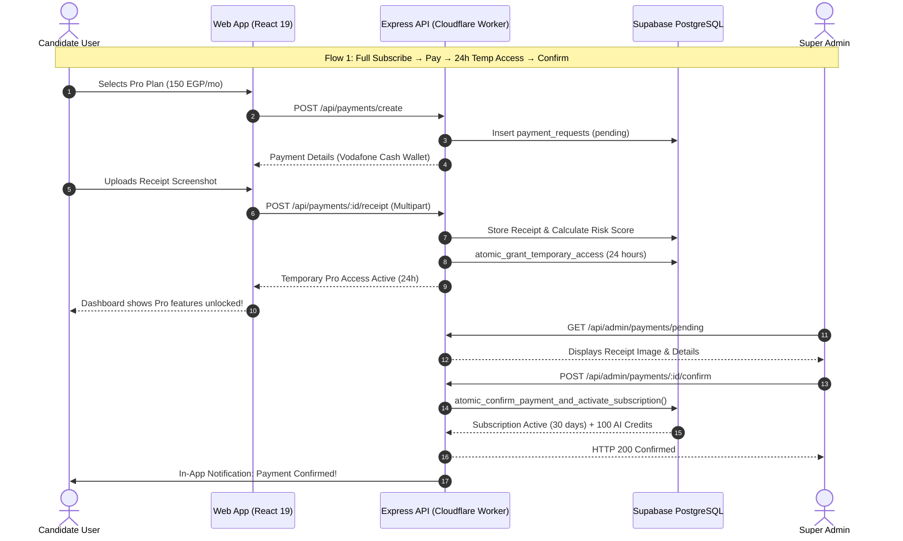

# QA and Acceptance Plan: CareerDev4AI Subscription, Payment & AI Credit System

- **Document Version**: 1.0.0
- **Status**: Approved Quality & Verification Specification
- **Target System**: CareerDev4AI (Egypt-First Career Super App)
- **Target Directory**: `d:\Saas\careerpilot-ai\docs\subscription-system\planning\QA_AND_ACCEPTANCE_PLAN.md`
- **Currency Standard**: Egyptian Pounds (EGP) stored as integer Piasters (1 EGP = 100 Piasters)
- **Harness & Runner**: Node.js ESM test harness ([tests/runner.mjs](file:///d:/Saas/careerpilot-ai/tests/runner.mjs)), Supabase PostgreSQL 15+, Supertest / Fetch API, TypeScript strict mode.

---

## 1. Executive Summary & Quality Strategy

This Quality Assurance (QA) and Acceptance Plan defines the test criteria, automated test suites, security validations, and acceptance gates required to verify the CareerDev4AI Subscription, Payment, and AI Credit System across Phases 1 through 8.

### 1.1 Architectural Classification

```
┌─────────────────────────────────────────────────────────────────────────────┐
│                       ARCHITECTURAL CLASSIFICATION                          │
├──────────────────────────┬──────────────────────────┬───────────────────────┤
│     VERIFIED FACTS       │       ASSUMPTIONS        │    RECOMMENDATIONS    │
├──────────────────────────┼──────────────────────────┼───────────────────────┤
│ • Automated test runner: │ • Egyptian p2p transfers │ • P0 tests block      │
│   tests/runner.mjs       │   (Vodafone Cash,        │   production merge    │
│ • Test identities created│   InstaPay) are manually │ • Concurrency stress  │
│   under example.invalid  │   verified with receipts │   tests for credits   │
│ • RLS active on tables   │ • 24hr temporary access  │ • Strict zero-leakage │
│ • Service role bypasses  │   reduces candidate drop │   of service_role key │
│   RLS (server-only)      │ • Zero birth year stored │ • Zero float currency │
└──────────────────────────┴──────────────────────────┴───────────────────────┘
```

#### Verified Facts
1. **Isolated Test Framework**: The existing test runner [tests/runner.mjs](file:///d:/Saas/careerpilot-ai/tests/runner.mjs) boots a dedicated API server instance, creates isolated Supabase test identities via [tests/helpers.ts](file:///d:/Saas/careerpilot-ai/tests/helpers.ts), and executes tests against live database tables without truncating shared rows.
2. **Explicit Teardown**: Test identities are prefixed with a unique run ID and cleanly removed upon completion via [tests/cleanup.mjs](file:///d:/Saas/careerpilot-ai/tests/cleanup.mjs).
3. **Database Security Baseline**: PostgreSQL tables enforce Row Level Security (RLS). Server routes authenticate caller identity via `req.authUser.id` extracted from the verified Supabase JWT in [server/auth/supabase-auth.ts](file:///d:/Saas/careerpilot-ai/server/auth/supabase-auth.ts).
4. **Administrative Verification Standard**: Admin actions require role membership in `public.admin_users` and write an immutable audit trail to `public.admin_audit_log`.

#### Assumptions
1. **Payment Verification Lag**: Because peer-to-peer Egyptian wallet payments (Vodafone Cash, InstaPay) lack public automated webhooks, receipts are audited by administrators within a 24-hour target window.
2. **Temporary Access UX**: Legitimate candidates who upload receipt screenshots are granted 24 hours of temporary Pro access to prevent onboarding drop-off while waiting for admin review.
3. **Concurrency Risks**: High user volume during marketing campaigns could trigger race conditions on credit balances unless serialized via database locks.

#### Recommendations
1. **Advisory Locking Verification**: Concurrency tests must deliberately launch parallel async HTTP calls to verify that PostgreSQL advisory transaction locks (`pg_advisory_xact_lock`) prevent negative balances.
2. **Double-Entry Financial Audits**: Any payment approval or credit transaction must produce corresponding ledger and event records that balance exactly.
3. **P0 Quality Gates**: Zero P0 or P1 test failures are permitted for production release.

---

## 2. Test Execution Harness & Methodologies

All automated tests adhere to the project's existing test harness architecture:
- Runner: `node tests/runner.mjs`
- Targeted Suite Execution: `$env:TEST_ONLY='subscriptions,payments,credits,entitlements'; node tests/runner.mjs`
- Test Files Location: `tests/subscriptions.test.ts`, `tests/payments.test.ts`, `tests/credits.test.ts`, `tests/entitlements.test.ts`.

### 2.1 Standard Test Lifecycle & Isolation Pattern

```typescript
import { createTestUser, admin, type TestUser } from './helpers.ts';

describe('Subscription & Payment Suite', () => {
  let candidateUser: TestUser;
  let adminUser: TestUser;

  before(async () => {
    // 1. Create candidate user with accepted legal terms
    candidateUser = await createTestUser('candidate');

    // 2. Create admin user and bootstrap super_admin privileges
    adminUser = await createTestUser('admin');
    await admin.from('admin_users').insert({
      profile_id: adminUser.id,
      email: adminUser.email,
      role: 'super_admin',
      status: 'active',
      permissions: ['subscriptions.read', 'subscriptions.write', 'payments.verify']
    });
  });

  after(async () => {
    // Isolated teardown handled automatically by test runner namespace
  });
});
```

---

## 3. Comprehensive Test Categories & Test Cases

---

### Category 1: Database Tests (DB)

- **Focus**: Migrations, rollback safety, schema constraints, stored procedure atomicity, and Row Level Security (RLS).
- **Target Files**: `supabase/migrations/20261110000001_*.sql` through `20261110000006_*.sql`.

| Test ID | Test Name | Priority | Phase | Preconditions | Steps | Expected Result |
|---------|-----------|----------|-------|---------------|-------|-----------------|
| **DB-01** | Clean Migration Deployment | **P0** | Phase 1 | Baseline DB schema active | 1. Apply all Phase 1-7 migrations sequentially.<br>2. Inspect schema logs for notices/warnings. | All tables, enums, triggers, and procedures create with code 0. Zero syntax errors. |
| **DB-02** | Rollback Script Execution | **P0** | Phase 1 | Migrations applied | 1. Execute rollback SQL blocks in reverse order.<br>2. Query `information_schema.tables`. | All new tables dropped cleanly. No orphan triggers or foreign key violations left behind. |
| **DB-03** | Currency Constraint Integrity | **P0** | Phase 1 | Schema deployed | 1. Attempt inserting negative amount into `payment_requests(amount_piasters)`.<br>2. Attempt inserting floating point value. | PostgreSQL CHECK constraint `positive_amount` rejects insert with check violation error code `23514`. |
| **DB-04** | Atomic Credit Reservation & Deduct | **P0** | Phase 1, 3 | Test user with 50 credits | 1. Call `atomic_reserve_and_deduct_ai_credits(user_id, 10, 'cv_assist', 'ref_1')`.<br>2. Verify balance. | Procedure returns `success: true`. New balance is 40. Immutable ledger record created with delta `-10`. |
| **DB-05** | Atomic Credit Overdraft Prevention | **P0** | Phase 1, 3 | Test user with 5 credits | 1. Call `atomic_reserve_and_deduct_ai_credits(user_id, 10, 'cv_assist', 'ref_2')`. | Procedure raises exception or returns `INSUFFICIENT_CREDITS`. Transaction aborts; balance remains 5. |
| **DB-06** | Atomic Failure Refund | **P1** | Phase 3 | Test user balance 40, active deduction of 10 | 1. Call `atomic_refund_ai_credits(user_id, 10, 'provider_timeout', 'ref_1')`. | Procedure succeeds. Balance restores to 50. Ledger row created with delta `+10` and `grant_type: 'refund'`. |
| **DB-07** | RLS Cross-Tenant Isolation | **P0** | Phase 1 | User A and User B exist | 1. Authenticate client as User A.<br>2. Attempt `SELECT * FROM subscriptions WHERE profile_id = User_B_ID`.<br>3. Attempt `SELECT * FROM payment_requests WHERE profile_id = User_B_ID`. | Zero rows returned. User A cannot view User B's subscription or payment records. |
| **DB-08** | Storage Receipt Bucket Security | **P0** | Phase 1, 4 | Bucket `payment-receipts` created | 1. Anonymous user attempts to download receipt from storage URL.<br>2. Authenticated User A attempts to read User B's receipt file.<br>3. Authenticated Super Admin requests signed URL. | 1. HTTP 401 / 403 Forbidden.<br>2. HTTP 403 Forbidden.<br>3. HTTP 200 OK with valid signed URL. |

---

### Category 2: API & Routing Tests (API)

- **Focus**: HTTP status codes, authentication gates, administrative authorization, input validation, and localized error schemas.
- **Target Files**: [app.ts](file:///d:/Saas/careerpilot-ai/app.ts), `server/subscriptions/*`, `server/payments/*`, `server/credits/*`.

| Test ID | Test Name | Priority | Phase | Preconditions | Steps | Expected Result |
|---------|-----------|----------|-------|---------------|-------|-----------------|
| **API-01** | Public Plans Catalog Listing | **P0** | Phase 2 | Baseline plans seeded | `GET /api/subscriptions/plans` (unauthenticated) | HTTP 200 OK. Returns array of active plans (`free`, `pro`, `elite`) with localized names and prices in Piasters. |
| **API-02** | Current Subscription Auth Gate | **P0** | Phase 2 | No auth header | `GET /api/subscriptions/current` | HTTP 401 Unauthorized (`MISSING_AUTH_TOKEN`). |
| **API-03** | Current Subscription Payload | **P0** | Phase 2 | User signed in with Pro plan | `GET /api/subscriptions/current` with valid Bearer token | HTTP 200 OK. Returns `{ plan: 'pro', status: 'active', billingCycle: 'monthly', expiresAt: '...', credits: 100 }`. |
| **API-04** | Payment Creation Validation | **P0** | Phase 4 | User signed in | `POST /api/payments/create` with `{ planId: 'invalid-uuid', method: 'vodafone_cash' }` | HTTP 400 Bad Request (`INVALID_PLAN_SPECIFIED`). |
| **API-05** | Admin Payments Queue Authorization | **P0** | Phase 5 | User signed in with `moderator` role | `GET /api/admin/payments/pending` | HTTP 403 Forbidden (`INSUFFICIENT_ADMIN_PERMISSIONS`). Requires `payments.verify`. |
| **API-06** | Admin Payment Confirmation Execution | **P0** | Phase 5 | Super Admin signed in; pending payment exists | `POST /api/admin/payments/:id/confirm` with `{ transactionNotes: 'Verified on Vodafone Cash wallet' }` | HTTP 200 OK. Payment status becomes `confirmed`. Subscription activates. Audit log recorded. |
| **API-07** | Localized Error Contract Schema | **P1** | Phase 2 | User requests endpoint exceeding limits | Trigger `UPGRADE_REQUIRED` error | Response JSON matches schema: `{ success: false, error: { code: 'UPGRADE_REQUIRED', message_en: '...', message_ar: '...' } }`. |

---

### Category 3: Subscription & Entitlement Tests (SUB)

- **Focus**: Subscription lifecycle, feature allowances, tier gating, upgrades, downgrades, and renewal extensions.
- **Target Files**: `server/subscriptions/service.ts`, `server/subscriptions/entitlements.ts`, `server/cv/buildCv.ts`.

| Test ID | Test Name | Priority | Phase | Preconditions | Steps | Expected Result |
|---------|-----------|----------|-------|---------------|-------|-----------------|
| **SUB-01** | Free Tier CV Creation Limit | **P0** | Phase 2 | Candidate has Free plan and 1 existing CV | Attempt `POST /api/cv/create` to create a 2nd CV. | HTTP 403 Forbidden with `UPGRADE_REQUIRED`. Explains Free tier is limited to 1 active CV. |
| **SUB-02** | Pro Tier Unlimited CV Allowance | **P0** | Phase 2 | Candidate has active Pro subscription | Candidate creates 2nd, 3rd, and 5th CV via `POST /api/cv/create`. | All requests return HTTP 200/201 Created. No artificial caps encountered. |
| **SUB-03** | Pro Tier ATS Analytics Gating | **P0** | Phase 2 | Free user and Pro user | 1. Free user calls `POST /api/cv/analyze-ats`.<br>2. Pro user calls same endpoint. | 1. Returns basic score only; detailed keyword breakdown redacted with upgrade prompt.<br>2. Returns full ATS breakdown. |
| **SUB-04** | Monthly to Annual Tier Upgrade | **P1** | Phase 2 | Active monthly Pro subscription (15 days remaining) | Call `POST /api/subscriptions/upgrade` with `{ plan: 'pro', cycle: 'annual' }`. | Remaining 15 days calculated as prorated discount in Piasters. Subscription period extends 365 days. |
| **SUB-05** | Subscription Grace Period Transition | **P1** | Phase 2, 7 | Active Pro subscription reaches `current_period_ends_at` | Scheduled worker runs daily expiry sweep. | Subscription status updates to `past_due`. Grace period of 3 days begins. Candidate retains access. |
| **SUB-06** | Subscription Termination on Expiration | **P0** | Phase 2, 7 | Subscription in `past_due` for > 3 days | Scheduled worker runs daily expiry sweep. | Status updates to `expired`. Entitlements downgrade to Free tier immediately. User data preserved intact. |

---

### Category 4: Payment Intelligence Tests (PAY)

- **Focus**: Egyptian payment flows (Vodafone Cash, InstaPay), receipt parsing, duplicate detection, risk scoring, and 24h temporary access.
- **Target Files**: `server/payments/*`, `server/jobs/tasks/expireTemporaryAccess.ts`.

| Test ID | Test Name | Priority | Phase | Preconditions | Steps | Expected Result |
|---------|-----------|----------|-------|---------------|-------|-----------------|
| **PAY-01** | Payment Request Creation | **P0** | Phase 4 | User authenticated | Call `POST /api/payments/create` for Pro Annual (1,440.00 EGP) with method `vodafone_cash`. | HTTP 201 Created. Returns payment ID, reference code (`CP-PAY-...`), amount `144000` Piasters, and wallet instructions. |
| **PAY-02** | Receipt Upload & Low Risk Auto-Grant | **P0** | Phase 4 | Payment created; account aged 7 days | Upload valid receipt image via `POST /api/payments/:id/receipt`. | Receipt stored in private bucket. Risk score evaluated < 40. Subscription granted `temporary_access` for 24 hours. |
| **PAY-03** | Duplicate Receipt Detection | **P0** | Phase 4 | User A uploaded receipt R1 | User B uploads identical receipt image R1 or exact same transaction reference. | Duplicate hash match detected. Risk score sets to 95 (Critical). Temporary access denied; queued for fraud review. |
| **PAY-04** | 24-Hour Temporary Access Expiration | **P0** | Phase 4, 7 | User has `temporary_access` with `current_period_ends_at = NOW() - INTERVAL '5 minutes'` | Scheduled worker task `expireTemporaryAccess` executes. | Status changes to `free`. Temporary access ends. In-app notification sent alerting user to submit valid proof. |
| **PAY-05** | Late Admin Confirmation Recovery | **P1** | Phase 4 | Payment temporary access expired 2 hours ago | Admin verifies receipt on wallet app and clicks Confirm in Admin Center. | Subscription restores to `active` for full 30 days starting from confirmation timestamp. Full monthly credits granted. |
| **PAY-06** | Admin Payment Rejection Flow | **P0** | Phase 4 | Payment in `temporary_access` | Admin clicks Reject with reason `INSUFFICIENT_AMOUNT_TRANSFERRED`. | Payment marked `rejected`. Subscription immediately revoked to `free`. Rejection notification delivered to user. |
| **PAY-07** | Concurrent Admin Confirmation Race | **P0** | Phase 4 | Two admins view same payment | Admin 1 and Admin 2 submit Confirm simultaneously. | PostgreSQL transaction lock ensures exactly one confirmation succeeds. Second request receives HTTP 409 Conflict. |

---

### Category 5: AI Credits & Accounting Tests (CRED)

- **Focus**: Double-entry ledger, concurrency serialization, atomic deductions, refunds on provider failure, trial grants, and expiration.
- **Target Files**: `server/credits/*`, `server/ai/quota.ts`, `server/cv/aiAssist.ts`.

| Test ID | Test Name | Priority | Phase | Preconditions | Steps | Expected Result |
|---------|-----------|----------|-------|---------------|-------|-----------------|
| **CRED-01** | Signup Trial Credit Allocation | **P0** | Phase 3 | New candidate registration | Complete signup flow through Supabase Auth trigger. | Candidate profile created with `5` trial credits in `public.ai_credit_ledger` (`grant_type: 'trial'`). |
| **CRED-02** | Deduct Credit on AI Assist Success | **P0** | Phase 3 | User has 5 credits | User generates AI CV bullet point via `POST /api/cv/ai-assist`. | HTTP 200 OK. 1 credit deducted. User balance becomes 4. Ledger record logs `feature_key: 'cv_bullet_assist'`. |
| **CRED-03** | Insufficient Credits Gate | **P0** | Phase 3 | User has 0 credits | User requests AI Interview Session (cost: 3 credits). | HTTP 402 Payment Required (`INSUFFICIENT_AI_CREDITS`). No call dispatched to Gemini API. |
| **CRED-04** | Automatic Refund on Provider 5xx | **P0** | Phase 3 | User has 5 credits; Gemini mock throws 503 | User triggers AI Targeted CV task (cost: 2 credits). | Task detects provider abort. Reserved 2 credits refunded atomically. User balance remains exactly 5. |
| **CRED-05** | High Concurrency Race Test | **P0** | Phase 3 | User has exactly 2 credits | Fire 10 parallel asynchronous HTTP requests to `POST /api/cv/ai-assist` (cost: 1 credit each). | Exactly 2 requests return HTTP 200 OK. Remaining 8 requests return HTTP 402. Final balance is 0. Never negative! |
| **CRED-06** | Monthly Credit Allocation on Renewal | **P1** | Phase 3 | Active Pro subscription renews | Payment confirmation executes for monthly billing renewal. | 100 fresh credits allocated with expiration matching new period end date. Unused monthly credits reset. |
| **CRED-07** | Purchased Credit Pack Non-Expiration | **P1** | Phase 3 | User purchased 50-credit add-on pack | Monthly subscription period ends. | Monthly plan credits reset, but purchased pack credits retain `expires_at = NULL` and remain fully usable. |

---

### Category 6: Security & Authorization Tests (SEC)

- **Focus**: Cross-tenant data isolation, permission escalation prevention, storage access control, client credential hygiene, and tampering.
- **Target Files**: `server/auth/*`, `server/admin/permissions.ts`, [shared/admin.ts](file:///d:/Saas/careerpilot-ai/shared/admin.ts).

| Test ID | Test Name | Priority | Phase | Preconditions | Steps | Expected Result |
|---------|-----------|----------|-------|---------------|-------|-----------------|
| **SEC-01** | Self-Payment Confirmation Prevention | **P0** | Phase 4, 5 | Candidate is also an admin | Admin attempts `POST /api/admin/payments/:id/confirm` on a payment request where `profile_id == admin.profile_id`. | HTTP 403 Forbidden (`CANNOT_VERIFY_OWN_PAYMENT`). Segregation of duties enforced. |
| **SEC-02** | Client Credit Manipulation Prevention | **P0** | Phase 3 | Authenticated candidate | Candidate sends `PATCH /api/users/me` with `{ ai_credits: 9999 }` or direct Supabase client call to `ai_credit_ledger`. | Supabase RLS policy `ai_credit_ledger_read_only` rejects insert/update. Client balance unchanged. |
| **SEC-03** | Admin Privilege Escalation Prevention | **P0** | Phase 5 | Moderator admin authenticated | Moderator sends `POST /api/admin/admins` or `PATCH /api/admin/admins/:id` to assign `super_admin` role. | HTTP 403 Forbidden. Only an existing Super Admin can modify admin roles. |
| **SEC-04** | Private Storage Bucket Direct Download | **P0** | Phase 1, 4 | Candidate receipt uploaded | Non-admin user crafts direct GET request to Supabase Storage public URL: `/storage/v1/object/public/payment-receipts/...`. | HTTP 400/404/403. Public access is disabled on bucket; signed URL with short 5-minute expiry required. |
| **SEC-05** | Service Role Key Hygiene Check | **P0** | Phase 8 | Production Vite build output in `dist/` | Search generated JavaScript bundles (`dist/assets/*.js`) for `SUPABASE_SERVICE_ROLE_KEY` or secret patterns. | Zero occurrences found. Service role key is strictly confined to server-side Node / Cloudflare Workers environment. |
| **SEC-06** | Coupon Code Brute Force Protection | **P1** | Phase 6 | Unauthenticated or candidate user | Send 50 invalid coupon code validation requests in 60 seconds. | Express rate limiter intervenes with HTTP 429 Too Many Requests after 10 failed attempts. |

---

### Category 7: End-to-End Integration Flows (INT)

- **Focus**: Multi-step user journeys connecting client interactions, edge APIs, database states, and administrative interventions.



#### Detailed Flow Specifications

#### Flow 1: Full Subscribe → Manual Pay → Temporary Access → Admin Confirm
- **Test ID**: `INT-01`
- **Priority**: **P0**
- **Phase Dependency**: Phase 1, 2, 4, 5
- **Steps**:
  1. Candidate registers account; verifies Free plan status and 5 trial credits.
  2. Candidate initiates checkout for Pro Monthly (150.00 EGP = 15,000 Piasters) via Vodafone Cash.
  3. API returns wallet recipient number and unique reference `CP-PAY-XXXX`.
  4. Candidate uploads valid PNG receipt.
  5. System validates image, evaluates risk score (Score: 10), and immediately grants `temporary_access` for 24 hours.
  6. Candidate creates a 2nd CV and runs ATS analysis (verifying Pro features work).
  7. Super Admin logs into Admin Center, reviews pending receipt in `AdminPaymentsPanel`, and clicks "Confirm".
  8. System transitions payment to `confirmed`, subscription to `active` (expiring in 30 days), and grants 100 AI credits.
- **Pass Criteria**: End-to-end journey completes without manual database interventions. All audit rows match.

#### Flow 2: Temporary Access Expiry → Free Reversion → Renewal Recovery
- **Test ID**: `INT-02`
- **Priority**: **P0**
- **Phase Dependency**: Phase 2, 4, 7
- **Steps**:
  1. Candidate uploads receipt; receives 24-hour temporary access.
  2. Simulate passage of 24 hours (update `current_period_ends_at = NOW() - INTERVAL '1 minute'`).
  3. Trigger background task `expireTemporaryAccess`.
  4. Candidate refreshes application; UI cleanly reflects reversion to Free tier with alert banner.
  5. Candidate attempts Pro action (e.g. create 2nd CV); correctly blocked with `UPGRADE_REQUIRED`.
  6. Super Admin discovers unreviewed receipt in queue, verifies funds in banking app, and approves payment.
  7. System immediately restores candidate to Pro `active` for full 30 days starting from current timestamp.
- **Pass Criteria**: Reversion executes cleanly without data corruption; late confirmation successfully restores full access.

#### Flow 3: Coupon Discount Application & Redemption Exhaustion
- **Test ID**: `INT-03`
- **Priority**: **P1**
- **Phase Dependency**: Phase 4, 6
- **Steps**:
  1. Admin creates coupon `LAUNCH50` (50% discount, max redemptions: 2).
  2. Candidate 1 applies `LAUNCH50` to Pro Annual (Original: 1,440.00 EGP).
  3. Amount accurately recalculates to 720.00 EGP (72,000 Piasters).
  4. Candidate 1 completes payment; coupon redemption count increments to 1.
  5. Candidate 2 applies `LAUNCH50` to Pro Monthly (Original: 150.00 EGP); pays 75.00 EGP (7,500 Piasters).
  6. Candidate 3 attempts to apply `LAUNCH50`.
  7. API rejects code with `COUPON_REDEMPTION_LIMIT_REACHED`.
- **Pass Criteria**: Discounts calculate accurately to the Piaster; maximum redemption limit is strictly enforced.

---

## 4. Requirement Traceability Matrix

The following matrix connects each implementation phase and engineering deliverable to its required test cases and acceptance criteria:

| Phase | Core Deliverable | Required Test Cases | Acceptance Gate |
|-------|------------------|---------------------|-----------------|
| **Phase 1** | Schema, Migrations, Storage Bucket, Admin Bootstrap | `DB-01`, `DB-02`, `DB-03`, `DB-07`, `DB-08` | Migrations execute with 0 errors; RLS verifies cross-tenant isolation. |
| **Phase 2** | Subscription Service, Entitlement Engine, Feature Gates | `API-01`, `API-02`, `API-03`, `SUB-01`, `SUB-02`, `SUB-03` | Free users limited to 1 CV; Pro tier unlocks advanced ATS & CV tools. |
| **Phase 3** | AI Credits Ledger, Reservation, Deduction & Refunds | `DB-04`, `DB-05`, `DB-06`, `CRED-01`, `CRED-02`, `CRED-03`, `CRED-04`, `CRED-05` | Zero negative balances under high concurrency; auto-refunds on AI failure. |
| **Phase 4** | Payments, Receipt Verification, Risk Scoring, Temp Access | `API-04`, `PAY-01`, `PAY-02`, `PAY-03`, `PAY-04`, `PAY-05`, `PAY-06`, `PAY-07` | 24h temp access works; duplicate receipts flagged; admin approval functional. |
| **Phase 5** | Admin Center Panels (Subscriptions, Payments, Revenue) | `API-05`, `API-06`, `SEC-01`, `SEC-03`, `INT-01` | Super admin can manage receipts and subscriptions; roles strictly enforced. |
| **Phase 6** | Coupons, Birthday Rewards & Privacy Consent | `SEC-06`, `INT-03` | Percentage & fixed discounts apply accurately; no birth year requested. |
| **Phase 7** | Cloudflare Queue Scheduled Jobs & Notifications | `SUB-05`, `SUB-06`, `PAY-04`, `CRED-06`, `INT-02` | Hourly sweep expires temp access; renewal notifications delivered on time. |
| **Phase 8** | Integration Test Suite & Production Canary Rollout | `SEC-05`, `INT-01`, `INT-02`, `INT-03` | 100% test pass rate in `runner.mjs`; clean bundle security audit. |

---

## 5. Test Implementation Code Examples

The following code demonstrates the concrete implementation patterns for the test suites to be placed in `tests/subscriptions.test.ts`, `tests/credits.test.ts`, and `tests/payments.test.ts`.

### 5.1 Concurrency & Advisory Lock Stress Test (`tests/credits.test.ts`)

```typescript
import assert from 'node:assert/strict';
import { createTestUser, admin, type TestUser } from './helpers.ts';

describe('AI Credits Concurrency and Overdraft Resistance', () => {
  let user: TestUser;

  before(async () => {
    user = await createTestUser('credit-stress');
    // Ensure user has exactly 2 credits in ledger
    await admin.rpc('atomic_grant_ai_credits', {
      p_profile_id: user.id,
      p_amount: 2,
      p_grant_type: 'trial',
      p_notes: 'Setup for concurrency test'
    });
  });

  it('prevents overdraft when 10 requests contend for 2 credits', async () => {
    const serverUrl = process.env.TEST_SERVER_URL ?? 'http://localhost:3000';
    
    // Launch 10 simultaneous requests costing 1 credit each
    const requests = Array.from({ length: 10 }).map(() =>
      fetch(`${serverUrl}/api/cv/ai-assist`, {
        method: 'POST',
        headers: {
          'Content-Type': 'application/json',
          Authorization: `Bearer ${user.token}`,
        },
        body: JSON.stringify({
          action: 'enhance_bullet',
          text: 'Managed team projects in engineering',
        }),
      })
    );

    const responses = await Promise.all(requests);
    const successResponses = responses.filter((res) => res.status === 200);
    const paymentRequiredResponses = responses.filter((res) => res.status === 402);

    assert.equal(
      successResponses.length,
      2,
      'Exactly 2 requests must succeed corresponding to available credit balance'
    );
    assert.equal(
      paymentRequiredResponses.length,
      8,
      'Remaining 8 requests must be rejected with HTTP 402 Payment Required'
    );

    // Verify database ledger balance is exactly 0
    const { data: balanceData } = await admin.rpc('get_profile_credit_balance', {
      p_profile_id: user.id,
    });
    assert.equal(balanceData, 0, 'Final credit balance must be exactly 0, never negative');
  });
});
```

### 5.2 Receipt Duplicate Detection Test (`tests/payments.test.ts`)

```typescript
import assert from 'node:assert/strict';
import { createTestUser, type TestUser } from './helpers.ts';

describe('Payment Intelligence Duplicate Detection', () => {
  let userA: TestUser;
  let userB: TestUser;

  before(async () => {
    userA = await createTestUser('user-a');
    userB = await createTestUser('user-b');
  });

  it('flags duplicate transaction reference and receipt hash', async () => {
    const serverUrl = process.env.TEST_SERVER_URL ?? 'http://localhost:3000';
    const sharedRef = 'TXN-VODAFONE-998877';

    // 1. User A creates payment and submits receipt with reference
    const createResA = await fetch(`${serverUrl}/api/payments/create`, {
      method: 'POST',
      headers: {
        'Content-Type': 'application/json',
        Authorization: `Bearer ${userA.token}`,
      },
      body: JSON.stringify({
        planCode: 'pro',
        billingCycle: 'monthly',
        paymentMethod: 'vodafone_cash',
        senderReference: sharedRef,
      }),
    });
    const paymentA = await createResA.json();
    assert.equal(createResA.status, 201);

    // 2. User B submits payment using the exact same transaction reference
    const createResB = await fetch(`${serverUrl}/api/payments/create`, {
      method: 'POST',
      headers: {
        'Content-Type': 'application/json',
        Authorization: `Bearer ${userB.token}`,
      },
      body: JSON.stringify({
        planCode: 'pro',
        billingCycle: 'monthly',
        paymentMethod: 'vodafone_cash',
        senderReference: sharedRef,
      }),
    });
    const paymentB = await createResB.json();
    assert.equal(createResB.status, 201);

    // Verify User B's risk score was escalated and temporary access denied
    assert.ok(paymentB.riskScore >= 90, 'Risk score must be >= 90 due to duplicate reference');
    assert.equal(
      paymentB.temporaryAccessGranted,
      false,
      'Temporary access must be denied for duplicate payment'
    );
  });
});
```

---

## 6. Definition of Done (DoD) & Acceptance Criteria

A phase or feature in the subscription system is declared complete and ready for production deployment if and only if the following gates are satisfied:

1. **Compilation & Type Safety**:
   - `npm run lint` (`tsc --noEmit`) passes with exactly 0 errors and 0 warnings.
2. **Automated Test Coverage**:
   - All tests in `tests/subscriptions.test.ts`, `tests/payments.test.ts`, `tests/credits.test.ts`, and `tests/entitlements.test.ts` pass with 100% green status.
3. **Security & RLS Conformance**:
   - Every newly created database table has RLS enabled with explicit restrictive policies.
   - Cross-tenant test cases prove no authenticated user can access another user's financial or subscription data.
4. **Monetary Integrity**:
   - All currency values are verified to be integer Egyptian Piasters. No floating point rounding bugs exist.
5. **Localization Complete**:
   - Translatable strings for subscription banners, payment instructions, error payloads, and admin buttons are present in both Arabic (`ar`) and English (`en`) translation dictionaries.
6. **Deployment Health Check**:
   - Live endpoint `https://careerdev4ai.pages.dev/api/health` returns HTTP 200 OK after deployment.
