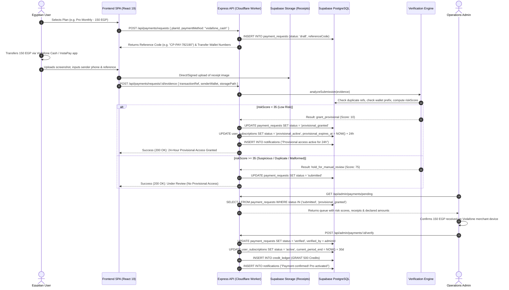
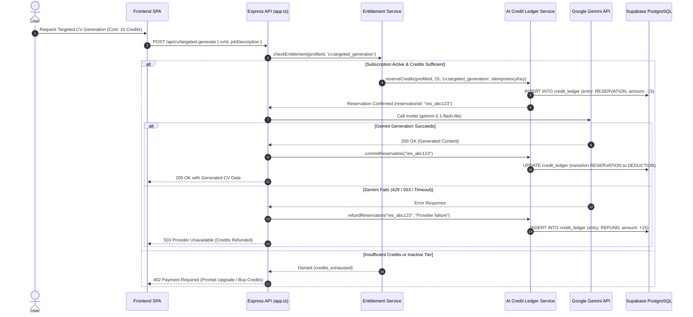
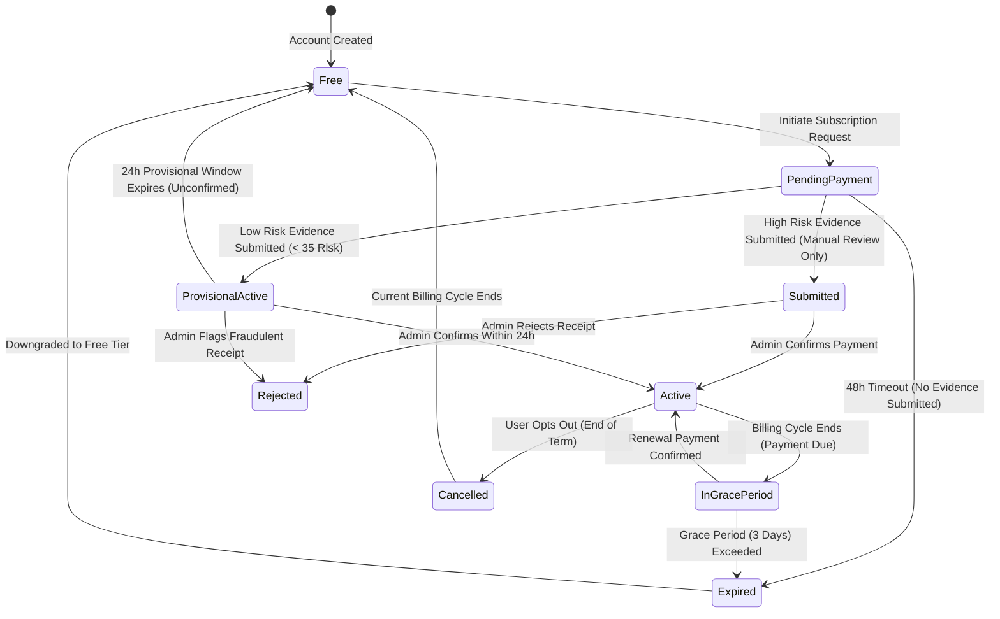
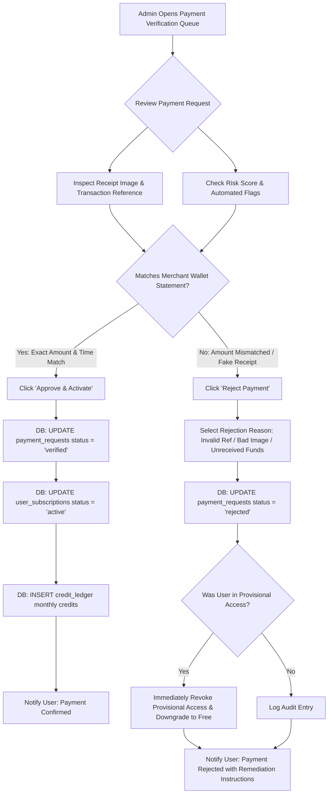
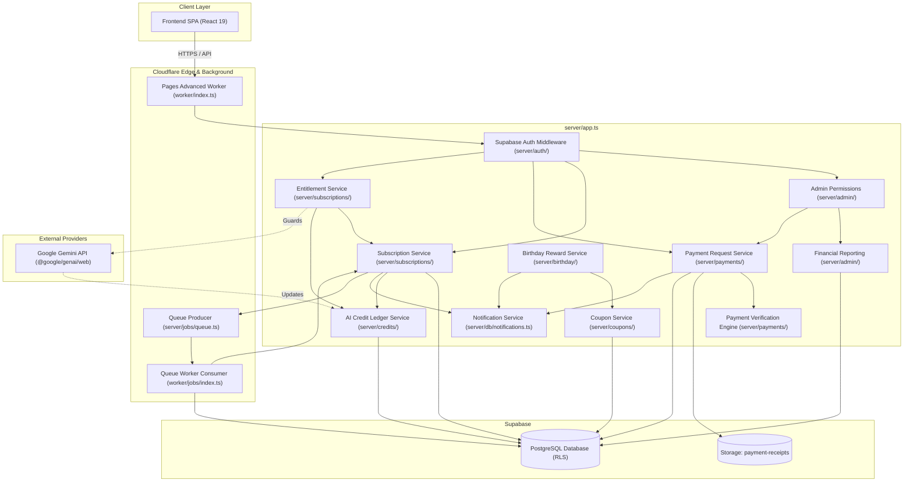
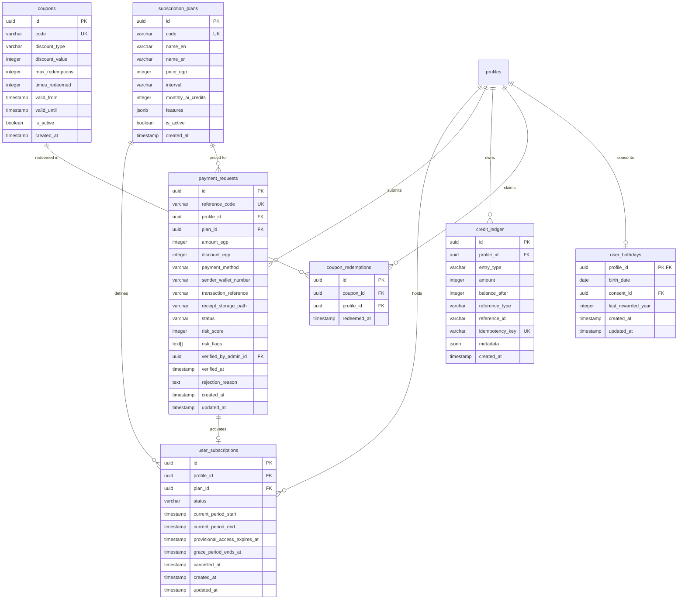

# Target System Architecture: CareerDev4AI Subscription & Monetization System

**Document Version:** 1.0.0  
**Status:** Approved Architectural Specification  
**Classification:** Core Planning Documentation  
**Target Execution Audience:** Senior Engineering Agent / Lead Backend Engineer  
**System Base Currency:** Egyptian Pounds (EGP)  
**Applicable Codebase:** `careerdev4ai` (Cloudflare Pages, Cloudflare Workers, React 19, Express, Supabase PostgreSQL, Google Gemini AI)

---

## 1. Executive Summary & Architectural Tenets

The CareerDev4AI Subscription & Monetization System transitions the platform from a purely free-tier service into a sustainable, Egypt-first freemium career platform. The system introduces paid subscription tiers, manual Egyptian payment rails (Vodafone Cash, InstaPay, manual bank transfers), a 24-hour provisional access safety valve, human-in-the-loop administrator payment verification, and an auditable, double-entry AI credit ledger.

This document serves as the authoritative architectural blueprint. It defines the target logical service boundaries, state machines, data flow pipelines, infrastructure utilization, and operational safeguards.

### Core Architectural Tenets

1. **Zero Disruption to the Free-Tier Mission**
   The foundational journey (`DISCOVER → LEARN → PRACTICE → PROVE → BUILD → APPLY → INTERVIEW → GROW`) remains accessible to every Egyptian student and fresh graduate. Monetization introduces premium acceleration (deep Gemini reasoning, bulk targeted CV variations, prioritized mock interview simulations, advanced ATS analytics) without creating artificial paywalls around core educational resources.

2. **Supabase PostgreSQL as the Single Financial Source of Truth**
   All financial transactions, payment requests, plan definitions, subscription states, and credit balances are authored and strictly enforced in Supabase PostgreSQL under Row Level Security (RLS). No financial state or credit balance is ever stored in ephemeral memory or client-side storage.

3. **Egypt-First Payment Rails with Human Verification**
   Due to the prevalence of P2P mobile wallets (Vodafone Cash, InstaPay, Orange Money, Etisalat Cash) over automated credit card billing in Egypt, the architecture treats payment verification as an asynchronous, human-in-the-loop process. Automated heuristics assess risk, grant temporary 24-hour provisional access, and queue receipts for administrative verification.

4. **Double-Entry AI Credit Ledger**
   AI features are metered via an immutable, double-entry ledger (`credit_ledger`). Credits are atomically reserved prior to provider dispatch, committed upon successful token generation, and refunded upon provider timeouts or 5xx/429 failures.

5. **Zero New External Infrastructure**
   The architecture strictly leverages existing platform primitives: Cloudflare Pages + Workers, Cloudflare Queues (`careerdev4ai-jobs`), Supabase Auth, PostgreSQL, and Supabase Storage. No third-party payment gateway SDKs, Trigger.dev instances, Redis caches, or external OCR APIs are introduced in the MVP phase.

---

## 2. Baseline Architecture (Verified Codebase Facts)

The following architectural facts have been verified directly against the production codebase:

| Subsystem | Existing Implementation Reference | Verified Characteristics & Runtime Constraints |
| :--- | :--- | :--- |
| **Frontend SPA** | [`src/App.tsx`](file:///d:/Saas/careerpilot-ai/src/App.tsx), [`src/lib/routing.ts`](file:///d:/Saas/careerpilot-ai/src/lib/routing.ts) | React 19, TypeScript, Vite, Tailwind CSS 4. Uses hash-based routing (`/#/cv-studio`, `/#/dashboard`). |
| **API Entrypoint** | [`worker/index.ts`](file:///d:/Saas/careerpilot-ai/worker/index.ts), [`app.ts`](file:///d:/Saas/careerpilot-ai/app.ts) | Cloudflare Pages Advanced Mode (`dist/_worker.js`). Bridges incoming requests to an Express app via `handleAsNodeRequest` with `nodejs_compat`. |
| **Database & Auth** | [`server/db/supabase.ts`](file:///d:/Saas/careerpilot-ai/server/db/supabase.ts), [`server/auth/require-auth.ts`](file:///d:/Saas/careerpilot-ai/server/auth/require-auth.ts) | Supabase PostgreSQL with RLS. Supabase Auth validates JWT Bearer tokens server-side, augmenting `req.authUser`. |
| **Object Storage** | [`server/db/cvStorage.ts`](file:///d:/Saas/careerpilot-ai/server/db/cvStorage.ts), [`server/db/portfolioStorage.ts`](file:///d:/Saas/careerpilot-ai/server/db/portfolioStorage.ts) | Supabase Storage buckets (`cv-documents`, `portfolio-files`). RLS restricted to owner profile. |
| **Background Jobs** | [`worker/jobs/index.ts`](file:///d:/Saas/careerpilot-ai/worker/jobs/index.ts), [`worker/jobs/wrangler.jsonc`](file:///d:/Saas/careerpilot-ai/worker/jobs/wrangler.jsonc) | Dedicated Cloudflare Worker consuming `careerdev4ai-jobs` queue. Has cron trigger configured: `triggers: { crons: ["*/5 * * * *"] }`. |
| **Job Queue Core** | [`server/jobs/queue.ts`](file:///d:/Saas/careerpilot-ai/server/jobs/queue.ts), [`server/jobs/jobs.ts`](file:///d:/Saas/careerpilot-ai/server/jobs/jobs.ts) | Producer abstraction (`CloudflareQueueProducer`). Task handlers defined in [`server/jobs/tasks/index.ts`](file:///d:/Saas/careerpilot-ai/server/jobs/tasks/index.ts). |
| **Admin System** | [`server/admin/permissions.ts`](file:///d:/Saas/careerpilot-ai/server/admin/permissions.ts), [`shared/admin.ts`](file:///d:/Saas/careerpilot-ai/shared/admin.ts) | Server-side role and permission verification (`requireAdmin`, `requirePermission`). Hardcoded roles: `super_admin`, `content_admin`, `opportunity_admin`, `moderator`. |
| **AI Providers** | [`server/ai/provider.ts`](file:///d:/Saas/careerpilot-ai/server/ai/provider.ts), [`server/ai/quota.ts`](file:///d:/Saas/careerpilot-ai/server/ai/quota.ts) | Primary: Google Gemini (`gemini-3.1-flash-lite`). Fallback: OpenRouter. Quota managed via an in-process, ephemeral `Map<string, DailyBucket>` (`AI_DAILY_LIMIT = 15`). |
| **Notifications** | [`server/db/notifications.ts`](file:///d:/Saas/careerpilot-ai/server/db/notifications.ts) | Server-backed notifications in `public.notifications`. Supported types: `'interview' \| 'roadmap' \| 'application' \| 'achievement' \| 'system' \| 'announcement'`. |

```
EXISTING SYSTEM DATA FLOW:
Browser (SPA) ──► Cloudflare Pages (Static Assets)
Browser (API) ──► Cloudflare Worker (dist/_worker.js) ──► Express (app.ts)
                     │
                     ├──► Supabase Auth (JWT Verify)
                     ├──► Supabase PostgreSQL (RLS DB)
                     ├──► Google Gemini / OpenRouter API
                     └──► Cloudflare Queue Producer ("careerdev4ai-jobs")
                                  │
                                  ▼
                     Cloudflare Queue Worker (worker/jobs/index.ts)
                     [Cron: */5 * * * * + Queue Consumer] ──► Supabase PostgreSQL
```

---

## 3. Target System Architecture & Logical Service Boundaries

Rather than deploying independent microservices that would complicate local development, increase latency, and violate Worker packaging simplicity, all new capabilities are organized as **modular domain services within `server/`**, mounted directly into the Express application in [`app.ts`](file:///d:/Saas/careerpilot-ai/app.ts).

```
TARGET LOGICAL SERVICE ARCHITECTURE:

                     Express Application (app.ts)
 ┌───────────────────────────────────────────────────────────────────────┐
 │                                                                       │
 │  ┌──────────────────────┐  ┌─────────────────────┐  ┌──────────────┐  │
 │  │ Subscription Service │  │ Payment Req Service │  │ Entitlements │  │
 │  │ server/subscriptions/│  │ server/payments/   │  │   Service    │  │
 │  └──────────┬───────────┘  └──────────┬──────────┘  └──────┬───────┘  │
 │             │                         │                    │          │
 │  ┌──────────▼───────────┐  ┌──────────▼──────────┐  ┌──────▼───────┐  │
 │  │   Coupon Service     │  │ Verification Engine │  │ Credit Ledger│  │
 │  │ server/coupons/      │  │ (Automated Risk)    │  │   Service    │  │
 │  └──────────┬───────────┘  └──────────┬──────────┘  └──────┬───────┘  │
 │             │                         │                    │          │
 │  ┌──────────▼───────────┐  ┌──────────▼──────────┐  ┌──────▼───────┐  │
 │  │ Birthday Reward Svc  │  │ Financial Reporting │  │ Notification │  │
 │  │ server/birthday/     │  │ server/admin/       │  │ Service (Ext)│  │
 │  └──────────────────────┘  └─────────────────────┘  └──────────────┘  │
 └───────────────────────────────────┬───────────────────────────────────┘
                                     │
                                     ▼
 ┌───────────────────────────────────────────────────────────────────────┐
 │                         Persistence & Workers                         │
 │  ┌────────────────────────┐  ┌─────────────────────────────────────┐  │
 │  │  Supabase PostgreSQL   │  │   Cloudflare Queue Worker           │  │
 │  │  (Authoritative State) │  │   (worker/jobs/index.ts)            │  │
 │  └────────────────────────┘  └─────────────────────────────────────┘  │
 └───────────────────────────────────────────────────────────────────────┘
```

---

### 3.1. Subscription Service

- **Module Path:** `server/subscriptions/service.ts`
- **Responsibilities:**
  - Plan catalog retrieval and validation (Free Tier, Pro Monthly, Pro Annual, Student Tier).
  - Lifecycle state machine management: `inactive`, `pending_payment`, `provisional_active`, `active`, `in_grace_period`, `expired`, `cancelled`.
  - Billing period calculations (monthly = 30 days, annual = 365 days).
  - Subscription upgrades, downgrades, and auto-credit allocations.
- **Authoritative Database Tables:** `public.subscription_plans`, `public.user_subscriptions`.
- **Public TypeScript Interface:**

```typescript
export type SubscriptionTier = 'free' | 'pro_monthly' | 'pro_annual' | 'student';
export type SubscriptionStatus =
  | 'inactive'
  | 'pending_payment'
  | 'provisional_active'
  | 'active'
  | 'in_grace_period'
  | 'expired'
  | 'cancelled';

export interface SubscriptionPlanDTO {
  id: string;
  code: SubscriptionTier;
  nameEn: string;
  nameAr: string;
  priceEgp: number;
  interval: 'monthly' | 'annual' | 'lifetime';
  monthlyAiCredits: number;
  features: string[];
  isActive: boolean;
}

export interface UserSubscriptionDTO {
  id: string;
  profileId: string;
  planId: string;
  status: SubscriptionStatus;
  currentPeriodStart: string;
  currentPeriodEnd: string;
  provisionalAccessExpiresAt: string | null;
  gracePeriodEndsAt: string | null;
  cancelledAt: string | null;
  createdAt: string;
  updatedAt: string;
}

export interface ISubscriptionService {
  getActivePlans(): Promise<SubscriptionPlanDTO[]>;
  getUserSubscription(profileId: string): Promise<UserSubscriptionDTO>;
  createPendingSubscription(profileId: string, planCode: SubscriptionTier): Promise<UserSubscriptionDTO>;
  grantProvisionalAccess(subscriptionId: string, durationHours?: number): Promise<UserSubscriptionDTO>;
  activateSubscription(subscriptionId: string, confirmedPaymentId: string): Promise<UserSubscriptionDTO>;
  cancelSubscription(subscriptionId: string, profileId: string): Promise<UserSubscriptionDTO>;
  expireSubscription(subscriptionId: string): Promise<void>;
  enterGracePeriod(subscriptionId: string, graceDays?: number): Promise<void>;
}
```

---

### 3.2. Payment Request Service

- **Module Path:** `server/payments/requests.ts`
- **Responsibilities:**
  - Create and register customer payment intents for Vodafone Cash, InstaPay, or bank transfer.
  - Generate collision-resistant payment reference codes (e.g. `CP-PAY-984213`).
  - Store payment submission evidence: receipt image file path, sender mobile wallet number, transaction reference code, claimed amount in EGP.
  - Manage payment request state transitions: `draft` -> `submitted` -> `provisional_granted` -> `verified` | `rejected` | `expired`.
- **Authoritative Database Tables:** `public.payment_requests`.
- **Supabase Storage:** Uploads receipt images to `payment-receipts` bucket.
- **Public TypeScript Interface:**

```typescript
export type PaymentMethod = 'vodafone_cash' | 'instapay' | 'orange_cash' | 'etisalat_cash' | 'bank_transfer';
export type PaymentRequestStatus = 'draft' | 'submitted' | 'provisional_granted' | 'verified' | 'rejected' | 'expired';

export interface CreatePaymentRequestInput {
  profileId: string;
  planId: string;
  amountEgp: number;
  paymentMethod: PaymentMethod;
  couponCode?: string;
}

export interface SubmitPaymentEvidenceInput {
  paymentRequestId: string;
  profileId: string;
  senderWalletNumber: string;
  transactionReference: string;
  receiptStoragePath: string;
  transferredAt: string;
}

export interface PaymentRequestDTO {
  id: string;
  referenceCode: string;
  profileId: string;
  planId: string;
  amountEgp: number;
  discountEgp: number;
  paymentMethod: PaymentMethod;
  senderWalletNumber: string | null;
  transactionReference: string | null;
  receiptStoragePath: string | null;
  status: PaymentRequestStatus;
  riskScore: number | null;
  riskFlags: string[];
  verifiedByAdminId: string | null;
  verifiedAt: string | null;
  rejectionReason: string | null;
  createdAt: string;
  updatedAt: string;
}

export interface IPaymentRequestService {
  createRequest(input: CreatePaymentRequestInput): Promise<PaymentRequestDTO>;
  submitEvidence(input: SubmitPaymentEvidenceInput): Promise<PaymentRequestDTO>;
  getPendingRequestsForAdmin(limit?: number, offset?: number): Promise<PaymentRequestDTO[]>;
  confirmPayment(paymentRequestId: string, adminId: string): Promise<PaymentRequestDTO>;
  rejectPayment(paymentRequestId: string, adminId: string, reason: string): Promise<PaymentRequestDTO>;
}
```

---

### 3.3. Payment Verification Service (Automated Risk Engine)

- **Module Path:** `server/payments/verification.ts`
- **Responsibilities:**
  - **NOT a payment confirmation service**: Does NOT mark payments as verified; only human administrators confirm money received in bank/wallet accounts.
  - Evaluates fraud indicators and computes a deterministic `risk_score` (0 to 100, where 0 is lowest risk).
  - **Duplicate Detection:** Queries `public.payment_requests` for identical `transaction_reference` or identical receipt file hashes.
  - **Sender Wallet Validation:** Validates standard Egyptian telecom prefixes (`010` = Vodafone, `011` = Etisalat, `012` = Orange, `015` = WE).
  - **Window Validation:** Flags receipts submitted with transfer dates > 48 hours in the past or in the future.
  - **Eligibility Decision:** Determines whether the submission qualifies for instant 24-hour provisional access (`risk_score < 35`).
  - **Pluggable OCR Hook:** Defines abstraction interface for text extraction from receipt images, falling back to manual review when OCR is unconfigured.
- **Public TypeScript Interface:**

```typescript
export interface VerificationRiskResult {
  riskScore: number; // 0 - 100
  flags: Array<
    | 'DUPLICATE_TRANSACTION_REF'
    | 'REUSED_RECEIPT_IMAGE'
    | 'INVALID_EGYPTIAN_WALLET_FORMAT'
    | 'TRANSFER_DATE_OUT_OF_BOUNDS'
    | 'AMOUNT_MISMATCH'
    | 'HIGH_VELOCITY_SUBMISSIONS'
    | 'OCR_DATA_UNAVAILABLE'
  >;
  provisionalAccessAllowed: boolean;
  recommendedAction: 'grant_provisional' | 'hold_for_manual_review' | 'flag_suspicious';
}

export interface IPaymentVerificationService {
  analyzeSubmission(
    paymentRequestId: string,
    evidence: SubmitPaymentEvidenceInput
  ): Promise<VerificationRiskResult>;
}
```

---

### 3.4. Entitlement Service

- **Module Path:** `server/subscriptions/entitlements.ts`
- **Responsibilities:**
  - The **authoritative single source of truth** for runtime capability checks ("Can user X access feature Y?").
  - Maps platform features to tiers and dynamically resolves access based on subscription status (`active` or `provisional_active`), grace periods, and remaining AI credits.
  - Provides reusable Express middleware: `requireEntitlement(feature: FeatureKey)`.
- **Public TypeScript Interface:**

```typescript
export type FeatureKey =
  | 'cv.ats_deep_scan'
  | 'cv.targeted_generation'
  | 'cv.unlimited_versions'
  | 'interview.ai_simulation'
  | 'roadmap.deep_mentor'
  | 'jobs.priority_matching'
  | 'ai.extended_reasoning';

export interface EntitlementDecision {
  allowed: boolean;
  reason?: 'tier_required' | 'credits_exhausted' | 'provisional_expired' | 'subscription_expired';
  currentTier: SubscriptionTier;
  remainingCredits: number;
}

export interface IEntitlementService {
  checkEntitlement(profileId: string, feature: FeatureKey): Promise<EntitlementDecision>;
  requireEntitlement(feature: FeatureKey): (req: Request, res: Response, next: NextFunction) => Promise<void>;
}
```

---

### 3.5. AI Credit Ledger Service

- **Module Path:** `server/credits/service.ts`
- **Responsibilities:**
  - Implements an immutable, auditable **double-entry ledger** replacing the in-process `Map` for authenticated users.
  - Enforces atomic credit operations: `GRANT` (monthly refresh/coupon), `RESERVATION` (in-flight request), `DEDUCTION` (committed tokens), `REFUND` (failed API calls), `EXPIRATION`.
  - Guarantees idempotency via `idempotency_key` on all ledger entries.
  - Ensures users cannot spend more credits than their verified balance.
- **Authoritative Database Tables:** `public.credit_ledger`.
- **Public TypeScript Interface:**

```typescript
export type CreditEntryType = 'GRANT' | 'RESERVATION' | 'DEDUCTION' | 'REFUND' | 'EXPIRATION' | 'ADJUSTMENT';

export interface CreditLedgerEntryDTO {
  id: string;
  profileId: string;
  entryType: CreditEntryType;
  amount: number; // Positive for grant/refund, negative for reservation/deduction
  balanceAfter: number;
  referenceType: 'subscription' | 'ai_feature' | 'coupon' | 'admin_adjustment';
  referenceId: string | null;
  idempotencyKey: string;
  metadata: Record<string, unknown>;
  createdAt: string;
}

export interface ICreditLedgerService {
  getBalance(profileId: string): Promise<number>;
  reserveCredits(
    profileId: string,
    amount: number,
    feature: string,
    idempotencyKey: string
  ): Promise<{ reservationId: string; remainingBalance: number }>;
  commitReservation(reservationId: string, actualCreditsUsed?: number): Promise<void>;
  refundReservation(reservationId: string, reason: string): Promise<void>;
  grantCredits(
    profileId: string,
    amount: number,
    reason: 'monthly_plan' | 'coupon' | 'birthday' | 'admin_grant',
    idempotencyKey: string,
    metadata?: Record<string, unknown>
  ): Promise<CreditLedgerEntryDTO>;
}
```

---

### 3.6. Coupon Service

- **Module Path:** `server/coupons/service.ts`
- **Responsibilities:**
  - Manages promotional discount codes and credit vouchers.
  - Supports: percentage discounts (e.g. `20%` off Pro Annual), fixed EGP discounts (e.g. `50 EGP` off), and direct bonus AI credit grants.
  - Validates constraints: activation windows (`valid_from` / `valid_until`), max redemptions globally, max redemptions per user, and tier applicability.
  - Enforces idempotent redemption in `public.coupon_redemptions`.
- **Authoritative Database Tables:** `public.coupons`, `public.coupon_redemptions`.

---

### 3.7. Birthday Reward Service

- **Module Path:** `server/birthday/service.ts`
- **Responsibilities:**
  - Manages compliant birthday storage: requires explicit user consent recorded in `public.consents` (integrating with [`server/db/consents.ts`](file:///d:/Saas\careerpilot-ai\server\db\consents.ts)).
  - Identifies active users whose birthday occurs on the current date (in Egypt Standard Time, UTC+2).
  - Issues personalized birthday reward coupons (e.g. `BDAY2026-XXXXX` granting 50 free AI credits or a 25% plan discount valid for 14 days).
  - Guarantees exactly one reward coupon per user per calendar year.

---

### 3.8. Admin Authorization Service (Extended)

- **Module Path:** [`server/admin/permissions.ts`](file:///d:/Saas\careerpilot-ai\server\admin\permissions.ts) & [`shared/admin.ts`](file:///d:/Saas\careerpilot-ai\shared\admin.ts)
- **Modifications (Preserving Existing Architecture):**
  - Extend `ADMIN_PERMISSIONS` with 7 new domain permissions:
    ```typescript
    export const ADMIN_PERMISSIONS = [
      // ... existing permissions
      'subscriptions.read',
      'subscriptions.manage',
      'payments.read',
      'payments.verify',
      'payments.reject',
      'credits.adjust',
      'coupons.manage',
      'finance.read',
    ] as const;
    ```
  - `super_admin` role automatically inherits all permissions.
  - Add optional `financial_admin` role or extend `moderator` permissions for payment verification.

---

### 3.9. Notification Service (Extended)

- **Module Path:** [`server/db/notifications.ts`](file:///d:/Saas\careerpilot-ai\server\db\notifications.ts)
- **Modifications (Preserving Existing Architecture):**
  - Extend `NOTIFICATION_TYPES` vocabulary:
    ```typescript
    export const NOTIFICATION_TYPES = [
      'interview',
      'roadmap',
      'application',
      'achievement',
      'system',
      'announcement',
      // New subscription-system types:
      'subscription',
      'payment',
      'credit',
      'reward',
    ] as const;
    ```
  - Standardized notification events dispatched:
    - `payment_evidence_received`: "Payment submitted for review. Provisional access active for 24h."
    - `payment_confirmed`: "Payment verified! Full Pro features activated."
    - `payment_rejected`: "Payment could not be verified: {reason}."
    - `provisional_expiring_soon`: "Provisional access expires in 2 hours."
    - `subscription_renewal_reminder`: "Your Pro plan renews in 3 days."
    - `credits_low`: "Your AI credit balance is below 10 credits."
    - `birthday_reward_issued`: "Happy Birthday! Claim your special reward."

---

### 3.10. Financial Reporting Service

- **Module Path:** `server/admin/financialReporting.ts`
- **Responsibilities:**
  - Calculates accurate accounting metrics strictly distinguishing **realized revenue** from **provisional access exposure**.
  - **Invariants:**
    - Only payments in `verified` status contribute to Realized Revenue.
    - Payments in `submitted` or `provisional_granted` status are reported exclusively as "Unverified Pipeline / Risk Exposure".
  - Aggregations: Total Revenue (EGP), MRR, ARR, ARPU, Payment Method breakdown, Coupon discount totals, and verification turnaround latency.

---

### 3.11. Scheduled Jobs Service (Cloudflare Worker Integration)

- **Module Path:** [`server/jobs/tasks/`](file:///d:/Saas\careerpilot-ai\server\jobs\tasks/) & [`worker/jobs/index.ts`](file:///d:/Saas\careerpilot-ai\worker\jobs\index.ts)
- **Responsibilities:**
  - Registers 5 new scheduled background task types within [`server/jobs/tasks/index.ts`](file:///d:/Saas\careerpilot-ai\server\jobs\tasks\index.ts):
    1. `expire-temporary-access` (Executed hourly): Scans payment requests in `provisional_granted` where `provisional_access_expires_at <= NOW()`. Revokes provisional access and notifies user.
    2. `expire-subscriptions` (Executed daily): Sweeps subscriptions past `current_period_end` + `grace_period_ends_at`. Transitions status to `expired`.
    3. `send-renewal-reminders` (Executed daily): Queries subscriptions expiring in 7 days, 3 days, and 24 hours. Queues reminder notifications.
    4. `grant-monthly-credits` (Executed daily): Identifies renewed active subscriptions entering a new billing cycle. Issues ledger `GRANT` entries.
    5. `check-birthday-rewards` (Executed daily at 00:05 UTC+2): Executes birthday eligibility check and distributes reward coupons.

---

## 4. End-to-End Data Flow Diagrams

### 4.1. Subscription Purchase & Provisional Access Flow



---

### 4.2. AI Credit Consumption Flow (Reservation & Deduction)



---

### 4.3. Complete Subscription Lifecycle State Machine



---

### 4.4. Admin Verification & Fraud Rejection Flow



---

## 5. Infrastructure & Cloudflare Platform Runtime Design

### 5.1. Runtime Compatibility (Cloudflare Pages Advanced Mode)

The web API executes inside Cloudflare Pages via `worker/index.ts` using the Workers runtime with `nodejs_compat`. 

**Critical Constraints & Guarantees:**
1. **No Blocking Synchronous I/O:** All database and storage operations use asynchronous `fetch`-based clients ([`@google/genai/web`](file:///d:/Saas\careerpilot-ai\app.ts#L18) and `@supabase/supabase-js`).
2. **Ephemeral Memory Isolation:** Isolates are stateless and can be recycled at any moment. **No financial state, active reservations, or rate counters may live in memory variables.** All state is persisted to PostgreSQL.
3. **Execution Time Limits:** Cloudflare Worker HTTP request handlers have strict CPU execution limits (50ms on free tier, 30s wall-clock). Heavy operations (image analysis, batch expiration sweeps) **MUST NOT** run inline during user HTTP requests.

### 5.2. Cloudflare Queues & Background Workers

The existing [`worker/jobs/index.ts`](file:///d:/Saas\careerpilot-ai\worker\jobs\index.ts) is a standalone Worker configured in [`worker/jobs/wrangler.jsonc`](file:///d:/Saas\careerpilot-ai\worker\jobs\wrangler.jsonc) consuming the `careerdev4ai-jobs` queue.

```jsonc
// Existing verified configuration in worker/jobs/wrangler.jsonc
{
  "name": "careerdev4ai-jobs",
  "triggers": {
    "crons": ["*/5 * * * *"]
  }
}
```

#### Scheduled Job Sweep Strategy
Cloudflare Pages projects do **NOT** support native cron triggers in their configuration. However, the background queue worker **already has a 5-minute cron trigger (`*/5 * * * *`) deployed and running**.

**Architectural Decision:**
All recurring subscription maintenance sweeps are triggered by this existing 5-minute cron handler in [`worker/jobs/index.ts`](file:///d:/Saas\careerpilot-ai\worker\jobs\index.ts). On each scheduled tick, the worker inspects the database and dispatches due tasks:

| Scheduled Task | Frequency | Execution Logic |
| :--- | :--- | :--- |
| `expire-temporary-access` | Runs every 5 min (checks records with `provisional_access_expires_at <= NOW()`) | Revokes expired provisional subscriptions; downgrades status to `inactive`; sends push notification. |
| `expire-subscriptions` | Runs daily (at 00:00 UTC) | Sweeps active subscriptions past `grace_period_ends_at`; transitions to `expired`. |
| `send-renewal-reminders` | Runs daily (at 08:00 UTC) | Identifies subscriptions expiring in 7d, 3d, or 1d; dispatches bilingual notifications. |
| `grant-monthly-credits` | Runs daily (at 00:30 UTC) | Identifies active subscriptions starting a new month; inserts `GRANT` ledger record. |
| `check-birthday-rewards` | Runs daily (at 00:05 UTC+2) | Identifies users celebrating birthdays today with valid consent; issues coupon. |

### 5.3. Supabase Storage Architecture: `payment-receipts` Bucket

A new private storage bucket named `payment-receipts` is provisioned in Supabase Storage.

**Security & Access Policy (RLS):**
- **Public Access:** Disabled (`public = false`).
- **Upload Policy:** Authenticated users can insert files only into their own folder: `(auth.uid() = profile_id)`.
- **Read Policy:**
  - Owner: `(auth.uid() = profile_id)` can read their uploaded receipts.
  - Administrators: Users with verified `payments.read` or `payments.verify` admin permission can read any receipt.
- **Retention & Cleanup:** Receipts older than 180 days from verified payments may be archived to Coldline storage or purged in compliance with Egyptian data minimization principles.

### 5.4. Anti-Infrastructure Directives (Explicit Exclusions)

To avoid infrastructure bloat, unnecessary operational expenses, and architectural regressions, the following technologies are **explicitly rejected** for the MVP:

- ❌ **No Stripe / Paymob / Fawry SDKs:** Direct automated card gateways require merchant commercial registration in Egypt, high transaction fees (2.75% + fixed), and encounter high failure rates with local debit cards. Manual wallet transfers (InstaPay/Vodafone Cash) have near 100% adoption among Egyptian youth.
- ❌ **No Trigger.dev or BullMQ:** The platform successfully migrated off Trigger.dev to native Cloudflare Queues; no external queue infrastructure will be reintroduced.
- ❌ **No External OCR API (e.g. Google Cloud Vision / AWS Textract):** Initial verification relies on administrative human review supported by internal deterministic heuristics. External OCR will only be evaluated when submission volume exceeds 150 daily requests.
- ❌ **No Redis / Memcached:** All caching and concurrency locking are executed directly against PostgreSQL via row-level locks (`SELECT ... FOR UPDATE`) and unique database constraints.

---

## 6. Module Dependency Graph



---

## 7. Database Architecture & Schema Specification

All financial transactions, credit modifications, and subscription states are governed by PostgreSQL schema with strict referential integrity and Row Level Security.

### 7.1. Database Entity-Relationship Diagram



---

### 7.2. High-Performance Indexing Strategy

To guarantee sub-millisecond query resolution and protect against table scans as historical ledger records scale, the following indexes are mandatory:

```sql
-- 1. AI Credit Ledger Balance & History Lookups
-- Enables rapid calculation of the latest balance without full table scanning
CREATE INDEX idx_credit_ledger_profile_created 
ON public.credit_ledger (profile_id, created_at DESC);

-- 2. Anti-Collision & Idempotency Enforcement
CREATE UNIQUE INDEX idx_credit_ledger_idempotency 
ON public.credit_ledger (idempotency_key);

-- 3. Duplicate Payment Detection (Instant fraud check)
CREATE INDEX idx_payment_requests_reference 
ON public.payment_requests (transaction_reference) 
WHERE transaction_reference IS NOT NULL;

-- 4. User Active Subscription Fast-Path
CREATE INDEX idx_subscriptions_profile_status 
ON public.user_subscriptions (profile_id, status);

-- 5. Cron Sweep Indexes (Background worker efficiency)
CREATE INDEX idx_subscriptions_period_end 
ON public.user_subscriptions (current_period_end) 
WHERE status = 'active';

CREATE INDEX idx_payment_requests_provisional_expires 
ON public.payment_requests (created_at) 
WHERE status = 'provisional_granted';

-- 6. Coupon Lookup
CREATE UNIQUE INDEX idx_coupons_code 
ON public.coupons (UPPER(code)) 
WHERE is_active = true;
```

---

### 7.3. Credit Ledger Materialized View Strategy

While individual balance inquiries execute fast via `idx_credit_ledger_profile_created`, calculating total platform liabilities or serving high-concurrency requests benefits from a cached balance snapshot.

**Recommendation for High Volume (> 50,000 ledger entries):**
Implement a summary table `user_credit_balances`:

```sql
CREATE TABLE public.user_credit_balances (
  profile_id UUID PRIMARY KEY REFERENCES public.profiles(id) ON DELETE CASCADE,
  current_balance INTEGER NOT NULL DEFAULT 0,
  reserved_balance INTEGER NOT NULL DEFAULT 0,
  last_ledger_entry_id UUID REFERENCES public.credit_ledger(id),
  updated_at TIMESTAMPTZ NOT NULL DEFAULT NOW()
);
```
Updated via an internal PostgreSQL trigger on `public.credit_ledger` to maintain zero-query balance reads.

---

## 8. Configuration & Environment Matrix

### 8.1. Current / MVP Phase (Zero External Secrets)

In accordance with architectural tenets, the MVP phase introduces **zero new required environment variables**. All configurations reside in Supabase database tables (`subscription_plans`, `coupons`).

| Variable Name | Environment | Purpose | Default / Handling |
| :--- | :--- | :--- | :--- |
| `SUPABASE_URL` | Worker / Server | Connection to Supabase | Verified existing in `process.env` |
| `SUPABASE_SERVICE_ROLE_KEY` | Worker / Server | Secure backend DB access | Verified existing in `process.env` |
| `GEMINI_API_KEY` | Worker / Server | Gemini reasoning models | Verified existing in `process.env` |
| `AI_DAILY_LIMIT` | Worker / Server | Legacy free-tier limiter | Retained for free users (15) |

### 8.2. Future Phase Expansion (When APIs Become Available)

| Variable Name | Phase | Purpose | Security Considerations |
| :--- | :--- | :--- | :--- |
| `VODAFONE_CASH_MERCHANT_PIN` | Phase 2 | Automated wallet balance inquiry | Stored via `wrangler secret put` |
| `INSTAPAY_API_KEY` | Phase 2 | Automated CBE InstaPay webhook | Cloudflare secret binding |
| `RECEIPT_OCR_API_KEY` | Phase 2 | Automated text extraction from receipts | Cloudflare secret binding |

---

## 9. Security, Compliance & Fraud Prevention

### 9.1. Protection Against Payment Receipt Fraud
1. **Perceptual Image Hashing:** Receipt uploads generate an SHA-256 hash. If another profile has previously submitted the exact same file, the request is instantly tagged with `REUSED_RECEIPT_IMAGE` and denied provisional access.
2. **Transaction Reference Canonicalization:** Transaction reference numbers are normalized (spaces and leading zeros stripped, uppercase) and checked against existing `verified` and `submitted` records.
3. **Provisional Access Quota:** A user can only receive provisional access **once per 60 days**. If a previous provisional access expired without payment confirmation, subsequent submissions remain in `submitted` status until confirmed by an administrator.
4. **Rate Limiting:** Maximum of 3 payment requests per user in any 24-hour window to prevent receipt-spamming attacks.

### 9.2. Egyptian Personal Data Protection Law (Law No. 151 of 2020)
1. **Explicit Birthday Consent:** Collection of birth dates is strictly optional and gated behind explicit consent recorded in `public.consents`. Users can revoke consent and purge their birthday data at any time from Profile Settings.
2. **Financial Data Sanitization:** Wallet phone numbers and transaction receipts are classified as sensitive personal data. Receipts are stored with private RLS policies and never rendered publicly.

### 9.3. Double-Entry Audit Invariants
The AI credit ledger enforces financial balance integrity. At any point in time:

$$\sum \text{Credits Granted} = \sum \text{Credits Deducted} + \sum \text{Active User Balances} + \sum \text{Expired Credits}$$

Any discrepancy between individual ledger rows and user balance triggers an administrative security alert.

---

## 10. Architectural Classification Matrix: Facts vs. Assumptions vs. Recommendations

To maintain transparency and guide senior engineering execution, all architectural statements are categorized below:

| Classification | Topic | Detail & Justification |
| :--- | :--- | :--- |
| **VERIFIED FACT** | **Cloudflare Runtime** | Pages Advanced Mode routes via [`worker/index.ts`](file:///d:/Saas\careerpilot-ai\worker\index.ts) using `handleAsNodeRequest`. Background processing is already established via [`worker/jobs/index.ts`](file:///d:/Saas\careerpilot-ai\worker\jobs\index.ts). |
| **VERIFIED FACT** | **Queue Cron Trigger** | The queue worker already has an active 5-minute cron (`*/5 * * * *`) declared in [`worker/jobs/wrangler.jsonc`](file:///d:/Saas\careerpilot-ai\worker\jobs\wrangler.jsonc). |
| **VERIFIED FACT** | **Admin Permissions** | Server permissions are fixed in [`shared/admin.ts`](file:///d:/Saas\careerpilot-ai\shared\admin.ts) and verified via [`server/admin/permissions.ts`](file:///d:/Saas\careerpilot-ai\server\admin\permissions.ts). |
| **VERIFIED FACT** | **AI Quota Limitations** | Current AI quota in [`server/ai/quota.ts`](file:///d:/Saas\careerpilot-ai\server\ai/quota.ts) is in-memory and non-persistent across Worker isolate recycles. |
| **ASSUMPTION** | **Egyptian Payment Habits** | Over 85% of target Egyptian university students and professionals use Vodafone Cash or InstaPay rather than international credit cards. |
| **ASSUMPTION** | **24-Hour Review Window** | Administrators will review and confirm submitted payment receipts within 12 to 24 hours of submission. |
| **ASSUMPTION** | **Provisional Abuse Rate** | Low-risk automated filtering (< 35 risk score) will keep fraudulent provisional access abuse under 3% of total volume. |
| **RECOMMENDATION** | **Queue-Driven Maintenance** | Execute hourly and daily maintenance sweeps via the existing queue worker's 5-minute cron trigger rather than attempting to introduce new cron infrastructure to Pages. |
| **RECOMMENDATION** | **Client-Side Direct Uploads** | Use Supabase signed upload URLs for receipt images to prevent heavy multipart file streaming through the Cloudflare Worker CPU budget. |
| **RECOMMENDATION** | **Materialized Credit Balances** | Introduce `user_credit_balances` once the `credit_ledger` surpasses 50,000 entries to prevent aggregation latency. |

---

## 11. Implementation Readiness Checklist

This document is certified complete and ready for senior engineering execution.

- [x] Verified existing codebase paths and runtime configurations.
- [x] Defined all 11 logical service boundaries with typed interfaces.
- [x] Rendered 5 comprehensive Mermaid diagrams covering purchases, credit flows, state transitions, admin reviews, and module dependencies.
- [x] Specified database schema, foreign key relations, constraints, and 6 high-performance indexes.
- [x] Formulated Egypt-first fraud prevention heuristics and legal compliance rules.
- [x] Confirmed zero new external infrastructure or secrets required for MVP.
- [x] Strictly separated facts, assumptions, and recommendations.
